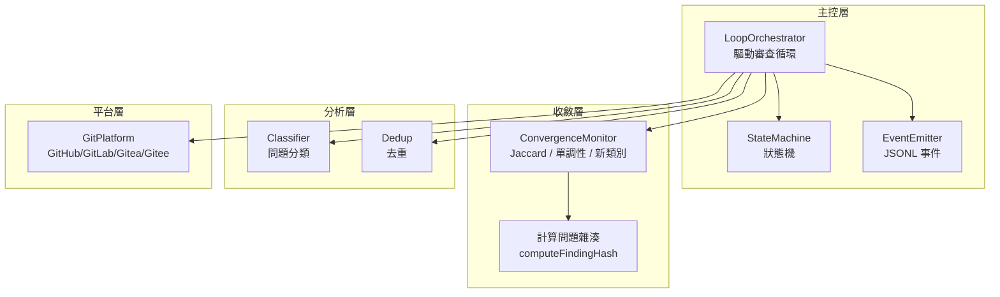
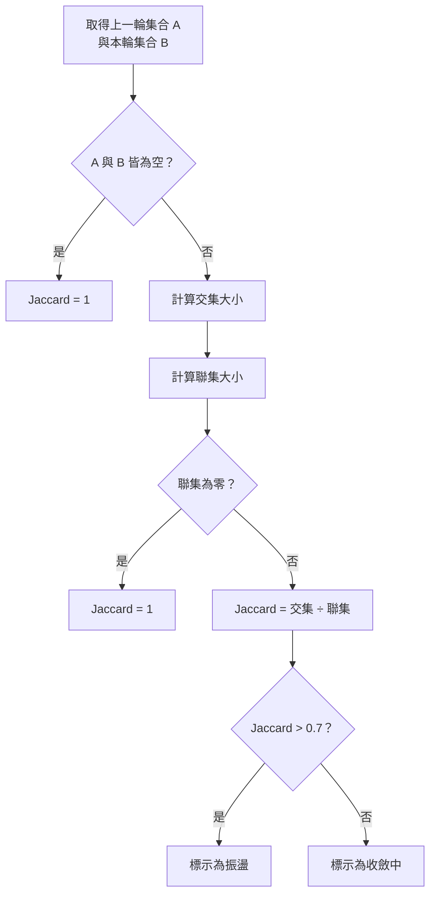
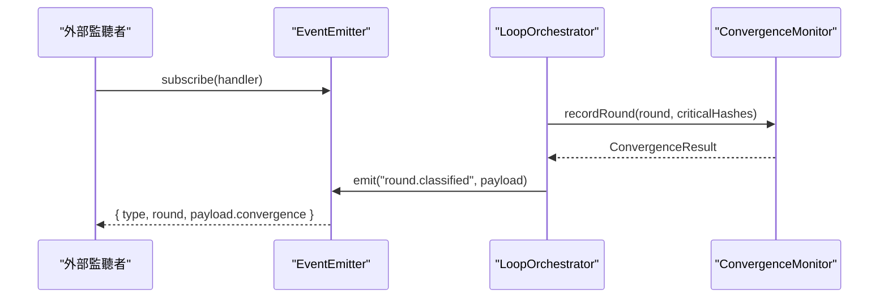
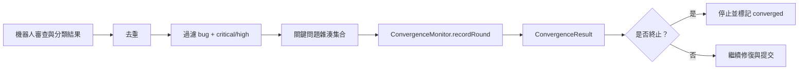

# ConvergenceMonitor 收斂監控

<cite>
**本文引用的檔案**   
- [ConvergenceMonitor.ts](https://github.com/mikeah2011/maestro/blob/master/src/core/convergence/ConvergenceMonitor.ts)
- [ConvergenceMonitor.test.ts](https://github.com/mikeah2011/maestro/blob/master/tests/core/convergence/ConvergenceMonitor.test.ts)
- [LoopOrchestrator.ts](https://github.com/mikeah2011/maestro/blob/master/src/core/loop/LoopOrchestrator.ts)
- [EventEmitter.ts](https://github.com/mikeah2011/maestro/blob/master/src/core/events/EventEmitter.ts)
- [DESIGN.md](https://github.com/mikeah2011/maestro/blob/master/docs/DESIGN.md)
</cite>

## 目錄

1. [簡介](#簡介)
2. [專案結構與角色定位](#專案結構與角色定位)
3. [核心狀態與結果模型](#核心狀態與結果模型)
4. [Jaccard 振盪偵測演算法](#jaccard-振盪偵測演算法)
5. [單調不增保證的實現機制](#單調不增保證的實現機制)
6. [新類別偵測與升級條件](#新類別偵測與升級條件)
7. [參數設定與調整建議](#參數設定與調整建議)
8. [與 LoopOrchestrator 的狀態同步機制](#與-looporchestrator-的狀態同步機制)
9. [常見異常與診斷指南](#常見異常與診斷指南)
10. [效能特性與優化方向](#效能特性與優化方向)
11. [總結](#總結)

## 簡介

`ConvergenceMonitor` 是 Maestro 審查循環中的「數學收斂層」。它不直接呼叫 AI、不修改程式碼，也不操作 Git；它的職責是把每一輪產生的「關鍵問題集合」轉換為一個可決策的狀態：繼續迭代、已清理、振盪、單調性違反、出現新問題類別，或達到硬式回合上限。

設計文件明確指出，Maestro 不是另一個審查工具，而是「審查機器人之上的收斂層」；其終止由硬性上限保證，品質收斂則依賴三個不變量：

1. 關鍵問題數量單調不增。
2. 第 2 輪後不得出現新的問題類別。
3. 連續兩輪的關鍵問題集合 Jaccard 相似度不得超過閾值。

這表示 `ConvergenceMonitor` 的本質是一個「判定器」：輸入是雜湊化的問題集合與類別集合，輸出是供 `LoopOrchestrator` 決定停止、升級或繼續的結構化結果。

**章節來源**
- [DESIGN.md:1-120](https://github.com/mikeah2011/maestro/blob/master/docs/DESIGN.md#L1-L120)
- [DESIGN.md:120-200](https://github.com/mikeah2011/maestro/blob/master/docs/DESIGN.md#L120-L200)

## 專案結構與角色定位

**圖表來源**
- [LoopOrchestrator.ts:1-120](https://github.com/mikeah2011/maestro/blob/master/src/core/loop/LoopOrchestrator.ts#L1-L120)
- [ConvergenceMonitor.ts:1-40](https://github.com/mikeah2011/maestro/blob/master/src/core/convergence/ConvergenceMonitor.ts#L1-L40)
- [EventEmitter.ts:1-30](https://github.com/mikeah2011/maestro/blob/master/src/core/events/EventEmitter.ts#L1-L30)

在實際執行流程中，`LoopOrchestrator` 負責：

- 等待 CI 與機器人審查。
- 取得討論串並轉成問題。
- 使用 `Classifier` 分類問題。
- 使用 `Dedup` 去重。
- 過濾出「bug 且嚴重程度為 critical 或 high」的問題作為關鍵問題。
- 將這些問題的雜湊交給 `ConvergenceMonitor.recordRound`。
- 根據返回狀態決定是否停止、修復、提交或進入下一輪。

`ConvergenceMonitor` 本身保持極小耦合：只關心「上一輪的關鍵問題集合」和「當前輪的關鍵問題集合」，以及「歷史類別集合」。

**章節來源**
- [LoopOrchestrator.ts:250-330](https://github.com/mikeah2011/maestro/blob/master/src/core/loop/LoopOrchestrator.ts#L250-L330)
- [ConvergenceMonitor.ts:1-40](https://github.com/mikeah2011/maestro/blob/master/src/core/convergence/ConvergenceMonitor.ts#L1-L40)

## 核心狀態與結果模型

`ConvergenceMonitor` 定義了六種收斂狀態：

| 狀態 | 含義 | 通常行為 |
|---|---|---|
| `converging` | 正常收斂中 | 繼續下一輪 |
| `clean` | 沒有關鍵問題 | 結束循環 |
| `oscillating` | Jaccard 相似度超過閾值 | 停止並升級給人工處理 |
| `non_monotone` | 關鍵問題數量增加 | 停止並升級 |
| `category_violation` | 第 2 輪後出現新問題類別 | 停止並升級 |
| `round_cap` | 超過最大回合數 | 停止並升級 |

對應的結果物件包含以下欄位：

| 欄位 | 型別 | 說明 |
|---|---|---|
| `status` | `ConvergenceStatus` | 收斂狀態 |
| `round` | `number` | 目前輪次 |
| `criticalCount` | `number` | 本輪關鍵問題數量 |
| `previousCriticalCount` | `number \| undefined` | 上一輪關鍵問題數量 |
| `jaccard` | `number \| undefined` | 與上一輪的 Jaccard 相似度 |
| `newCategories` | `ReadonlyArray<string> \| undefined` | 第 2 輪後出現的新類別 |
| `message` | `string` | 人類可讀的決策訊息 |

這個模型的好處是：`LoopOrchestrator` 不需要理解 Jaccard 計算細節，只需要根據 `status` 做決策。

**章節來源**
- [ConvergenceMonitor.ts:12-40](https://github.com/mikeah2011/maestro/blob/master/src/core/convergence/ConvergenceMonitor.ts#L12-L40)
- [ConvergenceMonitor.ts:41-110](https://github.com/mikeah2011/maestro/blob/master/src/core/convergence/ConvergenceMonitor.ts#L41-L110)

## Jaccard 振盪偵測演算法

### 基本定義

Jaccard 相似度衡量兩個集合的重疊程度：

$$
J(A, B) = \frac{|A \cap B|}{|A \cup B|}
$$

其中：

- $A$ 是上一輪的關鍵問題雜湊集合。
- $B$ 是本輪的關鍵問題雜湊集合。
- $A \cap B$ 是兩輪共同存在的問題。
- $A \cup B$ 是兩輪所有唯一問題的總集。

實作上，函式先遍歷集合 $A$，計算落在集合 $B$ 中的元素個數，得到交集大小；再根據公式計算聯集大小；最後回傳比值。

### 時間複雜度

假設上一輪有 $n$ 個關鍵問題，本輪有 $m$ 個關鍵問題：

- 遍歷 $A$：$O(n)$
- 每次查詢 $B.has(item)$：平均 $O(1)$
- 計算聯集：$O(1)$

因此整體時間複雜度為 $O(n)$，空間複雜度為 $O(1)$，因為交集計數器和聯集大小都是常數空間。

這裡的關鍵是：集合本身已經由 caller 建立；`jaccardSimilarity` 只負責比較，不複製集合。

### 邊界情況

| 情況 | 交集 | 聯集 | Jaccard | 解讀 |
|---|---:|---:|---:|---|
| 兩個空集合 | 0 | 0 | 1 | 視為完全相同 |
| 完全相同集合 | $k$ | $k$ | 1 | 完全重複，容易觸發振盪 |
| 完全不重疊 | 0 | $n+m$ | 0 | 無重疊 |
| 部分重疊 | $i$ | $n+m-i$ | $i/(n+m-i)$ | 依比例判斷 |

測試用例驗證了幾個重要邊界：

- 相同集合會得到 Jaccard 1.0。
- 不相交但數量減少時，仍可被視為收斂。
- 8 個共同元素加 1 個不同元素時，Jaccard ≈ 0.889，超過 0.7 閾值。
- 3 個共同元素、總聯集為 7 時，Jaccard ≈ 0.43，不會單獨觸發振盪。

**章節來源**
- [ConvergenceMonitor.ts:188-206](https://github.com/mikeah2011/maestro/blob/master/src/core/convergence/ConvergenceMonitor.ts#L188-L206)
- [ConvergenceMonitor.test.ts:218-249](https://github.com/mikeah2011/maestro/blob/master/tests/core/convergence/ConvergenceMonitor.test.ts#L218-L249)

### Jaccard 決策流程

**圖表來源**
- [ConvergenceMonitor.ts:188-206](https://github.com/mikeah2011/maestro/blob/master/src/core/convergence/ConvergenceMonitor.ts#L188-L206)
- [ConvergenceMonitor.ts:60-110](https://github.com/mikeah2011/maestro/blob/master/src/core/convergence/ConvergenceMonitor.ts#L60-L110)

## 單調不增保證的實現機制

單調不增保證是指：若以 $c_n$ 表示第 $n$ 輪的關鍵問題數量，則必須滿足

$$
c_{n+1} \le c_n
$$

這代表修復過程不能引入比上一輪更多的關鍵問題。如果新增，就可能是修復引入了回歸，或是問題識別邏輯產生不一致。

### 實現順序

`recordRound` 的檢查順序非常重要：

1. 若本輪關鍵問題數量為 0，直接回傳 `clean`。
2. 若輪次超過最大回合數，回傳 `round_cap`。
3. 若存在上一輪記錄，先比較數量。
4. 若本輪大於上一輪，回傳 `non_monotone`。
5. 計算 Jaccard。
6. 若超過閾值，回傳 `oscillating`。
7. 否則回傳 `converging`。

這個順序確保「數量增加」優先於「Jaccard 振盪」被報告。原因是：如果問題數量增加，即使 Jaccard 很低，系統也應該先懷疑「修復是否製造了新問題」，而不是只關注集合重疊程度。

### 為什麼用雜湊而非原始內容

關鍵問題集合使用的是「穩定問題雜湊」，而不是原始文字描述。這樣做的原因是：

- 機器人的評論文字可能改寫。
- rebase 或無關修改可能改變行號。
- 同一個問題在不同輪次可能有不同標題。

`computeFindingHash` 結合以下資訊：

| 成分 | 用途 |
|---|---|
| `file` | 鎖定檔案位置 |
| `lineBucket` | 以 5 行為一桶，容忍小幅行號偏移 |
| `normalizedCategory` | 類別統一為小寫並去除空白 |
| `surroundingContent` | 使用周邊程式碼內容雜湊，而非評論文字 |

這種設計讓同一個「實質問題」在不同輪次能產生相同雜湊，除非檔案、行桶、類別或周邊程式碼真正改變。

**章節來源**
- [ConvergenceMonitor.ts:41-110](https://github.com/mikeah2011/maestro/blob/master/src/core/convergence/ConvergenceMonitor.ts#L41-L110)
- [ConvergenceMonitor.ts:150-206](https://github.com/mikeah2011/maestro/blob/master/src/core/convergence/ConvergenceMonitor.ts#L150-L206)
- [ConvergenceMonitor.test.ts:11-66](https://github.com/mikeah2011/maestro/blob/master/tests/core/convergence/ConvergenceMonitor.test.ts#L11-L66)

## 新類別偵測與升級條件

`recordCategories` 負責另一條獨立不變量：第 2 輪後不得出現新的問題類別。

### 基線建構方式

實作會保留類別歷史，並在 round 3 或之後，從前兩筆類別紀錄中建立基線集合。具體做法是：

- 取 `Math.min(2, this.categoryHistory.length - 1)` 筆歷史。
- 將這些歷史中的類別全部加入基線集合。
- 對本輪類別進行過濾，找出不在基線中的項目。

這意味著：只要前一輪或前兩輪曾出現過某個類別，它就不會被視為「新類別」。

### 何時回報

- round 1：不回報。
- round 2：不回報。
- round 3 及之後：若有新類別，回傳 `category_violation`。
- 若無新類別，回傳 `null`。

注意：`recordCategories` 的回傳型別是 `ConvergenceResult | null`，而 `recordRound` 永遠回傳 `ConvergenceResult`。這是有意設計的差異：前者只在違反規則時才產生影響。

### 與主迴路的關係

在目前的 `LoopOrchestrator` 主流程中，關鍵問題收斂由 `recordRound` 控制。新類別檢查由 `recordCategories` 提供，但若要真正影響循環終止，caller 必須主動呼叫並處理回傳結果。也就是說，`category_violation` 是一種「可組合的不變量檢查點」，而不是自動與 `recordRound` 合併的單一狀態。

**章節來源**
- [ConvergenceMonitor.ts:112-149](https://github.com/mikeah2011/maestro/blob/master/src/core/convergence/ConvergenceMonitor.ts#L112-L149)
- [ConvergenceMonitor.test.ts:192-217](https://github.com/mikeah2011/maestro/blob/master/tests/core/convergence/ConvergenceMonitor.test.ts#L192-L217)

## 參數設定與調整建議

### 現有可觀察參數

| 參數 | 預設值 | 作用 | 調整風險 |
|---|---:|---|---|
| `MAX_ROUNDS` | 3 | 硬式回合上限 | 提高會延長循環時間；降低可能提前停止 |
| `OSCILLATION_THRESHOLD` | 0.7 | Jaccard 振盪閾值 | 提高較保守；降低較敏感 |
| `round_window_size` | 未直接暴露 | 概念上可用於滑動視窗 | 目前實作只比較上一輪，非滑動視窗 |
| `jaccard_threshold` | 0.7 | 同上 | 需透過覆寫類別或擴充模組調整 |

需要特別澄清的是：目前 `ConvergenceMonitor` 並沒有公開 `round_window_size` 參數。它的振盪檢測是「與上一輪比較」，而不是「過去 N 輪的平均或滑動窗口」。若要在未來支持滑動視窗，應考慮把 `criticalHistory` 改為可配置長度的緩衝區，並重新定義 Jaccard 為多輪聚合指標。

### 如何調整 Jaccard 閾值

由於 `OSCILLATION_THRESHOLD` 是模組內常數，調整方式包括：

1. **環境變數或設定檔注入**：最佳實務是讓 `ConvergenceMonitor` 接受選項物件，例如 `{ oscillationThreshold }`。
2. **子類別覆寫**：繼承 `ConvergenceMonitor` 並覆寫相關方法。
3. **直接修改模組常數**：僅適合內部開發或受控環境，不建議用於生產。

若調高到 0.8 或更高：

- 系統更不容易認為振盪。
- 適合問題集合波動較大、但仍在改善的情境。
- 風險是延遲偵測真正的來回震盪。

若調低到 0.6 或更低：

- 系統更容易觸發振盪。
- 適合快速收斂導向的流程。
- 風險是誤判「相似但不完全相同的問題集合」為震盪。

### 如何監聽收斂狀態變化

最推薦的方式是透過 `EventEmitter`。`LoopOrchestrator` 在每輪分類後會發出事件，其中包含 convergence status：

**圖表來源**
- [EventEmitter.ts:31-108](https://github.com/mikeah2011/maestro/blob/master/src/core/events/EventEmitter.ts#L31-L108)
- [LoopOrchestrator.ts:280-330](https://github.com/mikeah2011/maestro/blob/master/src/core/loop/LoopOrchestrator.ts#L280-L330)

要監聽收斂狀態變化，可訂閱 `round.classified` 事件，並讀取 payload 中的 `convergence` 欄位。若需要更詳細的決策訊息，可在未來擴充 `LoopOrchestrator`，把 `ConvergenceResult.message` 也放入事件 payload。

### 實際調整範例（以路徑代替程式碼）

以下範例以「步驟」呈現，避免直接貼出程式碼：

#### 情境一：提高振盪敏感度

1. 建立自訂 `ConvergenceMonitor` 子類別。
2. 覆寫比較邏輯或使用建構期選項設定較低的閾值。
3. 將實例注入 `LoopOrchestratorOptions.convergence`。
4. 訂閱 `round.classified` 事件。
5. 當狀態為 `oscillating` 時，記錄 `jaccard` 與 `message`。

#### 情境二：延長最大回合數

1. 在 `LoopRunOptions.maxRounds` 設定更大值。
2. 同時考慮提高 `ConvergenceMonitor` 的回合上限，或改用外部回合控制器。
3. 觀察 `roundCap` 事件與最終 `reason`。

#### 情境三：監聽所有收斂狀態

1. 使用 `EventEmitter.stdoutSink()` 或自訂 sink。
2. 訂閱事件。
3. 過濾 `round.classified`。
4. 印出 `round`、`convergence`、`criticals`、`unique`。
5. 若 `convergence` 為 `oscillating`、`non_monotone` 或 `category_violation`，觸發告警。

**章節來源**
- [ConvergenceMonitor.ts:35-40](https://github.com/mikeah2011/maestro/blob/master/src/core/convergence/ConvergenceMonitor.ts#L35-L40)
- [LoopOrchestrator.ts:150-170](https://github.com/mikeah2011/maestro/blob/master/src/core/loop/LoopOrchestrator.ts#L150-L170)
- [LoopOrchestrator.ts:280-330](https://github.com/mikeah2011/maestro/blob/master/src/core/loop/LoopOrchestrator.ts#L280-L330)
- [EventEmitter.ts:31-108](https://github.com/mikeah2011/maestro/blob/master/src/core/events/EventEmitter.ts#L31-L108)

## 與 LoopOrchestrator 的狀態同步機制

### 資料流向

`LoopOrchestrator` 與 `ConvergenceMonitor` 的關係是「單向依賴」：

**圖表來源**
- [LoopOrchestrator.ts:280-350](https://github.com/mikeah2011/maestro/blob/master/src/core/loop/LoopOrchestrator.ts#L280-L350)
- [ConvergenceMonitor.ts:41-110](https://github.com/mikeah2011/maestro/blob/master/src/core/convergence/ConvergenceMonitor.ts#L41-L110)

### 關鍵過濾邏輯

並非所有問題都參與收斂判斷。只有同時符合以下條件的問題才會被納入關鍵集合：

- 分類結果為 `bug`。
- 嚴重程度為 `critical` 或 `high`。
- 經過 `Dedup` 去重後仍保留。

這代表「品味問題」、「YAGNI」、「wrong」等通常不會觸發收斂停止，除非它們同時被錯誤分類為 bug 且嚴重程度達 high/critical。

### 狀態同步時機

每輪執行的順序如下：

1. 等待機器人審查。
2. 取得討論串。
3. 分類每個問題。
4. 計算每題預設動作。
5. 去重。
6. 過濾關鍵問題。
7. 呼叫 `ConvergenceMonitor.recordRound`。
8. 發出 `round.classified` 事件。
9. 若狀態為 `oscillating`、`non_monotone` 或 `category_violation`，立即停止。
10. 否則進入修復階段。

### 終止原因映射

| ConvergenceMonitor.status | LoopOrchestrator.finalState | reason |
|---|---|---|
| `clean` | stopped | converged |
| `oscillating` | stopped | converged |
| `non_monotone` | stopped | converged |
| `category_violation` | stopped | converged |
| `round_cap` | stopped | max_rounds 或 converged（視 caller 判斷） |
| `converging` | 繼續 | 無 |

值得注意的是，`LoopOrchestrator` 在遇到上述三種終止狀態時，統一使用 `reason: 'converged'`，並把具體的 convergence 狀態寫入事件 payload。這表示「收斂」在這個語境中不只是「成功清理」，也包括「發現不可持續的行為」。

**章節來源**
- [LoopOrchestrator.ts:280-350](https://github.com/mikeah2011/maestro/blob/master/src/core/loop/LoopOrchestrator.ts#L280-L350)

## 常見異常與診斷指南

### 問題一：一直顯示 oscillating

**可能原因：**

- 同一批關鍵問題每輪都被重新識別。
- 機器人評論文字改變，但穩定雜湊仍然匹配。
- Jaccard 閾值太低。
- 修復沒有真正消除問題，只是換一種表述。

**診斷步驟：**

1. 查看 `round.classified` 事件中的 `convergence`。
2. 檢查 `jaccard` 值是否接近 1.0。
3. 比較兩輪的關鍵問題雜湊是否相同。
4. 確認 `computeFindingHash` 使用的 file、line bucket、category、surrounding content 是否一致。
5. 若確實是重複問題，不要盲目提高閾值；應檢查修復是否有效。

**章節來源**
- [ConvergenceMonitor.test.ts:218-249](https://github.com/mikeah2011/maestro/blob/master/tests/core/convergence/ConvergenceMonitor.test.ts#L218-L249)
- [ConvergenceMonitor.ts:150-206](https://github.com/mikeah2011/maestro/blob/master/src/core/convergence/ConvergenceMonitor.ts#L150-L206)

### 問題二：出現 non_monotone

**可能原因：**

- 修復引入了新 bug。
- 去重邏輯不一致。
- 分類結果不穩定。
- 不同機器人對同一問題產生不同嚴重程度，導致關鍵集合擴大。

**診斷步驟：**

1. 比較 `previousCriticalCount` 與 `criticalCount`。
2. 列出上一輪與本輪的關鍵問題雜湊。
3. 檢查是否有原本不存在的新雜湊。
4. 確認這些新雜湊對應的問題是否真的被分類為 bug 且 severity 為 critical/high。
5. 若為修復回歸，應停止自動化修復並交由人工處理。

**章節來源**
- [ConvergenceMonitor.ts:60-90](https://github.com/mikeah2011/maestro/blob/master/src/core/convergence/ConvergenceMonitor.ts#L60-L90)
- [ConvergenceMonitor.test.ts:147-169](https://github.com/mikeah2011/maestro/blob/master/tests/core/convergence/ConvergenceMonitor.test.ts#L147-L169)

### 問題三：category_violation 頻繁出現

**可能原因：**

- 分類器在第 3 輪後開始產生之前未見的類別。
- 機器人的分類標籤不一致。
- 分類策略太開放，允許未知類別滲透。

**診斷步驟：**

1. 檢查 `recordCategories` 回傳的 `newCategories`。
2. 檢視第 1 輪和第 2 輪的類別歷史。
3. 確認新類別是否屬於預期範圍。
4. 若分類器產出不穩定，應強化確定性規則，使未知問題優先走已知分支。

**章節來源**
- [ConvergenceMonitor.ts:112-149](https://github.com/mikeah2011/maestro/blob/master/src/core/convergence/ConvergenceMonitor.ts#L112-L149)
- [ConvergenceMonitor.test.ts:192-217](https://github.com/mikeah2011/maestro/blob/master/tests/core/convergence/ConvergenceMonitor.test.ts#L192-L217)

### 問題四：round_cap 提前或延後觸發

**可能原因：**

- `maxRounds` 設定不符合業務需求。
- `ConvergenceMonitor.MAX_ROUNDS` 與 `LoopOrchestrator.DEFAULT_MAX_ROUNDS` 不一致。
- 某些輪次因 CI 失敗或機器人超時而跳過，導致邏輯回合數與期望不同。

**診斷步驟：**

1. 檢查 `LoopRunOptions.maxRounds`。
2. 檢查 `ConvergenceMonitor` 的 `roundCount`。
3. 查看最終 `LoopResult.reason`。
4. 若希望兩者一致，應集中管理回合上限，而不是分散在多個模組常數。

**章節來源**
- [ConvergenceMonitor.ts:35-40](https://github.com/mikeah2011/maestro/blob/master/src/core/convergence/ConvergenceMonitor.ts#L35-L40)
- [LoopOrchestrator.ts:150-170](https://github.com/mikeah2011/maestro/blob/master/src/core/loop/LoopOrchestrator.ts#L150-L170)
- [ConvergenceMonitor.test.ts:170-191](https://github.com/mikeah2011/maestro/blob/master/tests/core/convergence/ConvergenceMonitor.test.ts#L170-L191)

### 問題五：EventEmitter 沒有收到事件

**可能原因：**

- 沒有建立 EventEmitter 或沒有設置 sink。
- 沒有呼叫 `subscribe`。
- 外部消費者關閉 stdout 或 stream 導致 sink 拋錯。
- 事件上下文未正確設定。

**診斷步驟：**

1. 確認 `LoopOrchestratorOptions.emitter` 已注入。
2. 使用 `stdoutSink()` 或自訂 sink 驗證事件流。
3. 檢查是否調用 `subscribe` 並保留取消訂閱函式。
4. 注意 EventEmitter 的設計是「sink 失敗不會帶壞循環」，所以下游消費者崩潰不會導致主迴路停擺。

**章節來源**
- [EventEmitter.ts:1-30](https://github.com/mikeah2011/maestro/blob/master/src/core/events/EventEmitter.ts#L1-L30)
- [EventEmitter.ts:31-108](https://github.com/mikeah2011/maestro/blob/master/src/core/events/EventEmitter.ts#L31-L108)

## 效能特性與優化方向

### 當前效能特性

| 操作 | 時間複雜度 | 空間複雜度 | 備註 |
|---|---:|---:|---|
| `recordRound` | $O(n)$ | $O(1)$ | n 為本輪關鍵問題數量 |
| `jaccardSimilarity` | $O(n)$ | $O(1)$ | 遍歷上一輪集合 |
| `recordCategories` | $O(c)$ | $O(k)$ | c 為本輪類別數，k 為基線類別數 |
| `computeFindingHash` | $O(l)$ | $O(l)$ | l 為 surrounding content 長度 |
| `lineBucket` | $O(1)$ | $O(1)$ | 純算術運算 |

### 瓶頸分析

1. **Jaccard 比較**：主要成本在於遍歷上一輪集合。若每輪關鍵問題數量很大，可考慮維護雙向索引，但這會增加記憶體與複雜度。
2. **雜湊計算**：`computeFindingHash` 會對 surrounding content 做 SHA-1。內容越大，成本越高。目前設計是用「周圍 10 行」來穩定識別問題，這是一個合理的權衡。
3. **類別基線合併**：目前只合併最多兩筆歷史類別，成本可控。

### 優化建議

1. **若關鍵問題數量非常大**：可考慮在 `LoopOrchestrator` 層級限制進入 `ConvergenceMonitor` 的問題數量，例如只保留 top-k 嚴重問題。
2. **若需要滑動視窗**：應引入 `round_window_size` 參數，並重新定義收斂指標，例如「過去 N 輪的平均 Jaccard」或「最近兩輪最小 Jaccard」。
3. **若需要可配置閾值**：應擴充 `ConvergenceMonitorOptions`，讓 `oscillationThreshold` 和 `maxRounds` 成為可注入參數。
4. **若需要更完整的監控**：可在 `round.classified` 事件中增加 `jaccard`、`previousCriticalCount`、`newCategories`，讓外部 UI 或儀表板直接渲染，而不必重建 `ConvergenceMonitor`。

**章節來源**
- [ConvergenceMonitor.ts:41-206](https://github.com/mikeah2011/maestro/blob/master/src/core/convergence/ConvergenceMonitor.ts#L41-L206)
- [ConvergenceMonitor.test.ts:11-249](https://github.com/mikeah2011/maestro/blob/master/tests/core/convergence/ConvergenceMonitor.test.ts#L11-L249)

## 總結

`ConvergenceMonitor` 的核心價值不在於它做了很多事，而在於它用極小的狀態維持三個強約束：

1. 關鍵問題數量不能增加。
2. 連續兩輪的關鍵問題集合不能過度重疊。
3. 第 2 輪後不能出現新的問題類別。

這些約束讓 Maestro 的審查循環不是無限 AI 消耗，而是有數學背書的可終止流程。對於使用者而言，最重要的實踐原則是：

- 不要只調整 `jaccard_threshold` 來壓下警告；應先理解是哪一輪產生了什麼問題。
- 使用 `EventEmitter` 監聽 `round.classified`，並把 convergence status 納入儀表板或告警管道。
- 若需要更靈活的收斂策略，應擴充 `ConvergenceMonitor` 的選項介面，而不是散佈全域常數。
- 若修復後仍出現 `non_monotone`，優先檢查修復是否引入回歸，而不是繼續自動化修復。

這樣的設計讓 Maestor 的收斂層既能保護使用者免於無限循環，又能提供足夠的可觀測性，讓人工介入發生在正確的時機。