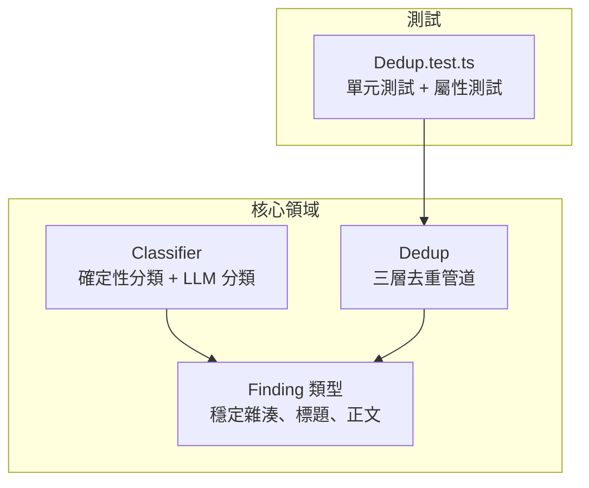
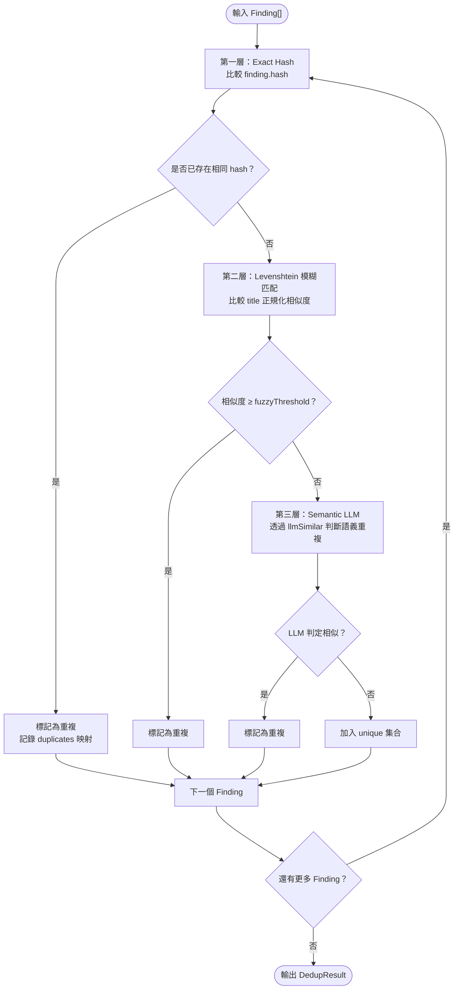
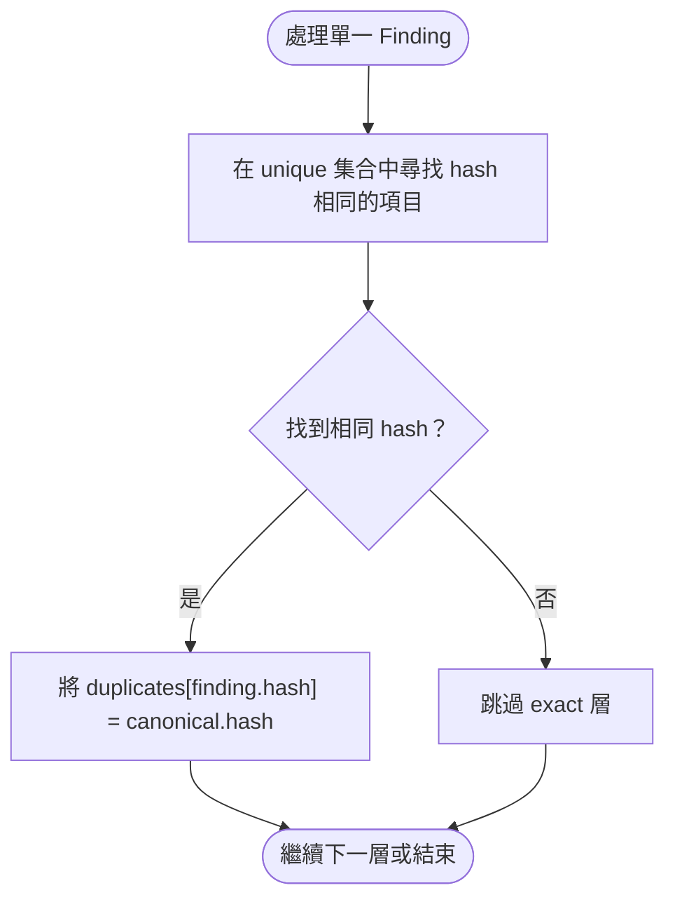
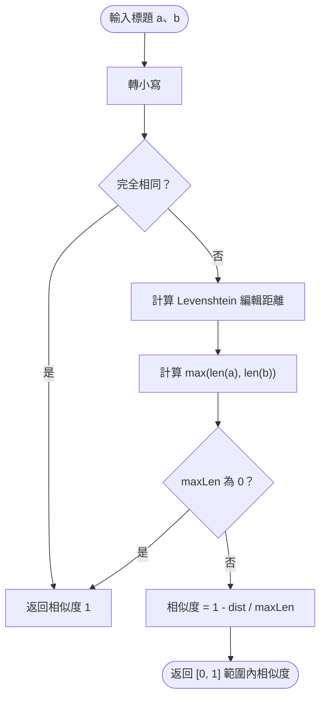
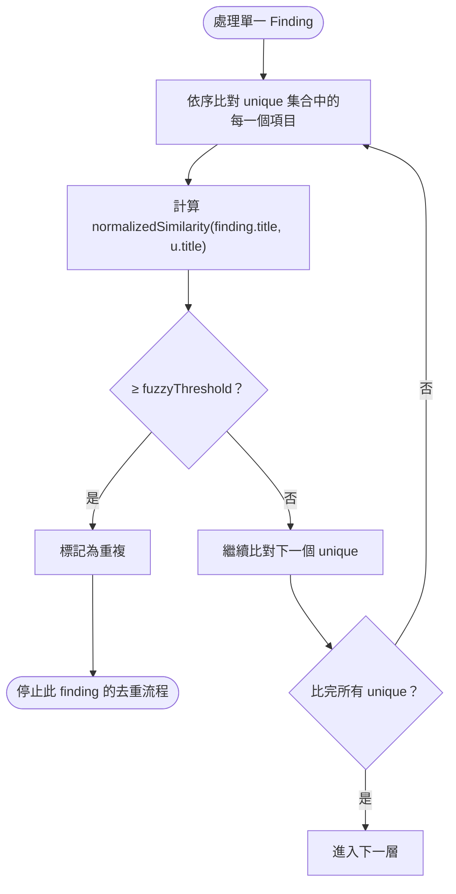
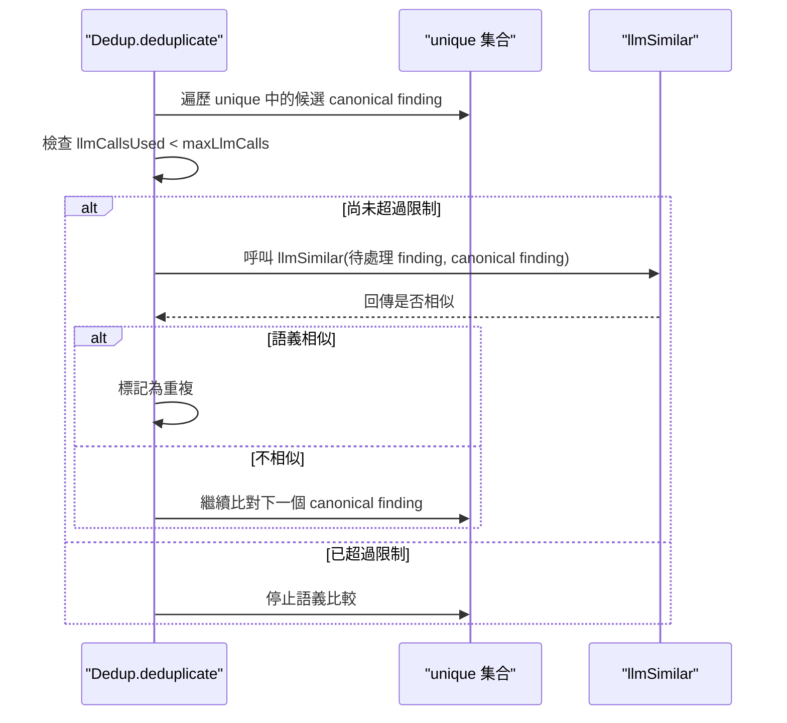
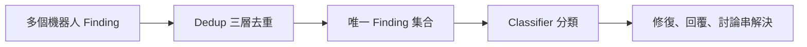

# Dedup 三層去重管道

**本文引用的檔案**

- [src/core/dedup/Dedup.ts](https://github.com/mikeah2011/maestro/blob/master/src/core/dedup/Dedup.ts)
- [tests/core/dedup/Dedup.test.ts](https://github.com/mikeah2011/maestro/blob/master/tests/core/dedup/Dedup.test.ts)
- [src/core/classify/Classifier.ts](https://github.com/mikeah2011/maestro/blob/master/src/core/classify/Classifier.ts)
- [src/core/types/Finding.ts](https://github.com/mikeah2011/maestro/blob/master/src/core/types/Finding.ts)
- [docs/DESIGN.md](https://github.com/mikeah2011/maestro/blob/master/docs/DESIGN.md)

## 目錄
1. [簡介](#簡介)
2. [專案結構與角色定位](#專案結構與角色定位)
3. [核心資料型別與輸入輸出](#核心資料型別與輸入輸出)
4. [三層去重架構總覽](#三層去重架構總覽)
5. [第一層：Exact Hash 去重](#第一層exact-hash-去重)
6. [第二層：Levenshtein 模糊匹配](#第二層levenshtein-模糊匹配)
7. [第三層：Semantic LLM 語義去重](#第三層semantic-llm-語義去重)
8. [與 Classifier 的協作關係](#與-classifier-的協作關係)
9. [參數調整與自訂策略](#參數調整與自訂策略)
10. [效能特徵與複雜度分析](#效能特徵與複雜度分析)
11. [常見問題診斷](#常見問題診斷)
12. [結論](#結論)

## 簡介
Dedup 是 Maestro 收斂循環中的「重複問題壓縮器」。它把多個 AI 審查機器人產出的 Finding 合併成一份最小且不重複的問題集合，讓後續的分類、修復、回覆與討論串解決邏輯不必對同一個問題反覆執行。

設計原則是「最廉價優先」：先做穩定雜湊比較，再做字串相似度比較，最後才呼叫 LLM 進行語義判斷；同時以 `maxLlmCalls` 限制每輪最大語義呼叫次數，避免成本失控。

## 專案結構與角色定位
Dedup 位於核心領域模組中，與其他關鍵組件形成明確分工：

**圖表來源**
- [src/core/dedup/Dedup.ts:1-153](https://github.com/mikeah2011/maestro/blob/master/src/core/dedup/Dedup.ts#L1-L153)
- [src/core/classify/Classifier.ts:1-191](https://github.com/mikeah2011/maestro/blob/master/src/core/classify/Classifier.ts#L1-L191)
- [src/core/types/Finding.ts:1-129](https://github.com/mikeah2011/maestro/blob/master/src/core/types/Finding.ts#L1-L129)
- [tests/core/dedup/Dedup.test.ts:1-281](https://github.com/mikeah2011/maestro/blob/master/tests/core/dedup/Dedup.test.ts#L1-L281)

Dedup 不直接呼叫平台 API，也不直接處理 PR 或討論串；它的職責是：給出一組 `Finding`，回傳唯一集合、重複映射與統計資訊。

**章節來源**
- [src/core/dedup/Dedup.ts:1-40](https://github.com/mikeah2011/maestro/blob/master/src/core/dedup/Dedup.ts#L1-L40)
- [docs/DESIGN.md:1-100](https://github.com/mikeah2011/maestro/blob/master/docs/DESIGN.md#L1-L100)

## 核心資料型別與輸入輸出

### 輸入：Finding
Dedup 的輸入是 `Finding[]`。每個 Finding 代表一個機器人發現的一個問題，其中對去重最重要的欄位包括：

| 欄位 | 用途 | 去重意義 |
|---|---|---|
| `hash` | 穩定雜湊 | 第一層 exact hash 去重的依據 |
| `title` | 人類可讀標題 | 第二層 Levenshtein 模糊匹配的依據 |
| `body` | 完整內容 | 第三層語義去重可能使用 |
| `location.file` / `startLine` | 程式碼位置 | 參與穩定雜湊產生，幫助跨行號偏移穩定 |
| `severity` | 標準化嚴重程度 | 參與穩定雜湊，確保相同類別問題才能視為重複 |

**章節來源**
- [src/core/types/Finding.ts:1-90](https://github.com/mikeah2011/maestro/blob/master/src/core/types/Finding.ts#L1-L90)
- [docs/DESIGN.md:60-100](https://github.com/mikeah2011/maestro/blob/master/docs/DESIGN.md#L60-L100)

### 輸出：DedupResult
`deduplicate()` 返回一個不可變結果物件：

| 欄位 | 型別 | 說明 |
|---|---|---|
| `unique` | `Finding[]` | 保留下來的唯一問題集合 |
| `duplicates` | `Map<string, string>` | 從重複 finding 的 `hash` 映射到其 canonical finding 的 `hash` |
| `llmCallsUsed` | `number` | 本輪實際消耗的 LLM 語義呼叫次數 |
| `tierStats` | `DedupTierStats` | 各層命中數量：`exact`、`fuzzy`、`llm` |

**章節來源**
- [src/core/dedup/Dedup.ts:22-40](https://github.com/mikeah2011/maestro/blob/master/src/core/dedup/Dedup.ts#L22-L40)
- [tests/core/dedup/Dedup.test.ts:1-60](https://github.com/mikeah2011/maestro/blob/master/tests/core/dedup/Dedup.test.ts#L1-L60)

## 三層去重架構總覽

**圖表來源**
- [src/core/dedup/Dedup.ts:42-115](https://github.com/mikeah2011/maestro/blob/master/src/core/dedup/Dedup.ts#L42-L115)

執行順序嚴格由上而下：只有當前一層無法確認重複時，才會進入下一層。這種設計讓高命中率的低成本層先過濾掉大部分重複，降低後續層的成本。

**章節來源**
- [src/core/dedup/Dedup.ts:1-40](https://github.com/mikeah2011/maestro/blob/master/src/core/dedup/Dedup.ts#L1-L40)
- [src/core/dedup/Dedup.ts:42-115](https://github.com/mikeah2011/maestro/blob/master/src/core/dedup/Dedup.ts#L42-L115)

## 第一層：Exact Hash 去重

### 設計理念
這是「最便宜且最確定」的一層。只要兩個 `Finding` 的 `hash` 相同，就認定它們是同一個問題，不管來自哪個機器人。根據文件註解與設計文件，這層通常能消除約 60% 的重複。

穩定雜湊的設計目標是在以下情境保持穩定：
- 機器人重新解析相同的程式碼位置。
- rebase 或無關修改導致行號偏移。
- 分類結果經過標準化後仍指向同一問題。

### 演算法流程

**圖表來源**
- [src/core/dedup/Dedup.ts:52-66](https://github.com/mikeah2011/maestro/blob/master/src/core/dedup/Dedup.ts#L52-L66)

### 時間與空間複雜度
- 逐個 scanning `unique` 陣列，因此單次 exact hash 檢查是 O(k)，k 是目前 unique 集合大小。
- 整體一輪最多 O(n × k)，n 為輸入長度。
- 空間主要是 `unique` 陣列與 `duplicates` Map。

### 誤判處理
Exact hash 本身幾乎不會誤判，因為它是相等比較；真正風險在於上游產生的 `hash` 是否足夠穩定。若上游雜湊計算方式改變，可能出現原本應被合併的問題變成不同雜湊，進而增加下游負擔。

**章節來源**
- [src/core/dedup/Dedup.ts:1-40](https://github.com/mikeah2011/maestro/blob/master/src/core/dedup/Dedup.ts#L1-L40)
- [src/core/dedup/Dedup.ts:52-66](https://github.com/mikeah2011/maestro/blob/master/src/core/dedup/Dedup.ts#L52-L66)
- [docs/DESIGN.md:60-80](https://github.com/mikeah2011/maestro/blob/master/docs/DESIGN.md#L60-L80)
- [tests/core/dedup/Dedup.test.ts:60-120](https://github.com/mikeah2011/maestro/blob/master/tests/core/dedup/Dedup.test.ts#L60-L120)

## 第二層：Levenshtein 模糊匹配

### 設計理念
當 stable hash 無法識別重複時，第二層改用標題文字相似度。例如「Missing null check」與「Null check missing」這類措辭不同但描述同一問題的情況。設計文件指出這層通常再消除約 25%。

閾值 `fuzzyThreshold` 預設為 0.8，表示歸一化相似度至少達到 0.8 才視為重複。

### 相似度計算流程

**圖表來源**
- [src/core/dedup/Dedup.ts:118-153](https://github.com/mikeah2011/maestro/blob/master/src/core/dedup/Dedup.ts#L118-L153)

### Levenshtein 實作特性
- 使用兩行 `Int32Array` 遞迴計算編輯距離。
- 時間複雜度 O(m × n)。
- 空間複雜度 O(n)，僅保留前一行與當前行。
- 測試涵蓋空字串、插入、刪除、替換、已知多編輯距離、對稱性與三角不等式。

### 模糊匹配決策流程

**圖表來源**
- [src/core/dedup/Dedup.ts:68-84](https://github.com/mikeah2011/maestro/blob/master/src/core/dedup/Dedup.ts#L68-L84)

### 閾值選擇建議
- 較低閾值（例如 0.7）會更積極去重，但可能把相近但不相同的標題視為重複。
- 較高閾值（例如 0.99）更保守，適合需要精確區分細微差異的情境。
- 測試顯示「Missing null check」與「Missing null checks」相似度約 0.94，因此在預設 0.8 下會被視為重複；但在 0.99 下可能被保留。

**章節來源**
- [src/core/dedup/Dedup.ts:42-84](https://github.com/mikeah2011/maestro/blob/master/src/core/dedup/Dedup.ts#L42-L84)
- [src/core/dedup/Dedup.ts:118-153](https://github.com/mikeah2011/maestro/blob/master/src/core/dedup/Dedup.ts#L118-L153)
- [tests/core/dedup/Dedup.test.ts:120-200](https://github.com/mikeah2011/maestro/blob/master/tests/core/dedup/Dedup.test.ts#L120-L200)

## 第三層：Semantic LLM 語義去重

### 設計理念
前三層無法覆蓋的所有剩餘重複，主要落在「文字差異很大但語意相同」的場合，例如 SQL injection 相關問題的不同描述方式。這層透過可注入的 `llmSimilar` 函式判斷兩個 `Finding` 是否語義重複。

為了控制成本，每次 `deduplicate()` 呼叫最多允許 `maxLlmCalls` 次語義比較，預設為 10。

### 觸發條件
第三層只有在以下條件全部成立時才啟用：
1. 未在第一層被排除。
2. 未在第二層被排除。
3. 提供 `llmSimilar`。
4. `llmCallsUsed < maxLlmCalls`。

### 呼叫流程

**圖表來源**
- [src/core/dedup/Dedup.ts:86-115](https://github.com/mikeah2011/maestro/blob/master/src/core/dedup/Dedup.ts#L86-L115)

### 失敗與降級行為
- 如果沒有提供 `llmSimilar`，第三層完全跳過。
- 如果呼叫次數達到上限，即使還有未比對過的 unique 項目，也會停止進一步語義比較。
- 達上限後，該 finding 仍可能加入 `unique` 集合，除非後續其他層已經將其標記為重複。

這是一種有意識的成本控制：與其無限消耗 LLM，寧願保留少量可能的語義重複，也不讓系統成本失控。

**章節來源**
- [src/core/dedup/Dedup.ts:42-115](https://github.com/mikeah2011/maestro/blob/master/src/core/dedup/Dedup.ts#L42-L115)
- [tests/core/dedup/Dedup.test.ts:201-281](https://github.com/mikeah2011/maestro/blob/master/tests/core/dedup/Dedup.test.ts#L201-L281)

## 與 Classifier 的協作關係

Classifier 與 Dedup 負責不同階段的事務：

| 組件 | 主要責任 | 與去重的關係 |
|---|---|---|
| Dedup | 合併重複問題 | 決定哪些 `Finding` 應該被視為同一問題 |
| Classifier | 將問題分類為 bug、taste、wrong、yagni、duplicate 等 | 依賴 Dedup 的結果來減少重複分類成本 |
| Finding | 共用資料模型 | 兩者都依賴穩定 `hash`、`title`、`body`、`location` |

Classifier 使用圍欄式設計：確定性規則優先，只有在規則無法決定時才呼叫 LLM。Dedup 則使用三層設計：最廉價比較優先，只有必要時才呼叫 LLM。兩者的共同哲學是「先做確定性、低成本判斷，再考慮 LLM」。

**圖表來源**
- [src/core/dedup/Dedup.ts:1-40](https://github.com/mikeah2011/maestro/blob/master/src/core/dedup/Dedup.ts#L1-L40)
- [src/core/classify/Classifier.ts:1-60](https://github.com/mikeah2011/maestro/blob/master/src/core/classify/Classifier.ts#L1-L60)
- [src/core/types/Finding.ts:1-90](https://github.com/mikeah2011/maestro/blob/master/src/core/types/Finding.ts#L1-L90)

常見協作模式：
- Dedup 先壓縮重複，減少 Classifier 的輸入量。
- 若上游分類階段已將某些問題標記為 `duplicate`，Dedup 仍可再次壓縮，因為穩定雜湊仍是最終仲裁者。
- Classifier 的 audit log 可用於追蹤為何某個問題被分類為某種類別；Dedup 的 `tierStats` 可用於追蹤重複是被哪一層消滅。

**章節來源**
- [src/core/classify/Classifier.ts:1-191](https://github.com/mikeah2011/maestro/blob/master/src/core/classify/Classifier.ts#L1-L191)
- [src/core/dedup/Dedup.ts:1-40](https://github.com/mikeah2011/maestro/blob/master/src/core/dedup/Dedup.ts#L1-L40)

## 參數調整與自訂策略

### 可設定參數

| 參數 | 型別 | 預設值 | 說明 |
|---|---|---:|---|
| `fuzzyThreshold` | `number` | `0.8` | Levenshtein 正規化相似度的最低閾值；值越高越保守 |
| `maxLlmCalls` | `number` | `10` | 每次 `deduplicate()` 呼叫的最大 LLM 語義比較次數 |
| `llmSimilar` | `(a: Finding, b: Finding) => Promise<boolean>` | 無 | 可注入的語義重複檢查函式 |

### 調整範例路徑

#### 提高模糊匹配敏感度
若希望更積極地合併相近標題，可降低 `fuzzyThreshold`；若希望更保守，可提高至 0.95 或更高。

參考路徑：
- [src/core/dedup/Dedup.ts:42-50](https://github.com/mikeah2011/maestro/blob/master/src/core/dedup/Dedup.ts#L42-L50)
- [tests/core/dedup/Dedup.test.ts:120-180](https://github.com/mikeah2011/maestro/blob/master/tests/core/dedup/Dedup.test.ts#L120-L180)

#### 調整語義去重成本上限
若預算較緊，可降低 `maxLlmCalls`；若希望盡可能減少語義重複，可調高上限，但需評估 LLM 成本。

參考路徑：
- [src/core/dedup/Dedup.ts:42-50](https://github.com/mikeah2011/maestro/blob/master/src/core/dedup/Dedup.ts#L42-L50)
- [tests/core/dedup/Dedup.test.ts:201-240](https://github.com/mikeah2011/maestro/blob/master/tests/core/dedup/Dedup.test.ts#L201-L240)

#### 注入自訂語義去重策略
可透過 `llmSimilar` 接入任意 LLM 提供者，例如 Anthropic、OpenAI、Gemini 或本地模型。這個函式接收兩個 `Finding`，並回傳 Promise<boolean>。

參考路徑：
- [src/core/dedup/Dedup.ts:42-50](https://github.com/mikeah2011/maestro/blob/master/src/core/dedup/Dedup.ts#L42-L50)
- [src/core/dedup/Dedup.ts:86-115](https://github.com/mikeah2011/maestro/blob/master/src/core/dedup/Dedup.ts#L86-L115)
- [tests/core/dedup/Dedup.test.ts:201-220](https://github.com/mikeah2011/maestro/blob/master/tests/core/dedup/Dedup.test.ts#L201-L220)

### 擴展自訂去重策略
目前 Dedup 是固定三層實現。若要加入第四層，可考慮以下方向：
1. 新增新的 `DedupTierStats` 計數欄位。
2. 在 `deduplicate()` 主迴圈中加入新層。
3. 定義新的選項與配置入口。
4. 補充對應的單元測試與屬性測試。
5. 更新 `DedupResult` 的回傳結構。

由於現有 API 封裝在 `Dedup` 類別中，擴充時應維持冪等性與 `output ⊆ input` 不變量。

**章節來源**
- [src/core/dedup/Dedup.ts:42-115](https://github.com/mikeah2011/maestro/blob/master/src/core/dedup/Dedup.ts#L42-L115)
- [tests/core/dedup/Dedup.test.ts:120-281](https://github.com/mikeah2011/maestro/blob/master/tests/core/dedup/Dedup.test.ts#L120-L281)

## 效能特徵與複雜度分析

### 整體時間複雜度
假設輸入有 n 個 Finding，unique 集合大小為 k：

| 層 | 單次比較成本 | 最壞情況總成本 |
|---|---|---|
| Exact Hash | O(1) 雜湊相等比較，但當前實作是陣列掃描 O(k) | O(n × k) |
| Levenshtein | O(m × n_title) 字串編輯距離 | O(n × k × m × n_title) |
| Semantic LLM | 取決於外部 `llmSimilar` 實作 | 最多 `maxLlmCalls` 次 |

注意：雖然雜湊比較理論上可使用 Map 優化為 O(1)，但當前 `Dedup` 實作對 exact hash 也使用 `Array.find` 掃描，因此整體仍受 O(n × k) 影響。

### 空間複雜度
- `unique`: O(k)
- `duplicates`: O(n)
- `tierStats`: O(1)
- Levenshtein 內部使用 O(n_title) 暫存陣列

### 性能瓶頸
1. **模糊匹配**：當標題很長且重複很多時，Levenshtein 成為主要開銷。
2. **語義呼叫**：當 `llmSimilar` 成本很高時，即使有限制也可能成為瓶頸。
3. **exact hash 未用 Map**：未來可考慮將 exact hash 改為 Map 查詢，改善大集合下的表現。

### 優化建議
- 若預期大量 Finding，可在外部先對 `hash` 建索引，再交由 Dedup。
- 針對極長標題，可在進入 fuzzy 層前先做短鍵過濾，例如首詞、關鍵字或縮短字串。
- 若語義重複率很低，可降低 `maxLlmCalls`，讓系統更快停下來。
- 若 `llmSimilar` 可快取，可在提供者層面對 `(a.hash, b.hash)` 做記憶體快取。

**章節來源**
- [src/core/dedup/Dedup.ts:42-115](https://github.com/mikeah2011/maestro/blob/master/src/core/dedup/Dedup.ts#L42-L115)
- [src/core/dedup/Dedup.ts:118-153](https://github.com/mikeah2011/maestro/blob/master/src/core/dedup/Dedup.ts#L118-L153)

## 常見問題診斷

### 問題一：重複問題未被去重
可能原因：
- 上游產生的 `hash` 不一致。
- `title` 差異太大，導致 Levenshtein 相似度低於 `fuzzyThreshold`。
- 未提供 `llmSimilar`，導致第三層完全跳過。
- `maxLlmCalls` 太低，語義比較提前中止。

診斷方法：
1. 檢查 `tierStats.exact` 與 `tierStats.fuzzy` 是否為零。
2. 檢查 `llmCallsUsed` 是否等於 `maxLlmCalls`。
3. 檢查 `duplicates` Map 是否包含該 finding 的 hash。

參考路徑：
- [src/core/dedup/Dedup.ts:42-115](https://github.com/mikeah2011/maestro/blob/master/src/core/dedup/Dedup.ts#L42-L115)
- [tests/core/dedup/Dedup.test.ts:201-240](https://github.com/mikeah2011/maestro/blob/master/tests/core/dedup/Dedup.test.ts#L201-L240)

### 問題二：太多問題被錯誤去重
可能原因：
- `fuzzyThreshold` 太低。
- 標題本來就不太一樣，但被模糊匹配誤判。
- `llmSimilar` 過於寬鬆。

診斷方法：
1. 提高 `fuzzyThreshold`，例如從 0.8 提高到 0.95。
2. 檢視被標記為重複的 two findings 的 `title`。
3. 檢查 `llmSimilar` 實作是否只比較 hash 而忽略內容。

參考路徑：
- [tests/core/dedup/Dedup.test.ts:120-180](https://github.com/mikeah2011/maestro/blob/master/tests/core/dedup/Dedup.test.ts#L120-L180)

### 問題三：LLM 成本過高
可能原因：
- `maxLlmCalls` 太高。
- 輸入集合太大，導致大量 unique 比對。
- `llmSimilar` 每次都呼叫遠端模型而未快取。

診斷方法：
1. 檢查 `llmCallsUsed` 與 `maxLlmCalls`。
2. 檢查 `tierStats.llm`。
3. 為 `llmSimilar` 加上基於 `hash` 的快取。

參考路徑：
- [src/core/dedup/Dedup.ts:42-50](https://github.com/mikeah2011/maestro/blob/master/src/core/dedup/Dedup.ts#L42-L50)
- [src/core/dedup/Dedup.ts:86-115](https://github.com/mikeah2011/maestro/blob/master/src/core/dedup/Dedup.ts#L86-L115)
- [tests/core/dedup/Dedup.test.ts:201-240](https://github.com/mikeah2011/maestro/blob/master/tests/core/dedup/Dedup.test.ts#L201-L240)

### 問題四：去重結果不穩定或不冪等
Dedup 承諾以下不變量：
- 冪等性：對去重後的結果再執行一次去重，得到的唯一集合應相同。
- 輸出子集：所有 `unique` 中的 finding 必須來自原始輸入。

這些由屬性測試驗證。若出現問題，應優先檢查：
- 輸入順序是否影響結果。
- 是否有外部狀態影響 `llmSimilar`。
- 是否修改了 `unique` 或 `duplicates`。

參考路徑：
- [tests/core/dedup/Dedup.test.ts:240-281](https://github.com/mikeah2011/maestro/blob/master/tests/core/dedup/Dedup.test.ts#L240-L281)

**章節來源**
- [src/core/dedup/Dedup.ts:42-115](https://github.com/mikeah2011/maestro/blob/master/src/core/dedup/Dedup.ts#L42-L115)
- [tests/core/dedup/Dedup.test.ts:201-281](https://github.com/mikeah2011/maestro/blob/master/tests/core/dedup/Dedup.test.ts#L201-L281)

## 結論
Dedup 三層去重管道以「最廉價優先」的方式處理來自多個 AI 機器人的重複問題。Exact hash 提供最高效率與最高確定性，Levenshtein 模糊匹配處理常見措辭變化，LLM 語義層則處理文字差異大但語意相同的難題。

實務上建議：
1. 先觀察 `tierStats`，了解重複主要集中在哪一層。
2. 調整 `fuzzyThreshold` 控制標題層級的保守程度。
3. 透過 `maxLlmCalls` 控制語義層成本。
4. 為 `llmSimilar` 建立基於 hash 的快取，避免重複呼叫。
5. 將 Dedup 與 Classifier 結合，先用 Dedup 壓縮重複，再用 Classifier 分類，減少不必要的 LLM 分類成本。

這樣可以確保 Maestro 的收斂循環在正確性、成本與效率之間取得平衡。