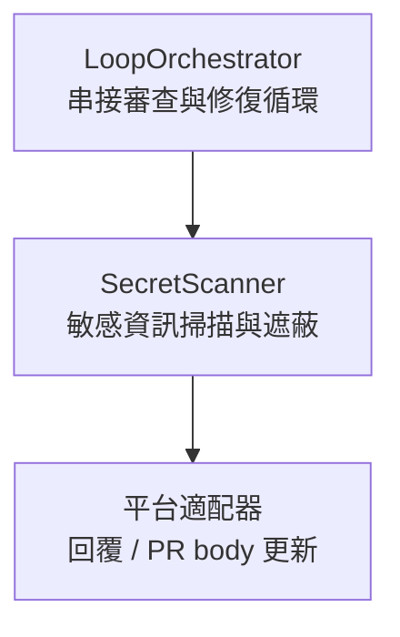
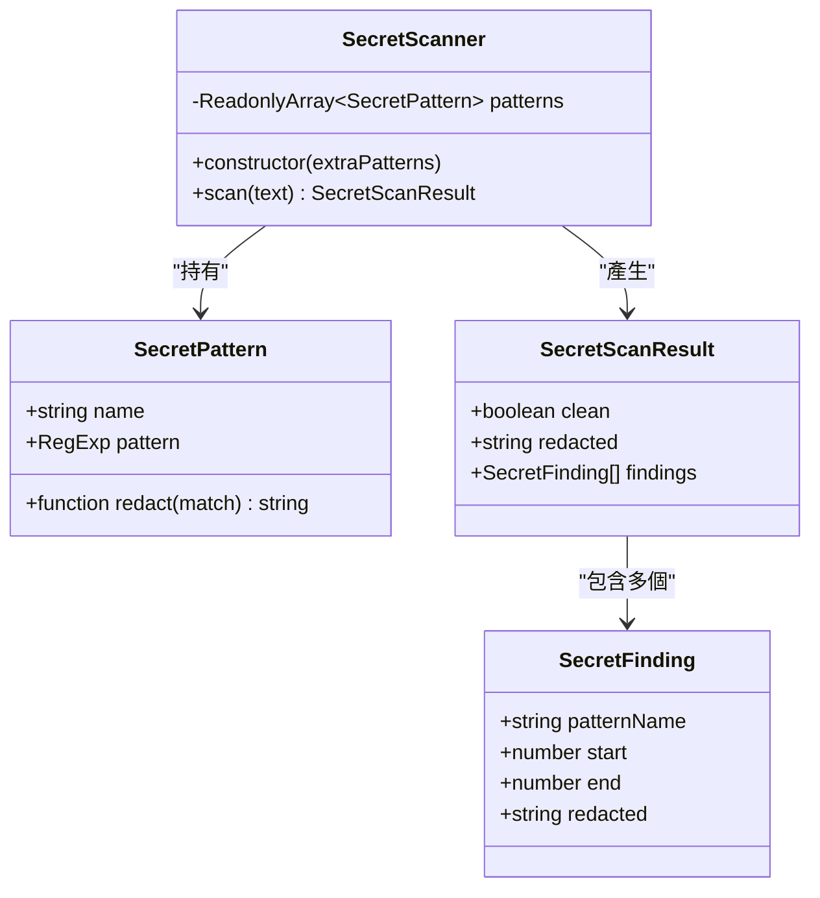
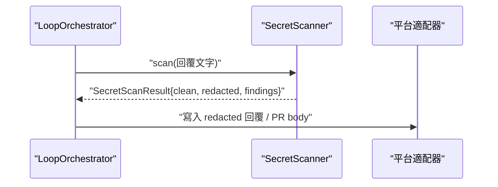
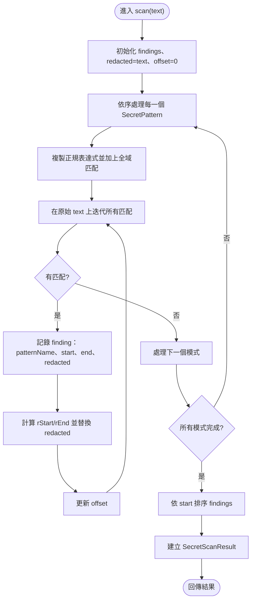
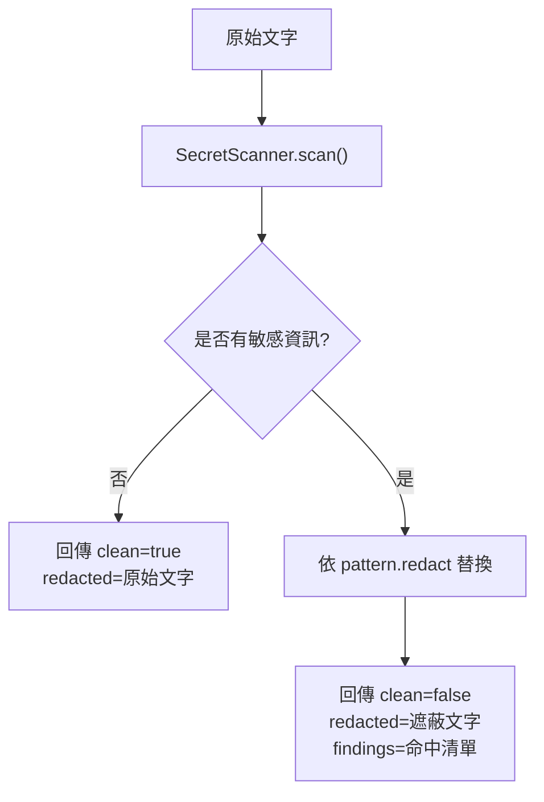
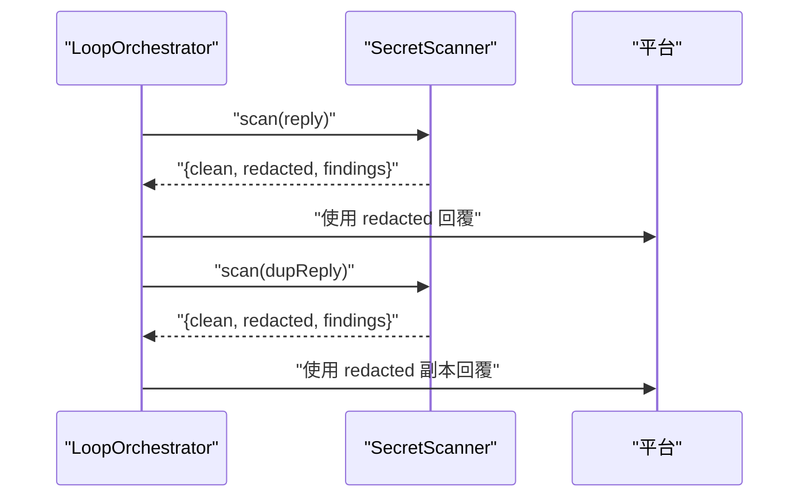
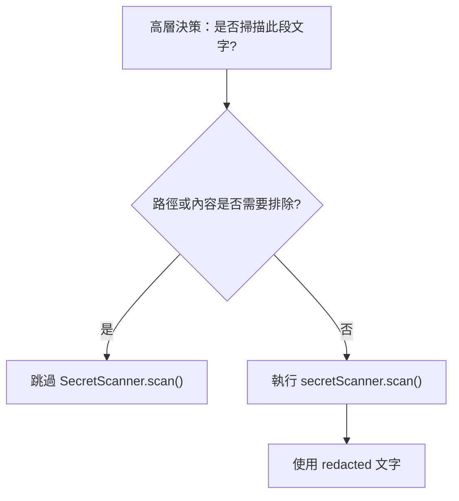

# SecretScanner 敏感資訊掃描

<cite>
**本文引用的檔案**   
- [src/core/security/SecretScanner.ts](https://github.com/mikeah2011/maestro/blob/master/src/core/security/SecretScanner.ts)
- [tests/core/security/SecretScanner.test.ts](https://github.com/mikeah2011/maestro/blob/master/tests/core/security/SecretScanner.test.ts)
- [src/core/loop/LoopOrchestrator.ts](https://github.com/mikeah2011/maestro/blob/master/src/core/loop/LoopOrchestrator.ts)
- [docs/DESIGN.md](https://github.com/mikeah2011/maestro/blob/master/docs/DESIGN.md)
- [README.md](https://github.com/mikeah2011/maestro/blob/master/README.md)
- [.maestro.example.yaml](https://github.com/mikeah2011/maestro/blob/master/.maestro.example.yaml)
</cite>

## 目錄
1. [簡介](#簡介)
2. [專案結構與角色定位](#專案結構與角色定位)
3. [核心資料結構與類型](#核心資料結構與類型)
4. [架構總覽](#架構總覽)
5. [詳細元件分析](#詳細元件分析)
6. [掃描流程與匹配演算法](#掃描流程與匹配演算法)
7. [支援的敏感模式類型](#支援的敏感模式類型)
8. [遮蔽策略與輸出模型](#遮蔽策略與輸出模型)
9. [白名單、黑名單與排除路徑](#白名單黑名單與排除路徑)
10. [配置選項說明](#配置選項說明)
11. [誤報處理與調校建議](#誤報處理與調校建議)
12. [效能考量](#效能考量)
13. [整合方式](#整合方式)
14. [新增自訂敏感模式與排除規則](#新增自訂敏感模式與排除規則)
15. [常見問題排查](#常見問題排查)
16. [結論](#結論)

## 簡介
SecretScanner 是 Maestro 安全層中的一個無狀態文字掃描器，負責在回覆文字或 PR 內容更新被寫入平台之前，偵測並遮蔽可能洩漏的敏感資訊。它內建 AWS key、GitHub token、JWT、Stripe key、Slack token、PEM 私鑰等常見機密格式的正則模式，並提供可組合的 `SecretPattern` 介面，讓使用者追加企業內部或第三方服務專屬的敏感模式。

本文件聚焦以下主題：
- 敏感資訊偵測與遮蔽機制
- 支援的模式類型與對應遮蔽策略
- 掃描流程、匹配演算法與性能特性
- 白名單與黑名單路徑現況
- 與 LoopOrchestrator 的整合點
- 如何新增自訂敏感模式與排除規則

[No sources needed since this section summarizes without analyzing specific files]

## 專案結構與角色定位
SecretScanner 位於 `src/core/security/SecretScanner.ts`，屬於核心安全模組；其單元測試位於 `tests/core/security/SecretScanner.test.ts`。它本身不直接讀取設定檔，而是由外部組件（例如 `LoopOrchestrator`）在建構時注入預設或擴充的 `SecretPattern` 陣列。

**圖表來源**
- [src/core/loop/LoopOrchestrator.ts:117-138](https://github.com/mikeah2011/maestro/blob/master/src/core/loop/LoopOrchestrator.ts#L117-L138)
- [src/core/security/SecretScanner.ts:86-136](https://github.com/mikeah2011/maestro/blob/master/src/core/security/SecretScanner.ts#L86-L136)

**章節來源**
- [src/core/security/SecretScanner.ts:1-136](https://github.com/mikeah2011/maestro/blob/master/src/core/security/SecretScanner.ts#L1-L136)
- [docs/DESIGN.md:53-53](https://github.com/mikeah2011/maestro/blob/master/docs/DESIGN.md#L53-L53)
- [README.md:114-114](https://github.com/mikeah2011/maestro/blob/master/README.md#L114-L114)

## 核心資料結構與類型
SecretScanner 透過三個主要型別描述掃描行為與結果：

| 名稱 | 用途 | 關鍵欄位或行為 |
|---|---|---|
| `SecretPattern` | 定義一種敏感資訊模式 | `name`、`pattern`、`redact` |
| `SecretFinding` | 單一命中結果 | `patternName`、`start`、`end`、`redacted` |
| `SecretScanResult` | 一次 `scan` 的結果 | `clean`、`redacted`、`findings` |

其中：
- `SecretPattern.pattern` 是 `RegExp`，且不應使用 `/g` 旗標；掃描器會內部複製為全域匹配以遍歷所有命中。
- `SecretPattern.redact` 接收原始匹配字串，回傳要替換後的遮蔽字串。
- `SecretFinding.start`、`end` 是原始輸入文字的索引區間，方便稽核與定位。
- `SecretScanResult.clean` 表示是否未發現任何敏感資訊。
- `SecretScanResult.redacted` 在未發現時等於原始輸入；否則返回已替換的版本。

**圖表來源**
- [src/core/security/SecretScanner.ts:13-84](https://github.com/mikeah2011/maestro/blob/master/src/core/security/SecretScanner.ts#L13-L84)
- [src/core/security/SecretScanner.ts:86-136](https://github.com/mikeah2011/maestro/blob/master/src/core/security/SecretScanner.ts#L86-L136)

**章節來源**
- [src/core/security/SecretScanner.ts:13-84](https://github.com/mikeah2011/maestro/blob/master/src/core/security/SecretScanner.ts#L13-L84)
- [src/core/security/SecretScanner.ts:86-136](https://github.com/mikeah2011/maestro/blob/master/src/core/security/SecretScanner.ts#L86-L136)

## 架構總覽
SecretScanner 在整體 Maestro 架構中的角色是「外發文字的安全閥」。設計文件指出，它會掃描每個外發回覆與 PR 內容更新，避免機器人引用程式碼差異時把密鑰重新持久化到討論串或 PR 內容中。

**圖表來源**
- [src/core/loop/LoopOrchestrator.ts:397-420](https://github.com/mikeah2011/maestro/blob/master/src/core/loop/LoopOrchestrator.ts#L397-L420)
- [src/core/security/SecretScanner.ts:86-136](https://github.com/mikeah2011/maestro/blob/master/src/core/security/SecretScanner.ts#L86-L136)
- [docs/DESIGN.md:53-53](https://github.com/mikeah2011/maestro/blob/master/docs/DESIGN.md#L53-L53)

**章節來源**
- [docs/DESIGN.md:53-53](https://github.com/mikeah2011/maestro/blob/master/docs/DESIGN.md#L53-L53)
- [src/core/loop/LoopOrchestrator.ts:117-138](https://github.com/mikeah2011/maestro/blob/master/src/core/loop/LoopOrchestrator.ts#L117-L138)
- [src/core/loop/LoopOrchestrator.ts:397-420](https://github.com/mikeah2011/maestro/blob/master/src/core/loop/LoopOrchestrator.ts#L397-L420)

## 詳細元件分析

### SecretScanner 類別
`SecretScanner` 建構子接受可選的 `extraPatterns`，並將其與內建模式合併。`scan` 方法對每一種模式執行全域匹配，記錄命中位置、生成遮蔽版本，並依起始位置排序結果。

實作重點：
- 不會修改原始輸入文字的位置參照，而是用 offset 追蹤替換後字串的位移。
- 每次匹配的 `redact` 函式只處理該匹配片段，由掃描器負責拼接成最終 `redacted`。
- 若沒有任何命中，直接回傳原始文字，避免不必要的字串操作。

**章節來源**
- [src/core/security/SecretScanner.ts:86-136](https://github.com/mikeah2011/maestro/blob/master/src/core/security/SecretScanner.ts#L86-L136)

### 內建模式集合
內建模式涵蓋以下常見機密格式：
- AWS Access Key ID
- AWS Secret Access Key
- GitHub Token
- PEM Private Key
- JWT
- Stripe Key
- Slack Token
- Generic API Key

這些模式的共同特點是：
- 使用明確前綴或固定格式降低誤報，例如 `AKIA`、`ghp_`、`github_pat_`、`sk_live_`、`pk_test_`、`xoxb-` 等。
- 針對長條形 token 或金鑰值設定最小長度，減少一般 base64 或隨機字串造成的誤判。
- `redact` 通常保留開頭幾個字元以便識別來源，再把後半部替換為 `[REDACTED]` 或完整區塊替換為 `[PRIVATE KEY REDACTED]`。

**章節來源**
- [src/core/security/SecretScanner.ts:35-84](https://github.com/mikeah2011/maestro/blob/master/src/core/security/SecretScanner.ts#L35-L84)

### 測試覆蓋範圍
測試檔驗證以下行為：
- 乾淨文字回傳 `clean=true` 且 `redacted` 不變。
- AWS key、GitHub token、PEM private key、JWT、Stripe key、generic api_key 都能被偵測。
- 遮蔽後原文不再出現敏感值，但前後非敏感文字仍保留。
- 多筆不同敏感資訊在同一行或同一段文字中仍可正確遮蔽。
- 使用者可透過 `SecretPattern` 加入自訂模式，且與內建模式共存。
- `start`、`end` 位置與原始輸入一致，方便稽核。

**章節來源**
- [tests/core/security/SecretScanner.test.ts:7-221](https://github.com/mikeah2011/maestro/blob/master/tests/core/security/SecretScanner.test.ts#L7-L221)

## 掃描流程與匹配演算法
以下是 `scan` 的核心流程：

**圖表來源**
- [src/core/security/SecretScanner.ts:86-136](https://github.com/mikeah2011/maestro/blob/master/src/core/security/SecretScanner.ts#L86-L136)

### 時間與空間複雜度
假設輸入文字長度為 `n`，模式數量為 `m`：
- 最壞情況下，每種模式都會進行一次正則遍歷，時間複雜度約為 `O(m × n)`。
- `findings` 最多保存所有命中，空間複雜度約為 `O(k)`，其中 `k` 是匹配數量。
- 每次替換會建立新的 `redacted` 字串，因此多次匹配會產生額外字串分配；不過實務上敏感資訊數量有限，通常不會成為瓶頸。

優化方向：
- 若未來擴展大量模式，可考慮先做快速字首篩選（例如檢查 `AKIA`、`ghp_`、`-----BEGIN`），再執行較貴的正則。
- 對於極大文本（如大型 diff），可在上游按段落或行切分，避免一次性處理整份冗長文字。

**章節來源**
- [src/core/security/SecretScanner.ts:86-136](https://github.com/mikeah2011/maestro/blob/master/src/core/security/SecretScanner.ts#L86-L136)

## 支援的敏感模式類型
目前內建的敏感模式類型如下：

| 模式名稱 | 說明 | 典型特徵 | 遮蔽策略 |
|---|---|---|---|
| `aws_access_key_id` | AWS Access Key ID | 以 `AKIA` 開頭並附帶固定長度字母數字 | 替換為 `AKIA[REDACTED]` |
| `aws_secret_access_key` | AWS Secret Access Key | 鍵名後接等號或冒號，接著 40 字符值 | 替換值部分為 `[REDACTED]` |
| `github_token` | GitHub Token | `ghp_`、`ghs_`、`gho_`、`ghr_`、`github_pat_` 前綴 | 保留前 8 字元後接 `[REDACTED]` |
| `private_key_pem` | PEM 私鑰區塊 | `-----BEGIN ... PRIVATE KEY-----` 到 `-----END ... PRIVATE KEY-----` | 整個區塊替換為 `[PRIVATE KEY REDACTED]` |
| `jwt` | JWT | 三段 base64url 組成，每段至少一定長度 | 保留前 10 字元後接 `[JWT REDACTED]` |
| `stripe_key` | Stripe Key | `sk_live_`、`pk_test_` 等前綴 | 保留前 12 字元後接 `[REDACTED]` |
| `slack_token` | Slack Token | `xox[baprs]-` 開頭的多段 token | 保留前 12 字元後接 `[REDACTED]` |
| `generic_api_key` | 通用 API Key | `api_key`、`apikey`、`access_token` 等鍵名搭配長值 | 替換值部分為 `[REDACTED]` |

這些模式都經過測試驗證，涵蓋空字串、嵌入句子的 token、不同前綴的 GitHub token、RSA/PKCS#8 PEM、Bearer JWT、Stripe live/test key，以及 `api_key = value`、`access_token: value` 等常見配置形式。

**章節來源**
- [src/core/security/SecretScanner.ts:35-84](https://github.com/mikeah2011/maestro/blob/master/src/core/security/SecretScanner.ts#L35-L84)
- [tests/core/security/SecretScanner.test.ts:26-145](https://github.com/mikeah2011/maestro/blob/master/tests/core/security/SecretScanner.test.ts#L26-L145)

## 遮蔽策略與輸出模型
SecretScanner 支援兩種主要遮蔽策略：

| 策略 | 適用場景 | 效果 |
|---|---|---|
| 部分遮蔽 partial masking | 多數 token、API key | 保留前幾個字元以便判斷來源，其餘替換為 `[REDACTED]` |
| 完全遮蔽 full redaction | 私密區塊，例如 PEM 私鑰 | 整個敏感區塊被替換為安全佔位字串 |

此外，`SecretScanResult` 提供三種輸出面向：
- `clean`：是否沒有發現敏感資訊。
- `redacted`：實際可安全送出的文字。
- `findings`：列出所有命中的模式名稱、位置與遮蔽後片段，可用於稽核或日誌。

**圖表來源**
- [src/core/security/SecretScanner.ts:86-136](https://github.com/mikeah2011/maestro/blob/master/src/core/security/SecretScanner.ts#L86-L136)
- [tests/core/security/SecretScanner.test.ts:151-209](https://github.com/mikeah2011/maestro/blob/master/tests/core/security/SecretScanner.test.ts#L151-L209)

**章節來源**
- [src/core/security/SecretScanner.ts:86-136](https://github.com/mikeah2011/maestro/blob/master/src/core/security/SecretScanner.ts#L86-L136)
- [tests/core/security/SecretScanner.test.ts:151-209](https://github.com/mikeah2011/maestro/blob/master/tests/core/security/SecretScanner.test.ts#L151-L209)

## 白名單、黑名單與排除路徑
根據目前程式碼庫的分析：

- `SecretScanner` 本身**沒有** `whitelist_paths`、`blacklist_paths`、`scanning_patterns`、`redaction_mode` 等設定屬性。
- 它的可擴展點是建構子接受的 `extraPatterns`，也就是在程式碼層面新增 `SecretPattern`。
- `.maestro.example.yaml` 中有 `scanOutgoing: true`，代表迴圈會在回覆與 PR body 更新前啟用 SecretScanner，但這是一個開關，而非敏感模式或排除路徑設定。
- `LoopOrchestrator` 也尚未把路徑白名單或黑名單傳遞給 `SecretScanner`。

因此，若需要「按路徑排除」或「調整遮蔽模式」，目前的正確做法是：
1. 在應用程式初始化階段，根據環境或設定載入自訂 `SecretPattern`。
2. 將這些模式傳入 `new SecretScanner(extraPatterns)`。
3. 若未來要支援路徑排除，應在 `LoopOrchestrator` 或更高層決定是否呼叫 `secretScanner.scan()`，而不是改動 `SecretScanner` 內部邏輯。

**章節來源**
- [src/core/security/SecretScanner.ts:86-91](https://github.com/mikeah2011/maestro/blob/master/src/core/security/SecretScanner.ts#L86-L91)
- [.maestro.example.yaml:195-195](https://github.com/mikeah2011/maestro/blob/master/.maestro.example.yaml#L195-L195)
- [src/core/loop/LoopOrchestrator.ts:117-138](https://github.com/mikeah2011/maestro/blob/master/src/core/loop/LoopOrchestrator.ts#L117-L138)

## 配置選項說明
目前與 SecretScanner 相關的配置行為如下：

| 項目 | 當前行為 | 建議用法 |
|---|---|---|
| `scanOutgoing` | YAML 中提供，用於控制是否在回覆與 PR body 更新前執行掃描 | 保持開啟，以避免 AI 機器人的引用文字持久化敏感資訊 |
| `scanning_patterns` | 未在 SecretScanner 或設定 schema 中定義 | 改為在程式碼中建立 `SecretPattern` 陣列並注入 |
| `whitelist_paths` | 未實現 | 可考慮在 `LoopOrchestrator` 層決定是否掃描某段文字 |
| `blacklist_paths` | 未實現 | 同上 |
| `redaction_mode` | 未實現 | 遮蔽策略由 `SecretPattern.redact` 決定 |

若要設定自訂敏感模式，應該：
1. 建立符合 `SecretPattern` 的物件。
2. 將物件放入 `extraPatterns`。
3. 使用這個 `SecretScanner` 實例來取代預設實例。

**章節來源**
- [.maestro.example.yaml:195-195](https://github.com/mikeah2011/maestro/blob/master/.maestro.example.yaml#L195-L195)
- [src/core/security/SecretScanner.ts:13-84](https://github.com/mikeah2011/maestro/blob/master/src/core/security/SecretScanner.ts#L13-L84)
- [src/core/security/SecretScanner.ts:86-91](https://github.com/mikeah2011/maestro/blob/master/src/core/security/SecretScanner.ts#L86-L91)

## 誤報處理與調校建議
### 常見誤報情境
- 一般 base64 字串被 JWT 模式誤判：內建 JWT 模式要求三段 base64url，每段都有最小長度限制，可降低短字串誤判。
- 程式碼註解或範例中包含假 token：若不希望自動遮蔽，可在上游過濾掉純註解區段，或在高層決定是否執行掃描。
- 通用 API key 模式匹配到看似配置的長字串：可調整 `generic_api_key` 的前綴詞或最小長度，使其更貼合公司內部命名慣例。

### 調校建議
- 優先修正 `pattern`，讓它更精確，而不是依賴 `redact` 掩飾錯誤匹配。
- 使用 `findings` 稽核實際命中位置，確認 `start`、`end` 是否符合預期。
- 若某個模式誤報頻繁，可暫時移除或降權（例如改用更嚴格的字首或邊界條件）。
- 若某些回覆不需要掃描，應在 `LoopOrchestrator` 層級跳過，而不是在 `SecretScanner` 內硬編碼例外。

**章節來源**
- [src/core/security/SecretScanner.ts:35-84](https://github.com/mikeah2011/maestro/blob/master/src/core/security/SecretScanner.ts#L35-L84)
- [tests/core/security/SecretScanner.test.ts:151-209](https://github.com/mikeah2011/maestro/blob/master/tests/core/security/SecretScanner.test.ts#L151-L209)

## 效能考量
- SecretScanner 是同步、無狀態、無 I/O 的輕量掃描器。
- 主要成本來自正則匹配與字串替換。
- 最佳實踐是避免對超大文本重複掃描；例如把整份 PR diff 拆成多段訊息時，應確保每段大小合理。
- 如果未來擴充到數十種以上模式，可考慮：
  - 建立快速前綴過濾器。
  - 對相同輸入做短期快取（需小心記憶體與安全性）。
  - 在 `LoopOrchestrator` 層對重複回覆做去重。

[No sources needed since this section provides general guidance]

## 整合方式
SecretScanner 由 `LoopOrchestrator` 管理：
- `LoopOrchestrator` 維護一個 `secretScanner` 屬性。
- 若未注入，則使用預設 `new SecretScanner()`。
- 在回覆或 PR body 更新前，會對文字執行 `scan()`，並使用 `redacted` 寫入平台。

**圖表來源**
- [src/core/loop/LoopOrchestrator.ts:117-138](https://github.com/mikeah2011/maestro/blob/master/src/core/loop/LoopOrchestrator.ts#L117-L138)
- [src/core/loop/LoopOrchestrator.ts:397-420](https://github.com/mikeah2011/maestro/blob/master/src/core/loop/LoopOrchestrator.ts#L397-L420)

**章節來源**
- [src/core/loop/LoopOrchestrator.ts:117-138](https://github.com/mikeah2011/maestro/blob/master/src/core/loop/LoopOrchestrator.ts#L117-L138)
- [src/core/loop/LoopOrchestrator.ts:397-420](https://github.com/mikeah2011/maestro/blob/master/src/core/loop/LoopOrchestrator.ts#L397-L420)

## 新增自訂敏感模式與排除規則

### 新增自訂敏感模式
要新增自訂模式，請實作 `SecretPattern`：
- `name`：人類可讀的模式名稱，出現在 `findings` 中。
- `pattern`：不含 `/g` 旗標的 `RegExp`。
- `redact`：接收原始匹配字串，回傳遮蔽後字串。

參考測試中的自訂模式用法，可以建立例如 `internal_service_key` 這類企業內部金鑰格式。

**章節來源**
- [src/core/security/SecretScanner.ts:13-29](https://github.com/mikeah2011/maestro/blob/master/src/core/security/SecretScanner.ts#L13-L29)
- [tests/core/security/SecretScanner.test.ts:182-209](https://github.com/mikeah2011/maestro/blob/master/tests/core/security/SecretScanner.test.ts#L182-L209)

### 新增排除規則
目前 SecretScanner 不提供路徑白名單或黑名單。若要在專案中使用排除規則，建議採用以下設計：

此處的 `PathCheck` 可由 `LoopOrchestrator` 或平台適配器根據文件路徑、PR 路徑、diff 區段或訊息類型決定。這樣能保持 SecretScanner 專注於「文字層級的敏感資訊遮蔽」，而不混雜路徑路由邏輯。

**圖表來源**
- [src/core/loop/LoopOrchestrator.ts:397-420](https://github.com/mikeah2011/maestro/blob/master/src/core/loop/LoopOrchestrator.ts#L397-L420)

**章節來源**
- [src/core/loop/LoopOrchestrator.ts:397-420](https://github.com/mikeah2011/maestro/blob/master/src/core/loop/LoopOrchestrator.ts#L397-L420)

## 常見問題排查

| 問題 | 可能原因 | 解決方式 |
|---|---|---|
| 敏感資訊未被遮蔽 | 模式未覆蓋該格式，或 `pattern` 太寬鬆/太嚴格 | 新增或調整 `SecretPattern`，並用測試驗證 |
| 正常文字被誤判為敏感資訊 | 通用模式過寬，例如 generic API key | 縮小匹配範圍，增加字首或長度限制 |
| 遮蔽後文字仍然出現原 token | `redact` 未正確替換全部敏感片段 | 檢查該模式的 `redact` 邏輯 |
| 找不到 `scanning_patterns`、`whitelist_paths` 等設定 | 這些設定目前不存在於 SecretScanner | 改為注入 `SecretPattern`，並在 `LoopOrchestrator` 層控制是否掃描 |
| 想排除某些路徑的回覆 | SecretScanner 不處理路徑 | 在 `LoopOrchestrator` 或平台層決定是否呼叫掃描 |

**章節來源**
- [src/core/security/SecretScanner.ts:13-84](https://github.com/mikeah2011/maestro/blob/master/src/core/security/SecretScanner.ts#L13-L84)
- [src/core/security/SecretScanner.ts:86-136](https://github.com/mikeah2011/maestro/blob/master/src/core/security/SecretScanner.ts#L86-L136)
- [tests/core/security/SecretScanner.test.ts:182-221](https://github.com/mikeah2011/maestro/blob/master/tests/core/security/SecretScanner.test.ts#L182-L221)

## 結論
SecretScanner 是 Maestro 中一個明確、無狀態、易擴展的敏感資訊掃描器。它透過內建正則模式保護外發回覆與 PR 內容，並提供 `SecretPattern` 介面讓企業補充自有金鑰格式。目前它不支援 `scanning_patterns`、`whitelist_paths`、`blacklist_paths`、`redaction_mode` 等設定字段；這些能力應以程式碼層注入模式與高層路徑決策的方式實現。

推薦的實踐是：
- 將常見敏感格式封裝為 `SecretPattern`，並加入測試。
- 保持 `redact` 簡單穩定，確保遮蔽後文字不包含原始敏感值。
- 在 `LoopOrchestrator` 層統一控制掃描時機與排除邏輯。
- 使用 `findings` 稽核命中位置，持續優化模式以降低誤報。

[No sources needed since this section summarizes without analyzing specific files]