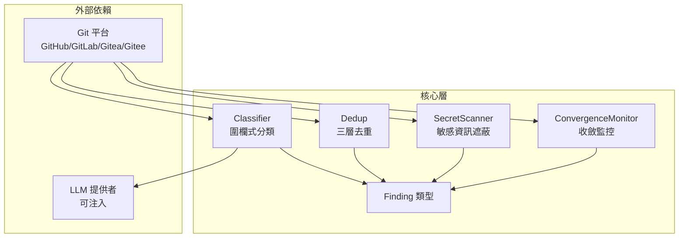
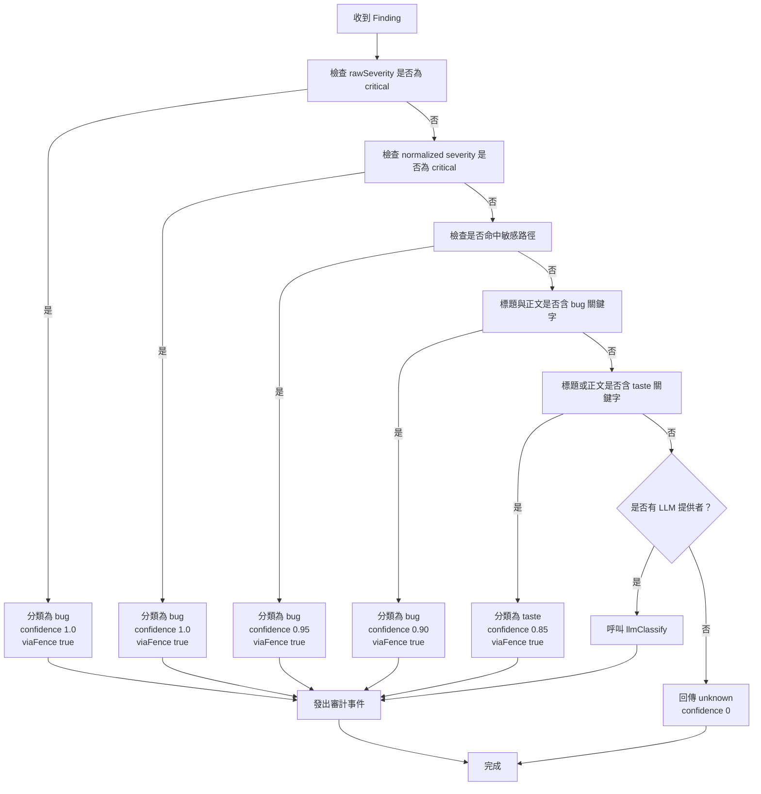
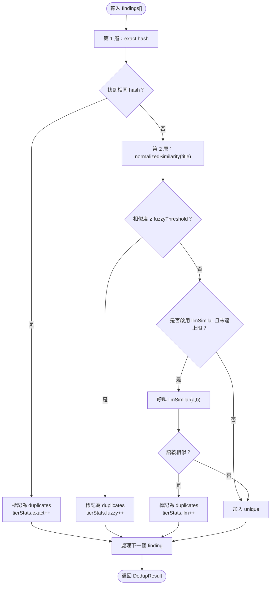
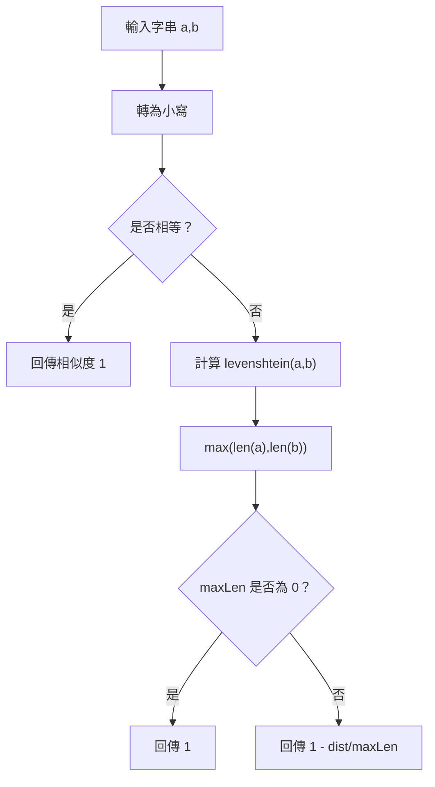
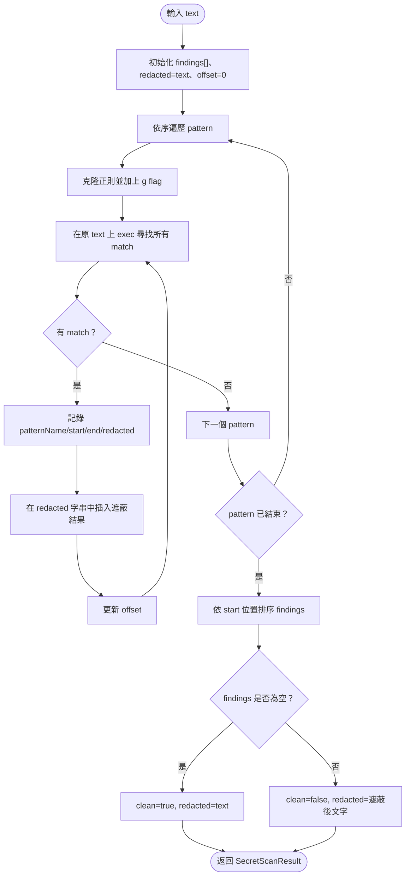
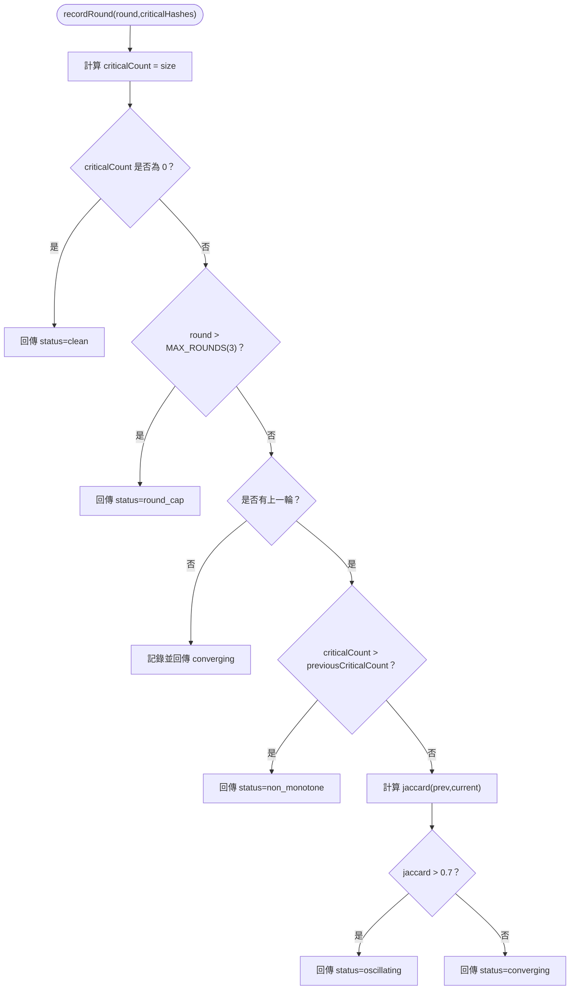
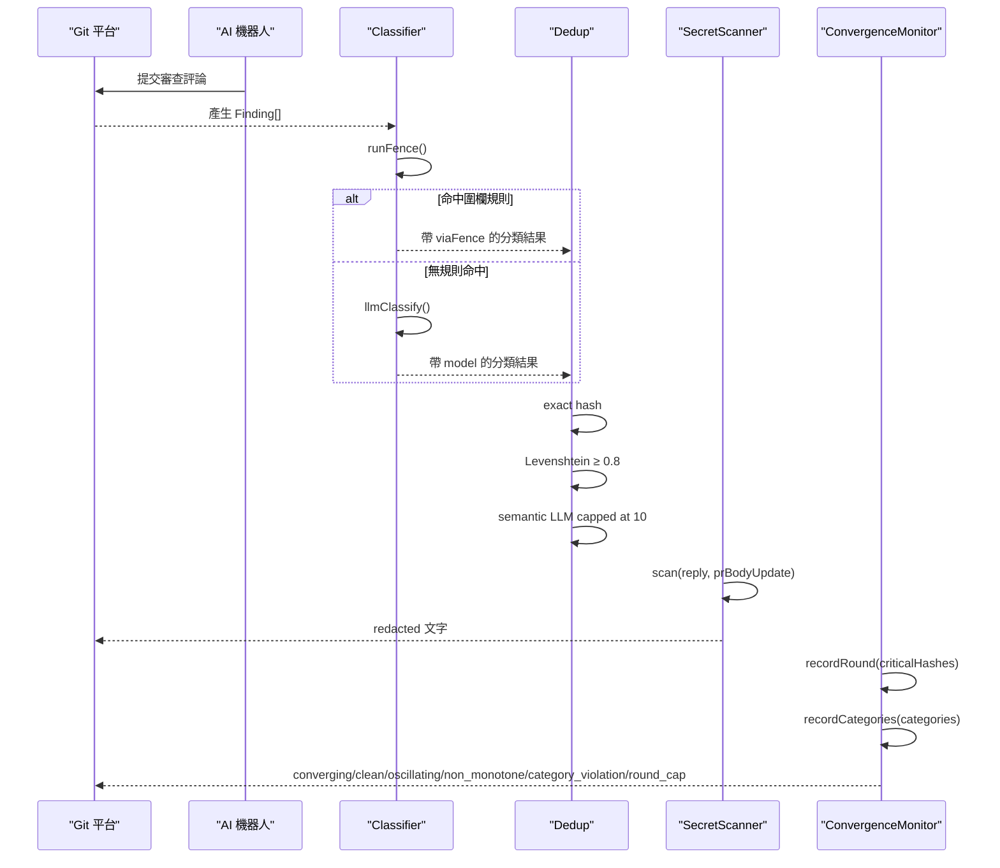
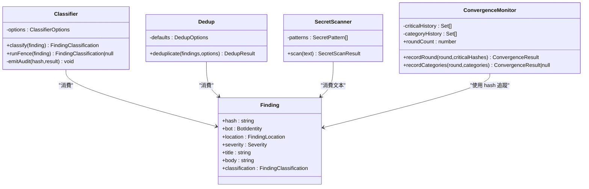

# 問題處理管道

<cite>
**本文引用的檔案**
- [Classifier.ts](https://github.com/mikeah2011/maestro/blob/master/src/core/classify/Classifier.ts)
- [Dedup.ts](https://github.com/mikeah2011/maestro/blob/master/src/core/dedup/Dedup.ts)
- [SecretScanner.ts](https://github.com/mikeah2011/maestro/blob/master/src/core/security/SecretScanner.ts)
- [ConvergenceMonitor.ts](https://github.com/mikeah2011/maestro/blob/master/src/core/convergence/ConvergenceMonitor.ts)
- [Finding.ts](https://github.com/mikeah2011/maestro/blob/master/src/core/types/Finding.ts)
- [DESIGN.md](https://github.com/mikeah2011/maestro/blob/master/docs/DESIGN.md)
- [Classifier.test.ts](https://github.com/mikeah2011/maestro/blob/master/tests/core/classify/Classifier.test.ts)
- [Dedup.test.ts](https://github.com/mikeah2011/maestro/blob/master/tests/core/dedup/Dedup.test.ts)
- [SecretScanner.test.ts](https://github.com/mikeah2011/maestro/blob/master/tests/core/security/SecretScanner.test.ts)
- [ConvergenceMonitor.test.ts](https://github.com/mikeah2011/maestro/blob/master/tests/core/convergence/ConvergenceMonitor.test.ts)
</cite>

## 目錄

1. [引言](#引言)
2. [專案結構與定位](#專案結構與定位)
3. [核心資料模型](#核心資料模型)
4. [圍欄式分類器](#圍欄式分類器)
5. [三層去重管道](#三層去重管道)
6. [敏感資訊掃描與遮蔽](#敏感資訊掃描與遮蔽)
7. [收斂監控與振盪偵測](#收斂監控與振盪偵測)
8. [端到端流程圖](#端到端流程圖)
9. [依賴關係分析](#依賴關係分析)
10. [效能指標與調參指南](#效能指標與調參指南)
11. [常見問題診斷](#常見問題診斷)
12. [優化建議](#優化建議)
13. [結論](#結論)

## 引言

本文件針對 Maestro中的「問題處理管道」提供完整技術文檔。該管道的目標是把多個 AI 審查機器人產生的原始評論，轉化為可合併、可追蹤、可終止的修復流程，並對循環行為提供數學保證。

管道由四個核心模組組成：

| 模組 | 主要責任 |
|---|---|
| `Classifier` | 圍欄式確定性規則優先，短路後才呼叫 LLM |
| `Dedup` | 三層去重：exact hash → Levenshtein 模糊 → semantic LLM |
| `SecretScanner` | 掃描外發文字，遮蔽 AWS key、GitHub token、JWT、私鑰等 |
| `ConvergenceMonitor` | Jaccard 振盪偵測 + 單調不增 + 第 2 輪後不得出現新類別 |

所有模組共用 `Finding` 類型，作為跨階段的統一輸入輸出模型。

## 專案結構與定位

從系統角度看，這些模組位於 `src/core/` 之下，屬於「核心層」。它們不直接綁定 Git 平台或 LLM 供應商，而是透過介面、注入函式與標準資料型別被上層管線使用。



**圖表來源**
- [Classifier.ts:1-191](https://github.com/mikeah2011/maestro/blob/master/src/core/classify/Classifier.ts#L1-L191)
- [Dedup.ts:1-153](https://github.com/mikeah2011/maestro/blob/master/src/core/dedup/Dedup.ts#L1-L153)
- [SecretScanner.ts:1-136](https://github.com/mikeah2011/maestro/blob/master/src/core/security/SecretScanner.ts#L1-L136)
- [ConvergenceMonitor.ts:1-206](https://github.com/mikeah2011/maestro/blob/master/src/core/convergence/ConvergenceMonitor.ts#L1-L206)
- [Finding.ts:1-129](https://github.com/mikeah2011/maestro/blob/master/src/core/types/Finding.ts#L1-L129)

**章節來源**
- [DESIGN.md:1-200](https://github.com/mikeah2011/maestro/blob/master/docs/DESIGN.md#L1-L200)

## 核心資料模型

### Finding：單一審查問題

`Finding` 代表「某個機器人在某輪審查中提出的一個問題」。它是分類器、去重器、敏感資訊掃描器與收斂監控器共同操作的基礎單位。

| 欄位 | 型別 | 說明 |
|---|---|---|
| `hash` | string | 穩定雜湊，用於跨機器人、跨輪次去重 |
| `bot` | `BotIdentity` | 指出問題來自哪個機器人帳號 |
| `firstSeenRound` / `lastSeenRound` | number | 首次出現與最近出現的輪次 |
| `location.file` | string | 問題所在檔案路徑 |
| `location.startLine` | number? | 一基起始行號 |
| `severity` | `Severity` | 標準化後的嚴重程度：critical/high/medium/low/info |
| `rawSeverity` | string? | 機器人原始嚴重級別 |
| `title` / `body` | string | 標題與正文，用於關鍵字與模糊匹配 |
| `classification` | `FindingClassification`? | 分類結果 |
| `threadId` / `reviewId` / `commentId` | string? | 平台原生討論串與評論 ID |

### FindingClassification：分類輸出

| 欄位 | 型別 | 說明 |
|---|---|---|
| `category` | `FindingCategory` | bug/yagni/wrong/taste/duplicate/unknown |
| `confidence` | number | 0～1 的可信度 |
| `viaFence` | boolean | 是否由確定性規則短路 |
| `fenceRule` | string? | 觸發的規則名稱 |
| `model` | string? | 若走 LLM，記錄使用的模型 |
| `reasoning` | string? | 審計用的推理摘要 |

### Severity 與 FindingCategory

| 型別 | 值域 | 用途 |
|---|---|---|
| `Severity` | critical/high/medium/low/info | 嚴重程度標準化 |
| `FindingCategory` | bug/yagni/wrong/taste/duplicate/unknown | 分類行動意涵 |

**章節來源**
- [Finding.ts:1-129](https://github.com/mikeah2011/maestro/blob/master/src/core/types/Finding.ts#L1-L129)

## 圍欄式分類器

### 設計理念

`Classifier` 的核心設計是「圍欄式」：在呼叫任何 LLM 之前，先用確定性規則檢查。只有當所有規則都無法判斷時，才進入 LLM 模糊分類。這樣做的目的很明確：

- 避免對明顯的 bug、安全相關問題、品味偏好反覆消耗 LLM。
- 讓每次分類的決策過程可審計。
- 讓未命中規則的問題保留 `unknown` 類別，而不是偽裝成高可信度的錯誤判斷。

### 規則優先順序

規則按「第一個命中者勝出」執行：

1. **原始嚴重級別為 critical**：包含 critical、blocker、error、fatal（大小寫不敏感）。
2. **正規化後 severity 為 critical**。
3. **敏感路徑**：路徑包含 `/auth/`、`/crypto/`、`/payment/`、`/security/`、`/token/`、`/password/` 等。
4. **bug 關鍵字**：包含 null pointer、SQL injection、buffer overflow、race condition、deadlock、XSS 等。
5. **taste 關鍵字**：包含 nitpick、cosmetic、style preference、just a suggestion 等。
6. **無規則命中**：若有 `llmClassify` 則呼叫 LLM；否則回傳 `unknown`。



**圖表來源**
- [Classifier.ts:1-191](https://github.com/mikeah2011/maestro/blob/master/src/core/classify/Classifier.ts#L1-L191)

### 輸入與輸出

| 階段 | 輸入 | 輸出 |
|---|---|---|
| 圍欄檢查 | `Finding` | `FindingClassification \| null` |
| LLM 分支 | `Finding` + `llmClassify(Finding)` | `FindingClassification` |
| 預設分支 | 無 LLM | `{ category: 'unknown', confidence: 0, viaFence: false }` |
| 審計 | 每次 classify 的結果 | 透過 `onAudit` 同步回傳 |

### 性能特性

- 規則匹配全部是字串與 Set 操作，時間複雜度約為 O(k)，k 為規則數量。
- 敏感路徑使用 `includes(prefix)`，不是完整正則匹配。
- bug/taste 關鍵字使用 `toLowerCase()` 後 `includes`，沒有編譯正則。
- 只有在全部規則失敗時才可能呼叫 LLM。

### 調參指南

| 參數 | 預設行為 | 調整方向 |
|---|---|---|
| `llmClassify` | 可注入的 LLM 分類函式 | 若不需要 LLM，省略即可；測試中已驗證無 LLM 時不會呼叫 |
| `onAudit` | 可注入的審計回呼 | 建議生產環境開啟，用於觀察哪條規則最常命中 |
| `BUG_KEYWORDS` | 內建靜態陣列 | 新增語言或領域特有錯誤時加入，但要注意誤判率 |
| `SENSITIVE_PATH_PREFIXES` | 內建靜態陣列 | 新增敏感目錄時加入，但過寬會導致大量假陽性 |

**章節來源**
- [Classifier.ts:1-191](https://github.com/mikeah2011/maestro/blob/master/src/core/classify/Classifier.ts#L1-L191)
- [Classifier.test.ts:1-200](https://github.com/mikeah2011/maestro/blob/master/tests/core/classify/Classifier.test.ts#L1-L200)

## 三層去重管道

### 設計理念

`Dedup` 的目標是把同一個問題在不同機器人、不同表述下重複出現的情況合併。它的策略是「最廉價優先」：

1. **第一層：精確雜湊** — 相同 `finding.hash` 視為完全相同。
2. **第二層：Levenshtein 模糊標題相似度** — 預設閾值 ≥ 0.8。
3. **第三層：語義 LLM 相似性** — 每輪最多呼叫 10 次，可注入 `llmSimilar`。

文檔註明的大致去重比例是：

| 層級 | 預期去重比例 | 說明 |
|---|---:|---|
| Exact hash | ~60% | 穩定雜湊相同的問題 |
| Fuzzy title | ~25% | 標題重述、微小差異 |
| Semantic LLM | ~15% | 語意相同但文字差異大 |

### 三層流程



**圖表來源**
- [Dedup.ts:1-153](https://github.com/mikeah2011/maestro/blob/master/src/core/dedup/Dedup.ts#L1-L153)

### 輸入與輸出

| 階段 | 輸入 | 輸出 |
|---|---|---|
| 整體 | `Finding[]` + `DedupOptions` | `DedupResult` |
| Exact hash | `unique[]` 與當前 finding | Map: duplicate hash → canonical hash |
| Fuzzy | 當前 finding.title vs unique[].title | 相似度 ≥ 閾值即視為重複 |
| Semantic | 當前 finding vs unique[] | `llmSimilar(a,b)` 回傳 boolean |

`DedupResult` 包含：

| 欄位 | 型別 | 說明 |
|---|---|---|
| `unique` | `Finding[]` | 去重後的唯一問題集合 |
| `duplicates` | `Map<string,string>` | 每個重複 finding 的 hash 對應到 canonical hash |
| `llmCallsUsed` | number | 實際消耗的 LLM 相似性呼叫次數 |
| `tierStats` | `DedupTierStats` | exact/fuzzy/llm 各層級的去重計數 |

### Levenshtein 與正規化相似度

`levenshtein` 使用兩列動態規劃，時間複雜度為 O(m×n)，空間複雜度為 O(n)。`normalizedSimilarity` 將編輯距離除以較長字串長度，得到 0～1 的正規化相似度。



**圖表來源**
- [Dedup.ts:88-153](https://github.com/mikeah2011/maestro/blob/master/src/core/dedup/Dedup.ts#L88-L153)

### 調參指南

| 參數 | 預設值 | 調整方向 |
|---|---:|---|
| `fuzzyThreshold` | 0.8 | 提高會更嚴格，降低會更寬鬆 |
| `maxLlmCalls` | 10 | 控制語義 LLM 去重的成本上限 |
| `llmSimilar` | 可注入 | 不提供時跳過第 3 層 |

**章節來源**
- [Dedup.ts:1-153](https://github.com/mikeah2011/maestro/blob/master/src/core/dedup/Dedup.ts#L1-L153)
- [Dedup.test.ts:1-200](https://github.com/mikeah2011/maestro/blob/master/tests/core/dedup/Dedup.test.ts#L1-L200)

## 敏感資訊掃描與遮蔽

### 設計理念

`SecretScanner` 掃描每一個即將外發的字串，包括回覆文字與 PR body 更新。它的主要風險場景是：機器人引用了 diff 中的密鑰，而我們的回覆又原樣複製了這些內容。因此，它必須在平台適配器持久化文字前執行遮蔽。

### 支援的內建模式

| 模式名稱 | 檢測目標 | 遮蔽方式 |
|---|---|---|
| `aws_access_key_id` | AWS Access Key ID | 替換為 `AKIA[REDACTED]` |
| `aws_secret_access_key` | AWS Secret Key | 替換為 `[REDACTED]` |
| `github_token` | ghp_/ghs_/gho_/ghr_/github_pat_ token | 保留前 8 碼 + `[REDACTED]` |
| `private_key_pem` | PEM 私鑰區塊 | 整段替換為 `[PRIVATE KEY REDACTED]` |
| `jwt` | JWT token | 保留前 10 碼 + `…[JWT REDACTED]` |
| `stripe_key` | sk_live/pk_test Stripe key | 保留前 12 碼 + `[REDACTED]` |
| `slack_token` | Slack token | 保留前 12 碼 + `[REDACTED]` |
| `generic_api_key` | api_key/access_token 等一般 API key | 替換為 `[REDACTED]` |

### 掃描流程



**圖表來源**
- [SecretScanner.ts:1-136](https://github.com/mikeah2011/maestro/blob/master/src/core/security/SecretScanner.ts#L1-L136)

### 輸入與輸出

| 階段 | 輸入 | 輸出 |
|---|---|---|
| scan(text) | 任意字串 | `SecretScanResult` |
| 結果 | clean / redacted / findings | 可用於平台適配器的寫入前過濾 |

`SecretScanResult` 包含：

| 欄位 | 型別 | 說明 |
|---|---|---|
| `clean` | boolean | 是否未發現任何敏感資訊 |
| `redacted` | string | 遮蔽後的文字；若 clean 則等於輸入 |
| `findings` | `SecretFinding[]` | 每個匹配的詳細紀錄 |

`SecretFinding` 包含：

| 欄位 | 型別 | 說明 |
|---|---|---|
| `patternName` | string | 命中的模式名稱 |
| `start` | number | 原文中的起始索引 |
| `end` | number | 原文中的結束索引（不含） |
| `redacted` | string | 遮蔽後的表示 |

### 調參指南

| 項目 | 說明 |
|---|---|
| 新增模式 | 透過建構子傳入 `extraPatterns` |
| 模式撰寫 | `pattern` 不可使用 `/g`，內部會自行克隆 |
| 遮蔽函式 | `redact(match)` 應返回不包含原始機密的字串 |
| 多匹配 | 使用 `/g` 克隆正則，確保多次匹配都能被記錄與遮蔽 |
| 位置偏移 | 使用 `offset` 維持 original 與 redacted 之間的位置一致性 |

**章節來源**
- [SecretScanner.ts:1-136](https://github.com/mikeah2011/maestro/blob/master/src/core/security/SecretScanner.ts#L1-L136)
- [SecretScanner.test.ts:1-200](https://github.com/mikeah2011/maestro/blob/master/tests/core/security/SecretScanner.test.ts#L1-L200)

## 收斂監控與振盪偵測

### 設計理念

`ConvergenceMonitor` 負責為審查循環提供三個不變量保證：

1. **單調不增**：下一輪的關鍵問題數量不得超過上一輪。
2. **Jaccard 振盪限制**：連續兩輪關鍵問題集的 Jaccard 相似度不得超過 0.7。
3. **第 2 輪後不得出現新類別**：如果第 3 輪出現之前從未見過的 `FindingCategory`，視為修復創造了新問題類。

此外，它還有一個硬性上限：最多 3 輪。

### 狀態定義

`ConvergenceStatus` 的可能狀態如下：

| 狀態 | 意義 | 處理建議 |
|---|---|---|
| `converging` | 正常，繼續迭代 | 繼續下一輪 |
| `clean` | 無關鍵問題 | 循環完成 |
| `oscillating` | Jaccard > 0.7 | 升級給人工處理 |
| `non_monotone` | 關鍵問題數量增加 | 可能引入迴歸，升級 |
| `category_violation` | 第 2 輪後出現新類別 | 升級 |
| `round_cap` | 達到 3 輪上限 | 停止並匯報 |

### 收斂決策流程



**圖表來源**
- [ConvergenceMonitor.ts:1-189](https://github.com/mikeah2011/maestro/blob/master/src/core/convergence/ConvergenceMonitor.ts#L1-L189)

### Jaccard 相似度

Jaccard 相似度定義為交集大小除以聯集大小：

$$
J(A,B) = \frac{|A \cap B|}{|A \cup B|}
$$

實作中，先遍歷集合 A，統計也在 B 中的元素數量作為交集；然後用兩個集合的大小減去交集得到聯集。

### 穩定雜湊設計

`computeFindingHash` 使用以下組合成為穩定識別：

```
sha1(file + NUL + line_bucket + NUL + normalized_category + NUL + sha1(surrounding_content))
```

其中：

- `lineBucket(line)` 把行號映射到大小為 5 的桶：1–5 → 0，6–10 → 1，以此類推。
- `computeContentHash` 對周邊程式碼內容做 SHA-1。
- 這種設計讓雜湊在改寫、rebase 或小範圍行號偏移下保持穩定。

### 輸入與輸出

| 方法 | 輸入 | 輸出 |
|---|---|---|
| `recordRound` | round:number、criticalHashes:Set<string> | `ConvergenceResult` |
| `recordCategories` | round:number、categories:Set<string> | `ConvergenceResult \| null` |
| `computeFindingHash` | file、startLine、normalizedCategory、surroundingContent | string |

`ConvergenceResult` 包含：

| 欄位 | 型別 | 說明 |
|---|---|---|
| `status` | `ConvergenceStatus` | 收斂狀態 |
| `round` | number | 目前輪次 |
| `criticalCount` | number | 本輪關鍵問題數量 |
| `previousCriticalCount` | number? | 上一輪關鍵問題數量 |
| `jaccard` | number? | 與上一輪關鍵問題集的 Jaccard 相似度 |
| `newCategories` | string[]? | 第 2 輪後出現的新類別 |
| `message` | string | 人類可讀的狀態訊息 |

### 調參指南

| 參數 | 預設值 | 調整方向 |
|---|---:|---|
| `MAX_ROUNDS` | 3 | 硬上限，通常不需修改 |
| `OSCILLATION_THRESHOLD` | 0.7 | 提高會減少振盪偵測，降低會更早停下來 |
| `lineBucketSize` | 5 | 控制行號桶大小，越大越容忍重排 |

**章節來源**
- [ConvergenceMonitor.ts:1-206](https://github.com/mikeah2011/maestro/blob/master/src/core/convergence/ConvergenceMonitor.ts#L1-L206)
- [ConvergenceMonitor.test.ts:1-200](https://github.com/mikeah2011/maestro/blob/master/tests/core/convergence/ConvergenceMonitor.test.ts#L1-L200)

## 端到端流程圖



**圖表來源**
- [Classifier.ts:1-191](https://github.com/mikeah2011/maestro/blob/master/src/core/classify/Classifier.ts#L1-L191)
- [Dedup.ts:1-153](https://github.com/mikeah2011/maestro/blob/master/src/core/dedup/Dedup.ts#L1-L153)
- [SecretScanner.ts:1-136](https://github.com/mikeah2011/maestro/blob/master/src/core/security/SecretScanner.ts#L1-L136)
- [ConvergenceMonitor.ts:1-206](https://github.com/mikeah2011/maestro/blob/master/src/core/convergence/ConvergenceMonitor.ts#L1-L206)

## 依賴關係分析

這四個模組之間的耦合度很低，主要依賴集中在 `Finding` 類型上。`Classifier` 是唯一需要外部 LLM 的模組，但 LLM 以注入函式形式提供，沒有直接耦合。



**圖表來源**
- [Classifier.ts:1-191](https://github.com/mikeah2011/maestro/blob/master/src/core/classify/Classifier.ts#L1-L191)
- [Dedup.ts:1-153](https://github.com/mikeah2011/maestro/blob/master/src/core/dedup/Dedup.ts#L1-L153)
- [SecretScanner.ts:1-136](https://github.com/mikeah2011/maestro/blob/master/src/core/security/SecretScanner.ts#L1-L136)
- [ConvergenceMonitor.ts:1-206](https://github.com/mikeah2011/maestro/blob/master/src/core/convergence/ConvergenceMonitor.ts#L1-L206)
- [Finding.ts:1-129](https://github.com/mikeah2011/maestro/blob/master/src/core/types/Finding.ts#L1-L129)

**章節來源**
- [DESIGN.md:1-200](https://github.com/mikeah2011/maestro/blob/master/docs/DESIGN.md#L1-L200)

## 效能指標與調參指南

### Classifier

| 指標 | 說明 |
|---|---|
| 規則匹配成本 | O(k)，k 為規則數量 |
| LLM 呼叫次數 | 僅在未命中圍欄規則時 |
| 最佳實踐 | 優先擴充規則欄柵，減少 LLM 依賴 |
| 風險 | 規則過於寬鬆會造成誤分類 |

### Dedup

| 指標 | 說明 |
|---|---|
| Exact hash | O(n)，n 為 unique 集合大小 |
| Fuzzy title | O(n×m)，m 為待比較題目數量 |
| Levenshtein | O(a×b)，a/b 為標題長度 |
| Semantic LLM | 最多 maxLlmCalls 次 |
| 最佳實踐 | 調高 `fuzzyThreshold` 可降低 LLM 呼叫 |
| 風險 | 過低閾值會誤殺不同問題 |

### SecretScanner

| 指標 | 說明 |
|---|---|
| 掃描成本 | O(p×t)，p 為 pattern 數量，t 為文字長度 |
| 遮蔽成本 | 每次 match 都要 slice + concat |
| 最佳實踐 | 把高頻模式放在前面 |
| 風險 | 過多 pattern 會影響外發延遲 |

### ConvergenceMonitor

| 指標 | 說明 |
|---|---|
| Jaccard 計算 | O(|A|)，遍歷前一輪集合 |
| 歷史儲存 | 每輪追加一個 Set |
| 最大輪次 | 3 輪硬上限 |
| 最佳實踐 | 使用穩定 hash，避免 rebase 造成假振盪 |
| 風險 | Jaccard 閾值太低會過度中止循環 |

### 調參總覽

| 模組 | 關鍵參數 | 影響 |
|---|---|---|
| Classifier | `llmClassify`、`onAudit`、關鍵字、敏感路徑 | LLM 成本與分類準確度 |
| Dedup | `fuzzyThreshold`、`maxLlmCalls`、`llmSimilar` | 去重敏感度與 LLM 預算 |
| SecretScanner | `extraPatterns` | 敏感資訊覆蓋面 |
| ConvergenceMonitor | `MAX_ROUNDS`、`OSCILLATION_THRESHOLD` | 循環終止條件 |

## 常見問題診斷

### 問題：分類器一直呼叫 LLM

**可能原因**

1. 沒有設定 `llmClassify`，導致回傳 `unknown`。
2. 問題沒有命中任何圍欄規則。
3. `rawSeverity` 或 `severity` 不是 critical。
4. 路徑不在 `SENSITIVE_PATH_PREFIXES` 中。
5. 標題與正文沒有命中 bug/taste 關鍵字。

**診斷步驟**

1. 開啟 `onAudit`，查看 `viaFence` 是否為 false。
2. 檢查 `fenceRule` 是否存在。
3. 確認 `Finding.title` 與 `Finding.body` 是否包含已知關鍵字。
4. 檢查 `Finding.location.file` 是否落在敏感路徑。

**解決方案**

- 補充關鍵字或敏感路徑。
- 在上層管道中補齊 `rawSeverity` 或 `severity`。
- 提供 `llmClassify`。

### 問題：去重漏掉重複問題

**可能原因**

1. `finding.hash` 不穩定。
2. `fuzzyThreshold` 太高。
3. 沒有提供 `llmSimilar`，導致第 3 層未啟用。
4. `maxLlmCalls` 已耗盡。

**診斷步驟**

1. 比較兩個重複問題的 hash。
2. 計算 `normalizedSimilarity(titleA,titleB)`。
3. 檢查 `DedupResult.tierStats` 與 `llmCallsUsed`。

**解決方案**

- 調低 `fuzzyThreshold`。
- 提供 `llmSimilar`。
- 修正 `computeFindingHash` 的輸入，確保 file、bucket、category、contentHash 穩定。

### 問題：敏感資訊仍然出現在回覆中

**可能原因**

1. 外發文字沒有經過 `SecretScanner.scan`。
2. 密鑰格式不在內建模式中。
3. 自訂模式的 `redact` 函式沒有正確遮蔽。
4. 多個 pattern 的遮蔽順序導致位置偏移計算錯誤。

**診斷步驟**

1. 檢查 `SecretScanResult.clean`。
2. 檢查 `findings` 是否包含該密鑰。
3. 檢查 `redacted` 是否仍包含原始值。
4. 使用測試案例比對已有模式。

**解決方案**

- 在所有平台寫入前強制執行 `scan`。
- 新增自訂 `SecretPattern`。
- 驗證 `redact` 函式返回不含原始機密的字串。

### 問題：收斂監測不斷報告振盪

**可能原因**

1. `OSCILLATION_THRESHOLD` 設置過低。
2. `computeFindingHash` 不穩定，導致同一問題在不同輪次被視為不同 hash。
3. 修復引入了新的關鍵問題。
4. 第 2 輪後出現了新的 `FindingCategory`。

**診斷步驟**

1. 檢查 `ConvergenceResult.jaccard`。
2. 比較兩輪的 `criticalHashes`。
3. 檢查 `newCategories`。
4. 檢查 `previousCriticalCount` 與 `criticalCount`。

**解決方案**

- 調整 `OSCILLATION_THRESHOLD`。
- 確保 hash 基於 file、line bucket、normalized category、content hash。
- 人工介入評估修復是否引入迴歸。

### 問題：循環在第 3 輪後停止

這是預期行為。`MAX_ROUNDS = 3` 是硬上限，第 4 輪會回傳 `round_cap`。

**解決方案**

- 檢查為什麼循環沒有在前 3 輪內收斂。
- 檢查是否持續振盪或關鍵問題數量沒有下降。
- 考慮提升分類與去重品質，減少歧義問題。

**章節來源**
- [Classifier.test.ts:1-200](https://github.com/mikeah2011/maestro/blob/master/tests/core/classify/Classifier.test.ts#L1-L200)
- [Dedup.test.ts:1-200](https://github.com/mikeah2011/maestro/blob/master/tests/core/dedup/Dedup.test.ts#L1-L200)
- [SecretScanner.test.ts:1-200](https://github.com/mikeah2011/maestro/blob/master/tests/core/security/SecretScanner.test.ts#L1-L200)
- [ConvergenceMonitor.test.ts:1-200](https://github.com/mikeah2011/maestro/blob/master/tests/core/convergence/ConvergenceMonitor.test.ts#L1-L200)

## 優化建議

### 1. 優先擴充 Classifier 規則欄柵

每少一次 LLM 呼叫，就少一次成本與延遲。建議優先收集常見誤判案例，將其轉為確定性規則。

### 2. 建立 Classifier 審計儀表板

利用 `onAudit` 累積：

- 各規則命中率
- viaFence 比例
- LLM 呼叫次數
- 各 category 分佈
- 各 confidence 分佈

### 3. 動態調整 Dedup 閾值

根據業務情境調整 `fuzzyThreshold`：

- 嚴格工程團隊：0.85～0.95
- 自然語言較多的 PR：0.75～0.85
- 高噪音環境：0.7～0.8

### 4. 限制 semantic LLM 使用範圍

semantic LLM 應該只作為最後手段。建議：

- 只在第 2 層未去重時啟用。
- 限制每輪最多 10 次呼叫。
- 對高價值問題優先比較。

### 5. 集中管理 SecretScanner 模式

建立組織級的敏感資訊模式庫，並定期回顧：

- 雲端 provider key
- CI token
- 資料庫連線字串
- 內部服務認證
- 第三方 SDK secret

### 6. 使用穩定 hash 避免重排干擾

確保 `computeFindingHash` 的輸入：

- file 路徑一致
- startLine 經 `lineBucket` 量化
- normalizedCategory 小寫且 trim
- surroundingContent 包含穩定的周邊程式碼片段

### 7. 將收斂狀態納入儀表板

監控：

- `converging` / `clean` / `oscillating` / `non_monotone` / `category_violation` / `round_cap` 的比例
- 平均輪次
- 關鍵問題數量趨勢
- Jaccard 平均值

## 結論

Maestro 的問題處理管道以四個模組形成一條清晰的處理鏈：

1. `Classifier` 用圍欄式規則短路，保護 LLM 成本。
2. `Dedup` 用 three-tier pipeline 消除同一問題的重複出現。
3. `SecretScanner` 在外發前遮蔽敏感資訊。
4. `ConvergenceMonitor` 用 Jaccard 與單調不增不變量強制循環終止。

這套設計的優點是成本低、可審計、可證明終止；缺點是規則維護成本較高，且過度依賴穩定 hash 的設計。對於長期運行的自動化 PR 審查系統而言，這是一個值得採用的架構方向。