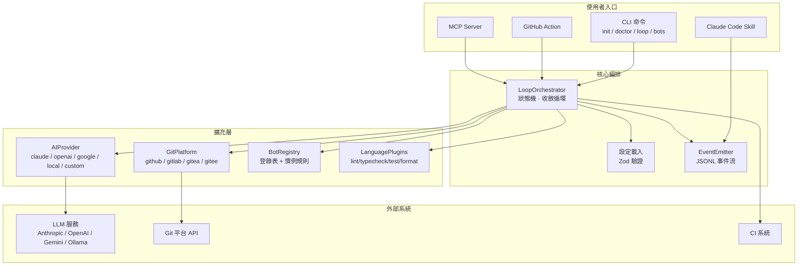
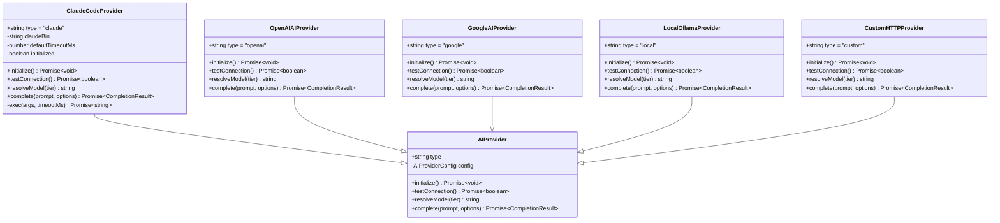
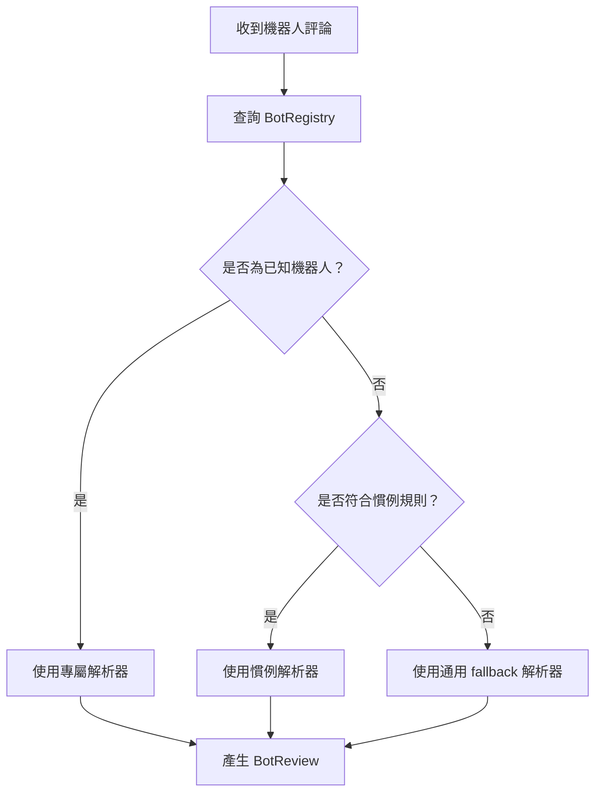
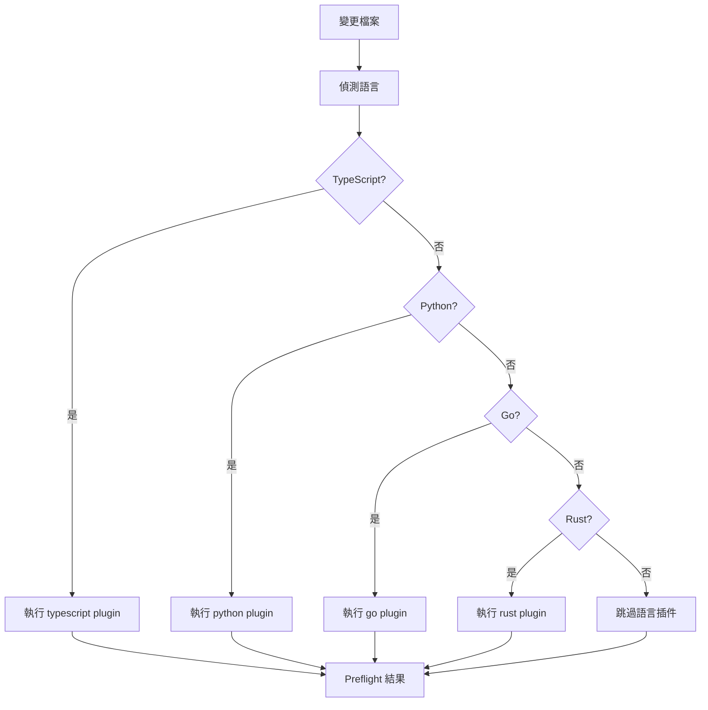
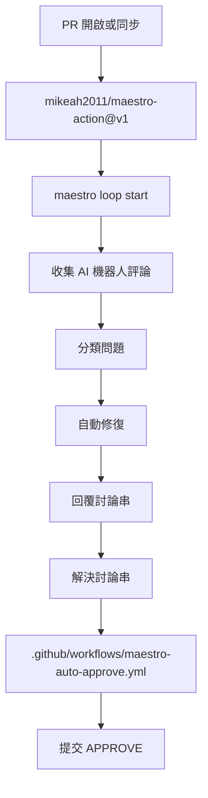
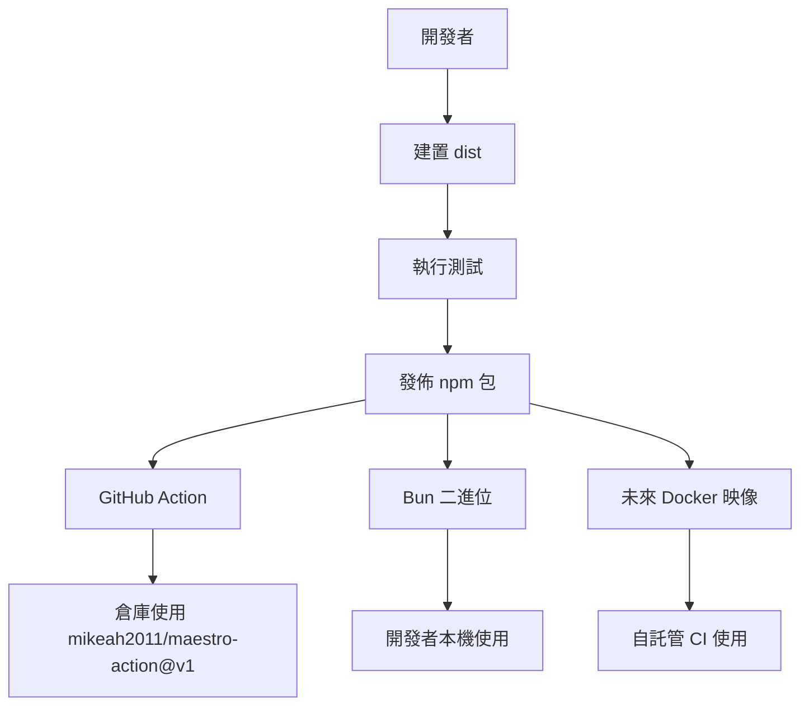
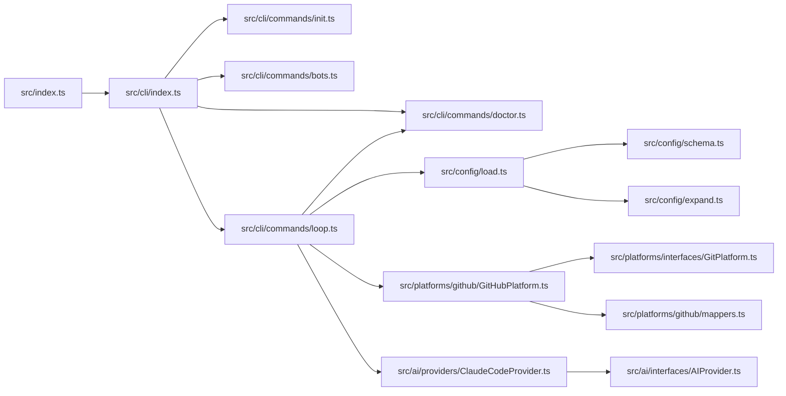
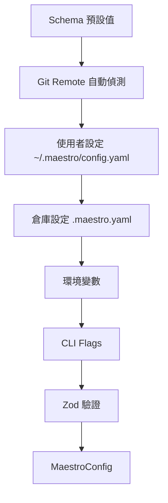

# 外部整合與擴充

<cite>
**本文引用的檔案**   
- [README.md](https://github.com/mikeah2011/maestro/blob/master/README.md)
- [package.json](https://github.com/mikeah2011/maestro/blob/master/package.json)
- [docs/DESIGN.md](https://github.com/mikeah2011/maestro/blob/master/docs/DESIGN.md)
- [.maestro.example.yaml](https://github.com/mikeah2011/maestro/blob/master/.maestro.example.yaml)
- [src/ai/interfaces/AIProvider.ts](https://github.com/mikeah2011/maestro/blob/master/src/ai/interfaces/AIProvider.ts)
- [src/ai/providers/ClaudeCodeProvider.ts](https://github.com/mikeah2011/maestro/blob/master/src/ai/providers/ClaudeCodeProvider.ts)
- [src/platforms/interfaces/GitPlatform.ts](https://github.com/mikeah2011/maestro/blob/master/src/platforms/interfaces/GitPlatform.ts)
- [src/platforms/github/GitHubPlatform.ts](https://github.com/mikeah2011/maestro/blob/master/src/platforms/github/GitHubPlatform.ts)
- [src/config/schema.ts](https://github.com/mikeah2011/maestro/blob/master/src/config/schema.ts)
- [src/config/load.ts](https://github.com/mikeah2011/maestro/blob/master/src/config/load.ts)
- [src/cli/commands/init.ts](https://github.com/mikeah2011/maestro/blob/master/src/cli/commands/init.ts)
- [src/cli/commands/bots.ts](https://github.com/mikeah2011/maestro/blob/master/src/cli/commands/bots.ts)
- [.github/workflows/maestro-auto-approve.yml](https://github.com/mikeah2011/maestro/blob/master/.github/workflows/maestro-auto-approve.yml)
</cite>

## 目錄

1. [引言](#引言)
2. [專案結構與擴充邊界](#專案結構與擴充邊界)
3. [AI Provider 擴充指南](#ai-provider-擴充指南)
4. [Git Platform 擴充指南](#git-platform-擴充指南)
5. [Bot Registry 與自訂機器人解析器](#bot-registry-與自訂機器人解析器)
6. [Language Plugins 定義](#language-plugins-定義)
7. [Claude Code Skill 與 JSONL 事件流管道](#claude-code-skill-與-jsonl-事件流管道)
8. [MCP Server 整合](#mcp-server-整合)
9. [GitHub Action 使用方式](#github-action-使用方式)
10. [GitLab CI Component 與 .gitlab-ci.yml 範本](#gitlab-ci-component-與-gitlab-ciyml-範本)
11. [實際整合範例與部署指引](#實際整合範例與部署指引)
12. [依賴關係分析](#依賴關係分析)
13. [效能與穩定性考量](#效能與穩定性考量)
14. [故障排除](#故障排除)
15. [結論](#結論)

## 引言

Maestro 的核心價值不是另一個 AI 審查工具，而是「收斂層」：它調度多個 AI 機器人的 PR 審查結果，分類問題、自動修復、在討論串中回覆、解決討論串，並在硬性上限內停止。對外整合與擴充點集中在五個介面層：

| 擴充層 | 目的 | 關鍵抽象 |
|---|---|---|
| AI Provider | 將不同 LLM 服務抽象為同一個 `prompt → completion` 管道 | `AIProvider` |
| Git Platform | 對 GitHub / GitLab / Gitea / Gitee 提供統一的 PR、評論、討論串與 CI 存取能力 | `GitPlatform` |
| Bot Registry | 識別並解析各審查機器人的評論格式 | 配置式登錄表 + 慣例規則 |
| Language Plugins | 以 shell 指令串接 lint / typecheck / test / format | `plugins.languages` |
| Event Stream | 讓 Claude Code skill、MCP Server、CI 或 CLI 前端共用執行期狀態 | JSONL 事件流 |

設計文件明確指出：Claude Code skill、Cursor rules、Gemini CLI hooks、Copilot CLI 整合都是「文件片段和約 30 行 shell 包裝」，核心長時運行邏輯仍在 CLI；單一 MCP Server 暴露 `start_loop`、`get_status`、`stop_loop`、`get_round_summary`，供支援 MCP 的代理免費整合。

**章節來源**
- [docs/DESIGN.md:3-31](https://github.com/mikeah2011/maestro/blob/master/docs/DESIGN.md#L3-L31)
- [docs/DESIGN.md:57-63](https://github.com/mikeah2011/maestro/blob/master/docs/DESIGN.md#L57-L63)
- [docs/DESIGN.md:171-179](https://github.com/mikeah2011/maestro/blob/master/docs/DESIGN.md#L171-L179)
- [README.md:1-60](https://github.com/mikeah2011/maestro/blob/master/README.md#L1-L60)

## 專案結構與擴充邊界



**圖表來源**
- [docs/DESIGN.md:33-56](https://github.com/mikeah2011/maestro/blob/master/docs/DESIGN.md#L33-L56)
- [src/ai/interfaces/AIProvider.ts:1-30](https://github.com/mikeah2011/maestro/blob/master/src/ai/interfaces/AIProvider.ts#L1-L30)
- [src/platforms/interfaces/GitPlatform.ts:1-30](https://github.com/mikeah2011/maestro/blob/master/src/platforms/interfaces/GitPlatform.ts#L1-L30)
- [src/config/load.ts:1-20](https://github.com/mikeah2011/maestro/blob/master/src/config/load.ts#L1-L20)

專案採用「核心可程式化、工具無關」的設計：

- `AIProvider` 只負責 `complete(prompt, options)`，不處理「審查」邏輯。
- `GitPlatform` 暴露 orchestrator-grade 的 PR、評論、討論串、CI 操作。
- 設定透過 Zod schema 驗證，允許 `openai`、`google`、`local`、`custom` 等 provider 類型。
- Git platform 支援 `github`、`gitlab`、`gitea`、`gitee` 四種類型。
- Language plugins 是 shell 指令定義，不需要 TypeScript 實作。

**章節來源**
- [src/ai/interfaces/AIProvider.ts:1-30](https://github.com/mikeah2011/maestro/blob/master/src/ai/interfaces/AIProvider.ts#L1-L30)
- [src/platforms/interfaces/GitPlatform.ts:1-30](https://github.com/mikeah2011/maestro/blob/master/src/platforms/interfaces/GitPlatform.ts#L1-L30)
- [src/config/schema.ts:1-20](https://github.com/mikeah2011/maestro/blob/master/src/config/schema.ts#L1-L20)
- [package.json:1-30](https://github.com/mikeah2011/maestro/blob/master/package.json#L1-L30)

## AI Provider 擴充指南

### 現有抽象

`AIProvider` 是一個抽象類別，所有擴充必須實作以下行為：

| 方法或屬性 | 用途 | 擴充重點 |
|---|---|---|
| `type` | Provider 識別字串，例如 `openai`、`google`、`local`、`custom` | 必須與 `.maestro.yaml` 中的 `provider.type` 一致 |
| `initialize()` | 建立 HTTP 客戶端、驗證連線 | 應冪等，重複呼叫不應重新建立資源 |
| `testConnection()` | 輕量連線測試 | 用於 `doctor` 與初始化階段 |
| `resolveModel(tier)` | 把 `cheap` / `strong` / `flagship` 映射到具體模型 ID | 若未指定，應回退至預設模型 |
| `complete(prompt, options)` | 唯一被 orchestrator 呼叫的推論方法 | 需支援 `systemPrompt`、`responseFormat`、`maxTokens`、`temperature`、`timeout` |

Provider 不自行選擇模型；model 由 stage routing 決定。每階段可選擇便宜模型處理高流量低風險任務，強力模型處理判斷任務，旗艦模型處理最終輸出。



**圖表來源**
- [src/ai/interfaces/AIProvider.ts:31-114](https://github.com/mikeah2011/maestro/blob/master/src/ai/interfaces/AIProvider.ts#L31-L114)
- [src/ai/providers/ClaudeCodeProvider.ts:1-40](https://github.com/mikeah2011/maestro/blob/master/src/ai/providers/ClaudeCodeProvider.ts#L1-L40)

### 新增 OpenAI Provider

OpenAI Provider 需要：

1. 實作 `AIProvider`，並將 `type` 設為 `'openai'`。
2. 從 `config.apiKey` 與 `config.baseUrl` 取得憑證與 endpoint。
3. 實作 `resolveModel`，將 `cheap`、`strong`、`flagship` 對應到 `models` 映射或預設值。
4. 實作 `complete`，將 prompt 轉為 OpenAI chat completion 請求，並回傳 `CompletionResult`。
5. 在設定檔中宣告 provider：

```yaml
ai:
  providers:
    openai:
      type: openai
      apiKey: ${OPENAI_API_KEY}
      models:
        cheap:    gpt-4o-mini
        strong:   gpt-4o
        flagship: o1-preview
```

建議處理以下錯誤：

| 錯誤情境 | 建議行為 |
|---|---|
| `apiKey` 未設定 | `initialize()` 或 `testConnection()` 失敗 |
| 速率限制 | 讀取 `X-RateLimit-*` header 並指數退避 |
| token 耗盡 | 記錄 cost 追蹤事件，觸發 `costBudgetUSD` 停止條件 |
| 非 JSON 回應且要求 `json_object` | 返回 `finishReason: 'error'`，保留 `raw` 以供審計 |

### 新增 Gemini Provider

Gemini Provider 的 `type` 應為 `'google'`，因為 schema 中使用的是 `google` 而非 `gemini`。設定範例已在示例組態中出現：

```yaml
ai:
  providers:
    gemini:
      type: google
      apiKey: ${GOOGLE_API_KEY}
      models:
        cheap:    gemini-2.0-flash
        strong:   gemini-1.5-pro
```

實作重點：

- 支援 Gemini REST 或 SDK。
- 支援 `systemPrompt`（Gemini system instruction）。
- 支援 `responseFormat.json_schema` 時轉換為 Gemini response schema。
- 支援 `baseUrl`，便於使用受控區域 endpoint。

### 新增本地 Ollama Provider

Ollama Provider 的 `type` 應為 `'local'`。它通常使用 OpenAI 相容 endpoint，因此可重用 OpenAI client 的 HTTP 請求結構，只需調整 base URL 與 model naming。

```yaml
ai:
  providers:
    local:
      type: local
      baseUrl: ${OLLAMA_BASE_URL:-http://localhost:11434}
      models:
        cheap:  mistral
        strong: llama3.1:70b
```

注意：

- `baseUrl` 應指向 Ollama 的 OpenAI 相容 API endpoint。
- 本地模型可能不支援完整 JSON schema，需提供 fallback。
- `testConnection()` 可呼叫 `/api/tags` 或一個極小 prompt。
- 成本估算通常為零或不適用，但仍需回報 usage 欄位。

### 新增自訂 HTTP Provider

`type: 'custom'` 適合封裝任何非標準 HTTP API。常見用途包括：

- 企業內部 LLM gateway。
- 帶權限檢查與審計的中間層。
- 多後端負載平衡或路由。

建議 `AIProviderConfig` 額外欄位包含：

| 欄位 | 類型 | 說明 |
|---|---|---|
| `endpoint` | string | 必填的完成 API endpoint |
| `method` | string | HTTP method，預設 `POST` |
| `headers` | object | 固定標頭，例如 `Authorization`、`X-Request-Id` |
| `requestTemplate` | object | 自訂請求體模板 |
| `responseParser` | function | 將原始回應解析為 `CompletionResult` |
| `retries` | number | 重試次數 |
| `timeout` | number | 單次請求逾時毫秒數 |

### Claude Code Provider 的行為觀察

現有的 `ClaudeCodeProvider` 是理解「非 API 型 Provider」的重要參考：

- 它透過子程序啟動 `claude --print`。
- `systemPrompt` 會被前置到 user prompt。
- 當 `responseFormat` 為 `json_object` 或 `json_schema` 時，會嘗試從純文字中提取最外層 JSON。
- Token usage 一律回報為零，因為 CLI 不暴露用量資訊。
- `testConnection()` 執行 `claude --print ping`。
- 有明確的 `initialize()` 檢查，未初始化時 `complete()` 拋出錯誤。

這代表擴充新 Provider 時，不必每個都走 HTTP；也可以是 CLI wrapper、檔案讀取器或模擬實現。

**章節來源**
- [src/ai/interfaces/AIProvider.ts:31-114](https://github.com/mikeah2011/maestro/blob/master/src/ai/interfaces/AIProvider.ts#L31-L114)
- [src/ai/providers/ClaudeCodeProvider.ts:1-146](https://github.com/mikeah2011/maestro/blob/master/src/ai/providers/ClaudeCodeProvider.ts#L1-L146)
- [src/config/schema.ts:12-35](https://github.com/mikeah2011/maestro/blob/master/src/config/schema.ts#L12-L35)
- [.maestro.example.yaml:5-44](https://github.com/mikeah2011/maestro/blob/master/.maestro.example.yaml#L5-L44)

## Git Platform 擴充指南

### 現有抽象

`GitPlatform` 是所有 Git 平台的統一抽象。orchestrator 不關心底層是 GitHub REST、GraphQL、GitLab REST，還是 Gitea API。

```mermaid
classDiagram
    class GitPlatform {
        +string type
        +PlatformCapabilities capabilities
        -GitPlatformConfig config
        +initialize() Promise~void~
        +testConnection() Promise~boolean~
        +detectRepo() Promise~{owner, repo}~
        +getPullRequest(prNumber) Promise~PullRequest~
        +getPullRequestDiff(prNumber) Promise~PullRequestDiff~
        +updatePullRequestBody(prNumber, body) Promise~void~
        +requestReviewers(prNumber, reviewers) Promise~void~
        +createPRComment(prNumber, body) Promise~void~
        +listPRComments(prNumber) Promise~Array~
        +listReviews(prNumber, since) Promise~BotReview[]~
        +getReview(reviewId) Promise~BotReview~
        +listReviewThreads(prNumber) Promise~ReviewThread[]~
        +replyInThread(threadId, body) Promise~void~
        +resolveReviewThread(threadId) Promise~void~
        +getCIStatus(headSha) Promise~CIStatus~
        +getRateLimitInfo() Promise~RateLimitInfo~
        +reactToReviewComment(commentNodeId, reaction) Promise~void~
    }

    class GitHubPlatform {
        +capabilities PlatformCapabilities
        +initialize() Promise~void~
        +testConnection() Promise~boolean~
        +getPullRequest(...)
        +listReviewThreads(...)
        +replyInThread(...)
        +resolveReviewThread(...)
    }

    class GitLabPlatform {
        +capabilities PlatformCapabilities
        +initialize() Promise~void~
        +listReviews(...)
        +replyInThread(...)
        +resolveReviewThread(...)
    }

    class GiteaPlatform {
        +capabilities PlatformCapabilities
        +initialize() Promise~void~
        +listReviews(...)
        +resolveReviewThread(...)
    }

    class GiteePlatform {
        +capabilities PlatformCapabilities
        +initialize() Promise~void~
        +listReviews(...)
        +resolveReviewThread(...)
    }

    GitHubPlatform --|> GitPlatform
    GitLabPlatform --|> GitPlatform
    GiteaPlatform --|> GitPlatform
    GiteePlatform --|> GitPlatform
```

**圖表來源**
- [src/platforms/interfaces/GitPlatform.ts:1-130](https://github.com/mikeah2011/maestro/blob/master/src/platforms/interfaces/GitPlatform.ts#L1-L130)
- [src/platforms/github/GitHubPlatform.ts:1-60](https://github.com/mikeah2011/maestro/blob/master/src/platforms/github/GitHubPlatform.ts#L1-L60)

### 擴充 GitLab Platform

GitLab Platform 需要實作：

1. `type = 'gitlab'`。
2. `capabilities`，特別是 `threadResolve`、`inlineReplies`、`reviewThreads`、`graphql`。
3. `listReviews`：列出 MR 的 review comments。
4. `listReviewThreads` / `replyInThread`：GitLab Discussion API。
5. `resolveReviewThread`：若平台支援 discussion resolved 欄位則直接使用；否則寫入降級標記。
6. `getCIStatus`：GitLab CI pipeline status。
7. `getRateLimitInfo`：GitLab rate limit header。

GitLab 的 token 環境變數慣例是 `GITLAB_TOKEN`，loader 已支援從 remote URL 自動偵測平台類型。

### 擴充 Gitea / Gitee Platform

Gitea 與 Gitee 的能力較弱，特別是討論串解決功能。`GitPlatform` 設計已考慮降級模式：

- 若 `capabilities.threadResolve === false`，orchestrator 可使用 sentinel marker 標記已解決。
- `reactToReviewComment` 預設為 no-op，只有支援的平台才覆寫。
- `graphql` 能力旗標控制是否使用 GraphQL 進行批量操作。

### 實作步驟摘要

| 步驟 | 內容 |
|---|---|
| 1 | 新建 `src/platforms/<platform>/<Platform>.ts` |
| 2 | 繼承 `GitPlatform` |
| 3 | 設定 `type` 與 `capabilities` |
| 4 | 實作 `initialize()` 與 `testConnection()` |
| 5 | 實作 PR I/O：`getPullRequest`、`updatePullRequestBody`、`createPRComment` |
| 6 | 實作 Review 與 Thread：`listReviews`、`listReviewThreads`、`replyInThread`、`resolveReviewThread` |
| 7 | 實作 CI：`getCIStatus` |
| 8 | 實作 Rate Limit：`getRateLimitInfo` |
| 9 | 在 loader 或 factory 中註冊該 platform type |
| 10 | 新增對應的 zod schema 驗證與測試 |

**章節來源**
- [src/platforms/interfaces/GitPlatform.ts:1-130](https://github.com/mikeah2011/maestro/blob/master/src/platforms/interfaces/GitPlatform.ts#L1-L130)
- [src/platforms/github/GitHubPlatform.ts:1-60](https://github.com/mikeah2011/maestro/blob/master/src/platforms/github/GitHubPlatform.ts#L1-L60)
- [src/config/load.ts:90-150](https://github.com/mikeah2011/maestro/blob/master/src/config/load.ts#L90-L150)
- [docs/DESIGN.md:127-143](https://github.com/mikeah2011/maestro/blob/master/docs/DESIGN.md#L127-L143)

## Bot Registry 與自訂機器人解析器

### 現有機制

Bot Registry 有三層機制：

1. **隨附精選登錄表**：已知機器人擁有專屬解析器。
2. **慣例型 fallback**：根據 login、app slug、comment body 關鍵字匹配。
3. **使用者自訂登錄**：透過 `.maestro.yaml` 的 `bots.registry` 與 `bots.detectByConvention.rules` 設定。

目前 CLI 的 `bots list`、`bots register`、`bots inspect` 仍標示為 M4 placeholder，但設定結構與 workflow scaffold 已存在。



**圖表來源**
- [src/cli/commands/bots.ts:1-40](https://github.com/mikeah2011/maestro/blob/master/src/cli/commands/bots.ts#L1-L40)
- [src/config/schema.ts:68-104](https://github.com/mikeah2011/maestro/blob/master/src/config/schema.ts#L68-L104)
- [docs/DESIGN.md:43-56](https://github.com/mikeah2011/maestro/blob/master/docs/DESIGN.md#L43-L56)

### 新增自訂 Bot Registry 條目

在 `.maestro.yaml` 中加入：

```yaml
bots:
  registry:
    - login: my-review-bot[bot]
      treatAs: blocking
      severityMap:
        critical: P0
        high: P1
        medium: P2
        low: P3
```

若需要慣例規則，可加入：

```yaml
bots:
  detectByConvention:
    enabled: true
    rules:
      - loginContains: ['my-review']
      - appSlugContains: ['review', 'audit']
      - commentBodyContains: ['MyCustomBot found an issue']
```

### 實作自訂解析器

自訂解析器應能將平台原生的評論物件轉換成 orchestrator 能理解的 `BotReview` 結構。關鍵欄位通常包含：

| 欄位 | 意義 |
|---|---|
| `login` | 機器人帳號 |
| `isBot` | 是否為 bot |
| `body` | 評論內容 |
| `submittedAt` | 提交時間 |
| `threads` | 若平台支援 thread 結構，應展開 |
| `severity` | 嚴重程度，可由 `severityMap` 映射 |
| `treatAs` | `blocking` 或 `advisory` |

**章節來源**
- [src/cli/commands/bots.ts:1-40](https://github.com/mikeah2011/maestro/blob/master/src/cli/commands/bots.ts#L1-L40)
- [src/config/schema.ts:68-104](https://github.com/mikeah2011/maestro/blob/master/src/config/schema.ts#L68-L104)
- [.maestro.example.yaml:63-104](https://github.com/mikeah2011/maestro/blob/master/.maestro.example.yaml#L63-L104)
- [docs/DESIGN.md:43-56](https://github.com/mikeah2011/maestro/blob/master/docs/DESIGN.md#L43-L56)

## Language Plugins 定義

Language Plugins 是以 shell 指令為單位的即插即用擴充點。schema 定義如下：

| 指令 | 用途 | 常見實作 |
|---|---|---|
| `lint` | 靜態檢查與自動修復 | ESLint、Ruff、golangci-lint、Clippy |
| `typecheck` | 型別檢查 | TypeScript、Mypy、Go vet、Cargo check |
| `test` | 單元測試或集成測試 | Vitest、pytest、go test、cargo test |
| `format` | 程式碼格式化 | Prettier、Ruff format、gofmt、cargo fmt |

範例已在 `.maestro.example.yaml` 中提供 TypeScript、Python、Go、Rust 四種語言。



**圖表來源**
- [src/config/schema.ts:130-147](https://github.com/mikeah2011/maestro/blob/master/src/config/schema.ts#L130-L147)
- [.maestro.example.yaml:140-174](https://github.com/mikeah2011/maestro/blob/master/.maestro.example.yaml#L140-L174)
- [docs/DESIGN.md:53-56](https://github.com/mikeah2011/maestro/blob/master/docs/DESIGN.md#L53-L56)

### 新增語言 Plugin

新增語言時，只需在 `.maestro.yaml` 的 `plugins.languages.<lang>` 區塊中加入四個 shell 指令。不需新增 TypeScript 類別。

注意事項：

- `$FILE_PATH` 會在 preflight 階段代入。
- 指令應遵循 Unix exit code：0 表示成功，非 0 表示失敗。
- 若 `preflight.blockOnSeverity` 設為 `critical`，則 critical 以上會阻止推送。
- 可組合已有工具，例如先 format 再 lint。

**章節來源**
- [src/config/schema.ts:130-147](https://github.com/mikeah2011/maestro/blob/master/src/config/schema.ts#L130-L147)
- [.maestro.example.yaml:140-174](https://github.com/mikeah2011/maestro/blob/master/.maestro.example.yaml#L140-L174)

## Claude Code Skill 與 JSONL 事件流管道

### 設計意圖

設計文件中明確說明：Claude Code skill 約 30 行，呼叫 CLI 並將 JSONL 事件流管道到 TodoWrite。其核心概念是：

- CLI 是程序。
- Skill 是視窗。
- 長時運行編排邏輯在 CLI。
- UI 工具只監控 JSONL 事件並分發控制指令。

```mermaid
sequenceDiagram
    participant User as "開發者"
    participant Skill as "Claude Code Skill"
    participant CLI as "Maestro CLI"
    participant Loop as "LoopOrchestrator"
    participant Events as "EventEmitter"
    participant Todo as "TodoWrite"

    User->>Skill: 啟動 maestro loop
    Skill->>CLI: 執行 loop start
    CLI->>Loop: 開始收斂循環
    Loop->>Events: 發出 JSONL 狀態事件
    Events-->>Skill: 監聽 .maestro/events.jsonl
    Skill->>Todo: 將事件轉為 TodoWrite 項目
    Skill->>CLI: 傳送 stop / resume / status
    CLI->>Loop: 更新狀態
    Loop->>Events: 發出終止事件
    Events-->>Todo: 關閉待辦事項
```

**圖表來源**
- [docs/DESIGN.md:57-63](https://github.com/mikeah2011/maestro/blob/master/docs/DESIGN.md#L57-L63)
- [docs/DESIGN.md:171-179](https://github.com/mikeah2011/maestro/blob/master/docs/DESIGN.md#L171-L179)
- [src/config/schema.ts:186-194](https://github.com/mikeah2011/maestro/blob/master/src/config/schema.ts#L186-L194)

### JSONL 事件流設定

事件流的預設路徑為 `.maestro/events.jsonl`，格式由 logging schema 控制：

| 欄位 | 預設值 | 說明 |
|---|---|---|
| `logging.level` | `info` | debug / info / warn / error |
| `logging.format` | `jsonl` | text 或 jsonl |
| `logging.eventStream` | `.maestro/events.jsonl` | 事件流檔案路徑 |
| `audit.enabled` | `true` | 是否啟用審計 |
| `audit.dir` | `.maestro/audit` | 審計目錄 |
| `audit.shadowLogClassifications` | `true` | 隱式記錄分類決策 |

### 如何串接 TodoWrite

雖然目前代碼庫沒有直接出現 `TodoWrite` 的 TypeScript 實作，但設計文件清楚描述其角色：Claude Code skill 將 CLI 產生的 JSONL 事件轉為 TodoWrite 項目。實務上可這樣設計：

1. 啟動 `maestro loop start --pr <N>`。
2. 使用 `tail -f .maestro/events.jsonl` 或 Node.js `fs.createReadStream` 持續讀取。
3. 將每個 event 轉換為 TodoWrite 的 create / update / complete 動作。
4. 狀態事件如 `WaitingForBot`、`Classifying`、`Fixing`、`Stopped` 對應不同待辦狀態。
5. 用戶可在 Claude Code UI 中點擊按鈕，skill 再呼叫 CLI 的 `loop stop`、`loop resume`、`loop status`。

這種設計讓 Claude Code UI 成為「可視化的 Maestro 控制台」，而不是替換核心邏輯。

**章節來源**
- [docs/DESIGN.md:57-63](https://github.com/mikeah2011/maestro/blob/master/docs/DESIGN.md#L57-L63)
- [docs/DESIGN.md:171-179](https://github.com/mikeah2011/maestro/blob/master/docs/DESIGN.md#L171-L179)
- [src/config/schema.ts:186-194](https://github.com/mikeah2011/maestro/blob/master/src/config/schema.ts#L186-L194)

## MCP Server 整合

### 暴露的 API

MCP Server 將暴露四個主要方法：

| 方法 | 輸入 | 輸出 | 用途 |
|---|---|---|---|
| `start_loop` | `{ prNumber, dryRun?, extraFlags? }` | `{ loopId, statusUrl }` | 啟動收斂循環 |
| `get_status` | `{ loopId }` | `{ state, round, findings, cost, nextAction }` | 查詢當前狀態 |
| `stop_loop` | `{ loopId }` | `{ stopped, finalSummary }` | 手動停止循環 |
| `get_round_summary` | `{ loopId }` | `{ rounds, changes, unresolvedThreads }` | 取得回合摘要 |

```mermaid
sequenceDiagram
    participant Agent as "MCP Client<br/>Claude Desktop / Cursor / Gemini Desktop"
    participant MCP as "MCP Server"
    participant CLI as "Maestro CLI"
    participant Loop as "LoopOrchestrator"
    participant Store as "LoopStateStore"

    Agent->>MCP: call start_loop(prNumber)
    MCP->>CLI: spawn maestro loop start --pr N
    CLI->>Loop: initialize orchestrator
    Loop->>Store: record loopId + state
    Store-->>MCP: { loopId, status }
    MCP-->>Agent: { loopId, status: "initializing" }

    Agent->>MCP: call get_status(loopId)
    MCP->>Store: read loop state
    Store-->>MCP: { state, round, cost }
    MCP-->>Agent: current status

    Agent->>MCP: call stop_loop(loopId)
    MCP->>CLI: send stop signal
    CLI->>Loop: terminate gracefully
    Loop-->>MCP: final summary
    MCP-->>Agent: { stopped: true, summary }
```

**圖表來源**
- [docs/DESIGN.md:63-63](https://github.com/mikeah2011/maestro/blob/master/docs/DESIGN.md#L63-L63)
- [docs/DESIGN.md:171-179](https://github.com/mikeah2011/maestro/blob/master/docs/DESIGN.md#L171-L179)

### 實作建議

MCP Server 不宜直接持有 long-running orchestrator instance；更穩健的架構是：

- `start_loop` 啟動 CLI process 或 background worker。
- 將 `loopId` 與 process PID、狀態檔案、事件流關聯起來。
- `get_status` 讀取狀態檔案或事件流最新紀錄。
- `stop_loop` 發送訊號或呼叫 CLI 的 `loop stop`。
- `get_round_summary` 從 audit log 或事件流重建回合摘要。

這樣做的好處是：

- 單一 MCP Server 可管理多個 loop。
- CLI 崩潰不會拖垮整個 server。
- 事件流仍可被 Claude Code skill 或其他消費者同時讀取。
- 符合「CLI 是程序，Skill/MCP 是視窗」的設計原則。

**章節來源**
- [docs/DESIGN.md:57-63](https://github.com/mikeah2011/maestro/blob/master/docs/DESIGN.md#L57-L63)
- [docs/DESIGN.md:171-179](https://github.com/mikeah2011/maestro/blob/master/docs/DESIGN.md#L171-L179)

## GitHub Action 使用方式

### mikeah2011/maestro-action@v1

設計文件的發布計畫明確列出：

> GitHub Action `mikeah2011/maestro-action@v1` — 單行 `run: maestro loop start --pr ${{ github.event.number }}`

這表示 Action 的主要職責是：

1. 安裝 Maestro CLI。
2. 注入 `GITHUB_TOKEN`。
3. 執行 `maestro loop start --pr <PR_NUMBER>`。
4. 等待 loop 結束或回傳退出碼。
5. 可選：上傳 audit log 或 events.jsonl。

### 基本使用範例

```yaml
name: Maestro PR Loop
on:
  pull_request:
    types: [opened, synchronize, reopened]

permissions:
  contents: write
  pull-requests: write
  checks: write

jobs:
  maestro-loop:
    runs-on: ubuntu-latest
    steps:
      - uses: actions/checkout@v4
      - uses: mikeah2011/maestro-action@v1
        with:
          pr-number: ${{ github.event.number }}
          env: |
            GITHUB_TOKEN=${{ secrets.GITHUB_TOKEN }}
            ANTHROPIC_API_KEY=${{ secrets.ANTHROPIC_API_KEY }}
```

### 與自動核准工作流搭配

`.github/workflows/maestro-auto-approve.yml` 是由 `maestro bots setup` 生成的工作流，會在所有 watched bots 滿足且討論串全數解決後，自動提交 APPROVE。



**圖表來源**
- [docs/DESIGN.md:171-179](https://github.com/mikeah2011/maestro/blob/master/docs/DESIGN.md#L171-L179)
- [.github/workflows/maestro-auto-approve.yml:1-93](https://github.com/mikeah2011/maestro/blob/master/.github/workflows/maestro-auto-approve.yml#L1-L93)
- [src/cli/commands/bots.ts:41-200](https://github.com/mikeah2011/maestro/blob/master/src/cli/commands/bots.ts#L41-L200)

### 自動核准流程邏輯

auto-approve 工作流的邏輯分為三階段：

1. **機器人滿足檢查**：
   - Copilot 類機器人：只要評論中包含特定訊息即可視為 satisfied。
   - Codex 類機器人：只要有 review 即可。
   - CodeRabbit / Ellipsis 等：需要 APPROVED 狀態。
2. **討論串檢查**：透過 GraphQL 確認所有 review threads 已 resolve。
3. **自動核准**：若尚未由 `github-actions[bot]` 核准，則提交 APPROVE。

**章節來源**
- [docs/DESIGN.md:171-179](https://github.com/mikeah2011/maestro/blob/master/docs/DESIGN.md#L171-L179)
- [.github/workflows/maestro-auto-approve.yml:1-93](https://github.com/mikeah2011/maestro/blob/master/.github/workflows/maestro-auto-approve.yml#L1-L93)
- [src/cli/commands/bots.ts:41-200](https://github.com/mikeah2011/maestro/blob/master/src/cli/commands/bots.ts#L41-L200)

## GitLab CI Component 與 .gitlab-ci.yml 範本

### 設計定位

設計文件將 GitLab CI Component 列為 MVP 的一部分，理由是「我們支援四個平台，所以這是一流功能」。這意味著 GitLab 不只是 GitHub Action 的複製貼上，而是需要提供：

1. GitLab CI Component，方便組織重複使用。
2. `.gitlab-ci.yml` 範本，展示如何在 GitLab 中驅動 maestro loop。
3. 支援 `GITLAB_TOKEN`。
4. 支援 GitLab Merge Request 事件。
5. 可選：GitLab CI job artifact 上傳 events.jsonl 與 audit log。

### 建議的 .gitlab-ci.yml 結構

```yaml
stages:
  - preflight
  - maestro-loop

variables:
  MAESTRO_PR_MERGE_REQUEST_ID: "$CI_MERGE_REQUEST_IID"
  GITLAB_TOKEN: "$CI_JOB_TOKEN"

preflight:
  stage: preflight
  image: node:20
  script:
    - npm ci
    - npx @mikeah2011/maestro@latest doctor
    - npx @mikeah2011/maestro@latest loop start --pr "$MAESTRO_PR_MERGE_REQUEST_ID" --dry-run

maestro-loop:
  stage: maestro-loop
  image: node:20
  needs:
    - preflight
  script:
    - npm ci
    - npx @mikeah2011/maestro@latest loop start --pr "$MAESTRO_PR_MERGE_REQUEST_ID"
  artifacts:
    paths:
      - .maestro/audit/
      - .maestro/events.jsonl
    when: always
```

### GitLab CI Component 建議位置

可將 component 放在組織共享 repo，例如 `devops/maestro-components`，然後在其他 project 中以以下方式引用：

```yaml
include:
  - component: devops/maestro-components/maestro-loop.yml
    ref: v1.0.0
    inputs:
      pr_id: "$CI_MERGE_REQUEST_IID"
```

這類 component 應提供：

| Input | 說明 |
|---|---|
| `pr_id` | Merge Request IID |
| `env` | 必要環境變數，如 `GITLAB_TOKEN`、`ANTHROPIC_API_KEY` |
| `dry_run` | 是否先執行 dry-run |
| `artifacts_enabled` | 是否上傳 audit 與 events |
| `retry_count` | 失敗重試次數 |

**章節來源**
- [docs/DESIGN.md:171-179](https://github.com/mikeah2011/maestro/blob/master/docs/DESIGN.md#L171-L179)
- [src/config/load.ts:90-150](https://github.com/mikeah2011/maestro/blob/master/src/config/load.ts#L90-L150)
- [package.json:3-20](https://github.com/mikeah2011/maestro/blob/master/package.json#L3-L20)

## 實際整合範例與部署指引

### 情境一：新增 OpenAI 作為 classification 的 cheap provider

1. 實作 `OpenAIAIProvider`，type 設為 `openai`。
2. 在 `.maestro.yaml` 中加入 provider。
3. 將 `classifyUnknown` 路由到 openai 的 cheap tier。
4. 在 CI 中設定 `OPENAI_API_KEY`。
5. 執行 `maestro doctor` 驗證。

### 情境二：使用本地 Ollama 做語義去重

1. 啟動 Ollama 並拉取模型。
2. 設定 `ai.providers.local.baseUrl` 與 `models`。
3. 將 `semanticDedup` 路由到 `local` 的 cheap tier。
4. 確認本地模型能接受 JSON output。
5. 觀察 cost 追蹤事件；本地模型成本通常為零。

### 情境三：新增 GitLab Platform

1. 實作 `GitLabPlatform`，支援 MR、Discussion、Pipeline status。
2. 設定 `platform.type: gitlab` 與 `GITLAB_TOKEN`。
3. 若平台版本不支援 discussion resolve，使用降級模式。
4. 測試 `listReviews`、`replyInThread`、`resolveReviewThread`。
5. 加入對應測試與 integration test。

### 情境四：新增自訂 HTTP Provider

1. 實作 `CustomHTTPProvider`，type 設為 `custom`。
2. 在 provider config 中加入企業 gateway 的 endpoint、header、template。
3. 處理 auth refresh、rate limit、error mapping。
4. 在 `testConnection()` 中驗證 endpoint 可達。
5. 在 CI 中將 API key 存入 vault，部署時注入。

### 部署流程



**圖表來源**
- [docs/DESIGN.md:145-170](https://github.com/mikeah2011/maestro/blob/master/docs/DESIGN.md#L145-L170)
- [package.json:21-47](https://github.com/mikeah2011/maestro/blob/master/package.json#L21-L47)

**章節來源**
- [docs/DESIGN.md:145-170](https://github.com/mikeah2011/maestro/blob/master/docs/DESIGN.md#L145-L170)
- [package.json:21-47](https://github.com/mikeah2011/maestro/blob/master/package.json#L21-L47)
- [src/cli/commands/init.ts:1-87](https://github.com/mikeah2011/maestro/blob/master/src/cli/commands/init.ts#L1-L87)

## 依賴關係分析

### 模組依賴圖



**圖表來源**
- [src/cli/commands/init.ts:1-87](https://github.com/mikeah2011/maestro/blob/master/src/cli/commands/init.ts#L1-L87)
- [src/cli/commands/bots.ts:1-40](https://github.com/mikeah2011/maestro/blob/master/src/cli/commands/bots.ts#L1-L40)
- [src/config/load.ts:1-20](https://github.com/mikeah2011/maestro/blob/master/src/config/load.ts#L1-L20)
- [src/platforms/github/GitHubPlatform.ts:1-60](https://github.com/mikeah2011/maestro/blob/master/src/platforms/github/GitHubPlatform.ts#L1-L60)
- [src/ai/providers/ClaudeCodeProvider.ts:1-40](https://github.com/mikeah2011/maestro/blob/master/src/ai/providers/ClaudeCodeProvider.ts#L1-L40)

### 設定層級依賴

設定載入順序由低到高：

1. Git remote auto-detect。
2. 使用者 `~/.maestro/config.yaml`。
3. 倉庫 `.maestro.yaml`。
4. 環境變數覆蓋。
5. CLI overrides。



**圖表來源**
- [src/config/load.ts:1-20](https://github.com/mikeah2011/maestro/blob/master/src/config/load.ts#L1-L20)
- [src/config/load.ts:150-200](https://github.com/mikeah2011/maestro/blob/master/src/config/load.ts#L150-L200)
- [src/config/schema.ts:1-20](https://github.com/mikeah2011/maestro/blob/master/src/config/schema.ts#L1-L20)

**章節來源**
- [src/config/load.ts:1-200](https://github.com/mikeah2011/maestro/blob/master/src/config/load.ts#L1-L200)
- [src/config/schema.ts:1-200](https://github.com/mikeah2011/maestro/blob/master/src/config/schema.ts#L1-L200)

## 效能與穩定性考量

### Provider 層

- 為高頻低風險 stage 選擇 `cheap` model，降低延遲與成本。
- 為最終輸出選擇 `flagship` model，提升品質。
- 本地 Ollama Provider 可能延遲較高，應設定合理 `timeout`。
- 自訂 HTTP Provider 應實作重試與 backoff，避免短時間內大量失敗。

### Platform 層

- GitHub Platform 使用 REST 與 GraphQL 分工：REST 處理 PR I/O 與 CI，GraphQL 處理 thread。
- 不支援 thread resolve 的平台使用降級模式，避免阻塞。
- 所有 platform 實作都應正確處理 rate limit。

### 事件流層

- JSONL 事件流適合 tail、log aggregator、MCP Server、Claude Code skill 同時消費。
- 建議使用 append-only 寫法，避免 concurrent writer 衝突。
- 若事件量很大，可輪轉事件檔案。

### 收斂層

- RoundBudget 是執行期斷言，違反即 crash，不允許靜默漂移。
- ConvergenceMonitor 使用 Jaccard 相似度 > 0.7 偵測振盪。
- maxRounds 最大為 5，即使使用者設定更高也會被限制。

**章節來源**
- [src/ai/interfaces/AIProvider.ts:31-114](https://github.com/mikeah2011/maestro/blob/master/src/ai/interfaces/AIProvider.ts#L31-L114)
- [src/platforms/interfaces/GitPlatform.ts:1-130](https://github.com/mikeah2011/maestro/blob/master/src/platforms/interfaces/GitPlatform.ts#L1-L130)
- [src/config/schema.ts:105-129](https://github.com/mikeah2011/maestro/blob/master/src/config/schema.ts#L105-L129)
- [docs/DESIGN.md:57-110](https://github.com/mikeah2011/maestro/blob/master/docs/DESIGN.md#L57-L110)

## 故障排除

### Claude Code Provider 無法執行

常見原因：

- `claude` binary 不在 PATH。
- Claude Code 未登入或 session 失效。
- `claude --print` 回應非預期格式。
- 超時太短，本地模型尚未完成。

解法：

- 執行 `claude --version` 確認可用。
- 手動執行 `claude --print ping`。
- 增加 `timeout`。
- 若只需要 JSON，確保 prompt 引導模型輸出可解析的 JSON。

### Git Platform 連線失敗

常見原因：

- token 未設定或權限不足。
- `baseUrl` 指向錯誤 endpoint。
- self-hosted GitHub Enterprise 的 GraphQL path 不同。
- GitLab / Gitea / Gitee token 名稱不符。

解法：

- 檢查 `tokenEnv` 或 `token`。
- 執行 `maestro doctor`。
- 確認 platform type 與 remote URL 一致。
- 對於 enterprise，確認 `baseUrl` 包含正確的 API root。

### Provider 路由錯誤

常見原因：

- provider type 與 schema 不一致。
- routing 中指定的 provider 不存在。
- tier 未對應到任何 model。
- OpenAI / Gemini / Ollama 的 model name 錯誤。

解法：

- 檢查 `ai.providers` 與 `ai.routing`。
- 確認 provider type 為 `claude`、`openai`、`google`、`local`、`custom`。
- 確認每個 tier 都有對應 model。

### JSONL 事件流無輸出

常見原因：

- `logging.format` 不是 `jsonl`。
- `logging.eventStream` 路徑不可寫。
- loop 尚未啟動或已結束。
- Claude Code skill 或 MCP Server 未正確監聽檔案。

解法：

- 檢查 `.maestro/events.jsonl`。
- 檢查 `logging.level` 與 `audit.enabled`。
- 使用 `tail -f .maestro/events.jsonl` 即時觀察。

**章節來源**
- [src/ai/providers/ClaudeCodeProvider.ts:41-146](https://github.com/mikeah2011/maestro/blob/master/src/ai/providers/ClaudeCodeProvider.ts#L41-L146)
- [src/platforms/github/GitHubPlatform.ts:61-120](https://github.com/mikeah2011/maestro/blob/master/src/platforms/github/GitHubPlatform.ts#L61-L120)
- [src/config/schema.ts:186-194](https://github.com/mikeah2011/maestro/blob/master/src/config/schema.ts#L186-L194)
- [src/config/load.ts:150-200](https://github.com/mikeah2011/maestro/blob/master/src/config/load.ts#L150-L200)

## 結論

Maestro 的外部整合與擴充點圍繞五個清晰邊界：

1. **AI Provider**：透過 `AIProvider` 抽象，可新增 OpenAI、Gemini、本地 Ollama 與自訂 HTTP provider。重點是 `initialize`、`testConnection`、`resolveModel`、`complete`。
2. **Git Platform**：透過 `GitPlatform` 抽象，可新增 GitLab、Gitea、Gitee。重點是 PR、review、thread、CI、rate limit 的統一接口。
3. **Bot Registry**：透過 YAML 登錄表與慣例規則，可快速註冊新機器人；專屬解析器可進一步精確處理評論結構。
4. **Language Plugins**：pure shell 指令，無需 TypeScript；新增語言只需修改 `.maestro.yaml`。
5. **Event Stream**：JSONL 是 Claude Code skill、MCP Server、CI 與未來 UI 的共同協定。

設計文件清楚區分「CLI 是程序」與「Skill/MCP 是視窗」，這使擴展方向保持集中：核心邏輯維持穩定，周邊整合以最小適配器形式存在。對於團隊而言，優先建議是：

- 先完成所需 AI provider 與 Git platform 實作。
- 用 `.maestro.yaml` 定義 bots 與 language plugins。
- 透過 Claude Code skill 或 MCP Server 連接 UI。
- 使用 GitHub Action 或 GitLab CI Component 進入 CI。
- 最後才考慮自訂 MCP tool 或自動化 approval 邏輯。