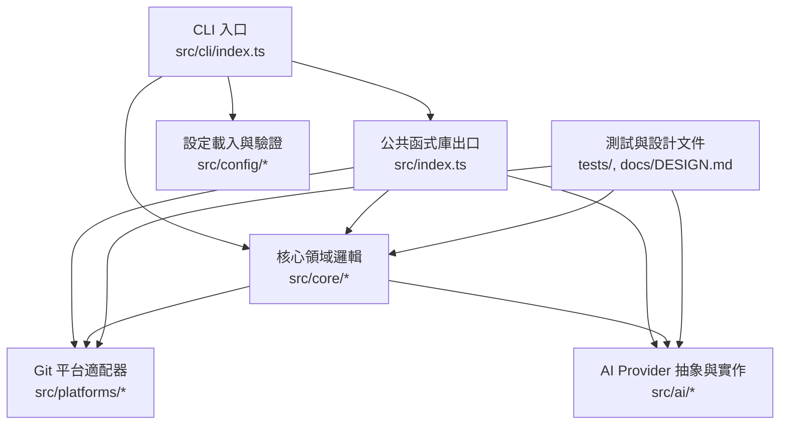
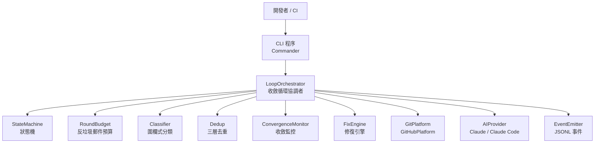
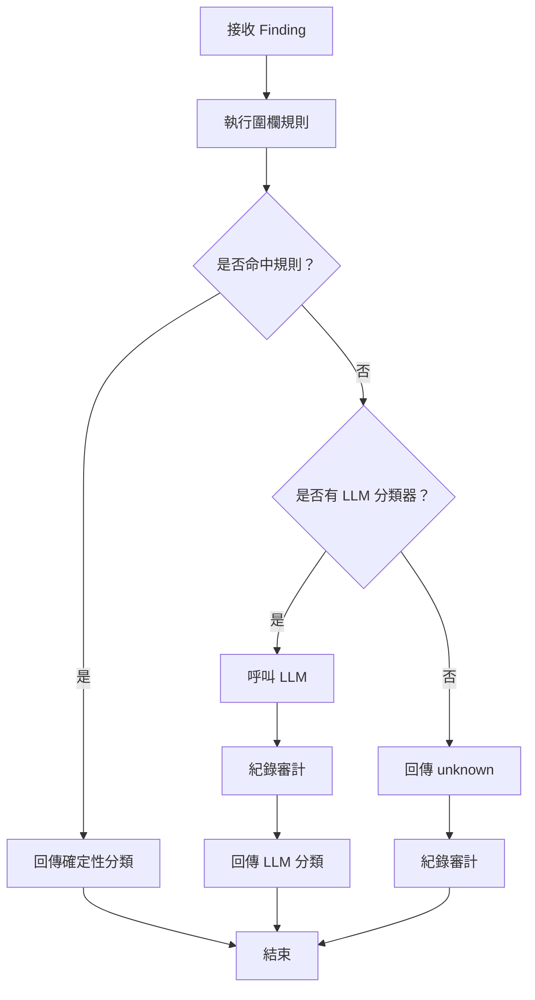
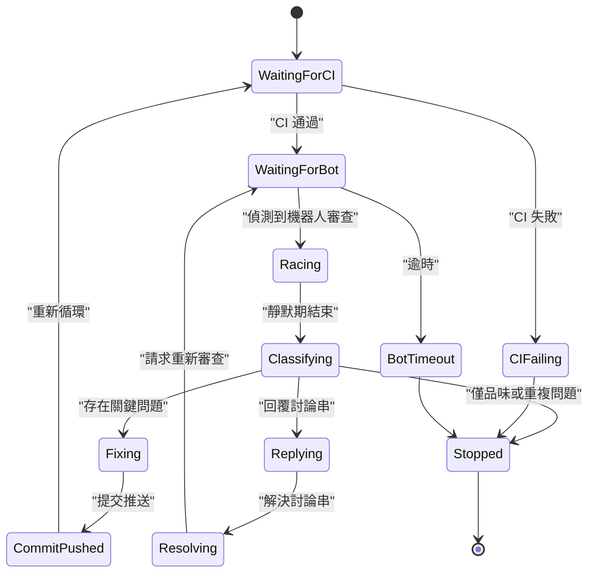
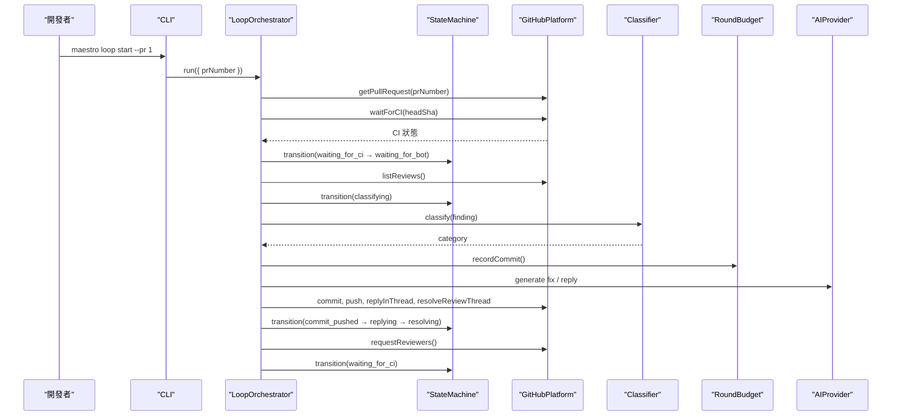
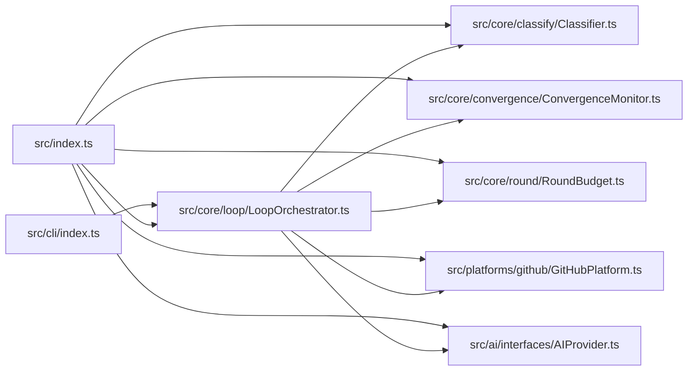

# 專案概覽

**本文引用的檔案**

- [README.md](https://github.com/mikeah2011/maestro/blob/master/README.md)
- [package.json](https://github.com/mikeah2011/maestro/blob/master/package.json)
- [docs/DESIGN.md](https://github.com/mikeah2011/maestro/blob/master/docs/DESIGN.md)
- [.maestro.example.yaml](https://github.com/mikeah2011/maestro/blob/master/.maestro.example.yaml)
- [src/index.ts](https://github.com/mikeah2011/maestro/blob/master/src/index.ts)
- [src/cli/index.ts](https://github.com/mikeah2011/maestro/blob/master/src/cli/index.ts)
- [src/core/loop/LoopOrchestrator.ts](https://github.com/mikeah2011/maestro/blob/master/src/core/loop/LoopOrchestrator.ts)
- [src/core/classify/Classifier.ts](https://github.com/mikeah2011/maestro/blob/master/src/core/classify/Classifier.ts)
- [src/core/convergence/ConvergenceMonitor.ts](https://github.com/mikeah2011/maestro/blob/master/src/core/convergence/ConvergenceMonitor.ts)
- [src/core/round/RoundBudget.ts](https://github.com/mikeah2011/maestro/blob/master/src/core/round/RoundBudget.ts)
- [src/platforms/github/GitHubPlatform.ts](https://github.com/mikeah2011/maestro/blob/master/src/platforms/github/GitHubPlatform.ts)
- [src/ai/interfaces/AIProvider.ts](https://github.com/mikeah2011/maestro/blob/master/src/ai/interfaces/AIProvider.ts)

## 目錄

1. [引言](#引言)
2. [專案結構](#專案結構)
3. [核心定位與價值主張](#核心定位與價值主張)
4. [安裝與環境需求](#安裝與環境需求)
5. [快速開始](#快速開始)
6. [系統架構總覽](#系統架構總覽)
7. [關鍵組件分析](#關鍵組件分析)
8. [收斂循環流程](#收斂循環流程)
9. [依賴關係分析](#依賴關係分析)
10. [效能與成本特性](#效能與成本特性)
11. [常見問題與除錯](#常見問題與除錯)
12. [結論](#結論)

## 引言

Maestro 是一個「統一調度 AI PR 審查機器人」的工具。它的核心主張很明確：不要取代 CodeRabbit、Ellipsis、Copilot Code Review、Codex、Gemini Code Assist、Sourcery 等已經存在的審查工具，而是把這些機器人的輸出作為輸入，執行後續的收斂工作。

具體來說，Maestro 負責：

- **分類問題**：判斷機器人發現的是 bug、品味偏好、錯誤判斷，還是可以延後處理的需求。
- **修復 bug**：在可修復的情況下自動或半自動產生修復提交。
- **回覆討論串**：在 GitHub 討論串內回覆，而不是亂發頂層評論。
- **解決討論串**：當問題被修復後，標記對應討論串為已解決。
- **請求重新審查**：完成一輪修復與回覆後，觸發機器人再次審查。
- **硬性結束循環**：最多 3 輪；超過上限、收斂或品質異常時停止並升級給人工處理。

這個工具同時具有兩種身分：

| 身分 | 說明 |
|---|---|
| CLI Tool | 提供 `init`、`doctor`、`loop`、`audit`、`bots` 等指令，方便人類或 CI 直接呼叫。 |
| TypeScript 函式庫 | 透過 `src/index.ts` 暴露介面、類型與核心類別，供 CI 腳本、未來插件或 MCP 伺服器匯入使用。 |

技術選型是 ESM + TypeScript + Bun。套件宣告 `type: module`，CLI 二進位由 `dist/cli.js` 提供，而函式庫主入口是 `dist/index.js`，並附帶 `.d.ts` 類型定義。

**Section sources**
- [README.md:1-30](https://github.com/mikeah2011/maestro/blob/master/README.md#L1-L30)
- [README.md:80-120](https://github.com/mikeah2011/maestro/blob/master/README.md#L80-L120)
- [package.json:1-89](https://github.com/mikeah2011/maestro/blob/master/package.json#L1-L89)
- [src/index.ts:1-150](https://github.com/mikeah2011/maestro/blob/master/src/index.ts#L1-L150)

## 專案結構

專案採用「功能分層」組織方式，主要分為 CLI、設定、核心邏輯、平台適配器與 AI Provider 五個方向：

| 目錄 | 主要責任 |
|---|---|
| `src/cli` | 使用者指令入口、子命令註冊、`.env` 載入與錯誤退出碼。 |
| `src/config` | YAML 設定載入、環境變數展開、Zod schema 驗證。 |
| `src/core` | 分類、去重、收斂監控、狀態機、修復引擎、事件系統、安全掃描等領域邏輯。 |
| `src/platforms` | Git 平台抽象與 GitHub 實作，封裝 REST、GraphQL 與 git 操作。 |
| `src/ai` | AI Provider 抽象、Claude API 與 Claude Code CLI 實作。 |
| `tests` | 單元測試與整合測試。 |
| `docs/DESIGN.md` | 面向公眾的技術設計摘要。 |

**Diagram sources**
- [src/cli/index.ts:1-86](https://github.com/mikeah2011/maestro/blob/master/src/cli/index.ts#L1-L86)
- [src/index.ts:1-150](https://github.com/mikeah2011/maestro/blob/master/src/index.ts#L1-L150)
- [docs/DESIGN.md:1-200](https://github.com/mikeah2011/maestro/blob/master/docs/DESIGN.md#L1-L200)

**Section sources**
- [README.md:80-120](https://github.com/mikeah2011/maestro/blob/master/README.md#L80-L120)
- [docs/DESIGN.md:1-200](https://github.com/mikeah2011/maestro/blob/master/docs/DESIGN.md#L1-L200)

## 核心定位與價值主張

### 不是另一個審查工具

Maestro 不會用一個新的 LLM 完全取代既有機器人。它把 CodeRabbit、Ellipsis、Copilot Code Review、Codex、Gemini Code Assist、Sourcery 視為「輸入端」，然後自己專注於「審查之後的事」。

### 收斂層

傳統審查流程的問題是：

1. 多個機器人同時發表意見。
2. 開發者手動判斷哪些是 bug、哪些是誤判、哪些是 YAGNI。
3. 修復一部分問題後推回，但可能漏掉真正的 bug。
4. 下一輪又出現新問題，形成無限循環。
5. 開發者在疲勞時合併，而不是在真正收斂時合併。

Maestro 的解法是建立一個有確定性停止條件的收斂循環。

### 三個關鍵約束

| 約束 | 意義 |
|---|---|
| 最多 3 輪 | 不設例外；第 4 輪會觸達硬上限。 |
| 單調不增的關鍵問題集 | 如果第 N+1 輪的關鍵問題比第 N 輪多，表示修復可能引入迴歸，應升級給人工處理。 |
| 振盪偵測 | 若連續兩輪的關鍵問題集合 Jaccard 相似度大於 0.7，代表問題不斷重複出現，應停止並升級。 |

這三者共同構成「收斂保證」的核心基礎。

**Section sources**
- [README.md:1-40](https://github.com/mikeah2011/maestro/blob/master/README.md#L1-L40)
- [docs/DESIGN.md:1-60](https://github.com/mikeah2011/maestro/blob/master/docs/DESIGN.md#L1-L60)
- [src/core/convergence/ConvergenceMonitor.ts:1-80](https://github.com/mikeah2011/maestro/blob/master/src/core/convergence/ConvergenceMonitor.ts#L1-L80)

## 安裝與環境需求

### 執行環境

根據套件描述與 engine 限制，需要：

| 項目 | 最低版本 |
|---|---|
| Bun | >= 1.1 |
| Node.js | >= 20 |
| TypeScript | 開發與型別檢查用途 |
| Vitest | 測試用途 |

CLI 二進位名稱是 `maestro`，由 `bin.maestro` 指向 `./dist/cli.js`。

### 必要權杖

| 環境變數 | 用途 | 權限建議 |
|---|---|---|
| `GITHUB_TOKEN` | GitHub 平台認證 | repo 讀寫、pull_requests 讀寫 |
| `ANTHROPIC_API_KEY` | Anthropic API（Claude） | 具備 Claude API 存取權 |

若沒有 `ANTHROPIC_API_KEY`，且本機安裝了 Claude Code CLI，Maestro 會自動 fallback 到 Claude Code Provider。兩者都不可用時，仍可執行循環，但會跳過 AI 自動修復階段。

### 設定檔

預設設定優先順序由高到低：

1. CLI 旗標
2. 環境變數
3. 倉庫層級 `.maestro.yaml`
4. 使用者層級 `~/.maestro/config.yaml`
5. 程式內預設值

範例設定位於 `.maestro.example.yaml`，包含平台、AI provider、機器人清單、停止條件、語言插件與 PR body 模板。

**Section sources**
- [package.json:1-89](https://github.com/mikeah2011/maestro/blob/master/package.json#L1-L89)
- [README.md:40-120](https://github.com/mikeah2011/maestro/blob/master/README.md#L40-L120)
- [.maestro.example.yaml:1-239](https://github.com/mikeah2011/maestro/blob/master/.maestro.example.yaml#L1-L239)
- [src/platforms/github/GitHubPlatform.ts:1-120](https://github.com/mikeah2011/maestro/blob/master/src/platforms/github/GitHubPlatform.ts#L1-L120)

## 快速開始

以下步驟與 README 中的快速開始一致：

1. 複製環境變數範本：  
   `cp .env.template .env`
2. 填入 `GITHUB_TOKEN=ghp_你的token`。
3. 調整 `.maestro.yaml` 中的 `owner` 與 `repo`。
4. 執行環境診斷：  
   `bun run src/cli/index.ts doctor`
5. 以 dry-run 模式試跑：  
   `bun run src/cli/index.ts loop start --pr 1 --dry-run`

常用指令：

| 指令 | 說明 |
|---|---|
| `bun run dev` | 開發模式，watch 重新執行 CLI。 |
| `bun run start <subcommand>` | 執行 CLI 子命令。 |
| `bun run build:bin` | 建置二進位至 `dist/maestro`。 |
| `bun run verify` | 執行型別檢查與測試。 |
| `bun run test` | 執行全部測試。 |
| `bunx vitest run tests/core/loop/LoopOrchestrator.test.ts` | 執行單一測試檔。 |

**Section sources**
- [README.md:40-120](https://github.com/mikeah2011/maestro/blob/master/README.md#L40-L120)
- [src/cli/index.ts:1-86](https://github.com/mikeah2011/maestro/blob/master/src/cli/index.ts#L1-L86)

## 系統架構總覽

Maestro 的架構可以簡化為兩層：

| 層級 | 角色 |
|---|---|
| CLI | 使用者介面與子命令入口。 |
| Orchestrator | 驅動狀態機，協調每輪的 CI 等待、機器人審查、分類、修復、回覆、解決與重新審查。 |
| Domain Components | 分類、去重、收斂監控、預算控制、安全掃描等領域邏輯。 |
| Platform | 抽象 Git 平台，目前提供 GitHub 實作。 |
| AI Provider | 抽象 LLM 能力，支援 Claude API 與 Claude Code CLI。 |
| Event System | 所有領域事件透過 EventEmitter 以結構化 JSONL 形式輸出。 |

**Diagram sources**
- [src/cli/index.ts:1-86](https://github.com/mikeah2011/maestro/blob/master/src/cli/index.ts#L1-L86)
- [src/core/loop/LoopOrchestrator.ts:1-200](https://github.com/mikeah2011/maestro/blob/master/src/core/loop/LoopOrchestrator.ts#L1-L200)
- [src/core/classify/Classifier.ts:1-191](https://github.com/mikeah2011/maestro/blob/master/src/core/classify/Classifier.ts#L1-L191)
- [src/core/convergence/ConvergenceMonitor.ts:1-200](https://github.com/mikeah2011/maestro/blob/master/src/core/convergence/ConvergenceMonitor.ts#L1-L200)
- [src/core/round/RoundBudget.ts:1-131](https://github.com/mikeah2011/maestro/blob/master/src/core/round/RoundBudget.ts#L1-L131)
- [src/platforms/github/GitHubPlatform.ts:1-200](https://github.com/mikeah2011/maestro/blob/master/src/platforms/github/GitHubPlatform.ts#L1-L200)
- [src/ai/interfaces/AIProvider.ts:1-114](https://github.com/mikeah2011/maestro/blob/master/src/ai/interfaces/AIProvider.ts#L1-L114)

## 關鍵組件分析

### 公共函式庫出口

`src/index.ts` 是函式庫使用者的主要匯入點。它不直接暴露內部實作細節，而是重新匯出：

- AI Provider 抽象與 Claude 相關類別
- Git Platform 抽象與 GitHubPlatform
- 領域類型：Finding、PullRequest、CI 狀態等
- 事件系統
- RoundBudget 與 CommitThrottle
- StateMachine
- ConvergenceMonitor
- Classifier
- Dedup
- SecretScanner
- LoopOrchestrator
- FixEngine
- GitHub mappers

這種設計讓外部使用者能導入 Maestro 的型別與核心類別，而不必耦合內部模組路徑。

**Section sources**
- [src/index.ts:1-150](https://github.com/mikeah2011/maestro/blob/master/src/index.ts#L1-L150)

### CLI 入口

`src/cli/index.ts` 使用 Commander 註冊以下子命令：

| 子命令 | 用途 |
|---|---|
| `init` | 在當前倉庫建立 `.maestro.yaml`。 |
| `doctor` | 診斷設定、工具與權杖。 |
| `loop` | 執行 PR 的機器人審查收斂循環。 |
| `audit` | 重播某 PR 的分類決策。 |
| `bots` | 列出、註冊或檢查機器人登錄項目。 |

CLI 會在執行時靜默載入 `.env`，並從 package.json 讀取版本資訊。非零退出碼用於區分一般錯誤、用法錯誤、設定錯誤等。

**Section sources**
- [src/cli/index.ts:1-86](https://github.com/mikeah2011/maestro/blob/master/src/cli/index.ts#L1-L86)

### 分類器

`Classifier` 使用「圍欄式設計」：先執行確定性規則，只有在規則未命中時才呼叫 LLM。

規則優先順序如下：

1. 原始嚴重程度為 critical / blocker / error / fatal → bug
2. 正規化後嚴重程度為 critical → bug
3. 檔案路徑位於敏感目錄，例如 auth、crypto、payment、security、token 等 → bug
4. 標題或內容包含已知 bug 關鍵字 → bug
5. 標題或內容包含 taste 關鍵字 → taste
6. 以上皆無 → 選擇呼叫 LLM 或回傳 unknown

每個分類結果都會透過 audit callback 紀錄，便於日後稽核與重播。

**Diagram sources**
- [src/core/classify/Classifier.ts:1-191](https://github.com/mikeah2011/maestro/blob/master/src/core/classify/Classifier.ts#L1-L191)

**Section sources**
- [src/core/classify/Classifier.ts:1-191](https://github.com/mikeah2011/maestro/blob/master/src/core/classify/Classifier.ts#L1-L191)

### 收斂監控

`ConvergenceMonitor` 維護連續輪次的關鍵問題雜湊集合，並執行三項不變量：

| 不變量 | 行為 |
|---|---|
| 關鍵問題數量單調不增 | 若第 N+1 輪多於第 N 輪 → `non_monotone` |
| Jaccard 相似度 ≤ 0.7 | 若 > 0.7 → `oscillating` |
| 第 2 輪後不得出現新類別 | 若出現 → `category_violation` |
| 超過 3 輪 | → `round_cap` |

問題雜湊使用 `sha1(file + line_bucket + normalized_category + surrounding_content_hash)`，因此在 rebase、行號偏移或周邊程式碼未改變的情況下仍能穩定識別同一問題。

**Section sources**
- [src/core/convergence/ConvergenceMonitor.ts:1-200](https://github.com/mikeah2011/maestro/blob/master/src/core/convergence/ConvergenceMonitor.ts#L1-L200)

### 反垃圾郵件預算

`RoundBudget` 是整個系統中「只 throw、不警告」的執行期斷言。它強制：

| 不變量 | 限制 |
|---|---|
| 每輪提交次數 | ≤ 1 |
| 每個討論串每輪回覆次數 | ≤ 1 |
| 每輪 PR 內容更新次數 | ≤ 1 |
| 每個問題的分類呼叫次數 | ≤ 1（含記憶化） |
| 每輪審查者請求次數 | ≤ 1 |

違反任何一條都會拋出 `RoundBudgetViolation`，使程序崩潰。設計理由是：允許靜默漂移的工具最終會累積垃圾郵件。

**Section sources**
- [src/core/round/RoundBudget.ts:1-131](https://github.com/mikeah2011/maestro/blob/master/src/core/round/RoundBudget.ts#L1-L131)

### Git 平台適配器

`GitHubPlatform` 是 `GitPlatform` 介面的 GitHub 實作，使用：

- `@octokit/rest`：PR I/O、CI checks、rate limit
- `@octokit/graphql`：討論串查詢、回覆、解決
- `simple-git`：git 操作

它支援的功能包括：

- 取得 PR 與差異
- 列出審查與評論
- 在討論串內回覆
- 解決討論串
- 更新 PR 內容
- 請求審查者
- 取得 CI 狀態
- 取得 HEAD SHA

權杖解析優先使用配置中的 token，其次使用 `tokenEnv` 指定的環境變數，預設是 `GITHUB_TOKEN`。

**Section sources**
- [src/platforms/github/GitHubPlatform.ts:1-200](https://github.com/mikeah2011/maestro/blob/master/src/platforms/github/GitHubPlatform.ts#L1-L200)

### AI Provider 抽象

`AIProvider` 是一個抽象類別，定義：

- Provider 類型
- 設定與模型階層
- 連線測試
- 模型解析
- 通用的 completion 方法

不同實作（Claude API、Claude Code CLI、OpenAI、Gemini、本地 Ollama、自訂 HTTP）共用這個介面。 orchestrator 不需要知道底層是哪個模型，只需要傳入 prompt 與選項。

**Section sources**
- [src/ai/interfaces/AIProvider.ts:1-114](https://github.com/mikeah2011/maestro/blob/master/src/ai/interfaces/AIProvider.ts#L1-L114)

## 收斂循環流程

`LoopOrchestrator` 是收斂循環的核心協調者。它組合狀態機、預算控制器、分類器、去重器、收斂監控器與安全掃描器，並驅動每輪的完整流程。

### 主要狀態

### 單輪流程

**Diagram sources**
- [src/core/loop/LoopOrchestrator.ts:1-200](https://github.com/mikeah2011/maestro/blob/master/src/core/loop/LoopOrchestrator.ts#L1-L200)
- [src/core/classify/Classifier.ts:1-191](https://github.com/mikeah2011/maestro/blob/master/src/core/classify/Classifier.ts#L1-L191)
- [src/core/round/RoundBudget.ts:1-131](https://github.com/mikeah2011/maestro/blob/master/src/core/round/RoundBudget.ts#L1-L131)
- [src/platforms/github/GitHubPlatform.ts:1-200](https://github.com/mikeah2011/maestro/blob/master/src/platforms/github/GitHubPlatform.ts#L1-L200)

### 停止條件

循環可能在以下情況下終止：

| 情況 | 行為 |
|---|---|
| CI 失敗 | 進入 `ci_failing`，停止並可選擇通知。 |
| 機器人逾時 | 進入 `bot_timeout`。 |
| 3 輪上限到達 | 進入 `max_rounds`。 |
| 收斂 | 沒有關鍵問題或問題已解決。 |
| 人工停止 | 進入 `stopped`。 |
| 錯誤 | 記錄錯誤並停止。 |

**Section sources**
- [src/core/loop/LoopOrchestrator.ts:1-200](https://github.com/mikeah2011/maestro/blob/master/src/core/loop/LoopOrchestrator.ts#L1-L200)
- [README.md:1-40](https://github.com/mikeah2011/maestro/blob/master/README.md#L1-L40)
- [docs/DESIGN.md:60-120](https://github.com/mikeah2011/maestro/blob/master/docs/DESIGN.md#L60-L120)

## 依賴關係分析

### 模組依賴圖

### 外部依賴重點

| 套件 | 用途 |
|---|---|
| commander | CLI 子命令管理 |
| @octokit/rest | GitHub REST API |
| @octokit/graphql | GitHub GraphQL 討論串操作 |
| axios | HTTP 請求（AI Provider 使用） |
| simple-git | git 操作 |
| zod | 設定驗證 |
| js-yaml | YAML 設定解析 |
| dotenv | `.env` 載入 |
| chalk | CLI 色彩輸出 |
| p-retry | 重試邏輯 |
| @clack/prompts | 互動提示 |

**Diagram sources**
- [src/index.ts:1-150](https://github.com/mikeah2011/maestro/blob/master/src/index.ts#L1-L150)
- [src/cli/index.ts:1-86](https://github.com/mikeah2011/maestro/blob/master/src/cli/index.ts#L1-L86)
- [src/core/loop/LoopOrchestrator.ts:1-200](https://github.com/mikeah2011/maestro/blob/master/src/core/loop/LoopOrchestrator.ts#L1-L200)
- [package.json:1-89](https://github.com/mikeah2011/maestro/blob/master/package.json#L1-L89)

**Section sources**
- [package.json:1-89](https://github.com/mikeah2011/maestro/blob/master/package.json#L1-L89)
- [src/index.ts:1-150](https://github.com/mikeah2011/maestro/blob/master/src/index.ts#L1-L150)

## 效能與成本特性

### 分類成本控制

Classifier 的設計刻意避免對每個問題都呼叫 LLM。只有無法由圍欄規則決定的「未知問題」才會進入模型。這降低了每輪的 LLM 呼叫次數。

### 去重策略

Dedup 使用三層去重：

1. 精確雜湊：`(file, line_bucket, category)`
2. Levenshtein 模糊匹配
3. LLM 語義去重

第一層通常能消除約 60% 的重複，第二層再消除約 25%，第三層處理剩餘部分，並每輪限制呼叫次數。

### 收斂成本上限

`stopConditions.costBudgetUSD` 提供單次 loop 的成本上限。設計上建議搭配實際費用追蹤與 JSONL 事件稽核。

### 執行期效率

- RoundBudget 使用 Map 與 Set 追蹤每輪計數，空間與時間開銷相對可控。
- ConvergenceMonitor 維護歷史集合，計算 Jaccard 相似度。
- Classifier 的圍欄規則為字串比較與前綴匹配，屬於常數或小線性複雜度。

整體而言，Maestro 的核心價值不在於「更快的 LLM 推理」，而在於「更少的無效循環」。

**Section sources**
- [src/core/classify/Classifier.ts:1-191](https://github.com/mikeah2011/maestro/blob/master/src/core/classify/Classifier.ts#L1-L191)
- [src/core/convergence/ConvergenceMonitor.ts:1-200](https://github.com/mikeah2011/maestro/blob/master/src/core/convergence/ConvergenceMonitor.ts#L1-L200)
- [src/core/round/RoundBudget.ts:1-131](https://github.com/mikeah2011/maestro/blob/master/src/core/round/RoundBudget.ts#L1-L131)
- [.maestro.example.yaml:1-239](https://github.com/mikeah2011/maestro/blob/master/.maestro.example.yaml#L1-L239)

## 常見問題與除錯

### 找不到 GitHub Token

`GitHubPlatform` 在沒有配置 token 也找不到 `GITHUB_TOKEN` 環境變數時會拋出錯誤。請確認：

- `.env` 中存在 `GITHUB_TOKEN`
- Token 具備 repo 與 pull_requests 讀寫權限
- 如果是企業版 GitHub，需正確設定 `baseUrl`

### 沒有 Anthropic API Key

若 `ANTHROPIC_API_KEY` 未設定，且本機也未安裝 Claude Code CLI，則自動修復引擎會被停用。循環仍可執行，但不會自動修復需要 LLM 參與的 finding。

### 循環不停止

檢查：

- `stopConditions.maxRounds` 是否被修改（程式碼中最大允許值為 5）
- 是否存在持續出現的新問題類別
- Jaccard 相似度是否長期高於 0.7
- 是否遭遇 CI 失敗或機器人逾時

### 反垃圾郵件錯誤

若看到 `RoundBudgetViolation`，代表某個組件試圖在一輪內執行過多寫操作。這不是普通 warning，而是設計上的 crash，目的是防止工具隨時間累積垃圾訊息。

### 如何查看事件

EventEmitter 會輸出結構化 JSONL 事件。這可用於：

- Claude Code skill
- MCP 伺服器
- 純文字 `tail -f`
- 未來的 GitHub Action UI

**Section sources**
- [src/platforms/github/GitHubPlatform.ts:1-120](https://github.com/mikeah2011/maestro/blob/master/src/platforms/github/GitHubPlatform.ts#L1-L120)
- [src/core/round/RoundBudget.ts:1-131](https://github.com/mikeah2011/maestro/blob/master/src/core/round/RoundBudget.ts#L1-L131)
- [src/core/convergence/ConvergenceMonitor.ts:1-200](https://github.com/mikeah2011/maestro/blob/master/src/core/convergence/ConvergenceMonitor.ts#L1-L200)
- [docs/DESIGN.md:1-120](https://github.com/mikeah2011/maestro/blob/master/docs/DESIGN.md#L1-L120)

## 結論

Maestro 的定位非常清楚：它不是要取代 CodeRabbit、Ellipsis、Copilot Code Review、Codex、Gemini Code Assist 或 Sourcery，而是要成為它們之上的收斂層。

它的價值在於把原本容易無限延長的人工協調流程，轉成一個有明確邊界的自動化循環：

- 分類問題
- 修復 bug
- 回覆討論串
- 解決討論串
- 請求重新審查
- 在 3 輪內停止

同時，它保留雙重身分：既是可以直接使用的 CLI Tool，也可以作為 TypeScript 函式庫被 CI、插件或 MCP 整合。技術選型上，ESM + TypeScript + Bun 讓它既能編譯出輕量 CLI 二進位，又能提供強型別的公共 API。

對於初學者，Maestro 最重要的概念是「收斂」：讓 PR 在有意義的狀態下結束，而不是在疲勞時結束。對於經驗豐富的開發者，它的吸引力來自確定性停止條件、反垃圾郵件執行期斷言、Jaccard 收斂檢測、以及可稽核的事件流。