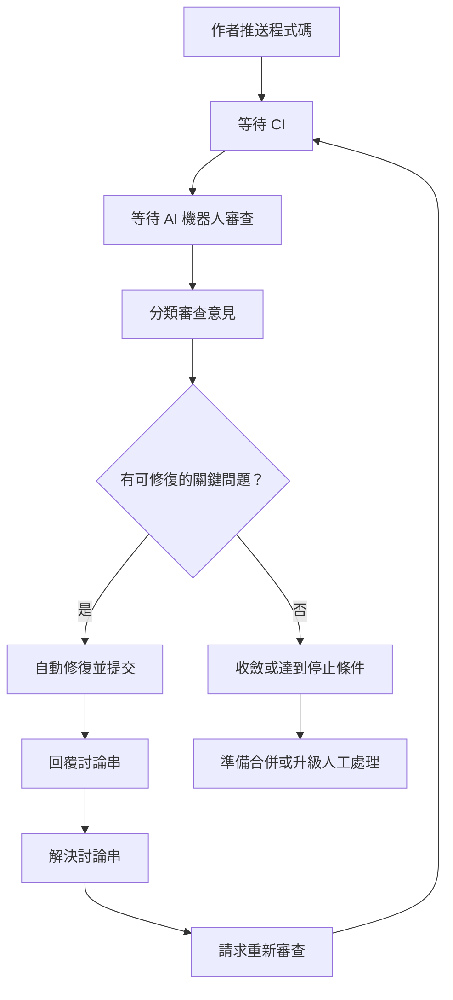
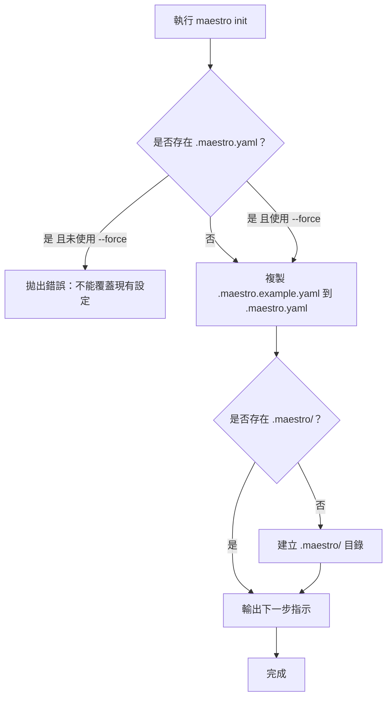
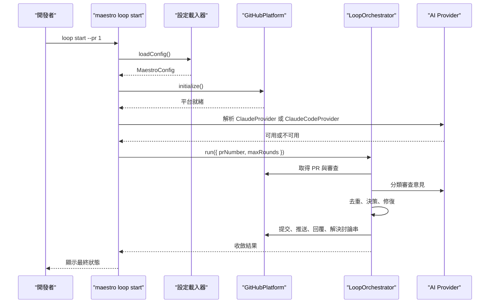
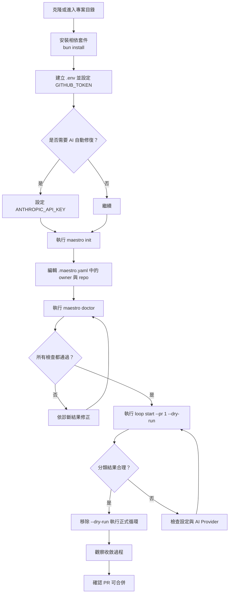

# 快速開始

**本文引用的檔案**

- [README.md](https://github.com/mikeah2011/maestro/blob/master/README.md)
- [package.json](https://github.com/mikeah2011/maestro/blob/master/package.json)
- [.maestro.example.yaml](https://github.com/mikeah2011/maestro/blob/master/.maestro.example.yaml)
- [src/cli/index.ts](https://github.com/mikeah2011/maestro/blob/master/src/cli/index.ts)
- [src/cli/commands/init.ts](https://github.com/mikeah2011/maestro/blob/master/src/cli/commands/init.ts)
- [src/cli/commands/doctor.ts](https://github.com/mikeah2011/maestro/blob/master/src/cli/commands/doctor.ts)
- [src/cli/commands/loop.ts](https://github.com/mikeah2011/maestro/blob/master/src/cli/commands/loop.ts)
- [src/config/load.ts](https://github.com/mikeah2011/maestro/blob/master/src/config/load.ts)
- [src/config/schema.ts](https://github.com/mikeah2011/maestro/blob/master/src/config/schema.ts)
- [docs/DESIGN.md](https://github.com/mikeah2011/maestro/blob/master/docs/DESIGN.md)

## 目錄

1. [什麼是 Maestro](#什麼是-maestro)
2. [安裝步驟](#安裝步驟)
3. [環境變數與基本設定](#環境變數與基本設定)
4. [初始化專案](#初始化專案)
5. [環境診斷](#環境診斷)
6. [執行第一個收斂循環](#執行第一個收斂循環)
7. [常用操作範例](#常用操作範例)
8. [常見錯誤與故障排除](#常見錯誤與故障排除)
9. [完整流程圖](#完整流程圖)
10. [小結](#小結)

## 什麼是 Maestro

Maestro 不是另一個程式碼審查工具，而是疊加在 CodeRabbit、Ellipsis、Copilot Code Review、Codex、Gemini Code Assist、Sourcery 等審查機器人之上的「收斂層」。它負責：

- 分類審查意見為 `bug`、`taste`、`wrong`、`yagni`、`unknown`。
- 去重重複問題。
- 自動修復真正的缺陷。
- 在討論串內回覆。
- 解決已處理的討論串。
- 請求重新審查。
- 在硬性上限內停止，並判斷是否升級給人工處理。

核心收斂規則包括：

- **最多 3 輪**（預設值；最大不超過 5）。
- **關鍵問題集單調不增**。
- **Jaccard 相似度超過閾值時視為振盪並停止**。
- **第 2 輪後不得出現新問題類別**。
- **每輪最多 1 次提交、每個討論串每輪最多 1 次回覆、每輪最多 1 次 PR 內容更新**。



**圖表來源**   
- [docs/DESIGN.md:1-207](https://github.com/mikeah2011/maestro/blob/master/docs/DESIGN.md#L1-L207)

**章節來源**   
- [README.md:1-80](https://github.com/mikeah2011/maestro/blob/master/README.md#L1-L80)
- [docs/DESIGN.md:1-120](https://github.com/mikeah2011/maestro/blob/master/docs/DESIGN.md#L1-L120)

## 安裝步驟

### 環境需求

| 項目 | 最低版本 | 用途 |
|---|---|---|
| Bun | ≥ 1.0 | 開發與執行 CLI |
| Node.js | ≥ 20 | 二進位執行期要求 |
| Git | 任意可用版本 | 偵測遠端倉庫、提交與推送 |
| GitHub Token | 具備 `repo` 與 `pull_requests` 讀寫權限 | 存取 Pull Request |
| Anthropic API Key 或 Claude Code CLI | 任一即可 | AI 分類與自動修復 |

若只想測試分類邏輯而不進行實際修改，可以只設定 GitHub Token；AI Provider 不可用時會停用自動修復引擎，但分類仍會執行。

### 使用 Bun 安裝

推薦使用專案根目錄下的 `bun.lock` 與 `package.json` 中的腳本。

```bash
bun install
```

安裝完成後，CLI 入口位於 `src/cli/index.ts`，透過 `package.json` 的 `start` 腳本執行：

```bash
bun run start
```

也可以直接執行 TypeScript 入口：

```bash
bun run src/cli/index.ts
```

**章節來源**   
- [package.json:1-89](https://github.com/mikeah2011/maestro/blob/master/package.json#L1-L89)
- [README.md:1-80](https://github.com/mikeah2011/maestro/blob/master/README.md#L1-L80)

## 環境變數與基本設定

### 必要環境變數

| 變數 | 是否必要 | 說明 |
|---|---:|---|
| `GITHUB_TOKEN` | 是 | GitHub 平台存取 Token，需具備 repo 與 pull requests 讀寫權限 |
| `ANTHROPIC_API_KEY` | 否 | 使用 Claude API 進行 AI 分類與自動修復；未設定時嘗試 fallback 到 Claude Code CLI |

其他可能用到的環境變數：

| 變數 | 用途 |
|---|---|
| `MAESTRO_MAX_ROUNDS` | 覆寫最大輪數 |
| `MAESTRO_COST_BUDGET_USD` | 覆寫成本預算 |
| `MAESTRO_LOG_LEVEL` | 日誌等級：`debug`、`info`、`warn`、`error` |
| `MAESTRO_AUDIT_DIR` | 審計目錄位置 |

建議在專案根目錄建立 `.env` 檔案：

```text
GITHUB_TOKEN=ghp_你的GitHubToken
ANTHROPIC_API_KEY=sk-ant-你的AnthropicKey
```

CLI 啟動時會自動載入當前工作目錄下的 `.env` 檔案。

**章節來源**   
- [src/cli/index.ts:1-86](https://github.com/mikeah2011/maestro/blob/master/src/cli/index.ts#L1-L86)
- [src/config/load.ts:1-120](https://github.com/mikeah2011/maestro/blob/master/src/config/load.ts#L1-L120)

### `.maestro.yaml` 基本設定

`.maestro.yaml` 是「倉庫層」設定，優先順序高於使用者設定檔，低於 CLI 旗標與環境變數。

最小可運作設定至少包含：

1. `platform.type`：目前支援 `github`、`gitlab`、`gitea`、`gitee`。
2. `platform.auth.tokenEnv`：指定環境變數名稱，例如 `GITHUB_TOKEN`。
3. `owner` 與 `repo`：若未提供，會嘗試從 git remote 自動偵測。
4. `ai.providers`：至少宣告一個 provider，Claude 是最常見的選擇。
5. `stopConditions.maxRounds`：預設為 3，最大值為 5。

以下是一個適合初學者的基本結構說明：

| 設定區段 | 必要欄位 | 說明 |
|---|---|---|
| `platform.type` | 是 | Git 平台類型 |
| `platform.auth.tokenEnv` | 是 | Token 對應的環境變數 |
| `platform.owner` | 可省略 | GitHub 組織或使用者 |
| `platform.repo` | 可省略 | GitHub 倉庫名稱 |
| `ai.providers.claude.apiKey` | 可省略 | 若留空則回退至 Claude Code CLI |
| `stopConditions.maxRounds` | 可省略 | 預設 3 |
| `stopConditions.costBudgetUSD` | 可省略 | 每次 loop 成本上限 |

完整範例可參考專案提供的 `.maestro.example.yaml`。

**章節來源**   
- [.maestro.example.yaml:1-239](https://github.com/mikeah2011/maestro/blob/master/.maestro.example.yaml#L1-L239)
- [src/config/schema.ts:1-226](https://github.com/mikeah2011/maestro/blob/master/src/config/schema.ts#L1-L226)
- [src/config/load.ts:1-216](https://github.com/mikeah2011/maestro/blob/master/src/config/load.ts#L1-L216)

## 初始化專案

### 命令

```bash
bun run src/cli/index.ts init
```

或使用已建構的二進位：

```bash
./dist/cli.js init
```

### 初始化行為

`maestro init` 會：

1. 檢查當前目錄是否已有 `.maestro.yaml`。
2. 若存在且未加上 `--force`，則回報錯誤並中止。
3. 複製套件附帶的 `.maestro.example.yaml` 到當前目錄的 `.maestro.yaml`。
4. 建立 `.maestro/` 目錄作為審計資料存放處。
5. 輸出下一步指示。



**圖表來源**   
- [src/cli/commands/init.ts:1-87](https://github.com/mikeah2011/maestro/blob/master/src/cli/commands/init.ts#L1-L87)

### 初始化後的下一步

init 完成後，你應該：

1. 編輯 `.maestro.yaml`，填入正確的 `owner`、`repo` 與 AI provider。
2. 確認 `.env` 中已設定 `GITHUB_TOKEN`。
3. 執行 `maestro doctor` 驗證環境。
4. 對某個 PR 執行 `maestro loop start --pr <PR號>`。

**章節來源**   
- [src/cli/commands/init.ts:1-87](https://github.com/mikeah2011/maestro/blob/master/src/cli/commands/init.ts#L1-L87)

## 環境診斷

### 命令

```bash
bun run src/cli/index.ts doctor
```

### 診斷內容

`doctor` 不會進行網路呼叫，只會檢查下列項目：

| 檢查項目 | pass | fail | warn | skip |
|---|---:|---:|---:|---:|
| 已安裝 git | ✅ | ❌ | — | — |
| 處於 git 工作樹 | ✅ | ❌ | — | — |
| `.maestro.yaml` 可載入並驗證 | ✅ | ❌ | 未找到但可自動偵測 | — |
| 平台 CLI 已安裝 | ✅ | ❌ | — | 未知平台 |
| 平台 Token 已設定 | ✅ | ❌ | — | — |
| AI Provider 金鑰或 Claude Code CLI | ✅ | — | 無金鑰且找不到 claude CLI | local provider |

如果所有檢查都不是 `fail`，`doctor` 會離開碼 0；若有任一項失敗，離開碼為 1。

### 常見診斷結果解讀

| 診斷訊息 | 原因 | 解決方式 |
|---|---|---|
| `git installed: fail` | 系統沒有 git | 安裝 Git |
| `inside a git repo: fail` | 不在 git 倉庫中 | 進入目標倉庫目錄再執行 |
| `.maestro.yaml: not found` | 沒有設定檔且無法偵測遠端 | 執行 `maestro init` |
| `platform token configured: fail` | `GITHUB_TOKEN` 未設定 | 將 Token 寫入 `.env` 或 shell 環境 |
| `AI provider keys: warn` | 沒有 API Key 且沒有 Claude CLI | 設定 `ANTHROPIC_API_KEY` 或安裝 Claude CLI |
| `claude installed: fail` | 沒有安裝平台 CLI（例如 `gh`） | 安裝對應平台的 CLI |

**章節來源**   
- [src/cli/commands/doctor.ts:1-200](https://github.com/mikeah2011/maestro/blob/master/src/cli/commands/doctor.ts#L1-L200)

## 執行第一個收斂循環

### 前置條件

1. 已完成 `maestro init`。
2. `.env` 中已設定 `GITHUB_TOKEN`。
3. 已設定 `ANTHROPIC_API_KEY`，或本機已安裝 Claude Code CLI。
4. 有一個真實存在的 GitHub Pull Request。
5. PR 的 CI 狀態正確，且允許 AI 機器人評論。

### 第一個命令

```bash
bun run src/cli/index.ts loop start --pr 1
```

其中 `<PR號>` 必須是正整數。

### 執行流程



**圖表來源**   
- [src/cli/commands/loop.ts:1-512](https://github.com/mikeah2011/maestro/blob/master/src/cli/commands/loop.ts#L1-L512)
- [src/cli/commands/init.ts:1-87](https://github.com/mikeah2011/maestro/blob/master/src/cli/commands/init.ts#L1-L87)

### 關鍵行為

- CLI 會先解析並驗證 `--pr` 參數。
- 載入 `.maestro.yaml`，並允許 CLI 旗標覆寫部分設定。
- 初始化 GitHubPlatform。
- 建立事件發射器，並訂閱標準輸出與人類可讀的 pretty sink。
- 解析 AI Provider：優先使用 `ANTHROPIC_API_KEY`，其次嘗試 Claude Code CLI。
- 非 dry-run 模式會建立 `FixEngine`，用於自動修復。
- 會根據分類結果提出建議行動：修復、延後或拒絕。
- 若非 dry-run，會提交變更並推送到遠端。
- 最後根據結束原因顯示成功、收斂或停止訊息。

**章節來源**   
- [src/cli/commands/loop.ts:1-512](https://github.com/mikeah2011/maestro/blob/master/src/cli/commands/loop.ts#L1-L512)

## 常用操作範例

### Dry-run 測試模式

Dry-run 會執行分類與報告，但不執行修復、提交與回覆。這是新手第一次執行最安全的選項。

```bash
bun run src/cli/index.ts loop start --pr 1 --dry-run
```

dry-run 模式下：

- 不會修改任何檔案。
- 不會提交程式碼。
- 不會推送到遠端。
- 不會回覆討論串。
- 仍可觀察分類、去重與收斂決策。

### 調整最大輪數

```bash
bun run src/cli/index.ts loop start --pr 1 --max-rounds 5
```

注意：schema 限制最大輪數不超過 5。

### 設定成本預算

```bash
bun run src/cli/index.ts loop start --pr 1 --cost-budget 10
```

### 查看狀態

目前 `status` 指令尚未實作，屬於未來版本規劃。

```bash
bun run src/cli/index.ts loop status --pr 1
```

輸出會提示該功能尚未實作，並返回退出碼 4。

### 停止循環

目前 `stop` 指令尚未實作。

```bash
bun run src/cli/index.ts loop stop --pr 1
```

### 恢復循環

目前 `resume` 指令尚未實作。

```bash
bun run src/cli/index.ts loop resume --pr 1
```

**章節來源**   
- [src/cli/commands/loop.ts:1-512](https://github.com/mikeah2011/maestro/blob/master/src/cli/commands/loop.ts#L1-L512)

## 常見錯誤與故障排除

### 錯誤一：找不到 `.maestro.yaml`

**現象**

`doctor` 回報 `.maestro.yaml` 未找到。

**原因**

尚未執行初始化，或當前目錄不是目標倉庫。

**解決方式**

```bash
cd /path/to/your/repo
bun run src/cli/index.ts init
```

**章節來源**   
- [src/cli/commands/doctor.ts:1-200](https://github.com/mikeah2011/maestro/blob/master/src/cli/commands/doctor.ts#L1-L200)
- [src/cli/commands/init.ts:1-87](https://github.com/mikeah2011/maestro/blob/master/src/cli/commands/init.ts#L1-L87)

### 錯誤二：`.maestro.yaml already exists`

**現象**

執行 `maestro init` 時出現錯誤。

**原因**

當前目錄已存在 `.maestro.yaml`，且未使用 `--force`。

**解決方式**

```bash
bun run src/cli/index.ts init --force
```

**章節來源**   
- [src/cli/commands/init.ts:1-87](https://github.com/mikeah2011/maestro/blob/master/src/cli/commands/init.ts#L1-L87)

### 錯誤三：`--pr must be a positive integer`

**現象**

執行 loop start 時報錯。

**原因**

`--pr` 不是正整數。

**解決方式**

```bash
bun run src/cli/index.ts loop start --pr 123
```

**章節來源**   
- [src/cli/commands/loop.ts:1-200](https://github.com/mikeah2011/maestro/blob/master/src/cli/commands/loop.ts#L1-L200)

### 錯誤四：config error

**現象**

載入設定失敗，退出碼為 3。

**原因**

`.maestro.yaml` 格式錯誤、型別不符合 schema，或必填欄位缺失。

**解決方式**

1. 比較 `.maestro.yaml` 與 `.maestro.example.yaml`。
2. 確保 `platform.type` 有效。
3. 確保 `platform.auth.tokenEnv` 指向正確環境變數。
4. 執行 `bun run src/cli/index.ts doctor` 取得更詳細資訊。

**章節來源**   
- [src/config/schema.ts:1-226](https://github.com/mikeah2011/maestro/blob/master/src/config/schema.ts#L1-L226)
- [src/cli/commands/loop.ts:1-200](https://github.com/mikeah2011/maestro/blob/master/src/cli/commands/loop.ts#L1-L200)

### 錯誤五：platform error

**現象**

GitHubPlatform 初始化失敗。

**原因**

`GITHUB_TOKEN` 未設定、權限不足，或 GitHub API 無法連線。

**解決方式**

1. 檢查 `.env` 是否載入。
2. 檢查 Token 是否具備 `repo` 與 `pull_requests` 權限。
3. 使用 `gh auth status` 驗證 GitHub CLI 認證。

**章節來源**   
- [src/cli/commands/loop.ts:1-200](https://github.com/mikeah2011/maestro/blob/master/src/cli/commands/loop.ts#L1-L200)

### 錯誤六：沒有可提交的變更

**現象**

輸出提示 staged 為 0。

**原因**

分類結果沒有需要修復的問題，或 dry-run 模式跳過修復。

**解決方式**

- 確認不是 dry-run。
- 確認 PR 確實有可修復的 bug。
- 確認 AI Provider 可用。

**章節來源**   
- [src/cli/commands/loop.ts:200-512](https://github.com/mikeah2011/maestro/blob/master/src/cli/commands/loop.ts#L200-L512)

### 錯誤七：AI provider unavailable

**現象**

系統警告自動修復引擎已停用。

**原因**

沒有 `ANTHROPIC_API_KEY`，且本機沒有可用的 Claude Code CLI。

**解決方式**

選其一：

```bash
export ANTHROPIC_API_KEY="sk-ant-你的Key"
```

或安裝 Claude Code CLI，讓系統自動 fallback。

**章節來源**   
- [src/cli/commands/loop.ts:400-512](https://github.com/mikeah2011/maestro/blob/master/src/cli/commands/loop.ts#L400-L512)
- [src/cli/commands/doctor.ts:1-200](https://github.com/mikeah2011/maestro/blob/master/src/cli/commands/doctor.ts#L1-L200)

### 錯誤八：loop ended with error

**現象**

loop 以錯誤結束。

**原因**

可能是平台錯誤、CI 失敗、機器人逾時，或其他異常。

**解決方式**

1. 查看 stderr 中由 pretty sink 產生的事件訊息。
2. 檢查 CI 是否通過。
3. 確認機器人評論是否產生。
4. 使用 `--dry-run` 先測試分類邏輯。

**章節來源**   
- [src/cli/commands/loop.ts:200-512](https://github.com/mikeah2011/maestro/blob/master/src/cli/commands/loop.ts#L200-L512)

## 完整流程圖

以下是初學者應遵循的 10 分鐘快速開始流程：



[此圖為概念性流程圖，不直接映射單一程式碼結構]

## 小結

要讓 Maestro 完成第一次成功執行，請記住這幾個關鍵點：

1. 使用 `bun install` 安裝相依套件。
2. 在 `.env` 中設定 `GITHUB_TOKEN`。
3. 若需要 AI 自動修復，設定 `ANTHROPIC_API_KEY`。
4. 執行 `maestro init` 產生 `.maestro.yaml`。
5. 執行 `maestro doctor` 確認環境。
6. 先用 `--dry-run` 測試分類邏輯。
7. 確認無誤後，執行正式的 `maestro loop start --pr <PR號>`。
8. 留意 `status`、`stop`、`resume` 目前尚未實作。

Maestro 的核心價值在於把分散的多個 AI 審查機器人整合成一個有明確停止條件的收斂循環，而不是讓你無限重讀機器人評論。

**章節來源**   
- [README.md:1-200](https://github.com/mikeah2011/maestro/blob/master/README.md#L1-L200)
- [package.json:1-89](https://github.com/mikeah2011/maestro/blob/master/package.json#L1-L89)
- [docs/DESIGN.md:1-207](https://github.com/mikeah2011/maestro/blob/master/docs/DESIGN.md#L1-L207)