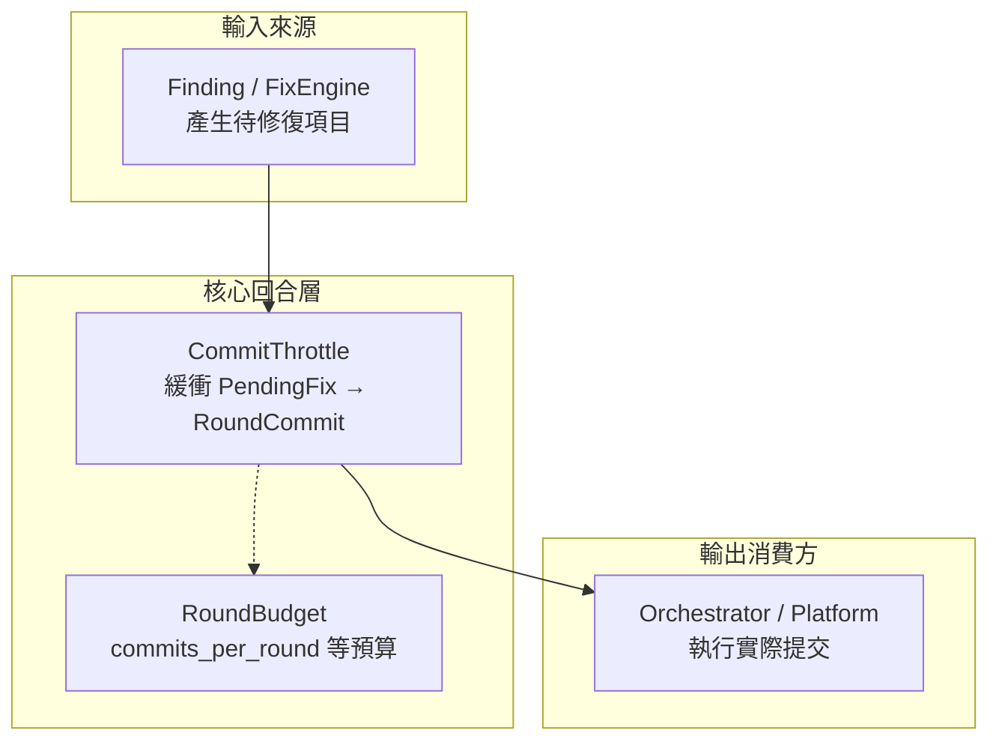
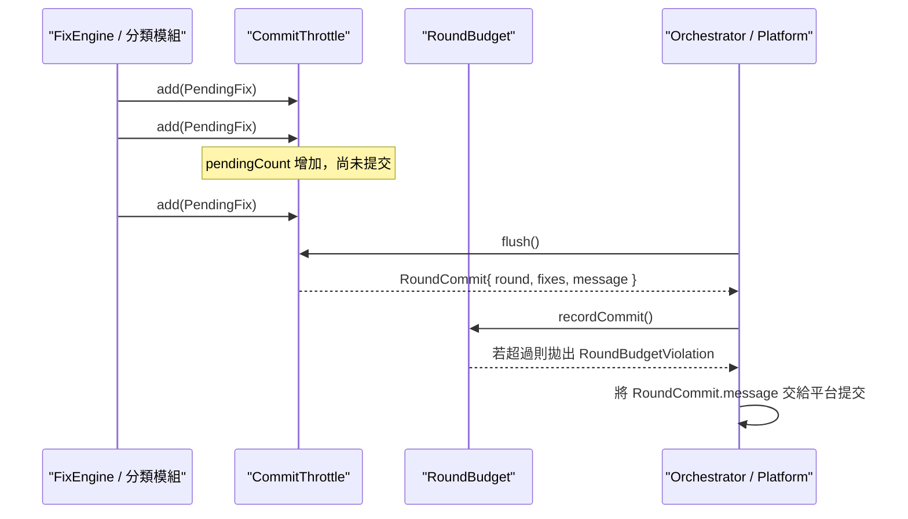
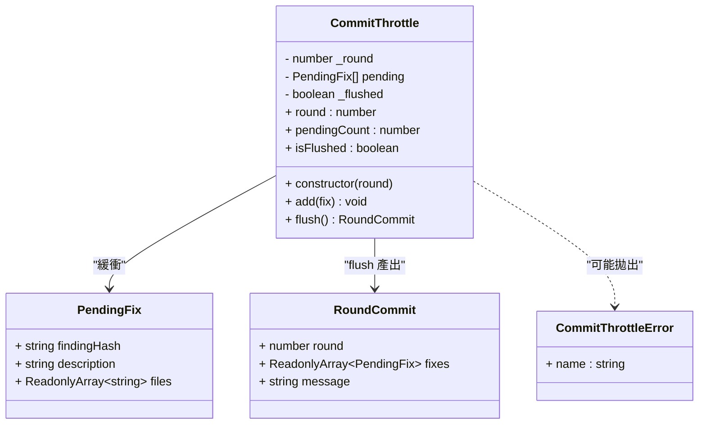
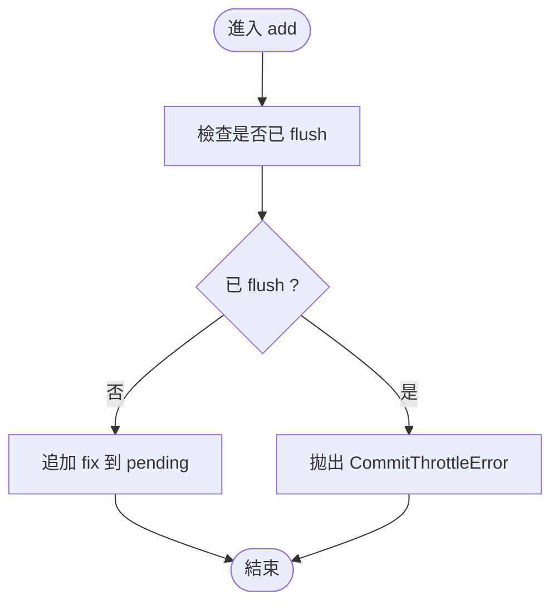
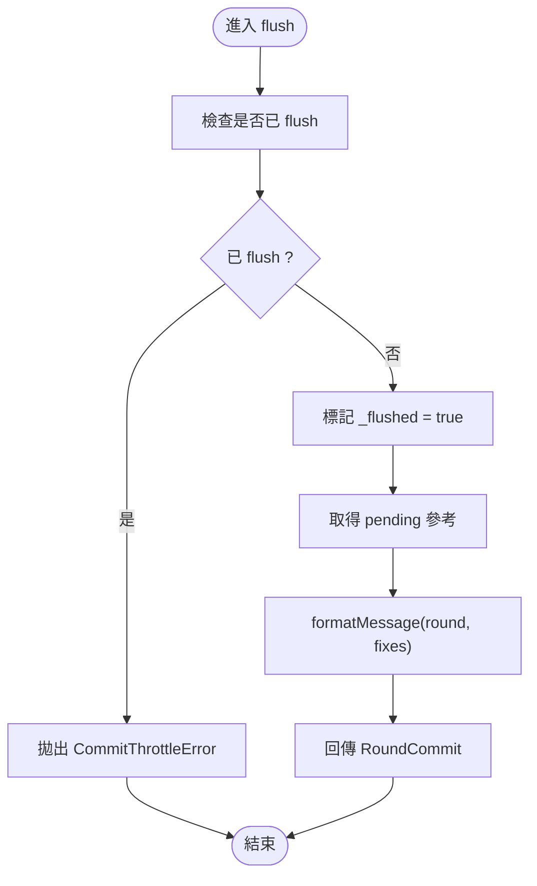
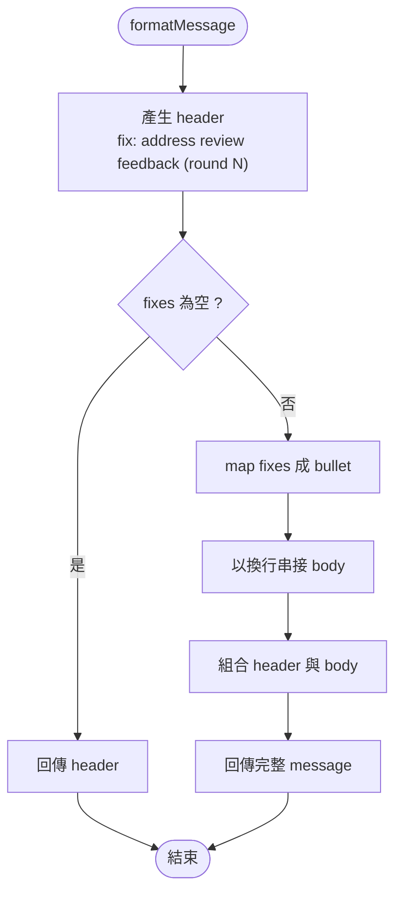
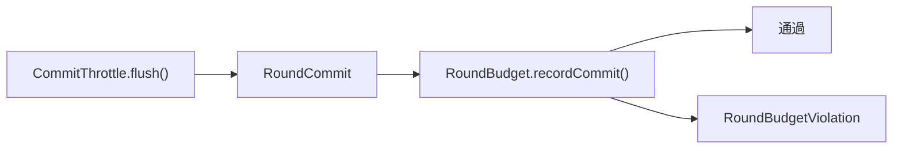

# 提交節流（CommitThrottle）

<cite>
**本文引用的文件**   
- [src/core/round/CommitThrottle.ts](https://github.com/mikeah2011/maestro/blob/master/src/core/round/CommitThrottle.ts)
- [tests/core/round/CommitThrottle.test.ts](https://github.com/mikeah2011/maestro/blob/master/tests/core/round/CommitThrottle.test.ts)
- [src/core/round/RoundBudget.ts](https://github.com/mikeah2011/maestro/blob/master/src/core/round/RoundBudget.ts)
- [src/core/types/Finding.ts](https://github.com/mikeah2011/maestro/blob/master/src/core/types/Finding.ts)
</cite>

## 目錄
1. [簡介](#簡介)
2. [專案結構與定位](#專案結構與定位)
3. [核心概念與資料結構](#核心概念與資料結構)
4. [架構總覽](#架構總覽)
5. [詳細組件分析](#詳細組件分析)
6. [依賴關係分析](#依賴關係分析)
7. [效能考量](#效能考量)
8. [錯誤處理與故障排除](#錯誤處理與故障排除)
9. [結論](#結論)

## 簡介
`CommitThrottle` 是 Maestro 每輪修復流程中的「單次提交節流器」。它的責任很明確：在當輪 Fixing 狀態期間，緩衝多個待修復項目；等到該輪修復完成時，一次性 flush 為單一 conventional commit。它本身不直接呼叫 git 或平台 API，而是產出結構化的 `RoundCommit`，供上層協調器交由平台執行實際提交。

設計上的關鍵約束是「單次性」：一旦 flush，這個 `CommitThrottle` 就變成已死亡狀態，不能再新增修復，也不能再次 flush。下一輪必須建立新的實例。配合 `RoundBudget.commits_per_round`，系統從構造上保證每輪最多只有一個 commit，避免反饋迴圈中產生垃圾式提交。

## 專案結構與定位
`CommitThrottle` 位於 `src/core/round/`，與 `RoundBudget` 同屬「每輪治理」層。它不依賴外部服務，也不直接操作 Git 或 GitHub API，因此是一個純邏輯組件。測試位於 `tests/core/round/CommitThrottle.test.ts`，驗證累積、flush、訊息格式與錯誤行為。



**圖表來源**
- [src/core/round/CommitThrottle.ts:1-102](https://github.com/mikeah2011/maestro/blob/master/src/core/round/CommitThrottle.ts#L1-L102)
- [src/core/round/RoundBudget.ts:1-131](https://github.com/mikeah2011/maestro/blob/master/src/core/round/RoundBudget.ts#L1-L131)

**章節來源**
- [src/core/round/CommitThrottle.ts:1-102](https://github.com/mikeah2011/maestro/blob/master/src/core/round/CommitThrottle.ts#L1-L102)
- [src/core/round/RoundBudget.ts:1-131](https://github.com/mikeah2011/maestro/blob/master/src/core/round/RoundBudget.ts#L1-L131)

## 核心概念與資料結構

### PendingFix：單個待修復項目
`PendingFix` 描述一個正在被修復的 finding：

| 欄位 | 類型 | 說明 |
|---|---|---|
| `findingHash` | `string` | 穩定 hash，用來標識正在修復的 finding。commit body 中以短前綴列出。 |
| `description` | `string` | 一行描述，成為 commit body bullet 的內容。 |
| `files` | `ReadonlyArray<string>` 可選 | 本次修復觸及的檔案路徑，可用於產生更豐富的訊息，但當前 formatter 主要使用 `findingHash` 與 `description`。 |

`findingHash` 對應系統其他位置使用的 finding identity，例如 `Finding.hash` 是由 `sha1(file + line_bucket + normalized_category + content_hash)` 產生的穩定值。這讓 commit 能回溯到具體問題。

**章節來源**
- [src/core/round/CommitThrottle.ts:14-26](https://github.com/mikeah2011/maestro/blob/master/src/core/round/CommitThrottle.ts#L14-L26)
- [src/core/types/Finding.ts:24-41](https://github.com/mikeah2011/maestro/blob/master/src/core/types/Finding.ts#L24-L41)

### RoundCommit：flush 後的結果
`RoundCommit` 是一次 flush 的結果：

| 欄位 | 類型 | 說明 |
|---|---|---|
| `round` | `number` | 所屬回合編號。 |
| `fixes` | `ReadonlyArray<PendingFix>` | 本輪所有已緩衝的修復，保持插入順序。 |
| `message` | `string` | 可直接傳給 git 的 conventional commit message。 |

**章節來源**
- [src/core/round/CommitThrottle.ts:28-36](https://github.com/mikeah2011/maestro/blob/master/src/core/round/CommitThrottle.ts#L28-L36)

### CommitThrottleError：內部錯誤型別
`CommitThrottleError` 繼承自 `Error`，用於表示違反單次性約束的操作，例如重複 flush 或 flush 後繼續新增修復。

**章節來源**
- [src/core/round/CommitThrottle.ts:38-44](https://github.com/mikeah2011/maestro/blob/master/src/core/round/CommitThrottle.ts#L38-L44)

## 架構總覽
下圖展示一輪修復中，`CommitThrottle` 如何參與資料流：



**圖表來源**
- [src/core/round/CommitThrottle.ts:56-91](https://github.com/mikeah2011/maestro/blob/master/src/core/round/CommitThrottle.ts#L56-L91)
- [src/core/round/RoundBudget.ts:63-75](https://github.com/mikeah2011/maestro/blob/master/src/core/round/RoundBudget.ts#L63-L75)

## 詳細組件分析

### CommitThrottle 類別與狀態
`CommitThrottle` 維護以下私有狀態：

| 成員 | 用途 | 行為 |
|---|---|---|
| `_round` | 所屬回合編號 | 建構時驗證必須是正整數；提供唯讀 `round`。 |
| `pending` | 緩衝陣列 | 儲存尚未 flush 的 `PendingFix`，保留插入順序。 |
| `_flushed` | 單次性旗標 | 初始為 `false`；flush 後設為 `true`，禁止再修改。 |



**圖表來源**
- [src/core/round/CommitThrottle.ts:14-91](https://github.com/mikeah2011/maestro/blob/master/src/core/round/CommitThrottle.ts#L14-L91)

**章節來源**
- [src/core/round/CommitThrottle.ts:46-91](https://github.com/mikeah2011/maestro/blob/master/src/core/round/CommitThrottle.ts#L46-L91)

### add：累積修復並強制單次性
`add(fix)` 的行為如下：

1. 檢查 `_flushed` 是否為 `true`。
2. 若是，拋出 `CommitThrottleError`，訊息包含回合編號。
3. 否則，把 `fix` 追加到 `pending` 陣列。

時間複雜度為 `O(1)` 均攤，因為是陣列尾端追加。空間複雜度為 `O(n)`，其中 `n` 是本輪累計的修復數量。



**圖表來源**
- [src/core/round/CommitThrottle.ts:63-71](https://github.com/mikeah2011/maestro/blob/master/src/core/round/CommitThrottle.ts#L63-L71)

**章節來源**
- [src/core/round/CommitThrottle.ts:63-71](https://github.com/mikeah2011/maestro/blob/master/src/core/round/CommitThrottle.ts#L63-L71)
- [tests/core/round/CommitThrottle.test.ts:39-53](https://github.com/mikeah2011/maestro/blob/master/tests/core/round/CommitThrottle.test.ts#L39-L53)

### flush：一次性封裝為 RoundCommit
`flush()` 負責將緩衝內容轉換為最終提交資料：

1. 檢查 `_flushed`。
2. 若已 flush，拋出 `CommitThrottleError`。
3. 將 `_flushed` 設為 `true`。
4. 取得 `pending` 參考。
5. 透過 `formatMessage(round, fixes)` 產生 commit message。
6. 回傳 `{ round, fixes, message }`。



**圖表來源**
- [src/core/round/CommitThrottle.ts:73-91](https://github.com/mikeah2011/maestro/blob/master/src/core/round/CommitThrottle.ts#L73-L91)

**章節來源**
- [src/core/round/CommitThrottle.ts:73-91](https://github.com/mikeah2011/maestro/blob/master/src/core/round/CommitThrottle.ts#L73-L91)
- [tests/core/round/CommitThrottle.test.ts:24-38](https://github.com/mikeah2011/maestro/blob/master/tests/core/round/CommitThrottle.test.ts#L24-L38)

### formatMessage：conventional commit 訊息格式化
`formatMessage` 根據 `round` 與 `fixes` 產生訊息：

- **header**：固定為 `fix: address review feedback (round N)`，其中 `N` 是回合編號。
- **無修復時**：只回傳 header，不包含 body。
- **有修復時**：body 由每個 `PendingFix` 生成一行 bullet，格式為 `- <前 8 碼 findingHash>: <description>`。
- `HASH_PREFIX_LENGTH` 固定為 8，用於截斷 hash。



**圖表來源**
- [src/core/round/CommitThrottle.ts:93-102](https://github.com/mikeah2011/maestro/blob/master/src/core/round/CommitThrottle.ts#L93-L102)

**章節來源**
- [src/core/round/CommitThrottle.ts:93-102](https://github.com/mikeah2011/maestro/blob/master/src/core/round/CommitThrottle.ts#L93-L102)
- [tests/core/round/CommitThrottle.test.ts:55-93](https://github.com/mikeah2011/maestro/blob/master/tests/core/round/CommitThrottle.test.ts#L55-L93)

### 建構期驗證
建構子要求 `round` 是正整數。若傳入非整數或小於 1 的值，會立即拋出 `CommitThrottleError`。這是防禦性編程的第一道防線，避免後續邏輯基於無效回合號運作。

**章節來源**
- [src/core/round/CommitThrottle.ts:56-62](https://github.com/mikeah2011/maestro/blob/master/src/core/round/CommitThrottle.ts#L56-L62)

## 依賴關係分析

### 與 RoundBudget 的配合
`RoundBudget` 是另一層反垃圾機制，其中 `recordCommit()` 保證每輪最多記錄一次 commit。若同一輪第二次呼叫，會拋出 `RoundBudgetViolation`，invariant 為 `commits_per_round`。

雖然 `CommitThrottle` 自身只限制「自己只能 flush 一次」，真正防止 orchestrator 在同一輪對不同 throttle 或多次提交濫用的，是 `RoundBudget.recordCommit()`。兩者的協作方式如下：

| 層級 | 保護目標 | 違規結果 |
|---|---|---|
| `CommitThrottle` | 單一 throttle 實例只能 flush 一次 | 拋出 `CommitThrottleError` |
| `RoundBudget` | 整個回合最多一次 commit | 拋出 `RoundBudgetViolation` |



**圖表來源**
- [src/core/round/CommitThrottle.ts:73-91](https://github.com/mikeah2011/maestro/blob/master/src/core/round/CommitThrottle.ts#L73-L91)
- [src/core/round/RoundBudget.ts:63-75](https://github.com/mikeah2011/maestro/blob/master/src/core/round/RoundBudget.ts#L63-L75)

**章節來源**
- [src/core/round/RoundBudget.ts:1-131](https://github.com/mikeah2011/maestro/blob/master/src/core/round/RoundBudget.ts#L1-L131)

### 與 Finding 的關係
`PendingFix.findingHash` 通常對應 `Finding.hash`。這樣做的好處是 commit message 能穩定關聯到原始問題，即使原始 bot comment 文字變動，hash 仍能作為識別錨點。

**章節來源**
- [src/core/types/Finding.ts:60-92](https://github.com/mikeah2011/maestro/blob/master/src/core/types/Finding.ts#L60-L92)
- [src/core/round/CommitThrottle.ts:14-26](https://github.com/mikeah2011/maestro/blob/master/src/core/round/CommitThrottle.ts#L14-L26)

## 效能考量
- `add` 使用陣列追加，均攤時間複雜度為 `O(1)`。
- `flush` 會遍歷 `fixes` 產生 message，時間複雜度為 `O(k)`，其中 `k` 是修復數量。
- `pending` 在 flush 後仍被保留在 `RoundCommit.fixes` 中，因此不會提前釋放記憶體；這對短生命週期的每輪物件來說通常可接受。
- 如果某輪有大量修復，message 字串拼接會隨修復數量線性增長。可考慮在極端情況下限制 bullet 數量或壓縮訊息，但目前實作未包含此優化。
- `files` 欄位目前未被 formatter 使用，若未來要納入更多細節，應注意訊息長度與平台限制。

[本節為一般性能討論，未直接分析特定程式碼片段]

## 錯誤處理與故障排除

### 常見錯誤情境

| 情境 | 觸發條件 | 錯誤型別 | 建議處理方式 |
|---|---|---|---|
| 建構時回合無效 | `round` 不是正整數 | `CommitThrottleError` | 修正上游調用邏輯，確保回合編號至少為 1。 |
| 重複 flush | 對同一 throttle 呼叫兩次 `flush` | `CommitThrottleError` | 確認 orchestrator 只在 Fixing 狀態結束時呼叫一次 flush。 |
| flush 後新增修復 | 先 flush，再呼叫 `add` | `CommitThrottleError` | 每輪結束後重建新的 `CommitThrottle`，不要重用舊實例。 |
| 同一輪多次提交 | orchestrator 多次調用平台提交且未受預算控制 | `RoundBudgetViolation` | 確保每輪只呼叫一次 `recordCommit()`，並只提交一次。 |

### 錯誤訊息特徵
- `CommitThrottleError` 的訊息通常包含回合編號，便於日誌追蹤是哪一輪發生違規。
- `RoundBudgetViolation` 會帶入 invariant 名稱與回合編號，方便診斷是哪種預算被打破。

### 實際生成的 commit message 範例
假設第 2 輪新增了兩個修復：

- 第一個修復的 `findingHash` 前 8 碼為 `aaaaaaaa`，描述為 `fix null deref in auth.ts`。
- 第二個修復的 `findingHash` 前 8 碼為 `bbbbbbbb`，描述為 `add missing index on users.email`。

產生的 conventional commit message 大致如下：

```
fix: address review feedback (round 2)

- aaaaaaaa: fix null deref in auth.ts
- bbbbbbbb: add missing index on users.email
```

若本輪沒有新增任何修復，message 只會是：

```
fix: address review feedback (round 2)
```

這些行為可由測試驗證：

- 含修復時的訊息包含 `round 2`、`fix:`、兩個 finding hash 前綴與描述。
- 無修復時只回傳 header。
- hash 前綴截斷為 8 個字元。
- bullet 順序與 `add` 的插入順序一致。

**章節來源**
- [tests/core/round/CommitThrottle.test.ts:24-93](https://github.com/mikeah2011/maestro/blob/master/tests/core/round/CommitThrottle.test.ts#L24-L93)
- [src/core/round/CommitThrottle.ts:93-102](https://github.com/mikeah2011/maestro/blob/master/src/core/round/CommitThrottle.ts#L93-L102)

## 結論
`CommitThrottle` 是一個小型但關鍵的構造型組件。它透過以下機制保障每輪提交的正確性：

1. 緩衝 `PendingFix`，保留插入順序。
2. 在 Fixing 狀態結束時一次性 flush 為 `RoundCommit`。
3. 使用 conventional commit 風格產生 header 與 bullet body。
4. 透過 `_flushed` 旗標強制單次性：flush 後不可再加修復，也不可再次 flush。
5. 與 `RoundBudget.commits_per_round` 配合，確保每輪最多一個 commit。

實務上使用時，應該遵循「每輪新建 `CommitThrottle`、flush 後丟棄、再由 orchestrator 提交 `RoundCommit.message`」的模式。若需要進一步豐富訊息內容，可擴展 `formatMessage` 以利用 `PendingFix.files`，同時注意訊息長度與平台限制。