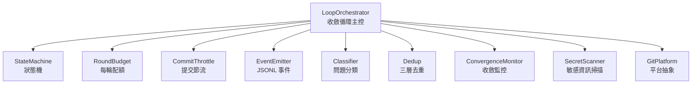
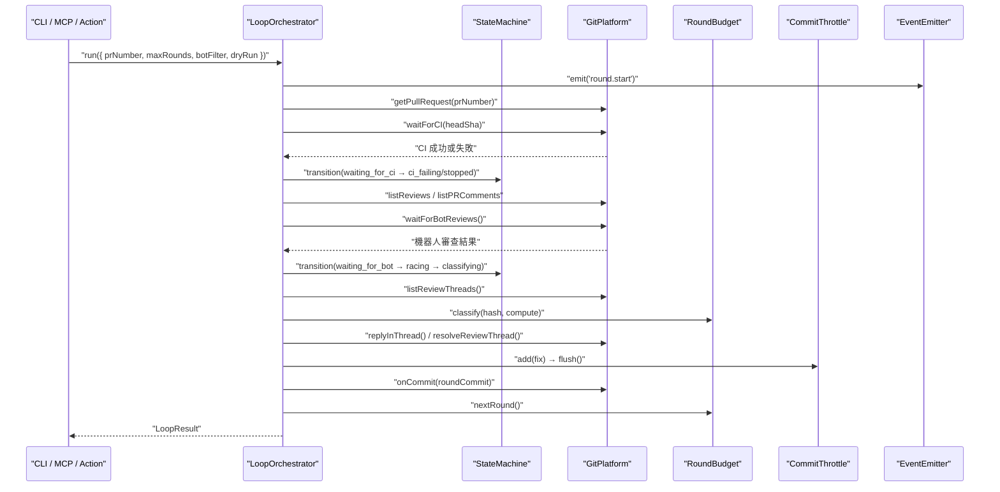
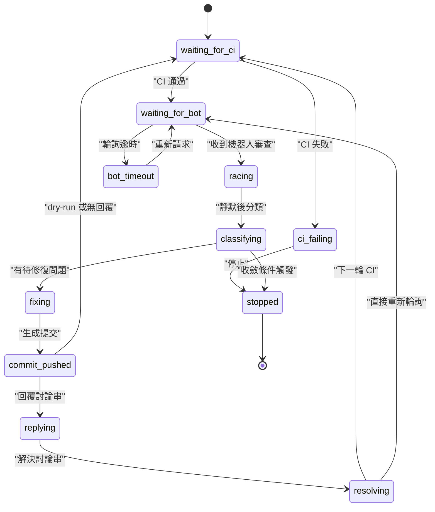
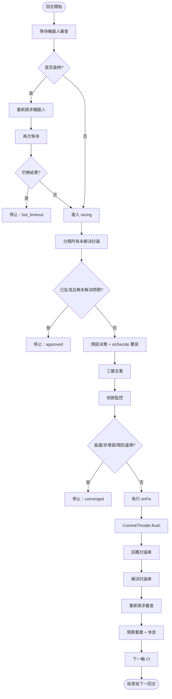
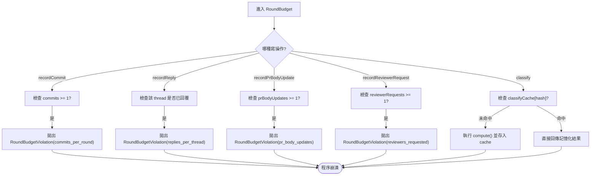
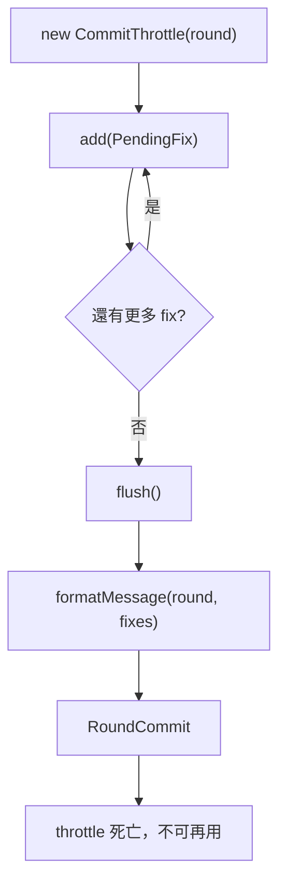
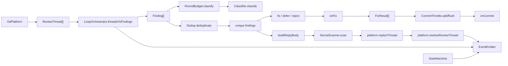
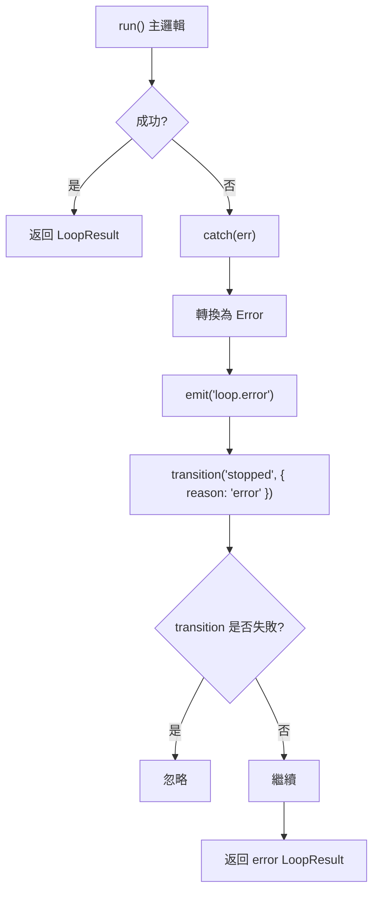

# 核心循環引擎

<cite>
**本文引用的檔案**   
- [LoopOrchestrator.ts](https://github.com/mikeah2011/maestro/blob/master/src/core/loop/LoopOrchestrator.ts)
- [StateMachine.ts](https://github.com/mikeah2011/maestro/blob/master/src/core/state/StateMachine.ts)
- [RoundBudget.ts](https://github.com/mikeah2011/maestro/blob/master/src/core/round/RoundBudget.ts)
- [CommitThrottle.ts](https://github.com/mikeah2011/maestro/blob/master/src/core/round/CommitThrottle.ts)
- [EventEmitter.ts](https://github.com/mikeah2011/maestro/blob/master/src/core/events/EventEmitter.ts)
- [DESIGN.md](https://github.com/mikeah2011/maestro/blob/master/docs/DESIGN.md)
- [README.md](https://github.com/mikeah2011/maestro/blob/master/README.md)
</cite>

## 目錄

1. [引言](#引言)
2. [專案結構與角色定位](#專案結構與角色定位)
3. [核心組件總覽](#核心組件總覽)
4. [架構總覽](#架構總覽)
5. [狀態機：定義、轉移類型與轉移圖](#狀態機定義轉移類型與轉移圖)
6. [收斂循環主體：LoopOrchestrator 流程分析](#收斂循環主體looporchestrator-流程分析)
7. [反垃圾郵件機制：RoundBudget](#反垃圾郵件機制roundbudget)
8. [提交節流策略：CommitThrottle](#提交節流策略committhrottle)
9. [事件流系統：EventEmitter JSONL](#事件流系統eventemitter-jsonl)
10. [數據流圖](#數據流圖)
11. [異常處理流程](#異常處理流程)
12. [除錯技巧](#除錯技巧)
13. [性能考量與優化建議](#性能考量與優化建議)
14. [結論](#結論)

## 引言

Maestro 的核心價值不是另一個程式碼審查工具，而是「審查機器人之上的收斂層」。它協調多個 AI 審查機器人（例如 CodeRabbit、Ellipsis、Copilot Code Review、Codex 等），把分散的評論分類、去重、修復、回覆、解決討論串，並強制在有限輪數內收斂或升級。

`LoopOrchestrator` 是這個收斂循環的主控者。它建立 `StateMachine`，按回合驅動狀態從「等待 CI」走向「等待機器人」、「競速」、「分類」、「修復」、「提交推送」、「回覆」、「解決討論串」，再回到「等待 CI」；同時由 `RoundBudget` 執行反垃圾郵件斷言、由 `CommitThrottle` 將一輪修復彙整為單一提交、由 `EventEmitter` 輸出結構化 JSONL 事件供外部監控或 UI 消費。

本文件聚焦以下五個核心子系統：

| 子系統 | 主要責任 |
|---|---|
| `LoopOrchestrator` | 收斂循環主體：協調平台、狀態機、預算、節流、分類、去重、收斂監控與事件。 |
| `StateMachine` | 狀態定義、正向轉移、跨狀態轉移、終止狀態判定。 |
| `RoundBudget` | 每輪寫操作上限：提交、回覆、PR body 更新、分類記憶化、審查者請求。 |
| `CommitThrottle` | 一輪修復緩衝區與單一提交格式化。 |
| `EventEmitter` | JSONL 事件來源，隔離下游 sink 失敗，不讓 UI 崩潰拖垮主循環。 |

**章節來源**
- [README.md:1-80](https://github.com/mikeah2011/maestro/blob/master/README.md#L1-L80)
- [DESIGN.md:1-120](https://github.com/mikeah2011/maestro/blob/master/docs/DESIGN.md#L1-L120)

## 專案結構與角色定位

核心循環相關實作集中在 `src/core`：



**圖表來源**
- [LoopOrchestrator.ts:1-120](https://github.com/mikeah2011/maestro/blob/master/src/core/loop/LoopOrchestrator.ts#L1-L120)

這裡的關鍵設計是：**所有副作用都透過可注入的依賴或平台介面**。`onFix`、`onCommit`、`onDecide`、`sleep`、`emitter` 都可替換，這讓單元測試可以跳過真實 AI、GitHub API 和延遲。

**章節來源**
- [LoopOrchestrator.ts:1-120](https://github.com/mikeah2011/maestro/blob/master/src/core/loop/LoopOrchestrator.ts#L1-L120)
- [README.md:80-160](https://github.com/mikeah2011/maestro/blob/master/README.md#L80-L160)

## 核心組件總覽

### LoopOrchestrator

`LoopOrchestrator.run(options)` 接收 PR 編號、最大回合數、機器人過濾清單與 dry-run 選項，返回最終狀態、已執行回合數與停止原因。

重要公開型別：

| 型別 | 用途 |
|---|---|
| `FixResult` | 一個可修復問題的結果：雜湊、描述、觸及檔案。 |
| `LoopRunOptions` | 控制一次 loop 行為：prNumber、maxRounds、botFilter、dryRun。 |
| `LoopResult` | 結果：finalState、rounds、reason、error。 |
| `LoopOrchestratorOptions` | 建構期設定：platform、emitter、classifier、dedup、convergence、secretScanner、hook、poll interval、timeout、sleep、onPRApproved、botTriggerComments。 |

預設值：

| 選項 | 預設值 |
|---|---|
| CI 輪詢間隔 | 10,000 毫秒 |
| 機器人輪詢間隔 | 30,000 毫秒 |
| 機器人逾時 | 300,000 毫秒 |
| 回合間休息 | 300,000 毫秒 |
| 最大回合數 | 3 |

**章節來源**
- [LoopOrchestrator.ts:1-120](https://github.com/mikeah2011/maestro/blob/master/src/core/loop/LoopOrchestrator.ts#L1-L120)

### StateMachine

狀態機維護當前狀態、允許的轉移規則、上下文同步到 EventEmitter，並在每次成功轉移時發出 `state.transition` 事件。

錯誤路徑會拋出 `StateTransitionError(from, to)`。

**章節來源**
- [StateMachine.ts:1-114](https://github.com/mikeah2011/maestro/blob/master/src/core/state/StateMachine.ts#L1-L114)

### RoundBudget

每輪只允許：

- 最多 1 次提交
- 每個討論串最多 1 次回覆
- 最多 1 次 PR body 更新
- 每個 finding hash 最多 1 次分類（含記憶化）
- 最多 1 次 reviewer 請求

違反任一不變量就拋出 `RoundBudgetViolation(invariant, round, message)`。沒有「警告後繼續」模式。

**章節來源**
- [RoundBudget.ts:1-131](https://github.com/mikeah2011/maestro/blob/master/src/core/round/RoundBudget.ts#L1-L131)

### CommitThrottle

收集當輪所有待修復項目，flush 時產生一個 `RoundCommit`，包含 round、fixes 順序、以及 conventional commit 訊息。一旦 flush，就不允許再加 fix；同一 throttle 也不允許重複 flush。

**章節來源**
- [CommitThrottle.ts:1-102](https://github.com/mikeah2011/maestro/blob/master/src/core/round/CommitThrottle.ts#L1-L102)

### EventEmitter

提供 JSONL 事件流：

- 自動加入時間戳、round、state、payload
- 支援 sink、in-process handler
- sink 或 handler 拋錯不會中斷主循環
- 提供 `toLine`、`streamSink`、`stdoutSink`

**章節來源**
- [EventEmitter.ts:1-108](https://github.com/mikeah2011/maestro/blob/master/src/core/events/EventEmitter.ts#L1-L108)

## 架構總覽



**圖表來源**
- [LoopOrchestrator.ts:201-533](https://github.com/mikeah2011/maestro/blob/master/src/core/loop/LoopOrchestrator.ts#L201-L533)

## 狀態機：定義、轉移類型與轉移圖

### 狀態定義

`LoopState` 包含三類狀態：

| 類別 | 狀態 |
|---|---|
| 正常流程 | `idle`、`writing`、`preflight`、`pr_created`、`waiting_for_ci`、`waiting_for_bot`、`racing`、`classifying`、`fixing`、`commit_pushed`、`replying`、`resolving` |
| 收斂終止 | `stopped` |
| 橫向錯誤 / 中斷 | `ci_failing`、`bot_timeout`、`human_intervened`、`rate_limited`、`token_expired`、`paused` |

其中核心收斂循環實際使用的狀態是：

```
waiting_for_ci → waiting_for_bot → racing → classifying → fixing → commit_pushed → replying → resolving → waiting_for_ci
```

**章節來源**
- [StateMachine.ts:12-24](https://github.com/mikeah2011/maestro/blob/master/src/core/state/StateMachine.ts#L12-L24)
- [LoopOrchestrator.ts:201-533](https://github.com/mikeah2011/maestro/blob/master/src/core/loop/LoopOrchestrator.ts#L201-L533)

### 三種轉移類型

#### 1. FORWARD：正向轉移

由 `FORWARD` 映射定義，表示線性循環中的合法下一步。例如：

- `waiting_for_ci → waiting_for_bot`
- `waiting_for_bot → racing`
- `classifying → fixing`
- `fixing → commit_pushed`
- `commit_pushed → waiting_for_ci` 或 `replying`
- `replying → resolving`
- `resolving → waiting_for_ci` 或 `waiting_for_bot`

這些轉移代表「正常流程推進」。

#### 2. CROSS_CUTTING：橫向轉移

`CROSS_CUTTING` 是從任何非終止狀態都可以直接進入的目標集合：

- `human_intervened`
- `rate_limited`
- `token_expired`
- `stopped`

這代表「外部中斷」或「全局錯誤」不需要經過完整狀態序列。例如平台回傳 401/403、使用者介入、速率限制，都能直接切到對應狀態。

#### 3. TERMINAL：終止狀態

`TERMINAL` 是沒有 outgoing transitions 的狀態：

- `stopped`
- `token_expired`

一旦進入終止狀態，`canTransition(to)` 一律返回 false。

**章節來源**
- [StateMachine.ts:26-66](https://github.com/mikeah2011/maestro/blob/master/src/core/state/StateMachine.ts#L26-L66)

### 狀態轉移圖



**圖表來源**
- [StateMachine.ts:26-66](https://github.com/mikeah2011/maestro/blob/master/src/core/state/StateMachine.ts#L26-L66)
- [LoopOrchestrator.ts:201-533](https://github.com/mikeah2011/maestro/blob/master/src/core/loop/LoopOrchestrator.ts#L201-L533)

## 收斂循環主體：LoopOrchestrator 流程分析

`LoopOrchestrator.run` 的控制流程可分為六段：

1. **初始化**：建立狀態機、初始狀態 `waiting_for_ci`、RoundBudget(1)、回合計數。
2. **初始 CI 檢查**：取得 PR 與 headSha，若 CI 失敗則直接進入 `ci_failing` → `stopped`。
3. **預先標記終端機器人**：掃描現有 PR comment 與 review，找出已達 usage limit 或已 satisfied/approved 的機器人，避免重複觸發。
4. **主迴圈**：最多 `maxRounds` 次。
5. **回合尾處理**：預算重置、回合間休息、下一輪 CI。
6. **全域異常處理**：任何未捕獲錯誤都會發出 `loop.error`，並嘗試轉入 `stopped`。

### 主迴圈步驟



**圖表來源**
- [LoopOrchestrator.ts:201-533](https://github.com/mikeah2011/maestro/blob/master/src/core/loop/LoopOrchestrator.ts#L201-L533)

### 關鍵行為說明

#### 等待 CI

`waitForCI` 最多等待 30 分鐘，每隔 `ciPollIntervalMs` 查詢一次 CI 狀態。成功返回 true，失敗或超時返回 false。

#### 等待機器人

`waitForBotReviews` 會過濾：

- 只接受機器人評論
- 可根據 `botFilter` 縮小範圍
- 超過 `botTimeoutMs` 返回 null

若第一次輪詢無結果，會先嘗試 `reRequestBotReviews`，再輪詢一次；仍無結果則停止。

#### 分類與決策

分類結果使用 `budget.classify(finding.hash, ...)` 做 per-finding 記憶化，防止同一 finding 重複呼叫分類器。

預設決策：

| 分類 | 預設動作 |
|---|---|
| bug | fix |
| unknown | fix |
| taste | defer |
| yagni | defer |
| wrong | reject |

若提供 `onDecide`，可在 dry-run 之外覆寫決策。

#### 收斂判斷

對 bug 且 severity 為 critical/high 的問題計算雜湊集合，交給 `ConvergenceMonitor.recordRound`。若狀態為 `oscillating`、`non_monotone`、`category_violation`，直接停止並標記 reason 為 `converged`。

#### 修復與提交

只有 decision 為 `fix` 的 finding 會傳給 `onFix`。若 dry-run 或無 actionable finding，會發出 `fix.skipped`。

提交階段建立新的 `CommitThrottle(round)`，把所有 fix 加進去後 flush，並由 `budget.recordCommit()` 強制每輪最多一次提交。

#### 回覆與反應

僅在平台支援 inline replies 時回覆。回覆內容會經 `SecretScanner.scan(...).redacted` 處理，避免洩漏敏感資訊。若平台支援 emoji reactions，會對原機器人評論加上 ROCKET 或 EYES 反應。

#### 解決討論串

若平台支援 thread resolve，會逐一解決所有 unique finding 的 discussion thread。

#### 重新請求審查

只有在以下條件成立時才重新請求：

- 至少回覆了一個討論串
- 所有討論串已解決
- 仍有未 approved/satisfied 的機器人
- 該機器人尚未在本輪 run 中被重新請求

**章節來源**
- [LoopOrchestrator.ts:201-533](https://github.com/mikeah2011/maestro/blob/master/src/core/loop/LoopOrchestrator.ts#L201-L533)
- [LoopOrchestrator.ts:534-697](https://github.com/mikeah2011/maestro/blob/master/src/core/loop/LoopOrchestrator.ts#L534-L697)

## 反垃圾郵件機制：RoundBudget

RoundBudget 的設計哲學很明確：**不允許靜默漂移**。如果某個實現路徑試圖在一輪內寫入超過上限，程序應直接崩潰，而不是記錄警告繼續執行。這是為了防止長期積累的垃圾評論、重複提交與無限 API 寫操作。

### 每輪不變量

| 不變量 | 方法 | 限制 |
|---|---|---|
| 每輪提交次數 | `recordCommit()` | ≤ 1 |
| 每討論串回覆次數 | `recordReply(threadId)` | ≤ 1/thread |
| PR body 更新次數 | `recordPrBodyUpdate()` | ≤ 1 |
| 分類呼叫次數 | `classify(hash, compute)` | 每個 hash ≤ 1，並記憶化 |
| 審查者請求次數 | `recordReviewerRequest()` | ≤ 1 |

### 回合切換

`nextRound()` 會：

- 增加 round 編號
- 重置 commits
- 重建 repliesPerThread Map
- 重置 prBodyUpdates
- 重建 classifyCache
- 重置 reviewerRequests

### 快照

`snapshot()` 提供除錯用的即時統計：round、commits、threadsReplied、prBodyUpdates、findingsClassified、reviewerRequests。



**圖表來源**
- [RoundBudget.ts:1-131](https://github.com/mikeah2011/maestro/blob/master/src/core/round/RoundBudget.ts#L1-L131)

**章節來源**
- [RoundBudget.ts:1-131](https://github.com/mikeah2011/maestro/blob/master/src/core/round/RoundBudget.ts#L1-L131)

## 提交節流策略：CommitThrottle

CommitThrottle 的本質是一個「回合作用域的可變緩衝區」：

1. 每個回合建立新的 `CommitThrottle(round)`。
2. 修復引擎產出的每個 fix 都透過 `add({ findingHash, description, files })` 追加。
3. 在 fixing 狀態結束後，`flush()` 產生一個 `RoundCommit`。
4. 之後不能再 add，也不能再次 flush。

這確保了「一輪最多一個提交」是由構造方式保證，而不只是事後檢查。

### RoundCommit 結構

| 欄位 | 說明 |
|---|---|
| `round` | 屬於第幾回合 |
| `fixes` | 該回合所有待提交的 fix，保持插入順序 |
| `message` | 可直接用於 git commit 的 conventional commit 訊息 |

### 訊息格式

訊息頭固定為：

```
fix: address review feedback (round N)
```

若存在 fixes，會在主體列出每個 fix 的前 8 字節 findingHash 與描述。



**圖表來源**
- [CommitThrottle.ts:1-102](https://github.com/mikeah2011/maestro/blob/master/src/core/round/CommitThrottle.ts#L1-L102)

**章節來源**
- [CommitThrottle.ts:1-102](https://github.com/mikeah2011/maestro/blob/master/src/core/round/CommitThrottle.ts#L1-L102)
- [LoopOrchestrator.ts:430-470](https://github.com/mikeah2011/maestro/blob/master/src/core/loop/LoopOrchestrator.ts#L430-L470)

## 事件流系統：EventEmitter JSONL

EventEmitter 是 orchestrator 的「UI 唯一真實來源」。所有狀態轉移、API 寫入、分類決策、回合進度都應該透過它輸出。

### MaestroEvent 結構

| 欄位 | 類型 | 說明 |
|---|---|---|
| `ts` | string | ISO-8601 時間戳 |
| `type` | string | 點分命名空間事件類型，例如 `state.transition`、`round.start` |
| `round` | number? | 若有 context 則包含回合號 |
| `state` | string? | 若有 context 則包含當前狀態 |
| `payload` | Record<string, unknown> | 事件專屬資料 |

### 關鍵特性

1. **sink 失敗不影響主循環**：try/catch 包起來，stdout 關閉或下游 consumer panic 都不會讓 orchestrator 崩潰。
2. **handler 同樣隔離**：subscribe 的回調也各自 try/catch。
3. **context 可疊加**：`setContext({ state })`、`setContext({ round })` 會合併，StateMachine 每次 transition 都會更新 state。
4. **JSONL 序列化**：`toLine(event)` 輸出單行 JSON 加換行符；`streamSink`、`stdoutSink` 提供常見 sink。

### 主要事件

| 事件類型 | 觸發時機 |
|---|---|
| `state.transition` | StateMachine 成功轉移 |
| `round.start` | 每回合開始 |
| `bots.polling` | 等待機器人輪詢 |
| `round.bot_status` | 顯示各機器人狀態 |
| `bot.satisfied` | 機器人達到 satisfied/approved |
| `ci.polling` | CI 輪詢中 |
| `round.decisions` | 分類決策摘要 |
| `round.classified` | 分類完成摘要 |
| `fix.skipped` | 無需修復 |
| `fix.applied` | 修復結果 |
| `round.committed` | 提交完成 |
| `thread.replied` | 回覆討論串 |
| `thread.resolved` | 解決討論串 |
| `round.waiting` | 回合間休息 |
| `rerequest.skipped` | 因未解決討論串而跳過重新請求 |
| `loop.error` | 未捕獲異常 |

**章節來源**
- [EventEmitter.ts:1-108](https://github.com/mikeah2011/maestro/blob/master/src/core/events/EventEmitter.ts#L1-L108)
- [LoopOrchestrator.ts:201-533](https://github.com/mikeah2011/maestro/blob/master/src/core/loop/LoopOrchestrator.ts#L201-L533)

## 數據流圖



**圖表來源**
- [LoopOrchestrator.ts:201-533](https://github.com/mikeah2011/maestro/blob/master/src/core/loop/LoopOrchestrator.ts#L201-L533)
- [LoopOrchestrator.ts:534-697](https://github.com/mikeah2011/maestro/blob/master/src/core/loop/LoopOrchestrator.ts#L534-L697)
- [RoundBudget.ts:1-131](https://github.com/mikeah2011/maestro/blob/master/src/core/round/RoundBudget.ts#L1-L131)
- [CommitThrottle.ts:1-102](https://github.com/mikeah2011/maestro/blob/master/src/core/round/CommitThrottle.ts#L1-L102)
- [EventEmitter.ts:1-108](https://github.com/mikeah2011/maestro/blob/master/src/core/events/EventEmitter.ts#L1-L108)

## 異常處理流程

orchestrator 的異常處理有兩個層次：

### 第一層：局部 try/catch

許多外部平台呼叫使用 try/catch 包裹並忽略錯誤，例如：

- 預先掃描 PR comments 以標記終端機器人
- 預先掃描已有 reviews 以標記已 satisfied/approved 機器人
- PR body 更新失敗
- emoji reaction 失敗
- re-request reviewers 失敗
- deduplicated finding 回覆失敗

這些都是「非致命」錯誤：即使失敗，收斂邏輯仍可繼續。

### 第二層：全域 catch

`run` 方法有一個大 try/catch：

1. 若非 Error 物件，轉換成 Error。
2. 發出 `loop.error` 事件。
3. 嘗試 transition 到 `stopped`，reason 為 `error`。
4. 若 already stopped 導致 transition 失敗，會 catch 並忽略。
5. 返回 `{ finalState: 'stopped', rounds, reason: 'error', error }`。



**圖表來源**
- [LoopOrchestrator.ts:470-533](https://github.com/mikeah2011/maestro/blob/master/src/core/loop/LoopOrchestrator.ts#L470-L533)

### 狀態機異常

若程式碼調用 `sm.transition(to)` 但目標狀態不在 FORWARD 或 CROSS_CUTTING 允許列表中，且當前狀態不是終止狀態以外的非法組合，會拋出 `StateTransitionError`。

**章節來源**
- [LoopOrchestrator.ts:470-533](https://github.com/mikeah2011/maestro/blob/master/src/core/loop/LoopOrchestrator.ts#L470-L533)
- [StateMachine.ts:68-114](https://github.com/mikeah2011/maestro/blob/master/src/core/state/StateMachine.ts#L68-L114)

## 除錯技巧

### 1. 啟用 JSONL 事件流

使用 `EventEmitter.stdoutSink()` 或自訂 sink，把所有狀態變化、平台呼叫、分類決策、提交訊息輸出到標準輸出。這樣可以用 `tail -f`、IDE terminal、Claude Code skill 或未來 GitHub Action UI 即時觀察。

推薦事件觀察重點：

| 觀察目標 | 事件 |
|---|---|
| 回合進度 | `round.start`、`round.waiting` |
| 機器人狀態 | `round.bot_status`、`bot.satisfied` |
| 分類決策 | `round.decisions`、`round.classified` |
| 修復行為 | `fix.skipped`、`fix.applied` |
| 提交行為 | `round.committed` |
| 討論串行為 | `thread.replied`、`thread.resolved` |
| 異常 | `loop.error` |

### 2. 使用 dry-run

設置 `dryRun = true` 可跳過 fix、commit、reply、resolve、re-request 等副作用，只執行分類與收斂邏輯。適合驗證分類準確度與收斂條件。

### 3. 注入 sleep

在測試中用立即解析的 Promise 替換 `sleep`，避免測試被 30 秒、5 分鐘等輪詢延遲拖慢。

### 4. 觀察 RoundBudget 快照

定期調用 `budget.snapshot()`，確認：

- commits 是否超過 1
- threadsReplied 是否超過討論串數量
- prBodyUpdates 是否超過 1
- findingsClassified 是否合理
- reviewerRequests 是否超過 1

若出現 `RoundBudgetViolation`，表示某條程式路徑違反反垃圾郵件不變量，需要修正，而不是調整配置。

### 5. 檢查狀態機轉移

若遇到 `StateTransitionError`，檢查：

- 當前狀態是否為終止狀態
- 目標狀態是否在 FORWARD[from] 中
- 目標狀態是否在 CROSS_CUTTING 中
- 是否有人為邏輯繞過了狀態機直接調用平台 API

### 6. 追蹤機器人逾時

若看到 `bot_timeout`，檢查：

- `botPollIntervalMs` 是否太短或太長
- `botTimeoutMs` 是否太短
- `botFilter` 是否過濾掉所有機器人
- 平台是否正確回傳機器人 review
- reRequest 是否成功

### 7. 排除分類噪音

若發現大量 taste/yagni/wrong 被誤判為 fix，檢查：

- `Classifier` 的圍欄規則
- `onDecide` 是否正確覆寫決策
- `RoundBudget.classify` 是否真的做了記憶化
- `Dedup` 是否正確消除重複

**章節來源**
- [EventEmitter.ts:1-108](https://github.com/mikeah2011/maestro/blob/master/src/core/events/EventEmitter.ts#L1-L108)
- [RoundBudget.ts:1-131](https://github.com/mikeah2011/maestro/blob/master/src/core/round/RoundBudget.ts#L1-L131)
- [LoopOrchestrator.ts:201-533](https://github.com/mikeah2011/maestro/blob/master/src/core/loop/LoopOrchestrator.ts#L201-L533)

## 性能考量與優化建議

### 現有的性能優化

1. **分類記憶化**：`RoundBudget.classify` 針對同一 finding hash 只執行一次分類計算。
2. **三層去重**：Dedup 在最廉價的精確雜湊層先消除約 60%，模糊匹配再消除約 25%。
3. **批量處理**：`Promise.all` 用於並行分類，減少串行等待。
4. **平台能力檢查**：只在平台支援時進行 inline reply、emoji reaction、thread resolve、request reviewers。
5. **非致命錯誤隔離**：多數平台 API 失敗不中斷主循環，避免因 UI 或次要功能崩潰影響收斂。
6. **可注入 sleep**：測試可完全移除延遲。

### 潛在瓶頸

| 瓶頸 | 影響 | 建議 |
|---|---|---|
| CI 輪詢 | 每 10 秒一次，最長 30 分鐘 | 可考慮指數退避或平台 webhook |
| 機器人輪詢 | 每 30 秒一次，最長 botTimeoutMs | 可考慮平台通知或更智能的重試 |
| 回合間休息 | 預設 5 分鐘 | 可根據機器人回應速度動態調整 |
| 每輪分類全部 finding | O(n × classifier_cost) | 優先處理 critical/high，低嚴重度延後 |
| 每輪 platform.listReviewThreads | 重複讀取 | 可引入 short-lived thread cache |
| 每輪 convergence 計算 | 隨 critical findings 增長 | 穩定後可降頻 |

### 優化原則

1. **不要降低 RoundBudget 嚴格度**：反垃圾郵件是安全屬性，不是效能開關。
2. **優化等待策略，而非跳過檢查**：輪詢間隔、退避、webhook 是可接受的優化；省略分類或去重不行。
3. **分離 I/O 與計算**：平台呼叫保持 async，分類與決策保持純函式風格。
4. **事件流不能阻塞**：EventEmitter 已做到 sink 隔離，新增 event 時也要遵守同樣原則。
5. **測試優先替換 sleep**：避免測試環境被 300 秒回合間隔拖垮。

**章節來源**
- [LoopOrchestrator.ts:1-120](https://github.com/mikeah2011/maestro/blob/master/src/core/loop/LoopOrchestrator.ts#L1-L120)
- [LoopOrchestrator.ts:201-533](https://github.com/mikeah2011/maestro/blob/master/src/core/loop/LoopOrchestrator.ts#L201-L533)
- [RoundBudget.ts:1-131](https://github.com/mikeah2011/maestro/blob/master/src/core/round/RoundBudget.ts#L1-L131)
- [EventEmitter.ts:1-108](https://github.com/mikeah2011/maestro/blob/master/src/core/events/EventEmitter.ts#L1-L108)

## 結論

核心循環引擎由 `LoopOrchestrator` 作為收斂主體，以 `StateMachine` 為狀態骨架，以 `RoundBudget` 為安全邊界，以 `CommitThrottle` 為提交聚合器，以 `EventEmitter` 為可觀察界面。

它的核心約束可以歸納為：

1. **狀態必須顯式轉移**：禁止隱晦的全局狀態跳躍。
2. **每輪寫操作必須受預算限制**：提交、回覆、PR body 更新、分類、審查者請求都有硬性上限。
3. **一輪只產生一個提交**：修復累積後一次性 flush。
4. **外部錯誤可橫向中斷**：token 過期、速率限制、人工介入可直接切到橫向狀態。
5. **所有可觀察行為都走事件流**：JSONL 是唯一事實來源。
6. **異常處理要可恢復**：非致命錯誤不崩潰循環，致命錯誤要記錄 `loop.error` 並停機。

這個設計讓 Maestro 不只是「自動回覆機器人」，而是具備確定性停止條件、可觀察狀態、可測試副作用、可注入依賴的工業級收斂控制器。