# 核心循環引擎（LoopOrchestrator）

<cite>
**本文引用的檔案**   
- [LoopOrchestrator.ts](https://github.com/mikeah2011/maestro/blob/master/src/core/loop/LoopOrchestrator.ts)
- [StateMachine.ts](https://github.com/mikeah2011/maestro/blob/master/src/core/state/StateMachine.ts)
- [EventEmitter.ts](https://github.com/mikeah2011/maestro/blob/master/src/core/events/EventEmitter.ts)
- [RoundBudget.ts](https://github.com/mikeah2011/maestro/blob/master/src/core/round/RoundBudget.ts)
- [CommitThrottle.ts](https://github.com/mikeah2011/maestro/blob/master/src/core/round/CommitThrottle.ts)
- [Classifier.ts](https://github.com/mikeah2011/maestro/blob/master/src/core/classify/Classifier.ts)
- [Dedup.ts](https://github.com/mikeah2011/maestro/blob/master/src/core/dedup/Dedup.ts)
- [ConvergenceMonitor.ts](https://github.com/mikeah2011/maestro/blob/master/src/core/convergence/ConvergenceMonitor.ts)
- [SecretScanner.ts](https://github.com/mikeah2011/maestro/blob/master/src/core/security/SecretScanner.ts)
- [FixEngine.ts](https://github.com/mikeah2011/maestro/blob/master/src/core/fix/FixEngine.ts)
- [GitPlatform.ts](https://github.com/mikeah2011/maestro/blob/master/src/platforms/interfaces/GitPlatform.ts)
- [loop.ts](https://github.com/mikeah2011/maestro/blob/master/src/cli/commands/loop.ts)
</cite>

## 目錄
1. [引言](#引言)
2. [專案結構與角色映射](#專案結構與角色映射)
3. [核心組件總覽](#核心組件總覽)
4. [系統架構](#系統架構)
5. [狀態機與循環生命週期](#狀態機與循環生命週期)
6. [詳細組件分析](#詳細組件分析)
7. [資料路徑與事件流](#資料路徑與事件流)
8. [錯誤處理與重試機制](#錯誤處理與重試機制)
9. [依賴關係分析](#依賴關係分析)
10. [效能與防濫用設計](#效能與防濫用設計)
11. [故障排除指南](#故障排除指南)
12. [結論](#結論)

## 引言

`LoopOrchestrator` 是 Maestro 的 PR 審查收斂主控制器。它把「等待 CI → 等待 bot 回覆 → racing → classifying → fixing → commit_pushed → replying → resolving」串成一個可重複、可計量、可停止的閉環；每輪結束後重新等待 CI，直到 PR 被批准、關鍵問題收斂、超過最大輪數、CI 失敗、bot 超時或發生不可恢復錯誤為止。

它同時承擔三個責任：

| 責任 | 說明 |
|---|---|
| **流程編排** | 透過 `StateMachine` 驅動明確的狀態轉移，不允許任意跳躍。 |
| **領域協調** | 組合 Classifier、Dedup、ConvergenceMonitor、SecretScanner、RoundBudget、CommitThrottle，把平台 API、AI fix、commit push、PR reply 包裝成一輪一輪的業務動作。 |
| **事件匯流** | 所有狀態變化、分類結果、修復、提交、回覆、解析都經過 `EventEmitter`，輸出 JSONL 供 Claude Code skill、MCP、CLI 終端與 `tail -f` 消費。 |

這個設計讓「控制邏輯」和「平台實現」解耦：`LoopOrchestrator` 只依賴 `GitPlatform` 抽象介面，而實際的 GitHub、GitLab、Gitea、Gitee 等實作由平台層提供。

**章節來源**
- [LoopOrchestrator.ts:1-80](https://github.com/mikeah2011/maestro/blob/master/src/core/loop/LoopOrchestrator.ts#L1-L80)
- [GitPlatform.ts:1-40](https://github.com/mikeah2011/maestro/blob/master/src/platforms/interfaces/GitPlatform.ts#L1-L40)

## 專案結構與角色映射

從程式碼組織來看，這是一個以「功能域 + 橫切能力」為主的結構：

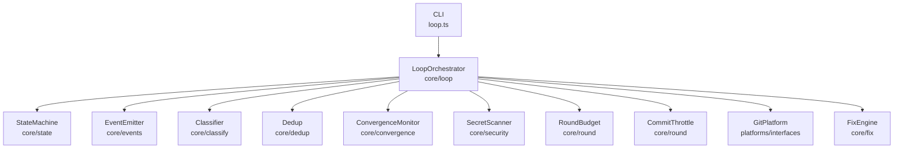

**圖表來源**
- [LoopOrchestrator.ts:1-80](https://github.com/mikeah2011/maestro/blob/master/src/core/loop/LoopOrchestrator.ts#L1-L80)
- [loop.ts:1-40](https://github.com/mikeah2011/maestro/blob/master/src/cli/commands/loop.ts#L1-L40)
- [GitPlatform.ts:1-40](https://github.com/mikeah2011/maestro/blob/master/src/platforms/interfaces/GitPlatform.ts#L1-L40)

`LoopOrchestrator` 本身不直接讀取 `.maestro.yaml`，也不直接建立 GitHub API client；這些由 `src/cli/commands/loop.ts` 負責。CLI 的角色是「組裝器」：載入設定、建立 platform、建立 AI provider、選擇是否啟用 FixEngine，再把物件注入 `LoopOrchestrator`。

**章節來源**
- [loop.ts:1-60](https://github.com/mikeah2011/maestro/blob/master/src/cli/commands/loop.ts#L1-L60)
- [loop.ts:60-160](https://github.com/mikeah2011/maestro/blob/master/src/cli/commands/loop.ts#L60-L160)

## 核心組件總覽

| 組件 | 主要職責 | 輸入 | 輸出 / 副作用 |
|---|---|---|---|
| `LoopOrchestrator` | 主循環、狀態切換、事件發射、回合間隔、CI/bot 輪詢 | PR number、選項、注入的平台與領域服務 | `LoopResult`：最終狀態、回合數、原因 |
| `StateMachine` | 驗證並執行狀態轉移 | 當前狀態、目標狀態 | `state.transition` 事件 |
| `EventEmitter` | 全域事件匯流與 JSONL 輸出 | 事件型別、payload | sink 寫出、handler 通知 |
| `RoundBudget` | 單輪防濫用預算 | round、行為記錄 | 違規拋出 `RoundBudgetViolation` |
| `CommitThrottle` | 單輪合併多個 fix 為一次 conventional commit | pending fixes | `RoundCommit` |
| `Classifier` | 規則欄柵 + LLM 分類 | Finding | `FindingClassification` |
| `Dedup` | 三層去重：exact → fuzzy Levenshtein → LLM semantic | findings | unique findings + duplicates map |
| `ConvergenceMonitor` | 數學收斂條件：單調遞減、Jaccard、類別新增、硬上限 | 每輪 critical hash set | convergence status |
| `SecretScanner` | 掃描 outgoing text 中的敏感資訊 | reply、PR body | redacted text + findings |
| `FixEngine` | M6 AI fix：讀上下文 → 調用 AI → 解析 replacement → 底到頂寫回 | classified actionable findings | `FixResult[]` |
| `GitPlatform` | PR、review、thread、CI、reaction 等平台操作 | PR number、sha、threadId | 平台數據與副作用 |

**章節來源**
- [LoopOrchestrator.ts:1-120](https://github.com/mikeah2011/maestro/blob/master/src/core/loop/LoopOrchestrator.ts#L1-L120)
- [StateMachine.ts:1-40](https://github.com/mikeah2011/maestro/blob/master/src/core/state/StateMachine.ts#L1-L40)
- [EventEmitter.ts:1-40](https://github.com/mikeah2011/maestro/blob/master/src/core/events/EventEmitter.ts#L1-L40)
- [RoundBudget.ts:1-40](https://github.com/mikeah2011/maestro/blob/master/src/core/round/RoundBudget.ts#L1-L40)
- [CommitThrottle.ts:1-40](https://github.com/mikeah2011/maestro/blob/master/src/core/round/CommitThrottle.ts#L1-L40)
- [Classifier.ts:1-40](https://github.com/mikeah2011/maestro/blob/master/src/core/classify/Classifier.ts#L1-L40)
- [Dedup.ts:1-40](https://github.com/mikeah2011/maestro/blob/master/src/core/dedup/Dedup.ts#L1-L40)
- [ConvergenceMonitor.ts:1-40](https://github.com/mikeah2011/maestro/blob/master/src/core/convergence/ConvergenceMonitor.ts#L1-L40)
- [SecretScanner.ts:1-40](https://github.com/mikeah2011/maestro/blob/master/src/core/security/SecretScanner.ts#L1-L40)
- [FixEngine.ts:1-60](https://github.com/mikeah2011/maestro/blob/master/src/core/fix/FixEngine.ts#L1-L60)
- [GitPlatform.ts:1-40](https://github.com/mikeah2011/maestro/blob/master/src/platforms/interfaces/GitPlatform.ts#L1-L40)

## 系統架構

整體架構可以分為四層：

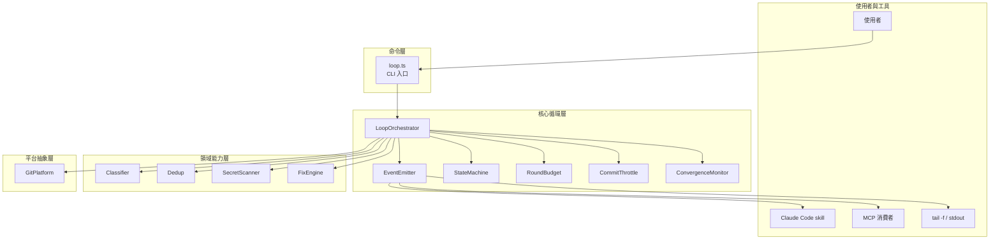

**圖表來源**
- [loop.ts:1-60](https://github.com/mikeah2011/maestro/blob/master/src/cli/commands/loop.ts#L1-L60)
- [LoopOrchestrator.ts:1-120](https://github.com/mikeah2011/maestro/blob/master/src/core/loop/LoopOrchestrator.ts#L1-L120)
- [EventEmitter.ts:1-40](https://github.com/mikeah2011/maestro/blob/master/src/core/events/EventEmitter.ts#L1-L40)
- [GitPlatform.ts:1-40](https://github.com/mikeah2011/maestro/blob/master/src/platforms/interfaces/GitPlatform.ts#L1-L40)

重要設計要點：

1. **事件優先於狀態顯示**：UI、skill、MCP、log consumer 不應直接讀取 orchestrator 內部狀態，而應訂閱 `EventEmitter`。
2. **sink 隔離異常**：sink 或 handler 拋錯不會中斷主循環，避免下游消費者崩潰拖垮整個 PR 審查。
3. **平台能力旗標**：orchestrator 根據 `GitPlatform.capabilities.inlineReplies`、`threadResolve`、`emojiReactions`、`requestReviewers` 等決定能做什麼，而不是對每個平台寫不同分支。
4. **dryRun 模式**：在 dry-run 下仍會 classification、dedup、convergence，但會跳過 fix、commit、reply、resolve、re-request。這適合稽核與報告用途。

**章節來源**
- [EventEmitter.ts:1-40](https://github.com/mikeah2011/maestro/blob/master/src/core/events/EventEmitter.ts#L1-L40)
- [EventEmitter.ts:60-108](https://github.com/mikeah2011/maestro/blob/master/src/core/events/EventEmitter.ts#L60-L108)
- [GitPlatform.ts:40-130](https://github.com/mikeah2011/maestro/blob/master/src/platforms/interfaces/GitPlatform.ts#L40-L130)
- [LoopOrchestrator.ts:120-200](https://github.com/mikeah2011/maestro/blob/master/src/core/loop/LoopOrchestrator.ts#L120-L200)

## 狀態機與循環生命週期

### 狀態定義

`LoopState` 包含正常前進狀態、錯誤/橫切狀態與終止狀態：

| 狀態 | 意義 |
|---|---|
| `waiting_for_ci` | 初始 CI 檢查尚未通過 |
| `waiting_for_bot` | 已過 CI，正在等待 bot review |
| `racing` | 取得最終 bot 狀態，準備開始本輪 |
| `classifying` | 拉取 review threads 並分類 |
| `fixing` | 執行可修復 finding |
| `commit_pushed` | 合併 fixes 成單一 commit |
| `replying` | 在討論串回覆並做 emoji reaction |
| `resolving` | 嘗試解析 thread |
| `ci_failing` | CI 失敗或錯誤 |
| `bot_timeout` | bot 未回覆且重請仍無結果 |
| `stopped` | 人為停止或其他終止 |
| `token_expired` | token 過期，無法恢復 |
| `rate_limited` | 觸發 rate limit |
| `human_intervened` | 人工干預 |
| `paused` | 暫停 |

### 合法轉移

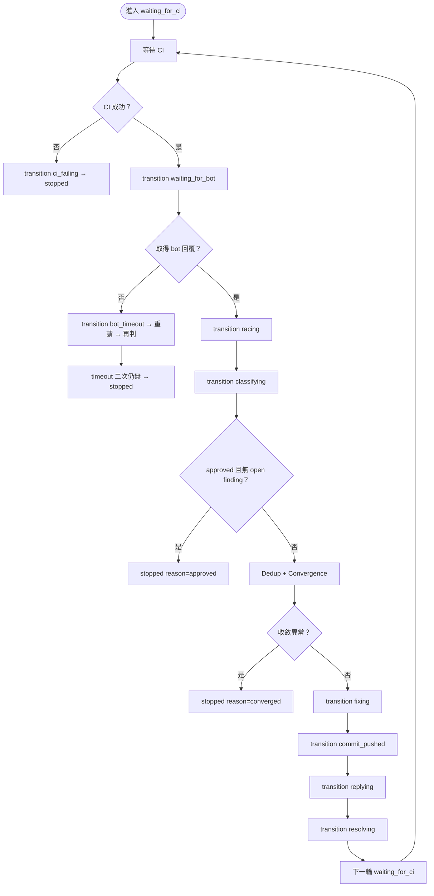

**圖表來源**
- [StateMachine.ts:15-45](https://github.com/mikeah2011/maestro/blob/master/src/core/state/StateMachine.ts#L15-L45)
- [LoopOrchestrator.ts:200-533](https://github.com/mikeah2011/maestro/blob/master/src/core/loop/LoopOrchestrator.ts#L200-L533)

### 完整序列圖

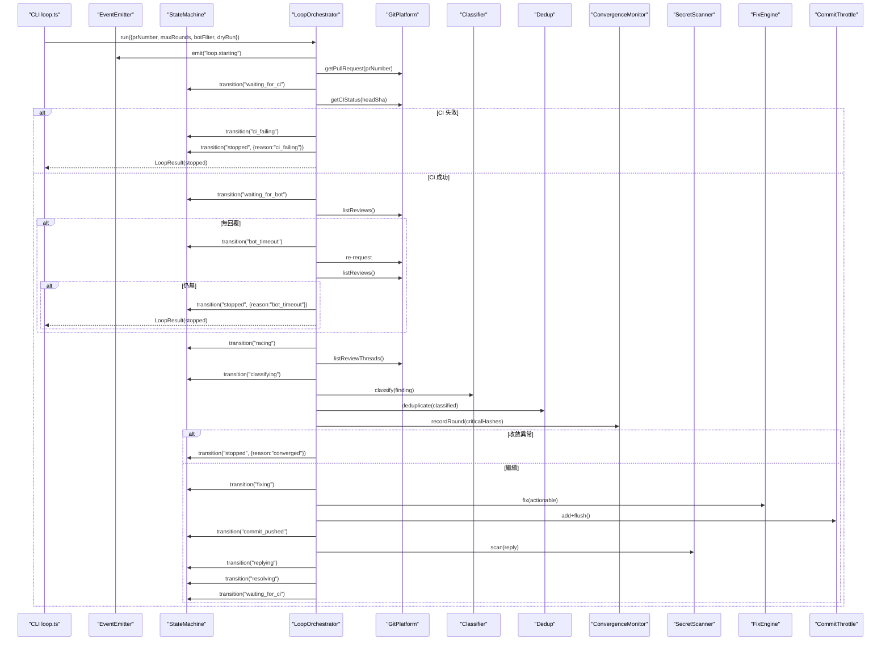

**圖表來源**
- [LoopOrchestrator.ts:200-533](https://github.com/mikeah2011/maestro/blob/master/src/core/loop/LoopOrchestrator.ts#L200-L533)
- [StateMachine.ts:15-45](https://github.com/mikeah2011/maestro/blob/master/src/core/state/StateMachine.ts#L15-L45)
- [FixEngine.ts:60-160](https://github.com/mikeah2011/maestro/blob/master/src/core/fix/FixEngine.ts#L60-L160)
- [CommitThrottle.ts:40-102](https://github.com/mikeah2011/maestro/blob/master/src/core/round/CommitThrottle.ts#L40-L102)

**章節來源**
- [StateMachine.ts:1-114](https://github.com/mikeah2011/maestro/blob/master/src/core/state/StateMachine.ts#L1-L114)
- [LoopOrchestrator.ts:200-533](https://github.com/mikeah2011/maestro/blob/master/src/core/loop/LoopOrchestrator.ts#L200-L533)

## 詳細組件分析

### 狀態機：`StateMachine`

`StateMachine` 是最小的可信狀態容器。它有三個關鍵集合：

| 集合 | 作用 |
|---|---|
| `FORWARD` | 每種狀態允許的前進目標 |
| `CROSS_CUTTING` | 任何非終止狀態都能跳轉的橫切狀態，例如 `stopped`、`rate_limited`、`token_expired`、`human_intervened` |
| `TERMINAL` | 沒有出邊的狀態，如 `stopped`、`token_expired` |

`canTransition` 先判斷是否已在終止狀態；如果是，一律拒絕。接著判斷目標是否屬於 cross-cutting；若是，允許。最後才查 `FORWARD[current]`。

`transition` 會：

1. 驗證合法性。
2. 記錄舊狀態。
3. 更新 `_state`。
4. 呼叫 `emitter.setContext({ state })`。
5. 發出 `state.transition` 事件。

這使得事件永遠能看到「新的 state context」，而不是舊值。

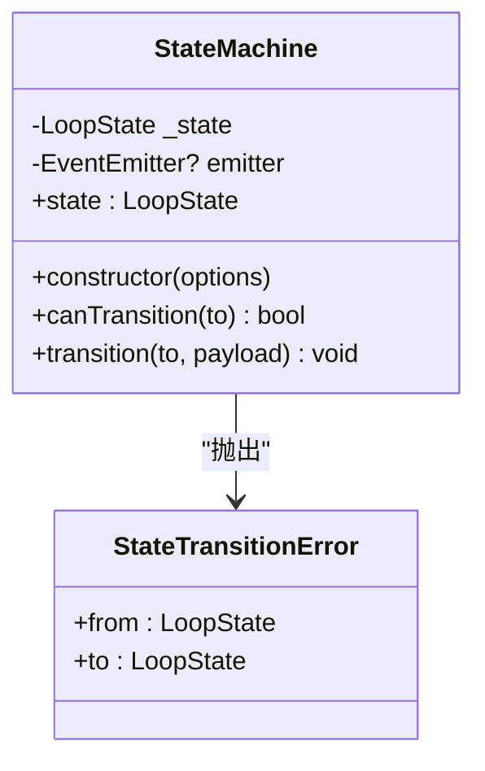

**圖表來源**
- [StateMachine.ts:40-114](https://github.com/mikeah2011/maestro/blob/master/src/core/state/StateMachine.ts#L40-L114)

**章節來源**
- [StateMachine.ts:1-114](https://github.com/mikeah2011/maestro/blob/master/src/core/state/StateMachine.ts#L1-L114)

### 事件系統：`EventEmitter`

`EventEmitter` 是一個 JSONL 事件匯流點。每個事件包含：

| 欄位 | 說明 |
|---|---|
| `ts` | ISO-8601 時間戳 |
| `type` | 點號命名空間事件類型，例如 `state.transition`、`round.start`、`classify.result` |
| `round` | 目前回合（若 context 有設） |
| `state` | 目前狀態（若 context 有設） |
| `payload` | 事件特定資料 |

它提供兩種消費方式：

1. **sink**：外部寫入器，例如 `stdoutSink()` 寫給 `process.stdout`。
2. **handlers**：in-process subscriber，例如 Claude Code skill 或 MCP server。

兩者都有 try/catch 保護，sink 或 handler 抛错不會中斷 event 發射。

CLI 的典型用法是：

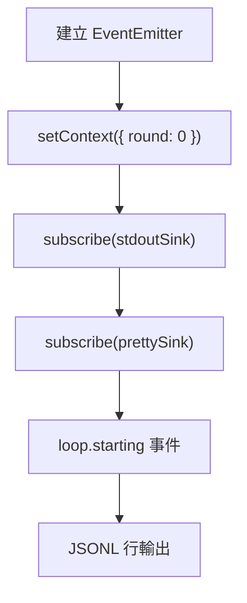

**圖表來源**
- [EventEmitter.ts:60-108](https://github.com/mikeah2011/maestro/blob/master/src/core/events/EventEmitter.ts#L60-L108)
- [loop.ts:120-160](https://github.com/mikeah2011/maestro/blob/master/src/cli/commands/loop.ts#L120-L160)

**章節來源**
- [EventEmitter.ts:1-108](https://github.com/mikeah2011/maestro/blob/master/src/core/events/EventEmitter.ts#L1-L108)
- [loop.ts:120-160](https://github.com/mikeah2011/maestro/blob/master/src/cli/commands/loop.ts#L120-L160)

### 回合預算：`RoundBudget`

`RoundBudget` 是防濫用的硬約束。它的設計哲學是「違反即崩潰」，而不是警告後繼續；因為警告式繼續會隨時間累積 spam。

| 預算 | 限制 |
|---|---|
| commits_per_round | 每輪最多一次 commit |
| replies_per_thread | 每個 discussion thread 每輪最多一次回覆 |
| pr_body_updates | 每輪最多一次 PR body 更新 |
| reviewer_requests | 每輪最多一次 reviewer request |
| findingsClassified | 透過 memoized `classify(hash, fn)` 防止同一 finding 重複計算 |

如果違反，會拋出 `RoundBudgetViolation`，包含 invariant 名稱、round 與訊息。

`nextRound()` 會重置 round、commits、repliesPerThread、prBodyUpdates、classifyCache、reviewerRequests。

**章節來源**
- [RoundBudget.ts:1-131](https://github.com/mikeah2011/maestro/blob/master/src/core/round/RoundBudget.ts#L1-L131)

### 提交節流：`CommitThrottle`

`CommitThrottle` 收集當輪所有 fix，並在 fixing 階段結尾 flush 成一個 conventional commit。

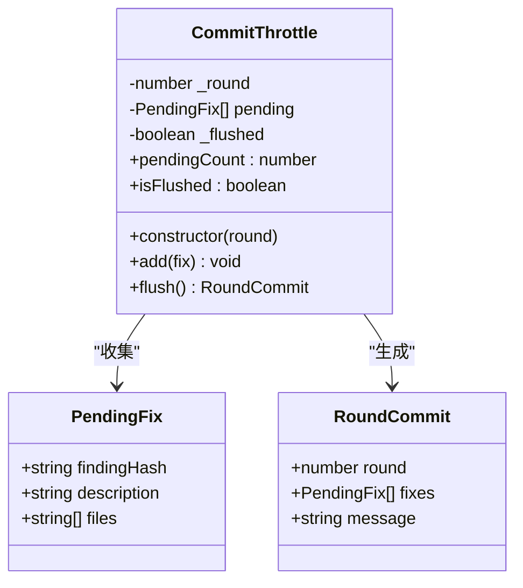

**圖表來源**
- [CommitThrottle.ts:1-102](https://github.com/mikeah2011/maestro/blob/master/src/core/round/CommitThrottle.ts#L1-L102)

message 格式使用 conventional commit：

- header：`fix: address review feedback (round N)`
- body：每筆 fix 以 `findingHash 前 8 字元: description` 呈現。

一旦 flush，再 add 或 flush 都會拋出 `CommitThrottleError`。

**章節來源**
- [CommitThrottle.ts:1-102](https://github.com/mikeah2011/maestro/blob/master/src/core/round/CommitThrottle.ts#L1-L102)

### 分類器：`Classifier`

Classifier 採用「規則欄柵 + LLM 備援」策略：

1. raw severity 是 critical/blocker/error/fatal → bug，confidence 1.0。
2. normalized severity 是 critical → bug，confidence 1.0。
3. file path 落在敏感路徑前綴 → bug，confidence 0.95。
4. title/body 出現 bug keyword → bug，confidence 0.90。
5. title/body 出現 taste keyword → taste，confidence 0.85。
6. 全部不匹配 → 呼叫可注入的 `llmClassify`；若沒有則返回 `unknown`。

每次 classify 都會透過 `onAudit` 留下審計紀錄，包括 finding hash、category、confidence、viaFence、fenceRule、model。

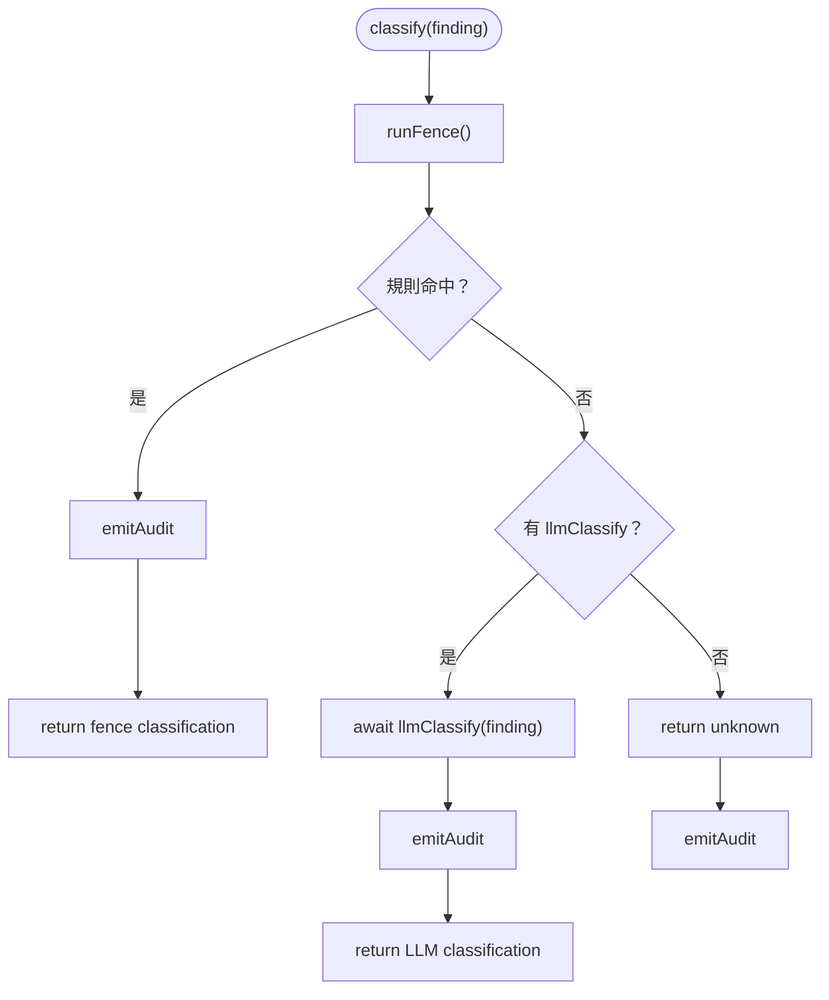

**圖表來源**
- [Classifier.ts:60-191](https://github.com/mikeah2011/maestro/blob/master/src/core/classify/Classifier.ts#L60-L191)

**章節來源**
- [Classifier.ts:1-191](https://github.com/mikeah2011/maestro/blob/master/src/core/classify/Classifier.ts#L1-L191)

### 去重：`Dedup`

Dedup 是三階管道，越便宜越先執行：

| Tier | 方法 | 預期殺除率 |
|---|---|---|
| Tier 1 | exact hash 相等 | ~60% |
| Tier 2 | Levenshtein normalized similarity ≥ threshold | ~25% |
| Tier 3 | 可注入的 LLM semantic similarity | ~15%，每輪最多 maxLlmCalls |

輸出包含：

- `unique`：保留的 finding。
- `duplicates`：duplicate hash → canonical hash。
- `tierStats`：各 tier 命中數。
- `llmCallsUsed`：Tier 3 使用的 LLM 次數。

Levenshtein 使用兩列 `Int32Array`，時間複雜度 O(m × n)，空間 O(n)。

**章節來源**
- [Dedup.ts:1-153](https://github.com/mikeah2011/maestro/blob/master/src/core/dedup/Dedup.ts#L1-L153)

### 收斂監控：`ConvergenceMonitor`

它追蹤每輪的 critical finding hash set，並強制以下不變量：

1. `|criticals(n+1)| ≤ |criticals(n)|`：不能變多。
2. Jaccard(criticals_n, criticals_{n-1}) ≤ 0.7：不能過度震盪。
3. round > 2 後不能出現新 category。
4. 最多 3 輪。

可能的 status：

| status | 含義 |
|---|---|
| `converging` | 正常繼續 |
| `clean` | 沒有 critical findings，完成 |
| `oscillating` | Jaccard > 0.7，需要人工介入 |
| `non_monotone` | critical count 增加，違反單調性 |
| `category_violation` | round 2 之後出現新 category |
| `round_cap` | 超過 3 輪 |

`computeFindingHash` 使用 file、line bucket、normalized category、surrounding content sha1 產生穩定 identity，容許 paraphrase 與小範圍 line shift。

**章節來源**
- [ConvergenceMonitor.ts:1-206](https://github.com/mikeah2011/maestro/blob/master/src/core/convergence/ConvergenceMonitor.ts#L1-L206)

### 機密掃描：`SecretScanner`

在 reply 與 PR body update 寫入平台之前，必須經過 SecretScanner。內建模式包括：

- AWS access key / secret
- GitHub token
- PEM private key
- JWT
- Stripe key
- Slack token
- generic API key

scan 的結果包含 clean flag、redacted text、以及每個 match 的位置與 redacted 表示。

注意：scanner 對 pattern 使用 clone 加 `/g` 來遍歷所有 match，並以原始文字位置計算 offset，確保 redacted 字串中的位置穩定。

**章節來源**
- [SecretScanner.ts:1-136](https://github.com/mikeah2011/maestro/blob/master/src/core/security/SecretScanner.ts#L1-L136)

### 修復引擎：`FixEngine`

FixEngine 是 M6 的 onFix 實作，對應 `LoopOrchestrator.onFix` 簽章：

1. 讀取 finding location 的檔案。
2. 讀取 ±CONTEXT_LINES 行內容。
3. 構建 prompt，調用 `AIProvider.complete`。
4. 解析 JSON response：`canFix`、`confidence`、`description`、`replacements`。
5. 若 confidence < minConfidence 或缺少 replacements，跳過。
6. 按 startLine 由大到小排序，避免修改 earlier line 影響 later line number。
7. 寫回檔案。
8. 返回 `FixResult`。

它使用可注入的 readFile/writeFile，讓測試不需要碰真實 filesystem。

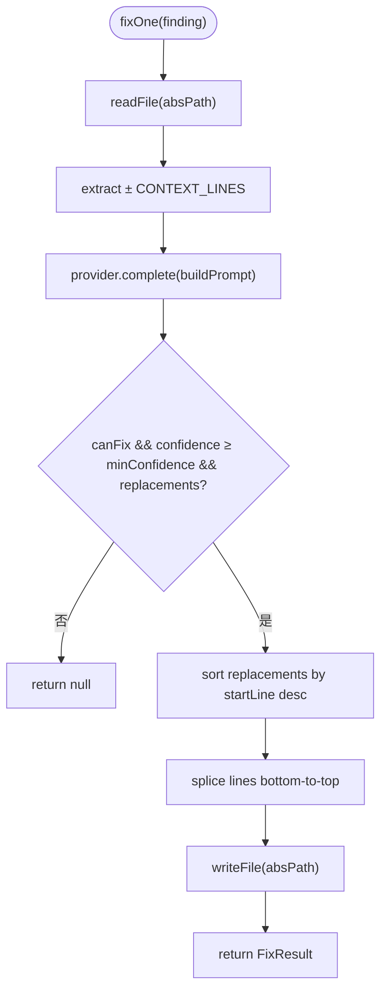

**圖表來源**
- [FixEngine.ts:60-200](https://github.com/mikeah2011/maestro/blob/master/src/core/fix/FixEngine.ts#L60-L200)

**章節來源**
- [FixEngine.ts:1-216](https://github.com/mikeah2011/maestro/blob/master/src/core/fix/FixEngine.ts#L1-L216)

### 平台抽象：`GitPlatform`

`GitPlatform` 是所有平台操作的抽象。它暴露：

- PR 讀取、diff、body 更新。
- reviewer request、PR comment。
- reviews、review threads、thread reply、thread resolve。
- CI status。
- rate limit info。
- optional emoji reaction。

orchestrator 不會直接知道這是 GitHub、GitLab 還是 Gitea；它只看 capability flags。

**章節來源**
- [GitPlatform.ts:1-130](https://github.com/mikeah2011/maestro/blob/master/src/platforms/interfaces/GitPlatform.ts#L1-L130)

## 資料路徑與事件流

### 主要資料路徑

**圖表來源**
- [LoopOrchestrator.ts:200-533](https://github.com/mikeah2011/maestro/blob/master/src/core/loop/LoopOrchestrator.ts#L200-L533)
- [Classifier.ts:60-191](https://github.com/mikeah2011/maestro/blob/master/src/core/classify/Classifier.ts#L60-L191)
- [Dedup.ts:60-153](https://github.com/mikeah2011/maestro/blob/master/src/core/dedup/Dedup.ts#L60-L153)
- [ConvergenceMonitor.ts:40-200](https://github.com/mikeah2011/maestro/blob/master/src/core/convergence/ConvergenceMonitor.ts#L40-L200)
- [FixEngine.ts:60-200](https://github.com/mikeah2011/maestro/blob/master/src/core/fix/FixEngine.ts#L60-L200)
- [CommitThrottle.ts:40-102](https://github.com/mikeah2011/maestro/blob/master/src/core/round/CommitThrottle.ts#L40-L102)

### 事件類型彙整

以下是 orchestrator 發射的主要事件類型：

| 事件類型 | 觸發時機 | 典型 payload |
|---|---|---|
| `loop.starting` | CLI 啟動 orchestrator | prNumber、maxRounds、botFilter、dryRun |
| `state.transition` | StateMachine 切換 | from、to、payload |
| `round.start` | 每輪開始 | round、prNumber |
| `ci.polling` | CI polling 期間 | headSha、pendingCount、failingCount |
| `round.bot_status` | 取得 bot 狀態後 | bots[]、satisfied |
| `bot.satisfied` | 發現 previously unseen satisfied/approved bot | bot、round、state |
| `round.decisions` | 計算 fix/defer/reject 決策後 | total、fix、defer、reject |
| `classify.result` | 單筆 finding 分類完成 | round、category、severity、confidence、file、line |
| `round.classified` | 每輪 classification + dedup + convergence 完成 | total、unique、criticals、duplicates、convergence |
| `fix.applied` | 單筆 fix 完成 | round、description、files |
| `fix.skipped` | 沒有 actionable fix | round、reason、categories、deferred |
| `round.committed` | 提交完成 | round、fixCount、message |
| `thread.replied` | 單筆 thread 回覆 | threadId、category |
| `thread.resolved` | 單筆 thread 解析 | threadId |
| `rerequest.skipped` | 因仍有 open threads 而跳過 re-request | prNumber、reason |
| `pr.body_updated` | approved 後更新 PR body | prNumber、length |
| `loop.error` | 主循環 catch 區塊 | error、round |

**章節來源**
- [LoopOrchestrator.ts:200-533](https://github.com/mikeah2011/maestro/blob/master/src/core/loop/LoopOrchestrator.ts#L200-L533)
- [EventEmitter.ts:1-40](https://github.com/mikeah2011/maestro/blob/master/src/core/events/EventEmitter.ts#L1-L40)

## 錯誤處理與重試機制

### 錯誤分層

| 層級 | 行為 |
|---|---|
| **狀態非法** | `StateMachine.transition` 拋出 `StateTransitionError`，代表程式邏輯錯誤，不應被吞掉。 |
| **預算違規** | `RoundBudget` 拋出 `RoundBudgetViolation`，代表開發者違反了「每輪一次」的防濫用合約。 |
| **提交節流違規** | `CommitThrottle` 拋出 `CommitThrottleError`，代表同一 round 多次 flush 或追加。 |
| **平台/網路/API** | 多數 platform 呼叫被包在 try/catch 或作為 non-fatal 分支，避免單一 API 失敗拖垮整個 loop。 |
| **主循環例外** | `run()` 最外層 catch 會發射 `loop.error`，嘗試 transition 到 `stopped`，並返回 `{finalState:'stopped', reason:'error', error}`。 |
| **sink/handler 異常** | `EventEmitter.emit` 不會讓 sink 或 handler 的 exception 向上冒泡。 |

### CI 重試與超時

`waitForCI` 不是簡單的一次查詢，而是 poll loop：

1. 呼叫 `platform.getCIStatus(headSha)`。
2. success → 返回 true。
3. failure/error → 返回 false。
4. 超過 30 分鐘 → 返回 false。
5. 否則 sleep `ciPollIntervalMs`（預設 10 秒）。

CI 失敗會導致：

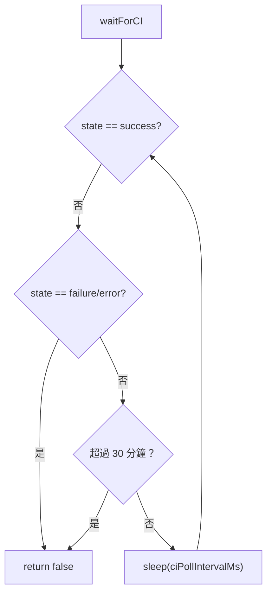

**圖表來源**
- [LoopOrchestrator.ts:533-697](https://github.com/mikeah2011/maestro/blob/master/src/core/loop/LoopOrchestrator.ts#L533-L697)

### Bot 重試

bot timeout 的路徑是：

1. 第一次 `waitForBotReviews` 取得空結果。
2. 跳轉到 `bot_timeout`。
3. 呼叫 `reRequestBotReviews`。
4. 再次 `waitForBotReviews`。
5. 仍然沒有 → 跳轉到 `stopped`，reason 為 `bot_timeout`。

此外，在每輪結束後，如果曾回覆 thread 且所有 thread 已解析，orchestrator 會過濾尚未在本輪 re-request 過的 bot，再次請求 review。

### 平台能力不足時的降級

orchestrator 不會假設所有平台支援所有功能：

- 只有 `capabilities.inlineReplies` 為真時才回覆 thread。
- 只有 `capabilities.threadResolve` 為真時才 call `resolveReviewThread`。
- 只有 `capabilities.requestReviewers` 為真時才 re-request reviewers。
- 只有 `capabilities.emojiReactions` 為真時才加 emoji reaction。

這種設計讓較舊或功能較弱的平台也能參與 loop，只是部分優化路徑會被跳過。

**章節來源**
- [LoopOrchestrator.ts:200-533](https://github.com/mikeah2011/maestro/blob/master/src/core/loop/LoopOrchestrator.ts#L200-L533)
- [LoopOrchestrator.ts:533-697](https://github.com/mikeah2011/maestro/blob/master/src/core/loop/LoopOrchestrator.ts#L533-L697)
- [StateMachine.ts:40-114](https://github.com/mikeah2011/maestro/blob/master/src/core/state/StateMachine.ts#L40-L114)
- [RoundBudget.ts:1-131](https://github.com/mikeah2011/maestro/blob/master/src/core/round/RoundBudget.ts#L1-L131)
- [CommitThrottle.ts:1-102](https://github.com/mikeah2011/maestro/blob/master/src/core/round/CommitThrottle.ts#L1-L102)

## 依賴關係分析

### 組件耦合圖

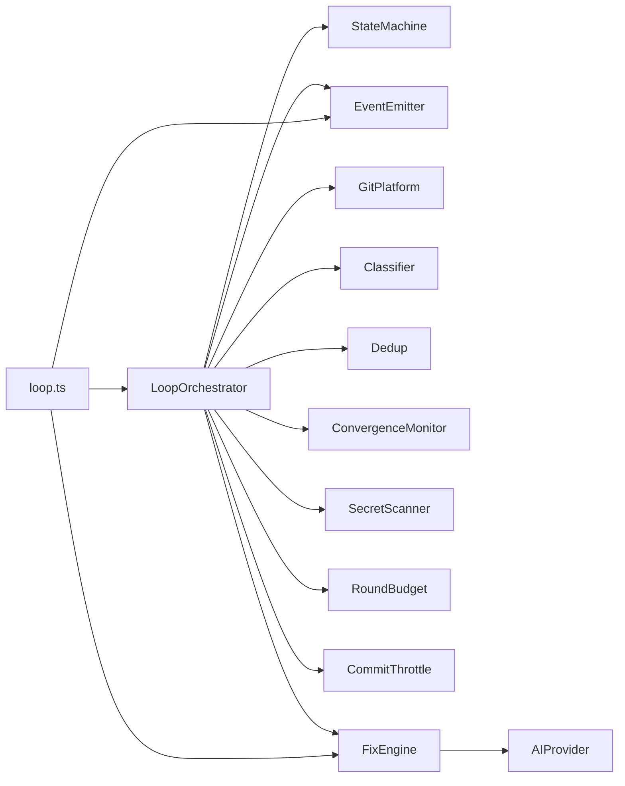

**圖表來源**
- [LoopOrchestrator.ts:1-120](https://github.com/mikeah2011/maestro/blob/master/src/core/loop/LoopOrchestrator.ts#L1-L120)
- [FixEngine.ts:1-60](https://github.com/mikeah2011/maestro/blob/master/src/core/fix/FixEngine.ts#L1-L60)
- [loop.ts:1-60](https://github.com/mikeah2011/maestro/blob/master/src/cli/commands/loop.ts#L1-L60)

### 高耦合點

1. **LoopOrchestrator ↔ StateMachine**：orchestrator 每段邏輯都伴隨 `sm.transition(...)`，因此狀態順序是程式碼中最強烈的契約。
2. **LoopOrchestrator ↔ EventEmitter**：幾乎所有重要步驟都手動 emit 事件，event 是外部觀測的主接口。
3. **LoopOrchestrator ↔ GitPlatform**：雖然介面抽象化，但 orchestrator 直接知道哪些 method 代表「等 CI」、「等 bot」、「reply in thread」、「resolve thread」。
4. **CLI ↔ LoopOrchestrator**：CLI 決定是否注入 FixEngine、Classifier.llmClassify、onDecide、onCommit。

### 低耦合點

1. **LoopOrchestrator 不依賴具體 AI provider**：FixEngine 依賴 `AIProvider`，orchestrator 只看到 `onFix(findings, round)`。
2. **EventEmitter 不依賴業務邏輯**：它不知道什麼是 round、classification、commit，只知道 type 與 payload。
3. **RoundBudget / CommitThrottle 是純函式風格的防禦邊界**：它們只關心自身 invariant，不關心 PR、finding、platform。

**章節來源**
- [LoopOrchestrator.ts:1-120](https://github.com/mikeah2011/maestro/blob/master/src/core/loop/LoopOrchestrator.ts#L1-L120)
- [FixEngine.ts:1-60](https://github.com/mikeah2011/maestro/blob/master/src/core/fix/FixEngine.ts#L1-L60)
- [EventEmitter.ts:1-40](https://github.com/mikeah2011/maestro/blob/master/src/core/events/EventEmitter.ts#L1-L40)
- [GitPlatform.ts:1-40](https://github.com/mikeah2011/maestro/blob/master/src/platforms/interfaces/GitPlatform.ts#L1-L40)

## 效能與防濫用設計

### 防濫用機制

| 機制 | 目的 | 失效行為 |
|---|---|---|
| `RoundBudget.commits_per_round` | 避免每筆 finding 都產生一個 commit | 拋出 `RoundBudgetViolation` |
| `RoundBudget.replies_per_thread` | 避免同一 thread 反覆回覆 | 拋出 `RoundBudgetViolation` |
| `RoundBudget.pr_body_updates` | 避免重複更新 PR body | 拋出 `RoundBudgetViolation` |
| `RoundBudget.reviewer_requests` | 避免每輪多次 reviewer request | 拋出 `RoundBudgetViolation` |
| `RoundBudget.classify` memoization | 避免同一 finding hash 重複分類 | 直接回傳 cache |
| `CommitThrottle` single-flush | 每輪只允許一個 commit | 拋出 `CommitThrottleError` |
| `ConvergenceMonitor.MAX_ROUNDS` | 避免無限迭代 | 返回 `round_cap` |
| `Dedup.maxLlmCalls` | 控制 Tier 3 LLM cost | 超過上限後不再呼叫 LLM |
| `Classifier.llmClassify` 可選 | 無 LLM 時仍能運作 | 回傳 `unknown` |
| `SecretScanner` | 防止 bot quote 回傳敏感 token | redact 並留下 audit findings |

### 時間複雜度觀察

| 步驟 | 複雜度 | 說明 |
|---|---:|---|
| Classifier.runFence | O(k) | k 是關鍵字/前綴數量，固定常數 |
| Dedup.tier1 | O(u) per item | u 是目前 unique 長度，hash 比較 |
| Dedup.tier2 | O(u × m × n) per item | Levenshtein |
| Dedup.tier3 | O(u × calls) | 受 maxLlmCalls 限制 |
| FixEngine.fix | O(f × c) | f 是 actionable findings，c 是 AI 成本 |
| ConvergenceMonitor.recordRound | O(c) | c 是 critical hash set 大小 |
| SecretScanner.scan | O(p × matches) | p 是 pattern 數量 |

### 最佳實踐建議

1. **production 一定要設置 EventEmitter sink**：默認 noop sink 不會寫出 JSONL，Claude Code skill、MCP、`tail -f` 將看不到事件。
2. **不要忽略 convergence terminating status**：`oscillating`、`non_monotone`、`category_violation` 應該升級給人類，而不是自動繼續。
3. **保持 RoundBudget invariant**：任何新增的 platform write 都要檢查是否需要 budget 保護。
4. **避免在 reply 中直接使用 bot output**：務必經過 SecretScanner。
5. **在 CI 不穩的環境中調整 ciPollIntervalMs 與 ci 超時**：預設 10 秒 polling、30 分鐘總超時。
6. **dry-run 適合 CI job 回報**：可以跑完整 classification + dedup + convergence，但不改 repo。

**章節來源**
- [RoundBudget.ts:1-131](https://github.com/mikeah2011/maestro/blob/master/src/core/round/RoundBudget.ts#L1-L131)
- [CommitThrottle.ts:1-102](https://github.com/mikeah2011/maestro/blob/master/src/core/round/CommitThrottle.ts#L1-L102)
- [Dedup.ts:1-153](https://github.com/mikeah2011/maestro/blob/master/src/core/dedup/Dedup.ts#L1-L153)
- [ConvergenceMonitor.ts:1-206](https://github.com/mikeah2011/maestro/blob/master/src/core/convergence/ConvergenceMonitor.ts#L1-L206)
- [SecretScanner.ts:1-136](https://github.com/mikeah2011/maestro/blob/master/src/core/security/SecretScanner.ts#L1-L136)
- [EventEmitter.ts:1-40](https://github.com/mikeah2011/maestro/blob/master/src/core/events/EventEmitter.ts#L1-L40)

## 故障排除指南

### 常見症狀與診斷路徑

| 症狀 | 可能原因 | 診斷方式 |
|---|---|---|
| loop 立刻停止且 reason=`stopped` | CI 失敗、max rounds、或主循環 throw | 檢查 `state.transition`、`loop.error`、`ci.polling` |
| loop 停在 `waiting_for_bot` | bot 未回覆或 timeout | 查看 `round.bot_status`、確認 bot filter、platform.requestReviewers |
| 同一問題被重複處理 | Dedup 未生效或 finding.hash 不穩定 | 檢查 `round.classified` 中 duplicates、確認 computeFindingHash |
| 每輪 critical count 上升 | 修復未解決問題或新增問題 | 查看 convergence status `non_monotone` |
| 一直 oscillating | Jaccard > 0.7 | convergence status `oscillating`，需要人工介入 |
| 沒有 commit 產生 | dry-run、no actionable fix、或 onFix 返回空 | 查看 `fix.skipped`、`round.committed` |
| reply 中有敏感 token | SecretScanner 未執行或 pattern 不匹配 | 檢查 `thread.replied`、pattern 配置 |
| Claude Code skill 看不到事件 | EventEmitter 沒有 stdoutSink | CLI 應 `emitter.subscribe(stdoutSink)` |
| 狀態轉移拋異常 | 非法狀態跳躍 | 檢查 StateMachine `FORWARD` 與 orchestrator 轉移順序 |

### 建議的觀察清單

1. **先看 `state.transition`**：確定 orchestrator 當前在哪個狀態。
2. **再看 `round.*` 事件**：`round.start`、`round.bot_status`、`round.decisions`、`round.classified`、`round.committed`。
3. **檢查 convergence status**：是否 clean、converging、oscillating、non_monotone、category_violation、round_cap。
4. **檢查 fix 相關事件**：`fix.applied`、`fix.skipped`。
5. **檢查 thread 相關事件**：`thread.replied`、`thread.resolved`。
6. **若有異常，最後看 `loop.error`**。

**章節來源**
- [LoopOrchestrator.ts:200-533](https://github.com/mikeah2011/maestro/blob/master/src/core/loop/LoopOrchestrator.ts#L200-L533)
- [StateMachine.ts:40-114](https://github.com/mikeah2011/maestro/blob/master/src/core/state/StateMachine.ts#L40-L114)
- [EventEmitter.ts:60-108](https://github.com/mikeah2011/maestro/blob/master/src/core/events/EventEmitter.ts#L60-L108)

## 結論

`LoopOrchestrator` 是一個以狀態機為骨架、以事件為神經系統、以預算與節流為安全閥的 PR 審查收斂引擎。它把原本分散在 CI、bot review、AI classification、AI fix、git commit、PR reply、thread resolve 的多個動作，整合成一個可重複、可度量、可停止的業務迴圈。

它的價值不在於某個單一演算法，而在於把這些元件放在正確的順序上：

1. **先等 CI**，不讓 bot 浪費資源在壞 build 上。
2. **再等 bot**，取得足夠的 review context。
3. **先分類、再去重**，避免對同一問題重複處理。
4. **用 ConvergenceMonitor 保護 loop**，避免無窮迭代或震盪。
5. **用 RoundBudget 與 CommitThrottle 保護寫入**，確保每輪只有一個 commit、每個 thread 只回覆一次。
6. **所有寫入前先經 SecretScanner**，避免 echo bot quote 造成資安問題。
7. **所有狀態與動作都透過 EventEmitter 輸出 JSONL**，讓 Claude Code skill、MCP、CLI 與 log consumer 共享同一份 truth。

未來若要擴展，最安全的做法是：

- 新增狀態時，先在 `StateMachine.FORWARD` 中明確列出允許轉移。
- 新增寫入動作時，檢查是否需要 `RoundBudget` 保護。
- 新增對外 observable 行為時，補上 `EventEmitter` 事件。
- 新增外部依賴時，保持 injectable，讓 `LoopOrchestrator` 繼續專注於流程編排，而不是具體實作細節。