# 測試策略

**本文引用的檔案**

- [package.json](https://github.com/mikeah2011/maestro/blob/master/package.json)
- [vitest.config.ts](https://github.com/mikeah2011/maestro/blob/master/vitest.config.ts)
- [src/index.ts](https://github.com/mikeah2011/maestro/blob/master/src/index.ts)
- [src/ai/interfaces/AIProvider.ts](https://github.com/mikeah2011/maestro/blob/master/src/ai/interfaces/AIProvider.ts)
- [tests/ai/providers/ClaudeCodeProvider.test.ts](https://github.com/mikeah2011/maestro/blob/master/tests/ai/providers/ClaudeCodeProvider.test.ts)
- [tests/ai/providers/ClaudeProvider.test.ts](https://github.com/mikeah2011/maestro/blob/master/tests/ai/providers/ClaudeProvider.test.ts)
- [src/platforms/interfaces/GitPlatform.ts](https://github.com/mikeah2011/maestro/blob/master/src/platforms/interfaces/GitPlatform.ts)
- [tests/platforms/github/GitHubPlatform.test.ts](https://github.com/mikeah2011/maestro/blob/master/tests/platforms/github/GitHubPlatform.test.ts)
- [tests/platforms/github/mappers.test.ts](https://github.com/mikeah2011/maestro/blob/master/tests/platforms/github/mappers.test.ts)
- [src/core/events/EventEmitter.ts](https://github.com/mikeah2011/maestro/blob/master/src/core/events/EventEmitter.ts)
- [src/core/state/StateMachine.ts](https://github.com/mikeah2011/maestro/blob/master/src/core/state/StateMachine.ts)
- [tests/core/state/StateMachine.test.ts](https://github.com/mikeah2011/maestro/blob/master/tests/core/state/StateMachine.test.ts)
- [tests/core/integration.test.ts](https://github.com/mikeah2011/maestro/blob/master/tests/core/integration.test.ts)
- [src/core/convergence/ConvergenceMonitor.ts](https://github.com/mikeah2011/maestro/blob/master/src/core/convergence/ConvergenceMonitor.ts)
- [tests/core/convergence/ConvergenceMonitor.test.ts](https://github.com/mikeah2011/maestro/blob/master/tests/core/convergence/ConvergenceMonitor.test.ts)
- [src/core/classify/Classifier.ts](https://github.com/mikeah2011/maestro/blob/master/src/core/classify/Classifier.ts)
- [tests/core/classify/Classifier.test.ts](https://github.com/mikeah2011/maestro/blob/master/tests/core/classify/Classifier.test.ts)

## 目錄

1. [引言](#引言)
2. [專案結構與測試位置](#專案結構與測試位置)
3. [核心測試設定](#核心測試設定)
4. [測試覆蓋率要求](#測試覆蓋率要求)
5. [模組測試對照與測試策略](#模組測試對照與測試策略)
6. [Mock 策略與外部依賴隔離](#mock-策略與外部依賴隔離)
7. [相依性注入與可測試性設計](#相依性注入與可測試性設計)
8. [Integration Test 設計模式](#integration-test-設計模式)
9. [屬性測試與 fast-check 整合建議](#屬性測試與-fast-check-整合建議)
10. [測試撰寫規範與常見模式](#測試撰寫規範與常見模式)
11. [除錯技巧](#除錯技巧)
12. [新增測試的檢查清單與最佳實踐](#新增測試的檢查清單與最佳實踐)
13. [結論](#結論)

## 引言

本文件的目標是為 Maestro 建立一份完整的測試策略文檔，說明如何基於 Vitest 單元測試框架與 fast-check 屬性測試能力，維護現有程式碼的測試品質，並指導未來功能的測試完整性。

專案是一個「AI PR Review Bot 協調器」：它串接 AI Provider、Git Platform、狀態機、回合預算、事件系統、分類器、去重機制與安全掃描器等模組，並透過 CLI 驅動整個流程。因此，測試策略必須同時涵蓋以下層面：

- **單元測試**：驗證單一類別或純函數的行為。
- **集成測試**：驗證多個核心原語之間的協作關係。
- **模擬測試**：隔離外部 HTTP、子程序、Git、平台 API 等副作用。
- **屬性測試**：針對數學不變量、穩定性、邊界條件進行泛化驗證。
- **覆蓋率門檻**：維持 lines/functions/statements 80%、branches 75% 的基線。

## 專案結構與測試位置

專案採用「來源模組結構對稱」的測試組織方式：

| 來源模組 | 測試位置 | 主要責任 |
|---|---|---|
| `src/ai/` | `tests/ai/` | AI Provider 抽象與實作測試 |
| `src/cli/` | `tests/cli/` | CLI 指令測試 |
| `src/config/` | `tests/config/` | 設定載入與展開邏輯測試 |
| `src/core/` | `tests/core/` | 狀態機、事件、回合、分類、收斂、集成測試 |
| `src/platforms/` | `tests/platforms/` | Git Platform 抽象與 GitHub 實作測試 |

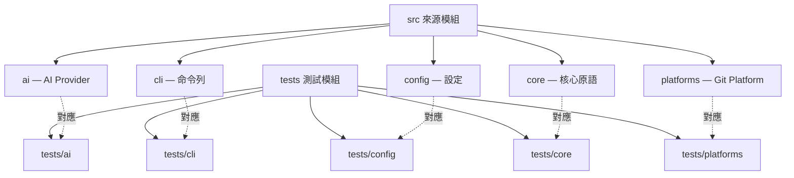

**圖表來源**
- [package.json:1-89](https://github.com/mikeah2011/maestro/blob/master/package.json#L1-L89)
- [vitest.config.ts:1-31](https://github.com/mikeah2011/maestro/blob/master/vitest.config.ts#L1-L31)

**章節來源**
- [package.json:1-89](https://github.com/mikeah2011/maestro/blob/master/package.json#L1-L89)
- [vitest.config.ts:1-31](https://github.com/mikeah2011/maestro/blob/master/vitest.config.ts#L1-L31)

## 核心測試設定

Vitest 設定位於 `vitest.config.ts`，主要包含以下關鍵行為：

| 設定項目 | 值與行為 |
|---|---|
| 測試環境 | `node` |
| 全域 API | `globals: false`，必須顯式導入 `describe`、`expect`、`it` |
| 測試匹配規則 | `tests/**/*.test.ts` 與 `src/**/*.test.ts` |
| 覆蓋率提供者 | `v8` |
| 覆蓋率報告格式 | `text`、`json-summary`、`html` |
| 覆蓋率範圍 | `src/**/*.ts` |
| 覆蓋率排除 | 測試檔案、CLI 入口、types 目錄 |
| 路徑別名 | `@` 指向 `src` |

測試腳本定義在 `package.json`：

| 腳本 | 用途 |
|---|---|
| `test` | 執行所有測試 |
| `test:watch` | 監控模式 |
| `test:coverage` | 執行測試並產生覆蓋率報告 |
| `verify` | 型別檢查＋測試 |

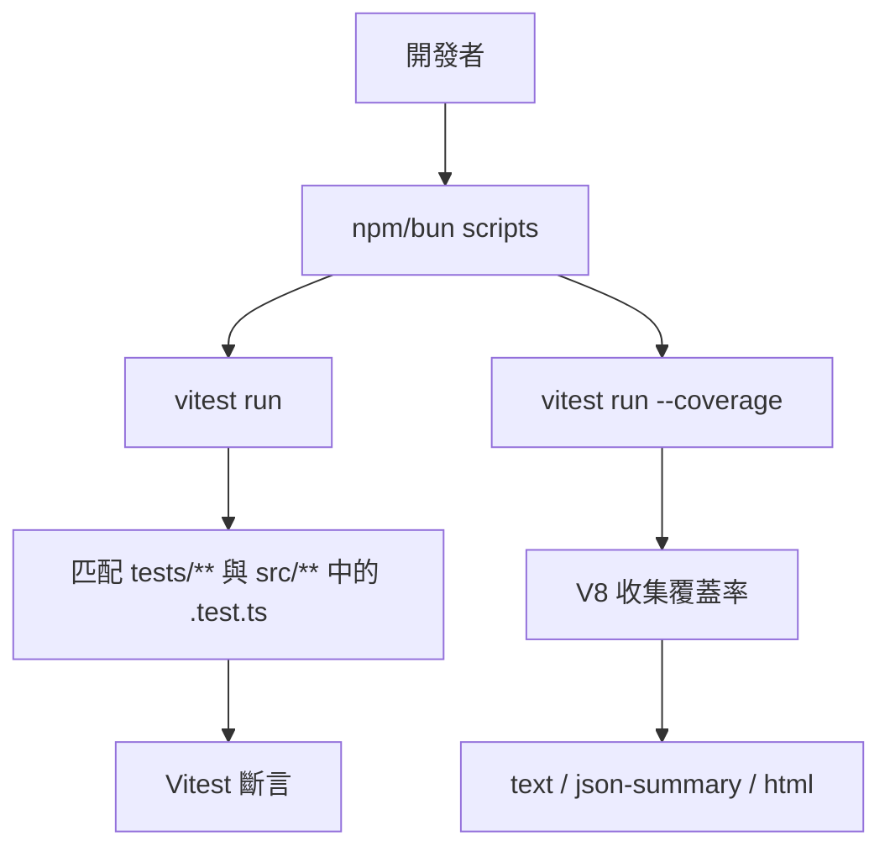

**圖表來源**
- [package.json:1-89](https://github.com/mikeah2011/maestro/blob/master/package.json#L1-L89)
- [vitest.config.ts:1-31](https://github.com/mikeah2011/maestro/blob/master/vitest.config.ts#L1-L31)

**章節來源**
- [package.json:1-89](https://github.com/mikeah2011/maestro/blob/master/package.json#L1-L89)
- [vitest.config.ts:1-31](https://github.com/mikeah2011/maestro/blob/master/vitest.config.ts#L1-L31)

## 測試覆蓋率要求

根據 Vitest 設定，專案的覆蓋率門檻如下：

| 指標 | 門檻 | 說明 |
|---|---:|---|
| Lines | 80% | 行覆蓋率 |
| Functions | 80% | 函式覆蓋率 |
| Statements | 80% | 陳述式覆蓋率 |
| Branches | 75% | 分支覆蓋率 |

這表示：

- 大部分邏輯都必須被執行到。
- 分支（例如 if/else、try/catch、短路運算）需要較高的關注度，但允許比主體邏輯略低一點的覆蓋率。
- CLI 入口與 types 目錄被排除在覆蓋率之外，這是合理的：CLI 入口通常是薄殼，types 不帶執行邏輯。
- 新增功能時，若導致覆蓋率低於門檻，`bun run test:coverage` 會失敗，形成持續整合保護。

### 覆蓋率報告使用建議

- 本地開發時優先查看 HTML 報告，便於快速定位未覆蓋分支。
- CI 中應保留 `text` 或 `json-summary`，便於記錄趨勢。
- 不要為了達到 80% 而寫無意義的假測試；應以「行為驗證」為優先。

**章節來源**
- [vitest.config.ts:1-31](https://github.com/mikeah2011/maestro/blob/master/vitest.config.ts#L1-L31)

## 模組測試對照與測試策略

### AI Provider 模組

AI Provider 提供抽象介面，由具體實作（Claude、Claude Code CLI 等）實現。測試重點在於：

- 抽象介面定義是否被正確理解。
- HTTP 或子程序等外部依賴是否被完全隔離。
- 初始化、連線測試、模型解析、完成呼叫等關鍵路徑是否被覆蓋。

#### 抽象介面

`AIProvider` 抽象類別定義了類型、配置、初始化、連線測試、模型解析與完成呼叫等契約。測試應確保每個實作遵守該契約。

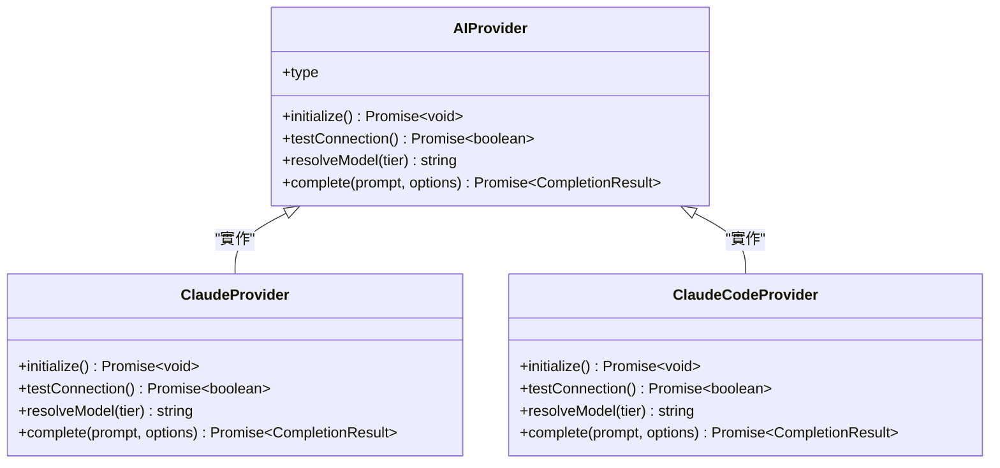

**圖表來源**
- [src/ai/interfaces/AIProvider.ts:1-114](https://github.com/mikeah2011/maestro/blob/master/src/ai/interfaces/AIProvider.ts#L1-L114)
- [tests/ai/providers/ClaudeProvider.test.ts:1-177](https://github.com/mikeah2011/maestro/blob/master/tests/ai/providers/ClaudeProvider.test.ts#L1-L177)
- [tests/ai/providers/ClaudeCodeProvider.test.ts:1-200](https://github.com/mikeah2011/maestro/blob/master/tests/ai/providers/ClaudeCodeProvider.test.ts#L1-L200)

#### ClaudeProvider 測試策略

- 使用 `vi.mock('axios')` 取代實際 HTTP 請求。
- 使用 helper 建立標準 Anthropic 回應。
- 驗證初始化錯誤、headers、baseUrl、model tier、JSON 解析、成本估算等。
- 驗證未完成初始化時呼叫 `complete()` 會拋出錯誤。

#### ClaudeCodeProvider 測試策略

- 使用 `vi.mock('node:child_process')` 取代實際子程序。
- 使用 `EventEmitter` 模擬 stdout/stderr。
- 驗證 binary 存在性、idempotent initialize、error handling、custom binary path、prompt 組合、JSON 解析等。

**章節來源**
- [src/ai/interfaces/AIProvider.ts:1-114](https://github.com/mikeah2011/maestro/blob/master/src/ai/interfaces/AIProvider.ts#L1-L114)
- [tests/ai/providers/ClaudeProvider.test.ts:1-177](https://github.com/mikeah2011/maestro/blob/master/tests/ai/providers/ClaudeProvider.test.ts#L1-L177)
- [tests/ai/providers/ClaudeCodeProvider.test.ts:1-200](https://github.com/mikeah2011/maestro/blob/master/tests/ai/providers/ClaudeCodeProvider.test.ts#L1-L200)

### Git Platform 模組

Git Platform 抽象類別描述與 Git 平台的互動契約，GitHub 實作則負責 Octokit、GraphQL、simple-git 等外部依賴。

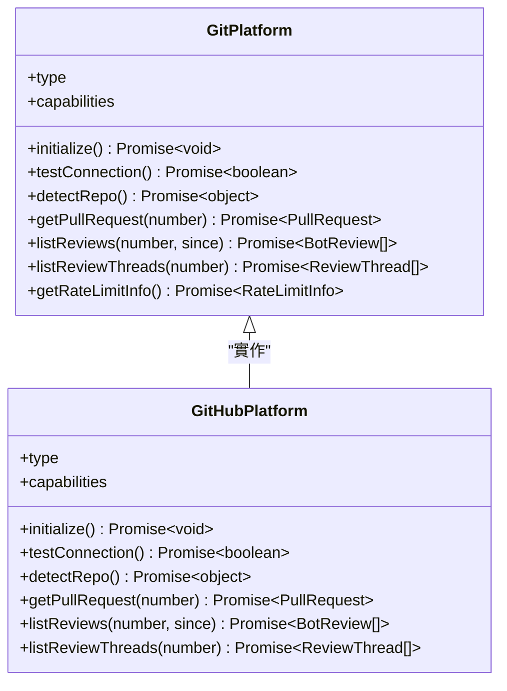

**圖表來源**
- [src/platforms/interfaces/GitPlatform.ts:1-130](https://github.com/mikeah2011/maestro/blob/master/src/platforms/interfaces/GitPlatform.ts#L1-L130)
- [tests/platforms/github/GitHubPlatform.test.ts:1-200](https://github.com/mikeah2011/maestro/blob/master/tests/platforms/github/GitHubPlatform.test.ts#L1-L200)

#### GitHubPlatform 測試策略

- 使用 constructor 注入 `clients`，包含 Octokit、GraphQL、Git。
- 不使用真實網路請求。
- 驗證 capability、initialize、testConnection、detectRepo、PR 讀寫、評論、審查、GraphQL 分頁等。
- 驗證未初始化前使用 API 會拋出錯誤。

#### Mapper 測試策略

`mappers.test.ts` 專注於純資料映射函數：

- 將 GitHub REST/GraphQL 資料結構轉換為內部 domain type。
- 驗證基本欄位、空值處理、狀態映射、統計計算、時間字串轉 Date。
- 這類測試不需要 Mock 外部服務，只驗證輸入輸出對應關係。

**章節來源**
- [src/platforms/interfaces/GitPlatform.ts:1-130](https://github.com/mikeah2011/maestro/blob/master/src/platforms/interfaces/GitPlatform.ts#L1-L130)
- [tests/platforms/github/GitHubPlatform.test.ts:1-200](https://github.com/mikeah2011/maestro/blob/master/tests/platforms/github/GitHubPlatform.test.ts#L1-L200)
- [tests/platforms/github/mappers.test.ts:1-200](https://github.com/mikeah2011/maestro/blob/master/tests/platforms/github/mappers.test.ts#L1-L200)

### 核心模組

#### 事件系統

`EventEmitter` 是 orchestrator 的單一事件來源，支援 sink、context、handler、JSONL 序列化與 stdout 輸出。

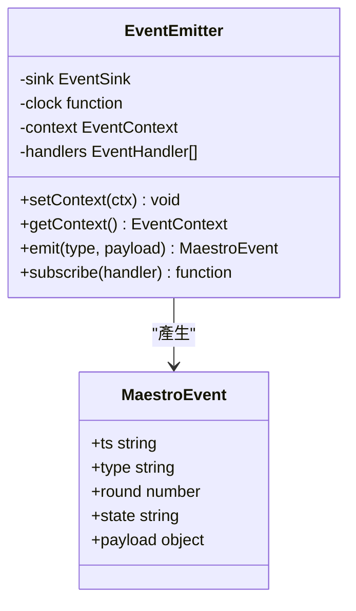

**圖表來源**
- [src/core/events/EventEmitter.ts:1-108](https://github.com/mikeah2011/maestro/blob/master/src/core/events/EventEmitter.ts#L1-L108)

#### 狀態機

`StateMachine` 管理 loop 的狀態轉換，支援正向轉換、跨切面轉換、終止狀態、事件同步更新 context。

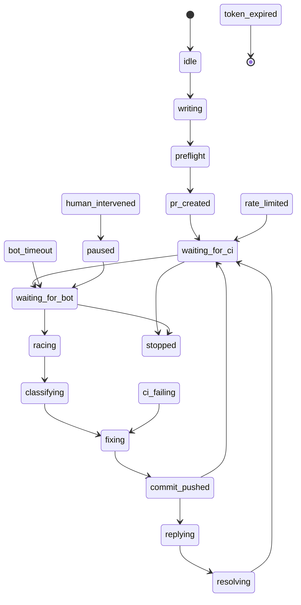

**圖表來源**
- [src/core/state/StateMachine.ts:1-114](https://github.com/mikeah2011/maestro/blob/master/src/core/state/StateMachine.ts#L1-L114)
- [tests/core/state/StateMachine.test.ts:1-174](https://github.com/mikeah2011/maestro/blob/master/tests/core/state/StateMachine.test.ts#L1-L174)

#### 收斂監控器

`ConvergenceMonitor` 用三個不變量保障 review loop 不會無限循環：

1. 嚴重問題數量非遞增。
2. Jaccard 相似度不得超過閾值，避免震盪。
3. 第 2 輪後不得出現新 finding category。
4. 最多 3 輪。

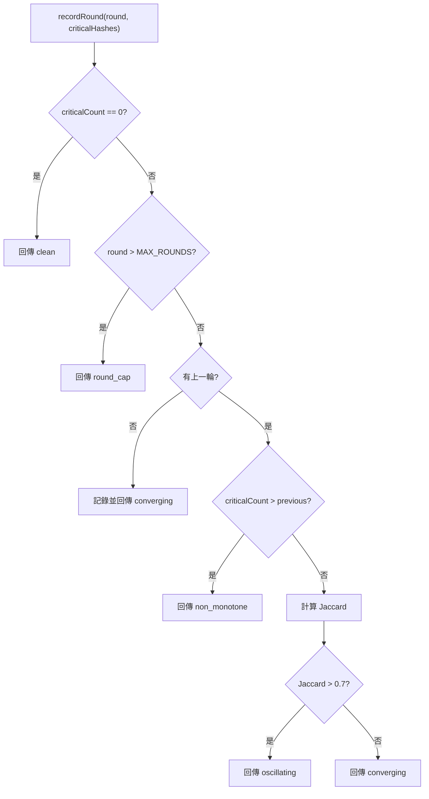

**圖表來源**
- [src/core/convergence/ConvergenceMonitor.ts:1-200](https://github.com/mikeah2011/maestro/blob/master/src/core/convergence/ConvergenceMonitor.ts#L1-L200)
- [tests/core/convergence/ConvergenceMonitor.test.ts:1-200](https://github.com/mikeah2011/maestro/blob/master/tests/core/convergence/ConvergenceMonitor.test.ts#L1-L200)

#### 分類器

`Classifier` 使用確定性 fence rule 優先判斷，再考慮 LLM fallback，並產生 audit entry。

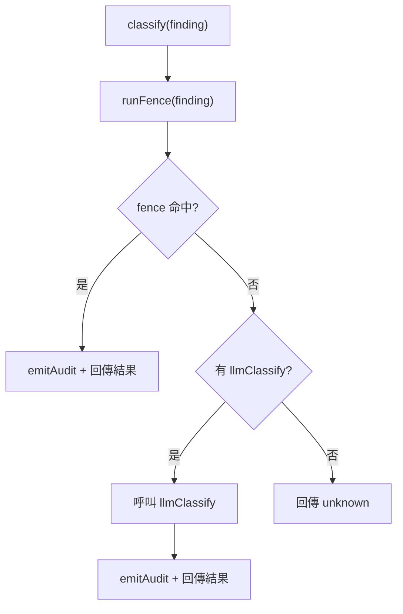

**圖表來源**
- [src/core/classify/Classifier.ts:1-191](https://github.com/mikeah2011/maestro/blob/master/src/core/classify/Classifier.ts#L1-L191)
- [tests/core/classify/Classifier.test.ts:1-200](https://github.com/mikeah2011/maestro/blob/master/tests/core/classify/Classifier.test.ts#L1-L200)

**章節來源**
- [src/core/events/EventEmitter.ts:1-108](https://github.com/mikeah2011/maestro/blob/master/src/core/events/EventEmitter.ts#L1-L108)
- [src/core/state/StateMachine.ts:1-114](https://github.com/mikeah2011/maestro/blob/master/src/core/state/StateMachine.ts#L1-L114)
- [tests/core/state/StateMachine.test.ts:1-174](https://github.com/mikeah2011/maestro/blob/master/tests/core/state/StateMachine.test.ts#L1-L174)
- [src/core/convergence/ConvergenceMonitor.ts:1-200](https://github.com/mikeah2011/maestro/blob/master/src/core/convergence/ConvergenceMonitor.ts#L1-L200)
- [tests/core/convergence/ConvergenceMonitor.test.ts:1-200](https://github.com/mikeah2011/maestro/blob/master/tests/core/convergence/ConvergenceMonitor.test.ts#L1-L200)
- [src/core/classify/Classifier.ts:1-191](https://github.com/mikeah2011/maestro/blob/master/src/core/classify/Classifier.ts#L1-L191)
- [tests/core/classify/Classifier.test.ts:1-200](https://github.com/mikeah2011/maestro/blob/master/tests/core/classify/Classifier.test.ts#L1-L200)

## Mock 策略與外部依賴隔離

專案已具備清晰的 Mock 範例，可作為新增測試的參考基準。

### HTTP 依賴：axios

使用 `vi.mock('axios', ...)` 覆寫 `axios.create`，並保留 `isAxiosError` 等必要行為。

適用場景：

- ClaudeProvider 的 HTTP 呼叫。
- GitHubPlatform 的 REST/GraphQL 呼叫。
- 任何使用 axios 的外部 API。

### 子程序：node:child_process

使用 `vi.mock('node:child_process')` 模擬 `spawn`，並自行建立帶有 stdout/stderr 的 mock process。

適用場景：

- ClaudeCodeProvider 呼叫 claude CLI。
- 其他需要 spawn 子程序的 provider。

### 外部 SDK：Octokit、simple-git

透過 constructor injection 注入 mock client，而不是替換整個模組。

適用場景：

- GitHubPlatform 使用 Octokit、GraphQL、simple-git。
- 未來新增的 Git Platform 實作也應採用相同模式。

### 事件與時間

`EventEmitter` 支援自訂 clock，方便測試控制時間；同時可用 sink 收集事件陣列，驗證事件順序、context 與 payload。

**章節來源**
- [tests/ai/providers/ClaudeProvider.test.ts:1-177](https://github.com/mikeah2011/maestro/blob/master/tests/ai/providers/ClaudeProvider.test.ts#L1-L177)
- [tests/ai/providers/ClaudeCodeProvider.test.ts:1-200](https://github.com/mikeah2011/maestro/blob/master/tests/ai/providers/ClaudeCodeProvider.test.ts#L1-L200)
- [tests/platforms/github/GitHubPlatform.test.ts:1-200](https://github.com/mikeah2011/maestro/blob/master/tests/platforms/github/GitHubPlatform.test.ts#L1-L200)
- [src/core/events/EventEmitter.ts:1-108](https://github.com/mikeah2011/maestro/blob/master/src/core/events/EventEmitter.ts#L1-L108)

## 相依性注入與可測試性設計

專案的可測試性主要建立在以下設計原則上：

| 設計原則 | 實作方式 | 測試優勢 |
|---|---|---|
| 抽象類別 | `AIProvider`、`GitPlatform` | 可替換實作、驗證契約 |
| Constructor Injection | `GitHubPlatform(config, clients)` | 無需 global mock 即可替換 SDK |
| Options Injection | `Classifier(llmClassify, onAudit)` | 可驗證 LLM 是否被呼叫 |
| Sink 模式 | `EventEmitter({ sink })` | 可捕獲事件而不寫入 stdout |
| Clock Injection | `EventEmitter(..., clock)` | 可控制時間戳記 |
| 明確錯誤類型 | `StateTransitionError`、`RoundBudgetViolation` | 測試可精確斷言錯誤 |

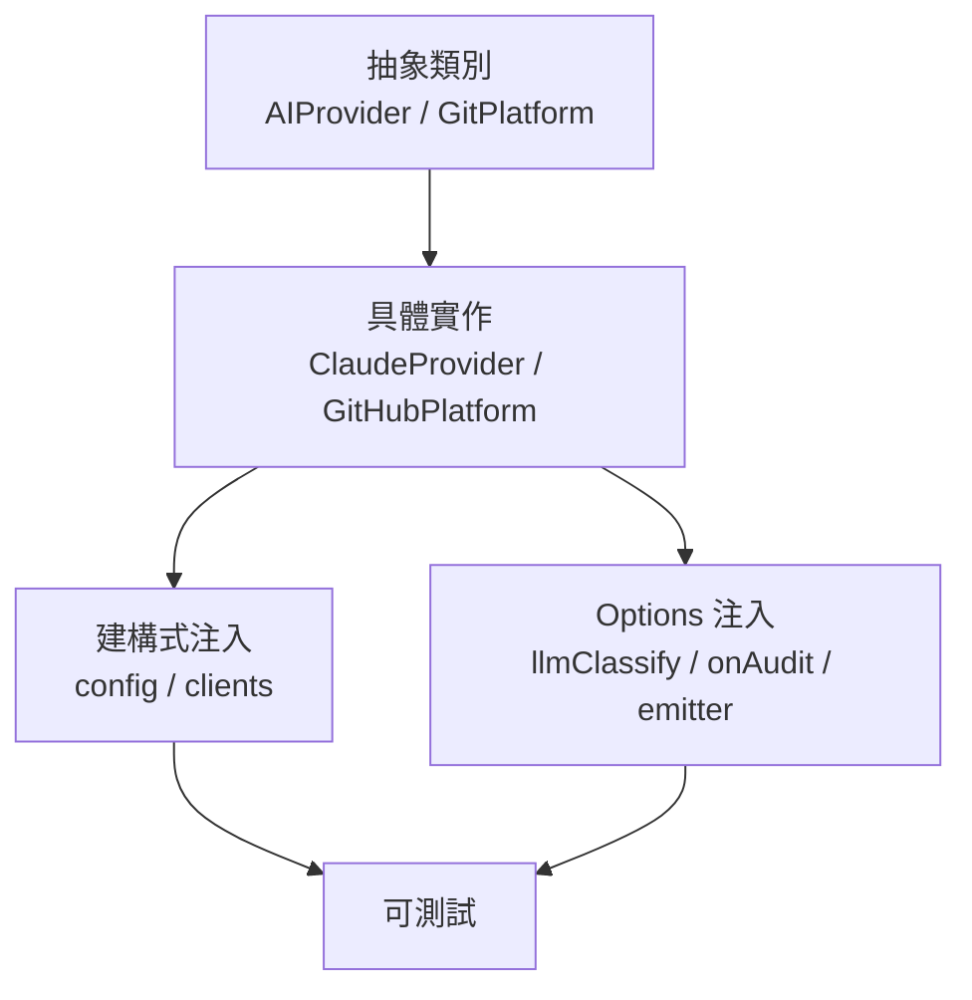

**圖表來源**
- [src/ai/interfaces/AIProvider.ts:1-114](https://github.com/mikeah2011/maestro/blob/master/src/ai/interfaces/AIProvider.ts#L1-L114)
- [src/platforms/interfaces/GitPlatform.ts:1-130](https://github.com/mikeah2011/maestro/blob/master/src/platforms/interfaces/GitPlatform.ts#L1-L130)
- [tests/platforms/github/GitHubPlatform.test.ts:1-200](https://github.com/mikeah2011/maestro/blob/master/tests/platforms/github/GitHubPlatform.test.ts#L1-L200)
- [src/core/classify/Classifier.ts:1-191](https://github.com/mikeah2011/maestro/blob/master/src/core/classify/Classifier.ts#L1-L191)

### 新增模組時的相依性注入準則

- 如果模組需要外部 SDK，請改用 constructor injection。
- 如果模組可能觸發副作用，請提供 callback、sink、event handler 等可觀察點。
- 如果模組有隨機性或時間依賴，請暴露 clock、seed 或 random generator。
- 不要讓業務邏輯直接耦合 `process.stdout`、`axios`、`child_process.spawn`。

**章節來源**
- [src/ai/interfaces/AIProvider.ts:1-114](https://github.com/mikeah2011/maestro/blob/master/src/ai/interfaces/AIProvider.ts#L1-L114)
- [src/platforms/interfaces/GitPlatform.ts:1-130](https://github.com/mikeah2011/maestro/blob/master/src/platforms/interfaces/GitPlatform.ts#L1-L130)
- [src/core/classify/Classifier.ts:1-191](https://github.com/mikeah2011/maestro/blob/master/src/core/classify/Classifier.ts#L1-L191)
- [src/core/events/EventEmitter.ts:1-108](https://github.com/mikeah2011/maestro/blob/master/src/core/events/EventEmitter.ts#L1-L108)

## Integration Test 設計模式

目前主要的 integration test 位於 `tests/core/integration.test.ts`，標題為「M2 primitives — round lifecycle integration」。

它驗證四個核心原語的協作：

| 原語 | 角色 |
|---|---|
| `EventEmitter` | 事件紀錄與上下文傳遞 |
| `StateMachine` | 狀態轉換與 event emission |
| `RoundBudget` | 每回合計數與違規檢查 |
| `CommitThrottle` | 每回合一次 commit 的限制 |

測試流程大致如下：

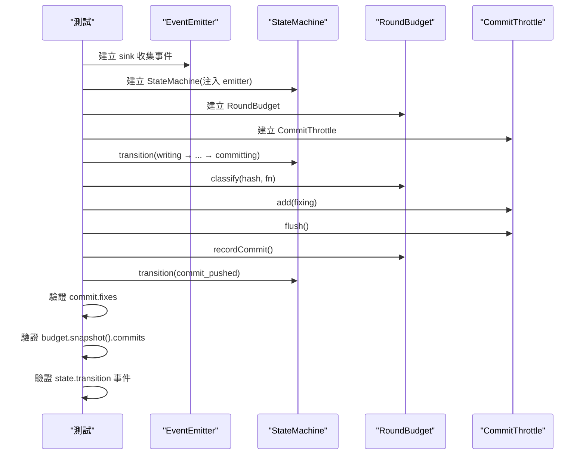

**圖表來源**
- [tests/core/integration.test.ts:1-91](https://github.com/mikeah2011/maestro/blob/master/tests/core/integration.test.ts#L1-L91)

### Integration Test 撰寫準則

1. **目的明確**：不是要驗證每個類別的細節，而是驗證「多類別協作是否符合設計不變量」。
2. **使用公共 API**：從 `src/index.ts` 重新匯出的 API 出發，模擬使用者視角。
3. **少 Mock、多組合**：integration test 應該盡量使用真實類別，而非全部替換成 stub。
4. **驗證副作用**：不僅檢查 return value，也要檢查事件、例外、狀態快照。
5. **命名反映場景**：例如「完整 round 生命周期」、「同一 round 內禁止重複 commit」。

**章節來源**
- [tests/core/integration.test.ts:1-91](https://github.com/mikeah2011/maestro/blob/master/tests/core/integration.test.ts#L1-L91)
- [src/index.ts:1-150](https://github.com/mikeah2011/maestro/blob/master/src/index.ts#L1-L150)

## 屬性測試與 fast-check 整合建議

專案已在 `devDependencies` 中加入 `fast-check`，但目前沒有可見的 `fc.property`、`fc.assert` 用法。這代表未來可以將 fast-check 用於以下場景：

### 適合使用 fast-check 的領域

| 領域 | 屬性 | 建議 |
|---|---|---|
| 收斂監控 | Jaccard 不等式、monotone non-increasing | 用隨機 critical hash set 驗證 invariant |
| 分類器 fence | 關鍵字大小寫不敏感、優先級固定 | 用亂序關鍵字、隨機 title/body 驗證 |
| mapper | 輸入 null、undefined、空陣列 | 用 `fc.array`、`fc.option` 生成邊界輸入 |
| lineBucket | 同 bucket 穩定、不同 bucket 不同 | 用 `fc.integer` 遍歷邊界 |
| finding hash | 正規化、穩定性、空 startLine | 用 `fc.string`、`fc.constantFrom` |
| state machine | 終止狀態不可逃逸 | 用隨機 transition 序列驗證非法跳躍 |

### 建議的測試結構

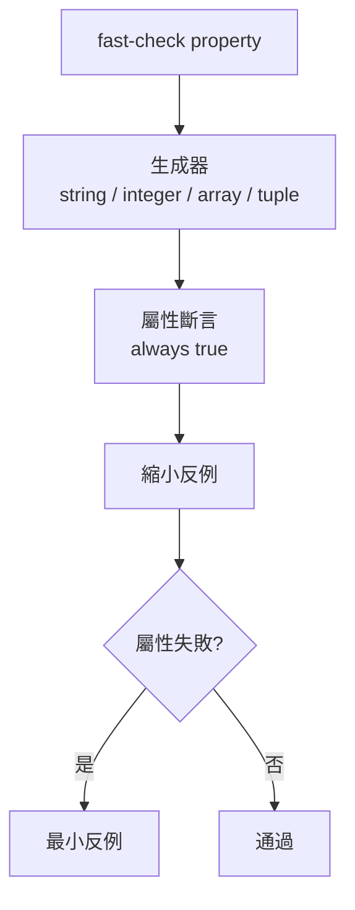

### 現有能力可直接驗證的屬性

以 `lineBucket` 為例，可宣告以下屬性：

- 同 bucket 內的任意兩行，bucket 值相等。
- 跨 bucket 的行，bucket 值不相等。
- 負數或零會被校正為有效 bucket。
- 大行號會進入預期 bucket。

以 `computeFindingHash` 為例，可宣告：

- 相同輸入產生相同雜湊。
- file、startLine、category、surroundingContent 任一改變都會改變雜湊。
- category 大小寫不影響雜湊。
- undefined startLine 會落入特定 bucket。

這些屬性目前尚未在測試中看到實作，但架構上非常適合加入。

**章節來源**
- [package.json:1-89](https://github.com/mikeah2011/maestro/blob/master/package.json#L1-L89)
- [src/core/convergence/ConvergenceMonitor.ts:1-200](https://github.com/mikeah2011/maestro/blob/master/src/core/convergence/ConvergenceMonitor.ts#L1-L200)
- [src/core/classify/Classifier.ts:1-191](https://github.com/mikeah2011/maestro/blob/master/src/core/classify/Classifier.ts#L1-L191)
- [src/core/state/StateMachine.ts:1-114](https://github.com/mikeah2011/maestro/blob/master/src/core/state/StateMachine.ts#L1-L114)

## 測試撰寫規範與常見模式

### 命名與結構

- 測試檔名使用 `<module>.test.ts`。
- 使用 `describe` 區隔類別或功能域。
- 使用 `it` 描述單一行為或場景。
- 測試名稱應為「情境 + 預期結果」，例如：
  - 「當 claude 二進制不存在時，initialize 拋出錯誤」
  - 「當 critical count 增加時，返回 non_monotone」

### 測試分層

| 層次 | 目的 | 範例 |
|---|---|---|
| 單元測試 | 驗證單一類別或純函數 | Classifier fence、lineBucket、mapPullRequest |
| 組件測試 | 驗證類別與其 injected dependency | GitHubPlatform with mocked Octokit |
| 集成測試 | 驗證多個核心原語協作 | M2 round lifecycle |
| 屬性測試 | 驗證數學性質與泛化邊界 | fast-check property |

### 常見測試模式

| 模式 | 適用場景 | 說明 |
|---|---|---|
| Factory Helper | Finding、GH Pull Request | 集中建立基礎物件，再用 overrides 覆蓋 |
| Mock Client | GitHubPlatform | 透過 constructor inject Octokit/GraphQL/git |
| Event Capture | StateMachine、EventEmitter | 使用 sink 收集事件陣列 |
| Error Expectation | 未初始化、非法 transition | 使用 `rejects.toThrow` 或 `toThrow` |
| Deterministic Time | EventEmitter | 使用自訂 clock |
| Pure Mapping | mappers | 只驗證輸入輸出，不觸碰網路 |

### 斷言建議

- 使用 `toBe`、`toEqual`、`toMatchObject` 保持明確。
- 使用 `toHaveLength`、`toContain` 驗證集合。
- 使用 `toHaveBeenCalledWith` 驗證 mock 呼叫。
- 使用 `not.toHaveBeenCalled` 驗證不應發生的副作用。
- 使用 `toThrow`、`rejects.toThrow` 驗證異常。

**章節來源**
- [tests/core/classify/Classifier.test.ts:1-200](https://github.com/mikeah2011/maestro/blob/master/tests/core/classify/Classifier.test.ts#L1-L200)
- [tests/platforms/github/mappers.test.ts:1-200](https://github.com/mikeah2011/maestro/blob/master/tests/platforms/github/mappers.test.ts#L1-L200)
- [tests/core/state/StateMachine.test.ts:1-174](https://github.com/mikeah2011/maestro/blob/master/tests/core/state/StateMachine.test.ts#L1-L174)

## 除錯技巧

### 1. 使用 watch 模式

開發階段使用 `bun run test:watch`，可自動重新執行相關測試。

### 2. 僅執行單一測試檔

Vitest 支援透過參數篩選測試，便於聚焦問題。

### 3. 檢查覆蓋率報告

使用 `bun run test:coverage`，然後開啟 HTML 報告，查看：

- 哪些分支未覆蓋。
- 哪個函式缺少測試。
- 是否有誤解的 exclude 配置。

### 4. 驗證 mock 是否生效

若測試意外觸發網路或子程序：

- 確認 `vi.mock` 放在 import 之前。
- 確認 mock 路徑與原始模組一致。
- 使用 `vi.mocked(...).mockReturnValue` 或 `mockResolvedValue`。
- 使用 `vi.clearAllMocks()` 避免測試間污染。

### 5. 事件除錯

對於 StateMachine 與 EventEmitter：

- 使用 sink 收集事件。
- 過濾特定 event type。
- 檢查 event.context.state 是否正確。
- 驗證事件順序與 payload。

### 6. 屬性測試反例

當 fast-check 失敗時：

- 查看縮小後的 counterexample。
- 將反例轉成一般 `it` 測試，防止回歸。
- 檢查生成器是否過於寬鬆或過於嚴格。

**章節來源**
- [package.json:1-89](https://github.com/mikeah2011/maestro/blob/master/package.json#L1-L89)
- [vitest.config.ts:1-31](https://github.com/mikeah2011/maestro/blob/master/vitest.config.ts#L1-L31)
- [tests/ai/providers/ClaudeCodeProvider.test.ts:1-200](https://github.com/mikeah2011/maestro/blob/master/tests/ai/providers/ClaudeCodeProvider.test.ts#L1-L200)
- [tests/core/state/StateMachine.test.ts:1-174](https://github.com/mikeah2011/maestro/blob/master/tests/core/state/StateMachine.test.ts#L1-L174)

## 新增測試的檢查清單與最佳實踐

### 新增單元測試前的檢查

- [ ] 是否屬於某個現有模組？
- [ ] 是否有對應的測試目錄？
- [ ] 是否使用 `describe` 與 `it`？
- [ ] 是否避免真實外部依賴？
- [ ] 是否驗證正常路徑與錯誤路徑？
- [ ] 是否驗證邊界條件？
- [ ] 是否可獨立執行？

### 新增 Integration Test 前的檢查

- [ ] 是否驗證多個模組協作？
- [ ] 是否使用公共 API？
- [ ] 是否驗證事件或副作用？
- [ ] 是否模擬真實使用者流程？
- [ ] 是否命名清楚反映場景？

### 新增屬性測試前的檢查

- [ ] 是否適合用「永遠為真」的性質表達？
- [ ] 是否涉及數學不變量、穩定性、邊界？
- [ ] 是否使用合適的生成器？
- [ ] 是否在失敗時能產生可理解的反例？
- [ ] 是否將重要反例轉為一般測試？

### 最佳實踐總結

1. **先寫測試，再補覆蓋率**：不要為了數字而寫假測試。
2. **優先測試行為，其次測試實現**。
3. **外部依賴一律隔離**。
4. **使用 constructor injection 而非 global mock**。
5. **integration test 要短、快、有意義**。
6. **屬性測試用來捕捉人類容易忽略的邊界**。
7. **所有新增功能都應包含測試，且覆蓋率門檻不破線**。

**章節來源**
- [tests/core/integration.test.ts:1-91](https://github.com/mikeah2011/maestro/blob/master/tests/core/integration.test.ts#L1-L91)
- [tests/core/classify/Classifier.test.ts:1-200](https://github.com/mikeah2011/maestro/blob/master/tests/core/classify/Classifier.test.ts#L1-L200)
- [tests/platforms/github/mappers.test.ts:1-200](https://github.com/mikeah2011/maestro/blob/master/tests/platforms/github/mappers.test.ts#L1-L200)

## 結論

Maestro 的測試體系已經具備良好的基礎：

- Vitest 提供現代化的單元測試能力。
- fast-check 已準備好用於屬性測試。
- 現有測試展示了清晰的 Mock 策略、constructor injection、事件捕獲與純函數映射測試。
- 覆蓋率門檻明確：lines/functions/statements 80%、branches 75%。
- integration test 提供了跨模組協作的驗證範例。

未來擴展時，應優先遵循以下方向：

1. 繼續使用抽象類別與依賴注入，保持模組可測試性。
2. 對外部 HTTP、子程序、Git、平台 API 一律隔離。
3. 對分類器、mapper、hash、bucket、state machine 等邏輯密集型模組補充更多邊界與屬性測試。
4. 對新功能新增對應的單元測試與至少一個 integration test。
5. 維持覆蓋率門檻，但不犧牲測試的意圖清晰度。

透過這份測試策略，團隊可以在 AI 與 Git 平台之間建立更穩健的自動化流程，確保 Maestro 的 review loop 在複雜現實環境中仍能保持可控、可驗證、可除錯。