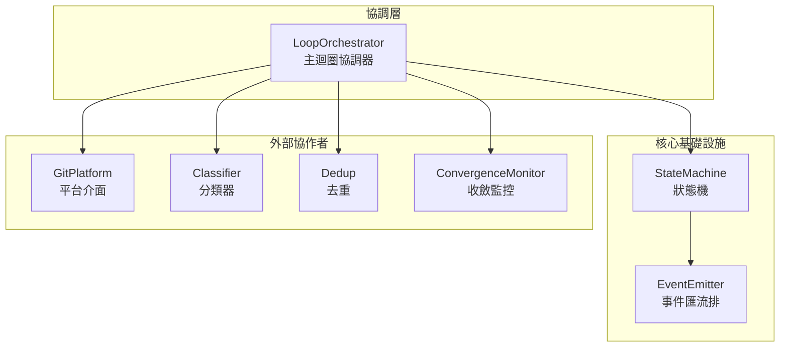
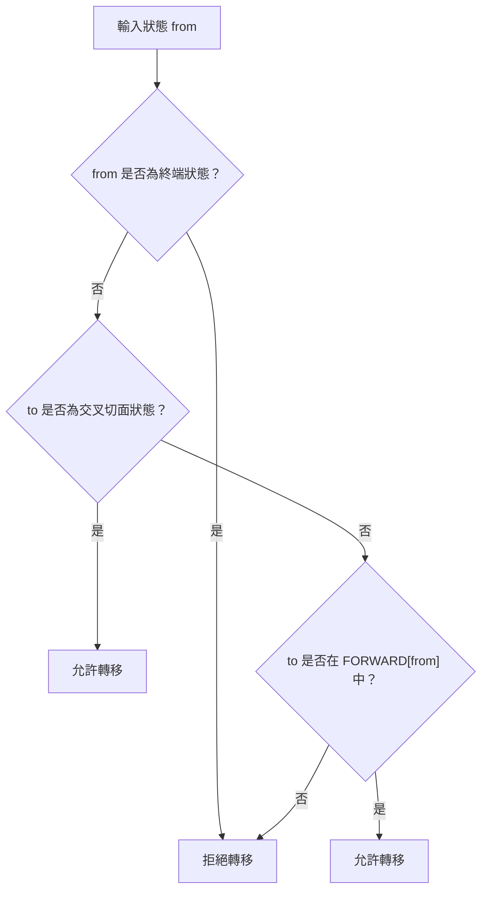
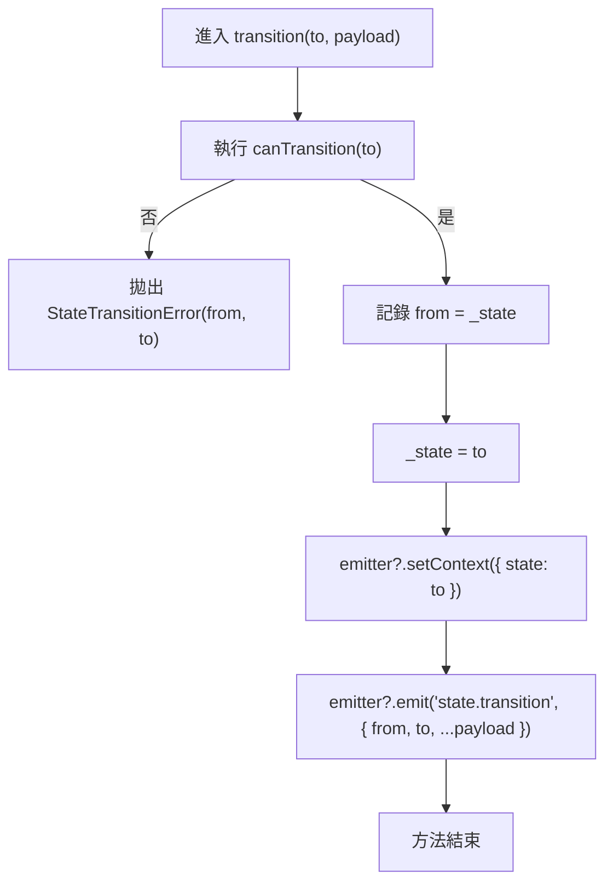
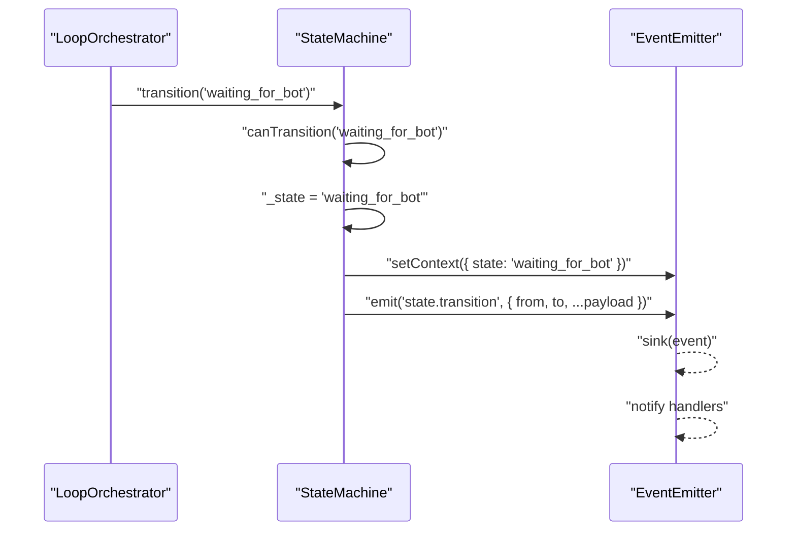
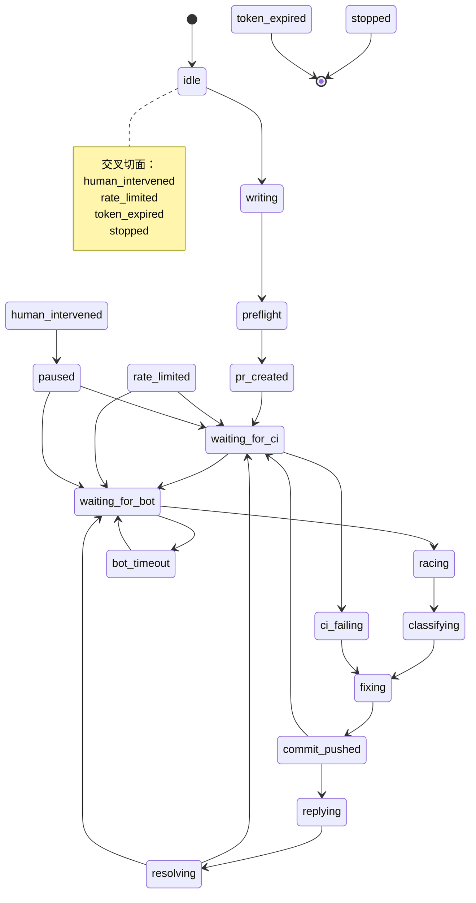
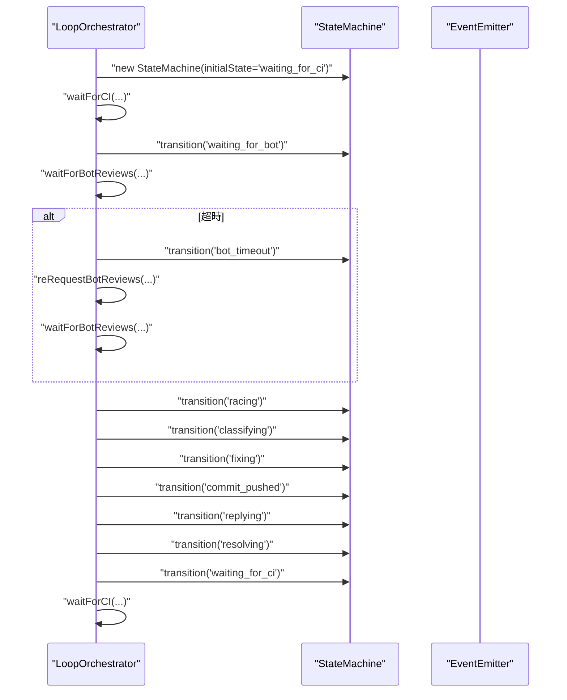
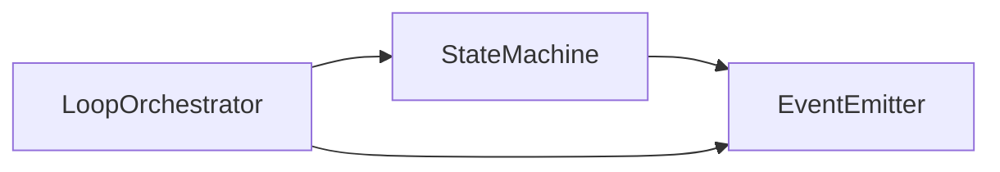

# 狀態機（StateMachine）

<cite>
**本文引用的檔案**   
- [src/core/state/StateMachine.ts](https://github.com/mikeah2011/maestro/blob/master/src/core/state/StateMachine.ts)
- [tests/core/state/StateMachine.test.ts](https://github.com/mikeah2011/maestro/blob/master/tests/core/state/StateMachine.test.ts)
- [src/core/loop/LoopOrchestrator.ts](https://github.com/mikeah2011/maestro/blob/master/src/core/loop/LoopOrchestrator.ts)
- [src/core/events/EventEmitter.ts](https://github.com/mikeah2011/maestro/blob/master/src/core/events/EventEmitter.ts)
</cite>

## 目錄
1. [簡介](#簡介)
2. [專案結構與角色定位](#專案結構與角色定位)
3. [核心資料型別與狀態定義](#核心資料型別與狀態定義)
4. [轉移表設計原理](#轉移表設計原理)
5. [驗證邏輯：canTransition 與 transition](#驗證邏輯cantransition-與-transition)
6. [事件與上下文傳播](#事件與上下文傳播)
7. [完整狀態轉移圖](#完整狀態轉移圖)
8. [錯誤處理策略：StateTransitionError](#錯誤處理策略statetransitionerror)
9. [在 LoopOrchestrator 中的驅動流程](#在-looporchestrator-中的驅動流程)
10. [使用範例與測試要點](#使用範例與測試要點)
11. [相依性分析](#相依性分析)
12. [效能與可維護性建議](#效能與可維護性建議)
13. [故障排除指南](#故障排除指南)
14. [結論](#結論)

## 簡介
StateMachine 是 Maestro 協調器的核心狀態機，負責封裝主迴圈的生命週期狀態、允許的轉移規則、事件通知以及異常防護。它不直接執行平台操作或 AI 修復；它的職責很明確：**驗證狀態是否合法、更新內部狀態、刷新事件上下文，並發布 `state.transition` 事件**。

真正的業務流程由 LoopOrchestrator 驅動，它會根據 CI 結果、機器人審查狀態、分類與修復結果來呼叫 StateMachine 的 `transition`，進而改變整個系統可見的狀態。

## 專案結構與角色定位
StateMachine 位於 `src/core/state`，屬於核心基礎設施層。它依賴 EventEmitter，但不依賴任何平台或外部服務。LoopOrchestrator 則處於協調層，組合分類、去重、收斂監控、平台介面等能力，並把這些能力轉譯成狀態轉移。

**圖表來源**
- [src/core/state/StateMachine.ts:1-114](https://github.com/mikeah2011/maestro/blob/master/src/core/state/StateMachine.ts#L1-L114)
- [src/core/loop/LoopOrchestrator.ts:1-200](https://github.com/mikeah2011/maestro/blob/master/src/core/loop/LoopOrchestrator.ts#L1-L200)
- [src/core/events/EventEmitter.ts:1-108](https://github.com/mikeah2011/maestro/blob/master/src/core/events/EventEmitter.ts#L1-L108)

**章節來源**
- [src/core/state/StateMachine.ts:1-114](https://github.com/mikeah2011/maestro/blob/master/src/core/state/StateMachine.ts#L1-L114)
- [src/core/loop/LoopOrchestrator.ts:1-200](https://github.com/mikeah2011/maestro/blob/master/src/core/loop/LoopOrchestrator.ts#L1-L200)
- [src/core/events/EventEmitter.ts:1-108](https://github.com/mikeah2011/maestro/blob/master/src/core/events/EventEmitter.ts#L1-L108)

## 核心資料型別與狀態定義
`LoopState` 是一個聯合字串型別，共包含 **20 個狀態**，可以分為四類：

| 類別 | 狀態 | 意義 |
|---|---|---|
| 正常工作狀態 | `idle`、`writing`、`preflight`、`pr_created` | 初始化與拉取請求建立階段 |
| CI 與機器人等待 | `waiting_for_ci`、`waiting_for_bot`、`racing` | 輪詢 CI 與機器人審查 |
| 修復與回覆 | `classifying`、`fixing`、`commit_pushed`、`replying`、`resolving` | 分類、修復、提交、回覆、解決討論串 |
| 終端狀態 | `stopped`、`token_expired` | 不再允許進一步轉移 |
| 錯誤與交叉切面 | `ci_failing`、`bot_timeout`、`human_intervened`、`rate_limited`、`token_expired`、`paused` | 異常恢復、人工介入、限流、權杖過期、暫停 |

其中：
- `stopped` 和 `token_expired` 是終端狀態。
- `ci_failing`、`bot_timeout`、`human_intervened`、`rate_limited`、`paused` 是可繼續恢復的工作狀態。
- `token_expired` 雖然是錯誤狀態，但因為沒有出邊，所以仍歸類為終端。

**章節來源**
- [src/core/state/StateMachine.ts:13-32](https://github.com/mikeah2011/maestro/blob/master/src/core/state/StateMachine.ts#L13-L32)
- [tests/core/state/StateMachine.test.ts:1-33](https://github.com/mikeah2011/maestro/blob/master/tests/core/state/StateMachine.test.ts#L1-L33)

## 轉移表設計原理
StateMachine 使用三張互相補充的規則表，而不是單一巨大映射：

### FORWARD：正向轉移表
`FORWARD` 定義了「線性迴圈」中每個狀態允許跳到的目標集合。它反映的是 **預期且受控的主流程**，例如：
- `idle → writing → preflight → pr_created → waiting_for_ci`
- `waiting_for_ci → waiting_for_bot / ci_failing`
- `waiting_for_bot → racing / bot_timeout`
- `racing → classifying → fixing → commit_pushed`
- `commit_pushed → waiting_for_ci / replying`
- `replying → resolving → waiting_for_ci / waiting_for_bot`

這讓主流程具備明確路徑，同時保留少量分支（例如 CI 失敗、回覆後再進入下一輪）。

### CROSS_CUTTING：交叉切面狀態集合
`CROSS_CUTTING` 定義的是 **跨領域異常與控制信號**：
- `human_intervened`：人工介入。
- `rate_limited`：API 限流。
- `token_expired`：權杖過期。
- `stopped`：強制停止。

這些狀態不需要知道當前處於哪個具體工作階段，只要不是終端狀態，就可以被觸發。

### TERMINAL：終端狀態集合
`TERMINAL` 只包含 `stopped` 與 `token_expired`。一旦進入這兩個狀態，`canTransition` 一律返回 `false`，避免狀態機被意外重置。

**圖表來源**
- [src/core/state/StateMachine.ts:34-64](https://github.com/mikeah2011/maestro/blob/master/src/core/state/StateMachine.ts#L34-L64)
- [src/core/state/StateMachine.ts:79-92](https://github.com/mikeah2011/maestro/blob/master/src/core/state/StateMachine.ts#L79-L92)

**章節來源**
- [src/core/state/StateMachine.ts:34-64](https://github.com/mikeah2011/maestro/blob/master/src/core/state/StateMachine.ts#L34-L64)
- [src/core/state/StateMachine.ts:79-92](https://github.com/mikeah2011/maestro/blob/master/src/core/state/StateMachine.ts#L79-L92)

## 驗證邏輯：canTransition 與 transition
### canTransition
`canTransition(to)` 的驗證順序是：

1. 若當前狀態已在 `TERMINAL`，直接拒絕。
2. 若目標狀態在 `CROSS_CUTTING`，直接允許。
3. 否則檢查 `FORWARD[this._state]` 是否包含目標狀態。
4. 若找不到對應列舉，預設為空陣列，因此也會拒絕。

這個設計的好處是：
- 終端狀態不可逃逸。
- 異常與控制信號擁有最高優先權。
- 正向流程保持最小且可讀。
- 新增狀態時，只需考慮它應該出現在哪一張表中。

### transition
`transition(to, payload)` 的執行順序是：

1. 呼叫 `canTransition(to)`。
2. 若不合法，拋出 `StateTransitionError`。
3. 記錄舊狀態 `from`。
4. 寫入新狀態 `_state = to`。
5. 透過 `emitter.setContext({ state: to })` 更新事件上下文。
6. 發出 `state.transition` 事件，攜帶 `from`、`to` 與額外 payload。

注意：即使 emitter 不存在，狀態仍會更新；event 只是可選觀察機制。

**圖表來源**
- [src/core/state/StateMachine.ts:79-107](https://github.com/mikeah2011/maestro/blob/master/src/core/state/StateMachine.ts#L79-L107)

**章節來源**
- [src/core/state/StateMachine.ts:79-107](https://github.com/mikeah2011/maestro/blob/master/src/core/state/StateMachine.ts#L79-L107)

## 事件與上下文傳播
StateMachine 本身不會產生 UI 或日誌，而是把 `state.transition` 交給 EventEmitter。EventEmitter 提供：

- `setContext(ctx)`：合併並覆蓋當前上下文，例如 `{ state }`。
- `emit(type, payload)`：為事件加上時間戳、round、state 等上下文，然後寫入 sink 並通知所有 handler。
- `subscribe(handler)`：訂閱事件，並回傳取消函式。
- `sink` 與 handler 的錯誤都被隔離，避免下游消費者崩潰影響主迴圈。

StateMachine 在每次成功轉移後，先更新上下文，再發送事件，因此後續由其他組件產生的事件也能自動帶上新的狀態。

**圖表來源**
- [src/core/state/StateMachine.ts:94-107](https://github.com/mikeah2011/maestro/blob/master/src/core/state/StateMachine.ts#L94-L107)
- [src/core/events/EventEmitter.ts:33-88](https://github.com/mikeah2011/maestro/blob/master/src/core/events/EventEmitter.ts#L33-L88)

**章節來源**
- [src/core/events/EventEmitter.ts:1-108](https://github.com/mikeah2011/maestro/blob/master/src/core/events/EventEmitter.ts#L1-L108)
- [src/core/state/StateMachine.ts:94-107](https://github.com/mikeah2011/maestro/blob/master/src/core/state/StateMachine.ts#L94-L107)

## 完整狀態轉移圖
以下圖顯示全部 20 個狀態及允許的轉移。橫向箭頭代表 FORWARD 表，虛線代表 CROSS_CUTTING 從任意非終端狀態出發。

**圖表來源**
- [src/core/state/StateMachine.ts:34-64](https://github.com/mikeah2011/maestro/blob/master/src/core/state/StateMachine.ts#L34-L64)
- [src/core/state/StateMachine.ts:66-71](https://github.com/mikeah2011/maestro/blob/master/src/core/state/StateMachine.ts#L66-L71)

**章節來源**
- [src/core/state/StateMachine.ts:34-71](https://github.com/mikeah2011/maestro/blob/master/src/core/state/StateMachine.ts#L34-L71)

## 錯誤處理策略：StateTransitionError
`StateTransitionError` 是一個專門的狀態轉移錯誤類型，繼承自 `Error`，並公開兩個屬性：

| 屬性 | 類型 | 說明 |
|---|---|---|
| `from` | `LoopState` | 轉移前的狀態 |
| `to` | `LoopState` | 非法的目標狀態 |

錯誤訊息格式為「Invalid state transition: from → to」，便於日誌與使用者診斷。

主要使用情境：
- 嘗試從終端狀態離開。
- 跳過中間步驟，例如從 `idle` 直接跳到 `classifying`。
- 未正確定義的正向轉移。

在 LoopOrchestrator 的 `run` 方法中，外部錯誤會被捕獲並轉換為 `loop.error` 事件，然後嘗試將狀態轉為 `stopped`。如果此時已經在終端狀態，二次 `transition` 可能拋出 `StateTransitionError`，程式碼已用 try/catch 忽略該情況，避免掩蓋原始錯誤。

**章節來源**
- [src/core/state/StateMachine.ts:73-81](https://github.com/mikeah2011/maestro/blob/master/src/core/state/StateMachine.ts#L73-L81)
- [src/core/loop/LoopOrchestrator.ts:534-583](https://github.com/mikeah2011/maestro/blob/master/src/core/loop/LoopOrchestrator.ts#L534-L583)
- [tests/core/state/StateMachine.test.ts:73-101](https://github.com/mikeah2011/maestro/blob/master/tests/core/state/StateMachine.test.ts#L73-L101)

## 在 LoopOrchestrator 中的驅動流程
LoopOrchestrator 是 StateMachine 的主要使用者。它建構 StateMachine 時指定初始狀態 `waiting_for_ci`，並把相同的 EventEmitter 注入兩者，使狀態事件與其他業務事件共享上下文。

典型主迴圈路徑如下：

關鍵行為包括：

| 情境 | LoopOrchestrator 的行為 | StateMachine 的結果 |
|---|---|---|
| 初始 CI 失敗 | 轉到 `ci_failing`，再轉到 `stopped` | 最終狀態為 `stopped` |
| 機器人審查超時 | 轉到 `bot_timeout`，重新要求審查，仍失敗則 `stopped` | 允許一次恢復 |
| 達到最大回合數 | 以 `reason='max_rounds'` 停止 | 終端狀態 |
| 已通過且無開放問題 | 以 `reason='approved'` 停止 | 終端狀態 |
| 收斂檢測為振盪或非單調 | 以 `reason='converged'` 停止 | 終端狀態 |
| 外層 try/catch 捕獲異常 | 發出 `loop.error`，嘗試轉為 `stopped` | 防止狀態機殘留於半完成狀態 |

**圖表來源**
- [src/core/loop/LoopOrchestrator.ts:185-214](https://github.com/mikeah2011/maestro/blob/master/src/core/loop/LoopOrchestrator.ts#L185-L214)
- [src/core/loop/LoopOrchestrator.ts:201-240](https://github.com/mikeah2011/maestro/blob/master/src/core/loop/LoopOrchestrator.ts#L201-L240)
- [src/core/loop/LoopOrchestrator.ts:360-420](https://github.com/mikeah2011/maestro/blob/master/src/core/loop/LoopOrchestrator.ts#L360-L420)
- [src/core/loop/LoopOrchestrator.ts:534-583](https://github.com/mikeah2011/maestro/blob/master/src/core/loop/LoopOrchestrator.ts#L534-L583)

**章節來源**
- [src/core/loop/LoopOrchestrator.ts:185-214](https://github.com/mikeah2011/maestro/blob/master/src/core/loop/LoopOrchestrator.ts#L185-L214)
- [src/core/loop/LoopOrchestrator.ts:201-240](https://github.com/mikeah2011/maestro/blob/master/src/core/loop/LoopOrchestrator.ts#L201-L240)
- [src/core/loop/LoopOrchestrator.ts:360-420](https://github.com/mikeah2011/maestro/blob/master/src/core/loop/LoopOrchestrator.ts#L360-L420)
- [src/core/loop/LoopOrchestrator.ts:534-583](https://github.com/mikeah2011/maestro/blob/master/src/core/loop/LoopOrchestrator.ts#L534-L583)

## 使用範例與測試要點
雖然實際程式碼不建議直接複製狀態機實現，但可以從測試中學習正確的用法：

### 基本用法
1. 建立 StateMachine：
   - 預設初始狀態為 `idle`。
   - 也可透過 `initialState` 指定，例如 `waiting_for_bot`。
2. 選擇合法目標狀態呼叫 `transition`。
3. 如果需要事件輸出，注入 EventEmitter。
4. 需要判斷合法性時使用 `canTransition`。

### 測試涵蓋的重點
- 預設初始狀態為 `idle`。
- 支援自訂初始狀態。
- 能走通寫入到合併準備的完整路徑。
- `commit_pushed` 可以重新進入 `waiting_for_ci`。
- 非法跳转会拋出 `StateTransitionError`。
- 從 `stopped` 離開會拋出錯誤。
- 錯誤物件包含 `from` 與 `to`。
- 任意非終端狀態都可升級到 `human_intervened`、`token_expired`、`rate_limited`、`stopped`。
- 終端狀態 `stopped` 不能再升級。
- `ci_failing` 可恢復到 `fixing`。
- `bot_timeout` 可恢復到 `waiting_for_bot`。
- `human_intervened → paused → waiting_for_bot` 可恢復。
- 成功轉移會發出 `state.transition`，並攜帶 `from`、`to` 與額外 payload。
- 轉移後的事件會自動帶有新的 state 上下文。

**章節來源**
- [tests/core/state/StateMachine.test.ts:1-174](https://github.com/mikeah2011/maestro/blob/master/tests/core/state/StateMachine.test.ts#L1-L174)

## 相依性分析
StateMachine 的相依關係非常乾淨：

| 元件 | 相依方向 | 說明 |
|---|---:|---|
| StateMachine | → EventEmitter | 可選事件通知與上下文更新 |
| LoopOrchestrator | → StateMachine | 驅動主迴圈狀態 |
| LoopOrchestrator | → EventEmitter | 驅動其他業務事件 |
| EventEmitter | 無內部業務相依 | 僅提供事件管道與上下文 |

**圖表來源**
- [src/core/state/StateMachine.ts:10-11](https://github.com/mikeah2011/maestro/blob/master/src/core/state/StateMachine.ts#L10-L11)
- [src/core/loop/LoopOrchestrator.ts:14-22](https://github.com/mikeah2011/maestro/blob/master/src/core/loop/LoopOrchestrator.ts#L14-L22)
- [src/core/events/EventEmitter.ts:1-28](https://github.com/mikeah2011/maestro/blob/master/src/core/events/EventEmitter.ts#L1-L28)

**章節來源**
- [src/core/state/StateMachine.ts:10-11](https://github.com/mikeah2011/maestro/blob/master/src/core/state/StateMachine.ts#L10-L11)
- [src/core/loop/LoopOrchestrator.ts:14-22](https://github.com/mikeah2011/maestro/blob/master/src/core/loop/LoopOrchestrator.ts#L14-L22)
- [src/core/events/EventEmitter.ts:1-28](https://github.com/mikeah2011/maestro/blob/master/src/core/events/EventEmitter.ts#L1-L28)

## 效能與可維護性建議
### 效能特性
- `canTransition` 的時間複雜度接近 O(1)：終端集合查詢 O(1)，交叉切面集合查詢 O(1)，正向查表 O(1) + 陣列包含 O(k)，k 通常很小。
- 空間複雜度固定：三個靜態常數結構與一個內部狀態欄位。
- 事件發射是副作用，但 EventEmitter 已對 sink 與 handler 做錯誤隔離，不會拖垮主迴圈。

### 可維護性建議
1. **新增狀態時務必同步更新三張表**：
   - 若在正向流程中出現，加入 `FORWARD`。
   - 若是異常或控制信號，加入 `CROSS_CUTTING`。
   - 若不可再轉移，加入 `TERMINAL`。
2. **避免在 LoopOrchestrator 中手動拼接狀態邏輯**：
   - 所有狀態變化應明確呼叫 `sm.transition`，不要只改變外部變數。
3. **payload 應保持一致語義**：
   - 停止相關事件建議攜帶 `reason`。
   - 回合相關事件建議攜帶 `round`。
4. **測試應覆蓋三類轉移**：
   - 正向轉移。
   - 交叉切面轉移。
   - 非法轉移。

[本節為一般性建議，不直接分析特定程式碼片段]

## 故障排除指南
常見問題與解法：

| 問題 | 可能原因 | 建議處理方式 |
|---|---|---|
| 啟動即報 Invalid state transition | 初始狀態設定錯誤或呼叫了非法轉移 | 檢查 `initialState` 與第一個 `transition` 目標 |
| 從 `stopped` 轉移失敗 | `stopped` 是終端狀態 | 重建 StateMachine，不要企圖從終端狀態恢復 |
| 狀態沒變但事件沒收到 | 未注入 EventEmitter | 在構造時注入 EventEmitter，或確認 sink/handler 是否正常 |
| 事件有 state 但狀態不對 | 多個組件各自管理狀態 | 統一由 StateMachine 持有真實狀態 |
| LoopOrchestrator 異常後狀態停在半途 | 外層 catch 無法再次轉移 | 檢查是否已在終端狀態；目前實作會忽略二次轉移錯誤 |
| CI 一直卡在 pending | waitForCI 未遇到 success/failure/error 或超過 30 分鐘 | 檢查平台 CI API 回應與 sleep/poll 間隔 |
| 機器人永遠等不到 | 未成功 reRequest 或平台不支援 requestReviewers | 檢查 platform capabilities 與 botTriggerComments |

**章節來源**
- [tests/core/state/StateMachine.test.ts:60-101](https://github.com/mikeah2011/maestro/blob/master/tests/core/state/StateMachine.test.ts#L60-L101)
- [src/core/loop/LoopOrchestrator.ts:534-583](https://github.com/mikeah2011/maestro/blob/master/src/core/loop/LoopOrchestrator.ts#L534-L583)
- [src/core/loop/LoopOrchestrator.ts:585-620](https://github.com/mikeah2011/maestro/blob/master/src/core/loop/LoopOrchestrator.ts#L585-L620)

## 結論
StateMachine 是一個小而堅固的狀態核心：它不處理平台細節，也不決定修復策略，但它確保 **狀態一致性、可觀察性與錯誤安全性**。  
`FORWARD` 描述主流程，`CROSS_CUTTING` 容許異常與控制信號穿透，`TERMINAL` 封閉終端狀態；`canTransition` 提供預測能力，`transition` 提供原子更新與事件通知。  
LoopOrchestrator 則負責把外部世界的 CI、機器人、分類與修復結果翻譯成合法的狀態轉移。兩者分工清楚，使主迴圈既靈活又可控。

[本節為總結性內容，不直接分析特定檔案]