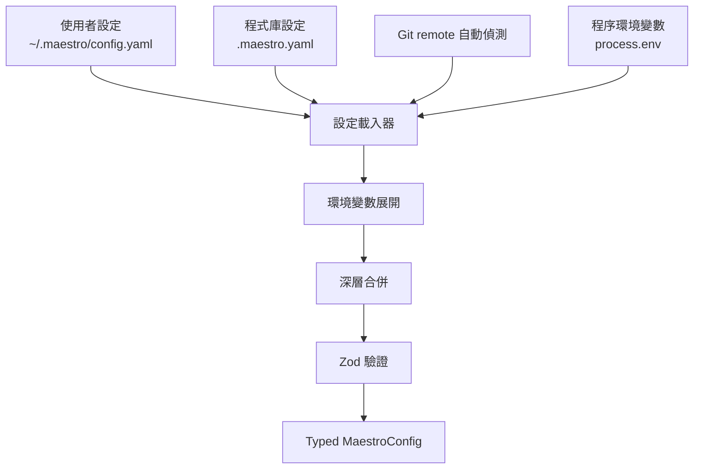
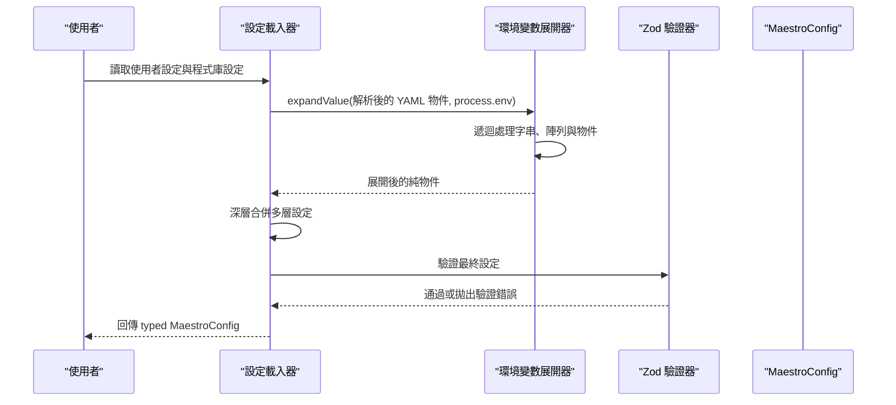
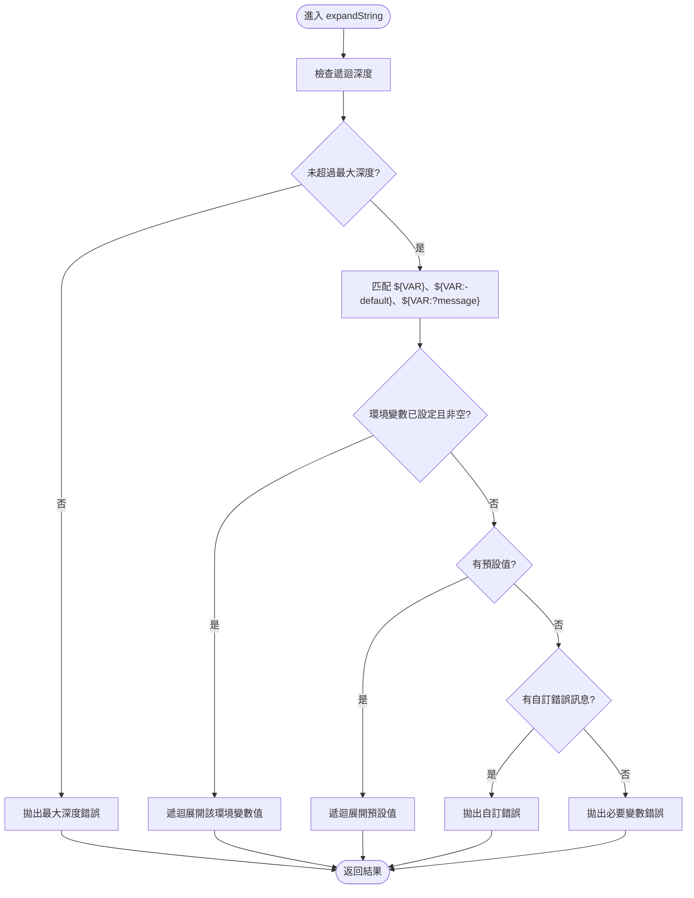
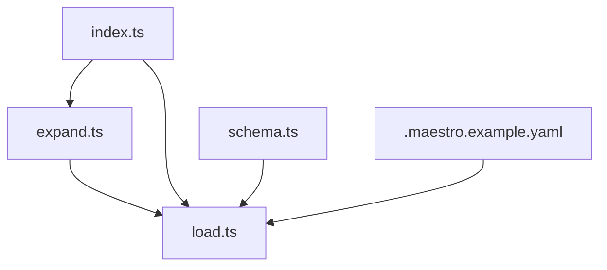

# 環境變數展開語法

<cite>
**本文引用的檔案**   
- [expand.ts](https://github.com/mikeah2011/maestro/blob/master/src/config/expand.ts)
- [expand.test.ts](https://github.com/mikeah2011/maestro/blob/master/tests/config/expand.test.ts)
- [load.ts](https://github.com/mikeah2011/maestro/blob/master/src/config/load.ts)
- [index.ts](https://github.com/mikeah2011/maestro/blob/master/src/config/index.ts)
- [schema.ts](https://github.com/mikeah2011/maestro/blob/master/src/config/schema.ts)
- [.maestro.example.yaml](https://github.com/mikeah2011/maestro/blob/master/.maestro.example.yaml)
</cite>

## 目錄
1. [簡介](#簡介)
2. [專案結構與整合位置](#專案結構與整合位置)
3. [核心元件](#核心元件)
4. [架構總覽](#架構總覽)
5. [詳細元件分析](#詳細元件分析)
6. [相依性分析](#相依性分析)
7. [效能考量](#效能考量)
8. [錯誤處理與除錯指南](#錯誤處理與除錯指南)
9. [安全性考量](#安全性考量)
10. [最佳實踐](#最佳實踐)
11. [結語](#結語)

## 簡介
本文件說明 `${ENV}` 字串展開功能，用於在 Maestro 設定檔中安全、可預測地展開環境變數。它支援必要欄位、預設值、自訂錯誤訊息等語法，並對巢狀展開設定最大深度以避免循環依賴。此機制主要作用於 `.maestro.yaml` 與 `~/.maestro/config.yaml` 等 YAML 設定中的字串值，例如 API key、Base URL、路徑或命令模板。

## 專案結構與整合位置
環境變數展開位於設定載入流程的中間層：YAML 解析後會先經過字串展開，再進行深層合併與 Zod 驗證。

**圖表來源**
- [load.ts:1-200](https://github.com/mikeah2011/maestro/blob/master/src/config/load.ts#L1-L200)
- [expand.ts:1-81](https://github.com/mikeah2011/maestro/blob/master/src/config/expand.ts#L1-L81)

**章節來源**
- [load.ts:1-200](https://github.com/mikeah2011/maestro/blob/master/src/config/load.ts#L1-L200)
- [expand.ts:1-81](https://github.com/mikeah2011/maestro/blob/master/src/config/expand.ts#L1-L81)

## 核心元件
- `EnvExpansionError`：展開失敗時拋出的錯誤型別，包含原始變數名稱。
- `expandString`：對單一字串執行 `${VAR}` 展開。
- `expandValue`：遞迴遍歷物件與陣列，對其中的字串執行展開。
- 設定載入器使用 `expandValue` 將 YAML 解析後的純物件轉換為最終配置。

**章節來源**
- [expand.ts:1-81](https://github.com/mikeah2011/maestro/blob/master/src/config/expand.ts#L1-L81)
- [load.ts:1-200](https://github.com/mikeah2011/maestro/blob/master/src/config/load.ts#L1-L200)

## 架構總覽
環境變數展開的完整資料流如下：

**圖表來源**
- [load.ts:1-200](https://github.com/mikeah2011/maestro/blob/master/src/config/load.ts#L1-L200)
- [expand.ts:1-81](https://github.com/mikeah2011/maestro/blob/master/src/config/expand.ts#L1-L81)

## 詳細元件分析

### 展開語法規則
| 模式 | 行為 | 備註 |
|---|---|---|
| `${VAR}` | 展開為環境變數值；若未設定則拋出錯誤 | 必要欄位 |
| `${VAR:-default}` | 當 `VAR` 未設定或為空字串時使用預設值 | 預設值不支援巢狀展開 |
| `${VAR:?error message}` | 當 `VAR` 未設定或為空字串時，拋出自訂錯誤訊息 | 適合必填但需要明確提示的欄位 |

重要限制：
- 僅支援大寫字母、數字與底線開頭的變數名，符合常見環境變數命名慣例。
- `$VAR`（不含花括號）不會被展開，避免與 Shell 樣式混淆。
- 預設值內部的 `${...}` 不會被展開，因為正規表達式無法可靠解析平衡花括號。

**章節來源**
- [expand.ts:1-81](https://github.com/mikeah2011/maestro/blob/master/src/config/expand.ts#L1-L81)
- [expand.test.ts:1-79](https://github.com/mikeah2011/maestro/blob/master/tests/config/expand.test.ts#L1-L79)

### 支援的環境變數格式
- 變數名必須以 `_` 或大寫字母開頭，其後只能包含大寫字母、數字與底線。
- 空字串等同於未設定，會觸發預設值或錯誤。
- 展開過程會從傳遞進來的 `env` 參數取得變數；預設使用 `process.env`。

這使得程式碼可以透過測試注入假環境，而不必真正修改程序環境。

**章節來源**
- [expand.ts:1-81](https://github.com/mikeah2011/maestro/blob/master/src/config/expand.ts#L1-L81)

### 巢狀展開行為
系統會遞迴展開「已解析的環境變數值」與「預設值」。舉例來說，若 `OUTER=${INNER}` 且 `INNER=deep`，則 `${OUTER}` 會被展開為 `deep`。

為了防止循環引用，展開過程有最大深度限制。超過限制時會拋出深度超出錯誤，而非無窮迴圈。

**圖表來源**
- [expand.ts:1-81](https://github.com/mikeah2011/maestro/blob/master/src/config/expand.ts#L1-L81)

**章節來源**
- [expand.ts:1-81](https://github.com/mikeah2011/maestro/blob/master/src/config/expand.ts#L1-L81)
- [expand.test.ts:1-79](https://github.com/mikeah2011/maestro/blob/master/tests/config/expand.test.ts#L1-L79)

### 物件與陣列展開
`expandValue` 會遞迴處理：
- 字串：套用 `${VAR}` 展開。
- 陣列：逐一展開元素。
- 物件：逐一展開屬性值。
- 其他型別：原樣保留。

它不會修改輸入物件，而是建立新物件，因此適合與設定載入器的深層合併一起使用。

**章節來源**
- [expand.ts:1-81](https://github.com/mikeah2011/maestro/blob/master/src/config/expand.ts#L1-L81)
- [expand.test.ts:1-79](https://github.com/mikeah2011/maestro/blob/master/tests/config/expand.test.ts#L1-L79)

### 設定載入流程中的位置
設定載入器會依以下順序讀取與合併設定：
1. Git remote 自動偵測。
2. 使用者設定 `~/.maestro/config.yaml`。
3. 程式庫設定 `.maestro.yaml`。
4. 程序環境變數中的少量覆寫。
5. CLI 覆寫。

每個 YAML 層都會先經 `expandValue` 展開，再進行深層合併，最後由 Zod 驗證。

**圖表來源**
- [load.ts:1-200](https://github.com/mikeah2011/maestro/blob/master/src/config/load.ts#L1-L200)

**章節來源**
- [load.ts:1-200](https://github.com/mikeah2011/maestro/blob/master/src/config/load.ts#L1-L200)

### 實際使用情境與範例

#### API Key
在 AI Provider 設定中使用 `${ANTHROPIC_API_KEY}`、`${OPENAI_API_KEY}`、`${GOOGLE_API_KEY}` 等變數，避免將金鑰寫入版本控制。

#### Base URL 與條件值
本地模型服務可使用 `${OLLAMA_BASE_URL:-http://localhost:11434}`，讓開發環境直接運作，而生產環境仍可透過環境變數覆蓋。

#### Path 與命令模板
路徑、命令或模板欄位都可以使用 `${PATH_VAR}`，搭配專案專屬的環境變數命名空間，便於在不同環境重複使用相同設定結構。

#### Config Reference
若某個設定值需要參考另一個環境變數，可以透過巢狀展開完成，例如把基礎路徑放在一個環境變數，再在其他欄位中引用。

這些用法已在示例設定檔中以真實欄位展示，包括 provider 的 `apiKey`、`baseUrl`，以及平台與安全相關設定。

**章節來源**
- [.maestro.example.yaml:1-200](https://github.com/mikeah2011/maestro/blob/master/.maestro.example.yaml#L1-L200)
- [expand.ts:1-81](https://github.com/mikeah2011/maestro/blob/master/src/config/expand.ts#L1-L81)

## 相依性分析
- `src/config/expand.ts` 提供核心展開邏輯與錯誤型別。
- `src/config/load.ts` 引入 `expandValue`，在 YAML 解析後執行展開。
- `src/config/index.ts` 重新匯出 `expandString`、`expandValue`、`EnvExpansionError`，供外部模組使用。
- `src/config/schema.ts` 定義最終配置的 Zod schema；環境變數展開發生在驗證之前。
- `.maestro.example.yaml` 展示實際 YAML 欄位如何使用 `${VAR}`。

**圖表來源**
- [expand.ts:1-81](https://github.com/mikeah2011/maestro/blob/master/src/config/expand.ts#L1-L81)
- [load.ts:1-200](https://github.com/mikeah2011/maestro/blob/master/src/config/load.ts#L1-L200)
- [index.ts:1-25](https://github.com/mikeah2011/maestro/blob/master/src/config/index.ts#L1-L25)
- [schema.ts:1-200](https://github.com/mikeah2011/maestro/blob/master/src/config/schema.ts#L1-L200)
- [.maestro.example.yaml:1-200](https://github.com/mikeah2011/maestro/blob/master/.maestro.example.yaml#L1-L200)

**章節來源**
- [index.ts:1-25](https://github.com/mikeah2011/maestro/blob/master/src/config/index.ts#L1-L25)
- [load.ts:1-200](https://github.com/mikeah2011/maestro/blob/master/src/config/load.ts#L1-L200)
- [schema.ts:1-200](https://github.com/mikeah2011/maestro/blob/master/src/config/schema.ts#L1-L200)

## 效能考量
- 展開使用單一正規表達式遍歷字串，時間複雜度大致與字串長度成線性關係。
- 巢狀展開會遞迴呼叫自身，但受最大深度限制保護。
- `expandValue` 會複製物件鍵值，因此空間成本隨配置大小增長。
- 對於大型配置或多層嵌套，應盡量減少不必要的巢狀變數，以降低遞迴次數。

[本節提供一般指導，不直接分析特定檔案]

## 錯誤處理與除錯指南

### 錯誤型別
- `EnvExpansionError`：專門表示環境變數展開錯誤，包含 `variable` 屬性，方便定位未設定或格式錯誤的變數。
- `ConfigError`：設定載入階段的錯誤包裝，可包裹展開或其他解析錯誤。

### 常見錯誤與解決方式
| 問題 | 可能原因 | 建議處理 |
|---|---|---|
| 必要環境變數未設定 | 未提供 `${VAR}` 對應值 | 設定環境變數或使用 `${VAR:-default}` |
| 需要明確錯誤提示 | 未設定但希望顯示自訂訊息 | 使用 `${VAR:?your error message}` |
| 展開過深或循環 | 環境變數互相引用形成循環 | 檢查 `A -> B -> A` 類型的引用 |
| `$NAME` 未被展開 | 使用了無花括號的 Shell 樣式 | 改為 `${NAME}` |
| 預設值內的 `${...}` 未展開 | 預設值不支援巢狀展開 | 改用獨立環境變數組合 |

### 測試建議
- 使用測試注入 `env` 參數，驗證展開結果與錯誤訊息。
- 針對未設定變數、空字串、預設值、自訂錯誤訊息、巢狀展開、多重模式、循環深度等情境撰寫測試。
- 確認 `expandValue` 不會修改輸入物件。

**章節來源**
- [expand.ts:1-81](https://github.com/mikeah2011/maestro/blob/master/src/config/expand.ts#L1-L81)
- [expand.test.ts:1-79](https://github.com/mikeah2011/maestro/blob/master/tests/config/expand.test.ts#L1-L79)
- [load.ts:1-200](https://github.com/mikeah2011/maestro/blob/master/src/config/load.ts#L1-L200)

## 安全性考量
環境變數展開本身只是字串替換，不具備內容過濾能力。敏感資訊洩漏風險主要來自以下幾點：

1. **日誌與錯誤訊息**  
   錯誤訊息可能包含未設定變數名稱，但不會直接輸出環境變數的值。然而，若自訂錯誤訊息或後續配置處理邏輯將金鑰印出，仍可能洩露。

2. **配置儲存**  
   不要將包含 `${VAR}` 展開後值的明文金鑰寫入版本控制。應只提交含有 `${VAR}` 的設定檔，並在部署環境注入實際值。

3. **預設值風險**  
   預設值不應包含任何秘密。即使變數未設定，預設值也會出現在最終配置中。

4. **與其他安全機制配合**  
   專案已有 `security.redactPatterns` 與 `SecretScanner` 等機制，可在送出前遮蔽常見機敏欄位。環境變數展開應該與這些機制共同使用，而不是取代它們。

5. **最小權限原則**  
   為不同環境分別設定 API key 與 token，避免共用同一組憑證。

**章節來源**
- [schema.ts:1-200](https://github.com/mikeah2011/maestro/blob/master/src/config/schema.ts#L1-L200)
- [.maestro.example.yaml:1-200](https://github.com/mikeah2011/maestro/blob/master/.maestro.example.yaml#L1-L200)

## 最佳實踐

### 環境變數命名空間
- 使用有意義的前綴，例如 `ANTHROPIC_API_KEY`、`OPENAI_API_KEY`、`GITHUB_TOKEN`。
- 將專案專屬路徑或端點放入專屬變數，例如 `MAESTRO_AUDIT_DIR`、`OLLAMA_BASE_URL`。
- 避免使用太通用的名稱，如 `KEY`、`TOKEN`，以免不同服務之間衝突。

### 避免循環依賴
- 環境變數之間不要互相引用形成循環。
- 若確實需要組合值，建議用單一環境變數存放基礎路徑，再由配置層組合，而不是讓多個環境變數互相依賴。

### 選擇合適的展開語法
- 必填欄位：優先使用 `${VAR:?clear error message}`，讓錯誤訊息能引導操作者補齊設定。
- 可選欄位：使用 `${VAR:-default}`，並確保預設值安全且合理。
- 路徑與命令模板：避免在模板中硬編碼環境相關路徑，改用環境變數。

### 組織設定檔
- 將共享的基礎設定放在使用者設定檔。
- 將程式庫相關的預設值放在程式庫設定檔。
- 敏感值一律透過環境變數注入，不在設定檔中明文出現。

### 測試與部署
- 單元測試使用注入的 `env` 模擬各種環境。
- 集成測試驗證完整設定載入流程。
- 部署流程應在容器或 CI 環境中注入環境變數，並驗證展開後的配置可正確啟動服務。

**章節來源**
- [expand.ts:1-81](https://github.com/mikeah2011/maestro/blob/master/src/config/expand.ts#L1-L81)
- [load.ts:1-200](https://github.com/mikeah2011/maestro/blob/master/src/config/load.ts#L1-L200)
- [.maestro.example.yaml:1-200](https://github.com/mikeah2011/maestro/blob/master/.maestro.example.yaml#L1-L200)

## 結語
`${ENV}` 字串展開為 Maestro 設定提供了靈活的環境差異化能力，同時透過語法限制、最大深度與明確錯誤型別降低誤用風險。正確使用時，它可以讓 API key、路徑、命令模板與條件值集中管理，並與專案既有的安全掃描與遮蔽機制協同工作。實務上應重視命名規範、循環預防與敏感值防護，使設定檔既能重用又不會成為資安弱點。