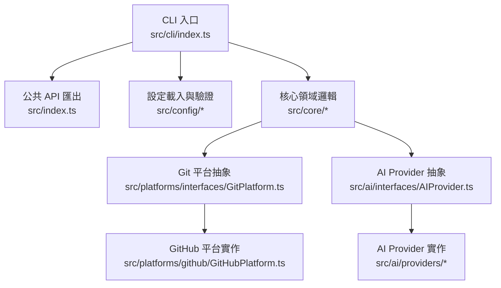
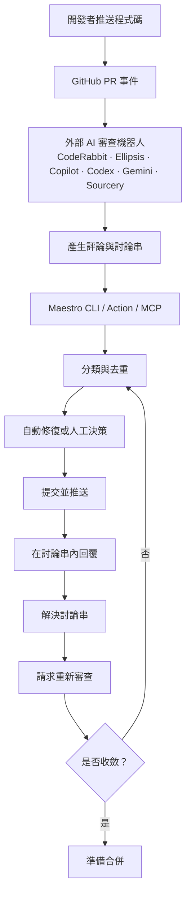
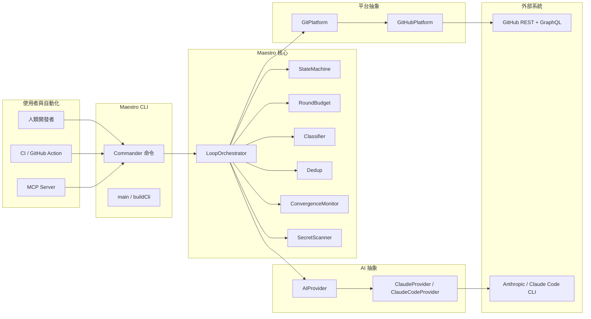
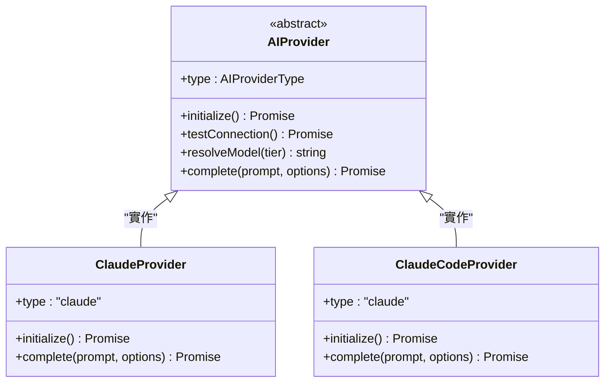
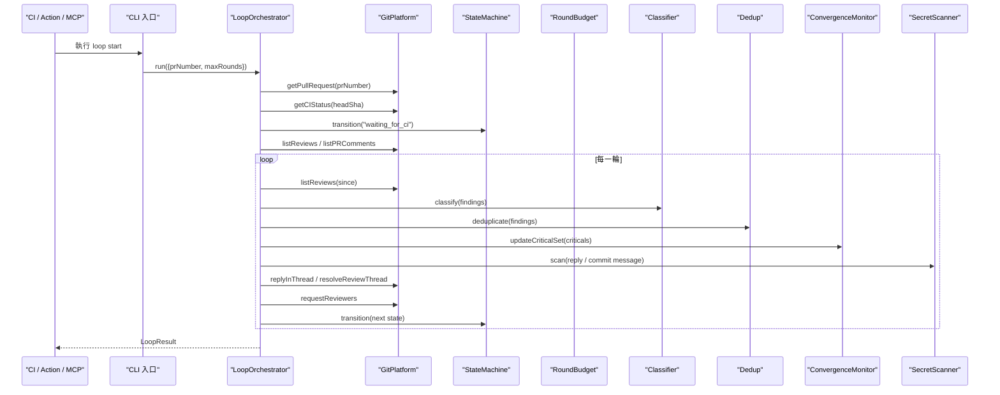
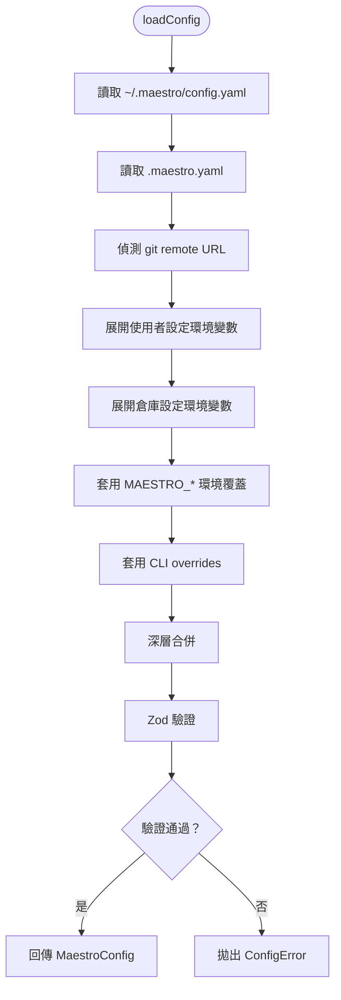
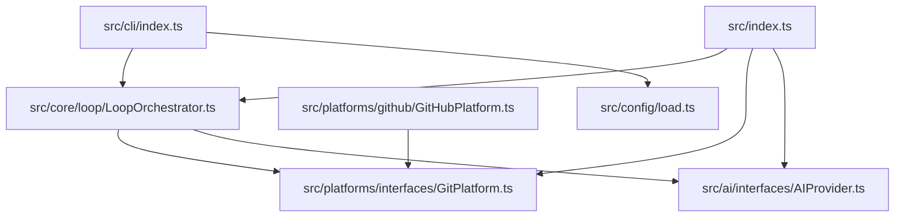

# 系統上下文與分層架構

<cite>
**本文引用的檔案**   
- [README.md](https://github.com/mikeah2011/maestro/blob/master/README.md)
- [DESIGN.md](https://github.com/mikeah2011/maestro/blob/master/docs/DESIGN.md)
- [package.json](https://github.com/mikeah2011/maestro/blob/master/package.json)
- [tsconfig.json](https://github.com/mikeah2011/maestro/blob/master/tsconfig.json)
- [CLAUDE.md](https://github.com/mikeah2011/maestro/blob/master/CLAUDE.md)
- [src/index.ts](https://github.com/mikeah2011/maestro/blob/master/src/index.ts)
- [src/cli/index.ts](https://github.com/mikeah2011/maestro/blob/master/src/cli/index.ts)
- [src/platforms/interfaces/GitPlatform.ts](https://github.com/mikeah2011/maestro/blob/master/src/platforms/interfaces/GitPlatform.ts)
- [src/ai/interfaces/AIProvider.ts](https://github.com/mikeah2011/maestro/blob/master/src/ai/interfaces/AIProvider.ts)
- [src/core/loop/LoopOrchestrator.ts](https://github.com/mikeah2011/maestro/blob/master/src/core/loop/LoopOrchestrator.ts)
- [src/platforms/github/GitHubPlatform.ts](https://github.com/mikeah2011/maestro/blob/master/src/platforms/github/GitHubPlatform.ts)
- [src/config/load.ts](https://github.com/mikeah2011/maestro/blob/master/src/config/load.ts)
</cite>

## 目錄

1. [引言](#引言)
2. [專案結構](#專案結構)
3. [核心元件](#核心元件)
4. [架構總覽](#架構總覽)
5. [詳細元件分析](#詳細元件分析)
6. [依賴分析](#依賴分析)
7. [效能考量](#效能考量)
8. [故障排除指南](#故障排除指南)
9. [結論](#結論)
10. [附錄：CI、Action 與 MCP 的導入方式](#附錄ciaction-mcp-的導入方式)

## 引言

Maestro 的產品定位是「審查機器人之上的收斂層」，而不是另一個獨立的程式碼審查工具。CodeRabbit、Ellipsis、Copilot Code Review、Codex、Gemini Code Assist、Sourcery 等工具已經很擅長找出問題；缺少的是審查之後的收尾工作：分類問題、修復真正錯誤、在討論串中回覆、解決討論串、請求重新審查，以及知道何時停止。

Maestro 的輸入是這些外部審查機器人對 PR 產生的評論與討論串，輸出則是已分類、去重、可修復的問題，以及準備合併的最終摘要。它透過硬性上限、單調不增的關鍵問題集、Jaccard 相似度收斂偵測與反垃圾郵件執行期斷言，把原本可能無限循環的 PR 審查流程變成有確定性停止條件的閉環。

對於初學者來說，可以這樣理解：

| 角色 | 職責 |
|---|---|
| 外部 AI 審查機器人 | 讀取 PR 並產出評論、討論串與建議 |
| Maestro CLI | 使用者或 CI 觸發入口 |
| `core` | 領域邏輯：狀態機、分類、去重、收斂、安全掃描、修復編排 |
| `platforms` | 抽象 Git 平台與 GitHub 實作 |
| `ai` | 抽象 LLM Provider 與 Claude 相關提供者 |
| `config` | YAML 設定載入、環境變數展開與 Zod 驗證 |
| `src/index.ts` | 公共 API 出口，供 CI、Action、MCP 或其他模組導入 |

**Section sources**
- [README.md:1-40](https://github.com/mikeah2011/maestro/blob/master/README.md#L1-L40)
- [DESIGN.md:1-40](https://github.com/mikeah2011/maestro/blob/master/docs/DESIGN.md#L1-L40)

## 專案結構

Maestro 使用 TypeScript ESM，目標為 ES2022，並由 Bun 建置。專案根目錄中的 `src/` 區分為四個主要層次：



**圖表來源**
- [src/cli/index.ts:1-86](https://github.com/mikeah2011/maestro/blob/master/src/cli/index.ts#L1-L86)
- [src/index.ts:1-150](https://github.com/mikeah2011/maestro/blob/master/src/index.ts#L1-L150)
- [src/platforms/interfaces/GitPlatform.ts:1-130](https://github.com/mikeah2011/maestro/blob/master/src/platforms/interfaces/GitPlatform.ts#L1-L130)
- [src/platforms/github/GitHubPlatform.ts:1-120](https://github.com/mikeah2011/maestro/blob/master/src/platforms/github/GitHubPlatform.ts#L1-L120)
- [src/ai/interfaces/AIProvider.ts:1-114](https://github.com/mikeah2011/maestro/blob/master/src/ai/interfaces/AIProvider.ts#L1-L114)

專案結構的組織原則如下：

| 目錄 | 責任 | 設計意圖 |
|---|---|---|
| `cli/` | Commander 子命令：`init`、`doctor`、`loop`、`audit`、`bots` | 程序型入口，不承載業務狀態 |
| `config/` | YAML schema、多層載入、環境變數展開 | 所有設定集中進入點 |
| `core/` | 狀態機、事件、預算、分類、去重、安全、修復、收斂、PR 編排 | 工具無關的領域模型 |
| `platforms/` | Git 平台抽象與 GitHub 實作 | 讓 orchestrator 不必直接依賴 GitHub |
| `ai/` | LLM Provider 抽象與 Claude 提供者 | 讓 orchestrator 不必直接呼叫 Anthropic |
| `src/index.ts` | re-export 類型與類別 | 作為 npm package 的公共 API |

**Section sources**
- [CLAUDE.md:14-47](https://github.com/mikeah2011/maestro/blob/master/CLAUDE.md#L14-L47)
- [src/cli/index.ts:1-86](https://github.com/mikeah2011/maestro/blob/master/src/cli/index.ts#L1-L86)
- [src/index.ts:1-150](https://github.com/mikeah2011/maestro/blob/master/src/index.ts#L1-L150)

## 核心元件

### CLI 入口

`src/cli/index.ts` 是 `maestro` 二進位的主入口。它會：

1. 從 `process.cwd()` 靜默載入 `.env`。
2. 建立 Commander 程式物件。
3. 註冊 `init`、`doctor`、`loop`、`audit`、`bots` 子命令。
4. 解析引數並返回退出碼。
5. 以非 library 模式直接執行時，將非零退出碼傳給 `process.exit`。

CLI 本身只負責使用者介面與命令路由，真正的 PR 收斂邏輯交給 `core/loop/LoopOrchestrator` 與對應的平台、AI 與設定層。

**Section sources**
- [src/cli/index.ts:1-86](https://github.com/mikeah2011/maestro/blob/master/src/cli/index.ts#L1-L86)

### 公共 API 匯出層

`src/index.ts` 是這個 package 的公共匯出入口。它不實現業務邏輯，而是把以下內容暴露給外部消費者：

| 匯出層級 | 內容 | 用途 |
|---|---|---|
| AI 抽象 | `AIProvider`、`AIProviderType`、`CompletionOptions`、`CompletionResult` 等 | 讓未來 OpenAI、Gemini、本地 Ollama 等 provider 共用同一個合約 |
| Git 平台抽象 | `GitPlatform`、`PlatformType`、`PlatformCapabilities`、`RateLimitInfo` 等 | 讓 GitHub、GitLab、Gitea、Gitee 共用同一個平台合約 |
| 領域類型 | `Finding`、`BotReview`、`PullRequest`、`CIStatus` 等 | 供測試、CI script、MCP server 共享資料結構 |
| 事件系統 | `EventEmitter`、`MaestroEvent`、`stdoutSink` 等 | 供 Claude Code skill、MCP server、tail 監控讀取 JSONL 事件 |
| 收斂原語 | `RoundBudget`、`CommitThrottle`、`ConvergenceMonitor`、`Classifier`、`Dedup`、`SecretScanner` | 供高階組件或測試組合 |
| 主編排器 | `LoopOrchestrator`、`LoopRunOptions`、`LoopResult` | 讓 CI / Action / MCP server 驅動完整 PR 收斂循環 |
| GitHub 實作 | `GitHubPlatform`、mappers、GraphQL client 類型 | 供需要直接操作 GitHub 的整合 |
| AI 提供者 | `ClaudeProvider`、`ClaudeCodeProvider` | 提供可直接使用的 Claude 實作 |

這意味著 `@mikeah2011/maestro` 不只是 CLI，也是一個可被其他程式碼 import 的函式庫。

**Section sources**
- [src/index.ts:1-150](https://github.com/mikeah2011/maestro/blob/master/src/index.ts#L1-L150)

### 設定載入層

`src/config/load.ts` 負責把分散在不同位置的設定合併成一個強類型的 `MaestroConfig`。優先順序由高到低為：

1. CLI 旗標（`overrides`）
2. 環境變數白名單
3. 倉庫 `.maestro.yaml`
4. 使用者 `~/.maestro/config.yaml`
5. Git remote 自動偵測
6. Zod schema 預設值

每個 YAML 層都會經過環境變數展開與深層合併，最後由 Zod 驗證。若驗證失敗，會拋出 `ConfigError`，並保留原始原因以便診斷。

**Section sources**
- [src/config/load.ts:1-216](https://github.com/mikeah2011/maestro/blob/master/src/config/load.ts#L1-L216)

## 架構總覽

### PR 工作流程中的系統上下文



**圖表來源**
- [README.md:1-40](https://github.com/mikeah2011/maestro/blob/master/README.md#L1-L40)
- [DESIGN.md:1-40](https://github.com/mikeah2011/maestro/blob/master/docs/DESIGN.md#L1-L40)
- [src/core/loop/LoopOrchestrator.ts:1-120](https://github.com/mikeah2011/maestro/blob/master/src/core/loop/LoopOrchestrator.ts#L1-L120)

### 分層互動邊界



**圖表來源**
- [src/cli/index.ts:1-86](https://github.com/mikeah2011/maestro/blob/master/src/cli/index.ts#L1-L86)
- [src/core/loop/LoopOrchestrator.ts:1-120](https://github.com/mikeah2011/maestro/blob/master/src/core/loop/LoopOrchestrator.ts#L1-L120)
- [src/platforms/interfaces/GitPlatform.ts:1-130](https://github.com/mikeah2011/maestro/blob/master/src/platforms/interfaces/GitPlatform.ts#L1-L130)
- [src/platforms/github/GitHubPlatform.ts:1-120](https://github.com/mikeah2011/maestro/blob/master/src/platforms/github/GitHubPlatform.ts#L1-L120)
- [src/ai/interfaces/AIProvider.ts:1-114](https://github.com/mikeah2011/maestro/blob/master/src/ai/interfaces/AIProvider.ts#L1-L114)

## 詳細元件分析

### Git 平台抽象與 GitHub 實作

`src/platforms/interfaces/GitPlatform.ts` 定義了一個面向 orchestrator 的抽象類別。它不是 UI 適配器，也不是簡單的 HTTP 包裝器，而是「orchestrator-grade」的平台合約：

| 能力欄位 | 意義 |
|---|---|
| `threadResolve` | 是否可用原生 API 標記討論串為已解決 |
| `inlineReplies` | 是否可在討論串內回覆，而非只能發表頂層 PR 評論 |
| `reviewThreads` | 平台是否把 review threads 視為一等公民 |
| `requestReviewers` | 是否能透過 API 指定 reviewer |
| `ciStatus` | 是否能查詢 CI check 狀態 |
| `graphql` | 是否支援 GraphQL 批量操作 |
| `emojiReactions` | 是否支援對評論加上 emoji 反應 |

`src/platforms/github/GitHubPlatform.ts` 是目前的參考實作，使用：

- `@octokit/rest` 處理 PR I/O、CI checks、rate limit。
- `@octokit/graphql` 處理 review thread 相關操作。
- `simple-git` 取得 owner/repo 資訊。
- mapper 函式把 GitHub 原生格式轉換為 Maestro 內部類型。

這種設計的好處是：未來要加入 GitLab、Gitea、Gitee 時，不需要修改 orchestrator，只要新增 `GitPlatform` 實作即可。

```mermaid
classDiagram
    class GitPlatform {
        <<abstract>>
        +type : PlatformType
        +capabilities : PlatformCapabilities
        +initialize() Promise<void>
        +testConnection() Promise<boolean>
        +detectRepo() Promise<{owner, repo}>
        +getPullRequest(prNumber) Promise<PullRequest>
        +listReviews(prNumber, since) Promise<BotReview[]>
        +listReviewThreads(prNumber) Promise<ReviewThread[]>
        +replyInThread(threadId, body) Promise<void>
        +resolveReviewThread(threadId) Promise<void>
        +getCIStatus(headSha) Promise<CIStatus>
        +getRateLimitInfo() Promise<RateLimitInfo>
    }

    class GitHubPlatform {
        +type : "github"
        +capabilities : PlatformCapabilities
        +initialize() Promise<void>
        +testConnection() Promise<boolean>
        +detectRepo() Promise<{owner, repo}>
        +getPullRequest(prNumber) Promise<PullRequest>
        +listReviews(prNumber, since) Promise<BotReview[]>
        +listReviewThreads(prNumber) Promise<ReviewThread[]>
        +replyInThread(threadId, body) Promise<void>
        +resolveReviewThread(threadId) Promise<void>
        +getCIStatus(headSha) Promise<CIStatus>
        +getRateLimitInfo() Promise<RateLimitInfo>
    }

    GitPlatform <|-- GitHubPlatform : "實作"
```

**圖表來源**
- [src/platforms/interfaces/GitPlatform.ts:1-130](https://github.com/mikeah2011/maestro/blob/master/src/platforms/interfaces/GitPlatform.ts#L1-L130)
- [src/platforms/github/GitHubPlatform.ts:1-120](https://github.com/mikeah2011/maestro/blob/master/src/platforms/github/GitHubPlatform.ts#L1-L120)

**Section sources**
- [src/platforms/interfaces/GitPlatform.ts:1-130](https://github.com/mikeah2011/maestro/blob/master/src/platforms/interfaces/GitPlatform.ts#L1-L130)
- [src/platforms/github/GitHubPlatform.ts:1-200](https://github.com/mikeah2011/maestro/blob/master/src/platforms/github/GitHubPlatform.ts#L1-L200)

### AI Provider 抽象與提供者

`src/ai/interfaces/AIProvider.ts` 是一個純粹的完成提示合約。orchestrator 不會呼叫「review」方法，而是把 prompt 轉給 provider，由 provider 回傳 completion。這樣做的好處是：

- 不同階段可以使用不同 tier：高頻低風險操作用便宜模型，判斷性操作用強力模型。
- 未來加入 OpenAI、Gemini、本地 Ollama 或自訂 HTTP provider 時，不需改 orchestrator。
- cost tracking、usage、finish reason、parsedJson、raw audit 都在統一格式中。

目前提供的實作包括：

| Provider | 特點 |
|---|---|
| `ClaudeProvider` | 直接呼叫 Anthropic Messages API，需要 API Key |
| `ClaudeCodeProvider` | 透過 Claude Code CLI 子程序，無需 API Key |



**圖表來源**
- [src/ai/interfaces/AIProvider.ts:1-114](https://github.com/mikeah2011/maestro/blob/master/src/ai/interfaces/AIProvider.ts#L1-L114)
- [src/index.ts:118-150](https://github.com/mikeah2011/maestro/blob/master/src/index.ts#L118-L150)

**Section sources**
- [src/ai/interfaces/AIProvider.ts:1-114](https://github.com/mikeah2011/maestro/blob/master/src/ai/interfaces/AIProvider.ts#L1-L114)
- [src/index.ts:118-150](https://github.com/mikeah2011/maestro/blob/master/src/index.ts#L118-L150)

### LoopOrchestrator 與收斂循環

`src/core/loop/LoopOrchestrator.ts` 是整個系統的 orchestrator，它把 M2+M3+M4 各里程碑組合成一個確定性的 PR 收斂循環。其主要行為如下：

1. 取得 PR 與 HEAD SHA。
2. 等待 CI 通過。
3. 從現有 PR 評論中預先識別已達到用量上限或已滿足的外部機器人。
4. 進入主循環：等待 CI → 等待機器人 → 競速 → 分類 → 修復 → 提交推送 → 回覆 → 解決討論串 → 請求重新審查。
5. 透過 `StateMachine` 管理狀態轉換。
6. 透過 `RoundBudget` 強制每輪資源限制。
7. 透過 `ConvergenceMonitor` 偵測振盪與收斂。
8. 透過 `Classifier` 與 `Dedup` 處理問題分類與去重。
9. 透過 `SecretScanner` 防止外發訊息洩漏敏感資訊。



**圖表來源**
- [src/core/loop/LoopOrchestrator.ts:1-200](https://github.com/mikeah2011/maestro/blob/master/src/core/loop/LoopOrchestrator.ts#L1-L200)
- [src/platforms/interfaces/GitPlatform.ts:1-130](https://github.com/mikeah2011/maestro/blob/master/src/platforms/interfaces/GitPlatform.ts#L1-L130)

**Section sources**
- [src/core/loop/LoopOrchestrator.ts:1-200](https://github.com/mikeah2011/maestro/blob/master/src/core/loop/LoopOrchestrator.ts#L1-L200)

### 設定載入流程



**圖表來源**
- [src/config/load.ts:1-216](https://github.com/mikeah2011/maestro/blob/master/src/config/load.ts#L1-L216)

**Section sources**
- [src/config/load.ts:1-216](https://github.com/mikeah2011/maestro/blob/master/src/config/load.ts#L1-L216)

## 依賴分析

### 技術棧

| 項目 | 版本或規格 | 用途 |
|---|---|---|
| TypeScript | 5.6.x | 語言與型別檢查 |
| ESM | `type: module` | Node.js 原生 ESM |
| Target | ES2022 | 符合 Node.js >= 20 的能力 |
| Module Resolution | bundler | 配合 Bun / Vite / tsconfig paths |
| Bun | >= 1.1 | 開發、watch、build、compile binary |
| Node.js | >= 20 | 二進位執行環境 |
| Vitest | 2.x | 單元測試與覆蓋率 |
| fast-check | 3.x | 屬性測試，用於 Dedup 冪等性與結合性驗證 |

**Section sources**
- [package.json:1-89](https://github.com/mikeah2011/maestro/blob/master/package.json#L1-L89)
- [tsconfig.json:1-41](https://github.com/mikeah2011/maestro/blob/master/tsconfig.json#L1-L41)

### 外部依賴概覽

| 套件 | 用途 |
|---|---|
| `commander` | CLI 子命令框架 |
| `@octokit/rest` | GitHub REST API |
| `@octokit/graphql` | GitHub GraphQL，用於 review thread |
| `axios` | HTTP 客戶端，常見於 LLM provider 或自訂 HTTP provider |
| `dotenv` | CLI 啟動時載入 `.env` |
| `js-yaml` | YAML 解析 |
| `zod` | 設定 schema 與運行期驗證 |
| `simple-git` | 取得 git remote、owner、repo |
| `chalk` | CLI 文字顏色 |
| `p-retry` | 重試策略 |
| `@clack/prompts` | CLI 互動提示 |

**Section sources**
- [package.json:40-89](https://github.com/mikeah2011/maestro/blob/master/package.json#L40-L89)

### 模組依賴關係圖



**圖表來源**
- [src/cli/index.ts:1-86](https://github.com/mikeah2011/maestro/blob/master/src/cli/index.ts#L1-L86)
- [src/index.ts:1-150](https://github.com/mikeah2011/maestro/blob/master/src/index.ts#L1-L150)
- [src/core/loop/LoopOrchestrator.ts:1-120](https://github.com/mikeah2011/maestro/blob/master/src/core/loop/LoopOrchestrator.ts#L1-L120)
- [src/platforms/interfaces/GitPlatform.ts:1-130](https://github.com/mikeah2011/maestro/blob/master/src/platforms/interfaces/GitPlatform.ts#L1-L130)
- [src/platforms/github/GitHubPlatform.ts:1-120](https://github.com/mikeah2011/maestro/blob/master/src/platforms/github/GitHubPlatform.ts#L1-L120)
- [src/ai/interfaces/AIProvider.ts:1-114](https://github.com/mikeah2011/maestro/blob/master/src/ai/interfaces/AIProvider.ts#L1-L114)
- [src/config/load.ts:1-216](https://github.com/mikeah2011/maestro/blob/master/src/config/load.ts#L1-L216)

**Section sources**
- [src/index.ts:1-150](https://github.com/mikeah2011/maestro/blob/master/src/index.ts#L1-L150)
- [src/core/loop/LoopOrchestrator.ts:1-120](https://github.com/mikeah2011/maestro/blob/master/src/core/loop/LoopOrchestrator.ts#L1-L120)

## 效能考量

Maestro 的設計不只關注功能正確性，也重視外部成本與 PR 噪音控制：

1. **三層去重**：精確雜湊 → Levenshtein 模糊匹配 → LLM 語義去重。最廉價層先消除大量重複，減少後續昂貴 LLM 呼叫。
2. **分類圍欄設計**：關鍵字、嚴重程度、敏感路徑等確定性規則優先短路，只有未知問題才進入模型。
3. **每輪配額**：`RoundBudget` 強制每輪最多一次提交、每個討論串最多一次回覆、每輪最多一次 PR 內容更新。
4. **收斂偵測**：Jaccard 相似度超過閾值表示振盪，直接停止並升級，避免無謂消耗 token。
5. **成本上限**：可配置 USD 預算，每次執行報告 token 用量與預估費用。
6. **Polling 間隔可配置**：CI 輪詢與機器人輪詢都支援調整延遲，避免過度打壓平台 API。

這些機制共同降低三個風險：token 成本失控、PR 討論串垃圾化、以及長時間無法收斂的 PR。

[本節為一般性效能討論，未直接分析特定程式碼片段]

## 故障排除指南

### 常見問題與定位方向

| 現象 | 可能原因 | 排查位置 |
|---|---|---|
| CLI 找不到 GitHub Token | `GITHUB_TOKEN` 未設定，或 `.env` 未載入 | `src/cli/index.ts`、`src/platforms/github/GitHubPlatform.ts` |
| 設定檔無法解析 | YAML 格式錯誤、環境變數展開失敗 | `src/config/load.ts` |
| 型別檢查失敗 | TypeScript strict mode、ESNext module resolution | `tsconfig.json`、`package.json` |
| 測試無法連線 GitHub | 測試應注入 Octokit / GraphQL client | `src/platforms/github/GitHubPlatform.ts` |
| 測試無法連線 LLM | 測試應使用 mock provider 或直接測試 orchestrator hook | `src/ai/interfaces/AIProvider.ts`、`src/core/loop/LoopOrchestrator.ts` |
| PR 評論過多或重複 | 去重或 RoundBudget 異常 | `src/core/dedup/Dedup.ts`、`src/core/round/RoundBudget.ts` |
| 收斂永遠不停止 | 關鍵問題集合未單調下降、或 Jaccard 閾值異常 | `src/core/convergence/ConvergenceMonitor.ts` |

### 退出碼說明

CLI 定義了明確的退出碼：

| 退出碼 | 意義 |
|---|---|
| 0 | 成功 |
| 1 | 一般錯誤 |
| 2 | 使用方式錯誤 |
| 3 | 設定錯誤 |
| 4 | 尚未實作的佔位指令 |

這讓 CI 和 Action 能根據退出碼決定 pipeline 結果。

**Section sources**
- [src/cli/index.ts:1-86](https://github.com/mikeah2011/maestro/blob/master/src/cli/index.ts#L1-L86)
- [src/config/load.ts:1-216](https://github.com/mikeah2011/maestro/blob/master/src/config/load.ts#L1-L216)
- [src/platforms/github/GitHubPlatform.ts:1-200](https://github.com/mikeah2011/maestro/blob/master/src/platforms/github/GitHubPlatform.ts#L1-L200)

## 結論

Maestro 的核心價值不在於取代 CodeRabbit、Ellipsis、Copilot、Codex、Gemini Code Assist 或 Sourcery，而在於把這些工具的輸出變成一個可追蹤、可分類、可修復、可停止的 PR 收斂流程。

它的架構可以簡化為三個重點：

1. **CLI 是程序，不是領域邏輯。** Commander 只負責命令路由與使用者介面。
2. **platform 與 ai 都是抽象層。** orchestrator 依賴抽象，而不是直接依賴 GitHub 或 Anthropic。
3. **src/index.ts 是公共 API 出口。** 它讓 CI、Action、MCP server 與其他模組能以穩定契約導入 Maestro，而不必直接碰 internal implementation。

對初學者而言，建議閱讀順序是：

1. 先看 README 的產品定位。
2. 再看 `src/cli/index.ts` 了解 CLI 如何啟動。
3. 接著看 `src/index.ts` 了解哪些東西可以 export 給外部使用。
4. 然後看 `src/core/loop/LoopOrchestrator.ts` 了解收斂循環。
5. 最後看 `src/platforms/interfaces/GitPlatform.ts` 與 `src/ai/interfaces/AIProvider.ts` 理解抽象邊界。

[本節為總結性內容，未直接分析特定檔案]

## 附錄：CI、Action 與 MCP 的導入方式

### 作為 npm package 導入

`package.json` 定義了：

| 欄位 | 值 | 意義 |
|---|---|---|
| `name` | `@mikeah2011/maestro` | npm package 名稱 |
| `main` | `./dist/index.js` | CommonJS 相容入口 |
| `types` | `./dist/index.d.ts` | TypeScript 型別入口 |
| `exports` | `"."` 與 `"./cli"` | ESM import 與 CLI entry |
| `bin` | `./dist/cli.js` | 安裝後可用的二進位名稱 |

因此，外部程式碼可以：

```typescript
import { LoopOrchestrator, GitPlatform, AIProvider } from "@mikeah2011/maestro";
```

而 CI 可以直接執行：

```bash
npx @mikeah2011/maestro@latest loop start --pr ${{ github.event.number }}
```

**Section sources**
- [package.json:1-39](https://github.com/mikeah2011/maestro/blob/master/package.json#L1-L39)
- [src/index.ts:1-150](https://github.com/mikeah2011/maestro/blob/master/src/index.ts#L1-L150)

### 作為 CLI 二進位導入

Bun 建構腳本會把 CLI 打包到 `dist/`，並可編譯成獨立二進位：

| 指令 | 作用 |
|---|---|
| `bun run build` | 打包 CLI 到 `dist/` |
| `bun run build:bin` | 編譯獨立二進位 `dist/maestro` |
| `bun run verify` | 型別檢查 + 測試 |
| `bun run test` | 執行測試 |

**Section sources**
- [package.json:24-39](https://github.com/mikeah2011/maestro/blob/master/package.json#L24-L39)
- [CLAUDE.md:14-33](https://github.com/mikeah2011/maestro/blob/master/CLAUDE.md#L14-L33)

### 作為 MCP Server 導入

根據設計文件，Maestro 計畫提供 MCP server，暴露 `start_loop`、`get_status`、`stop_loop`、`get_round_summary` 等能力。一旦上線，任何支援 MCP 的代理（Claude Desktop、Cursor、Gemini Desktop 等）都可以透過同一個 CLI 與事件流控制 Maestro，而不需要每個工具各自寫適配器。

設計文件中特別強調：

> CLI 是程序，Skill 是視窗。長時運行的編排邏輯在 CLI 中；UI 工具是監控器，負責讀取事件並分發控制指令。

**Section sources**
- [DESIGN.md:41-90](https://github.com/mikeah2011/maestro/blob/master/docs/DESIGN.md#L41-L90)
- [src/index.ts:52-78](https://github.com/mikeah2011/maestro/blob/master/src/index.ts#L52-L78)