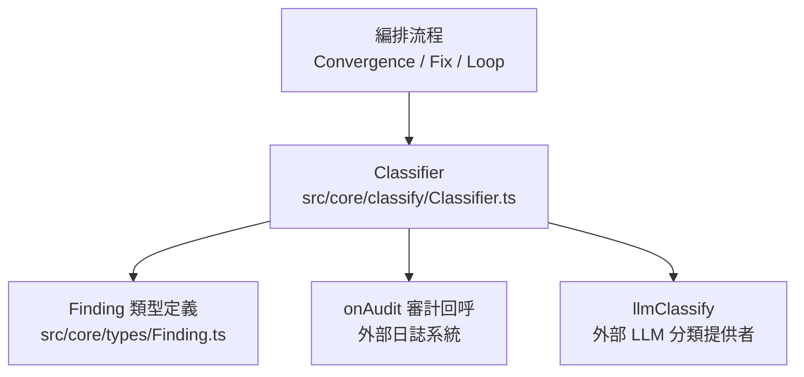
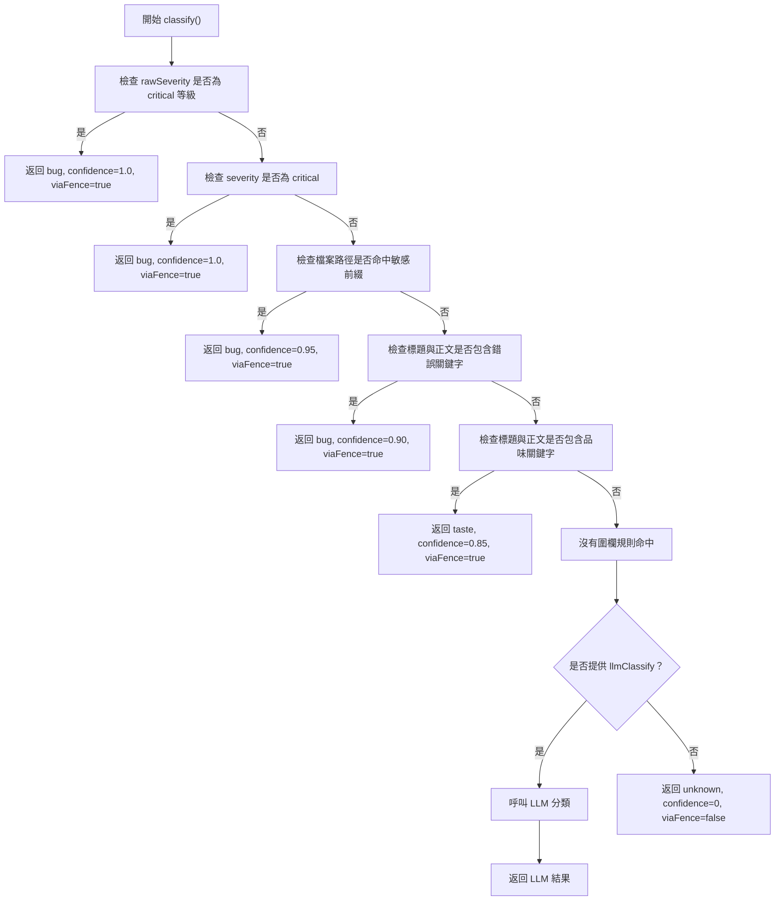
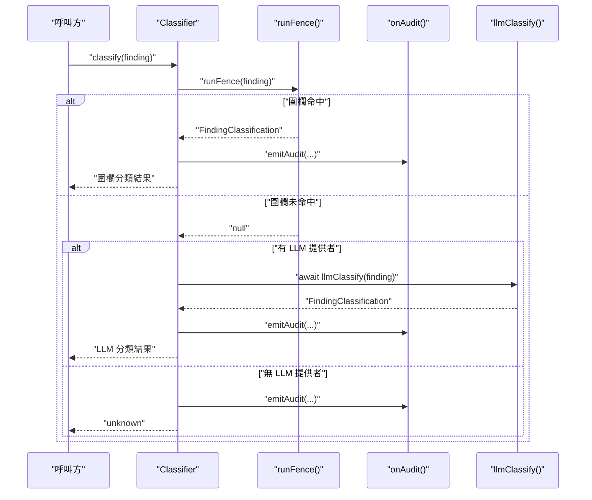
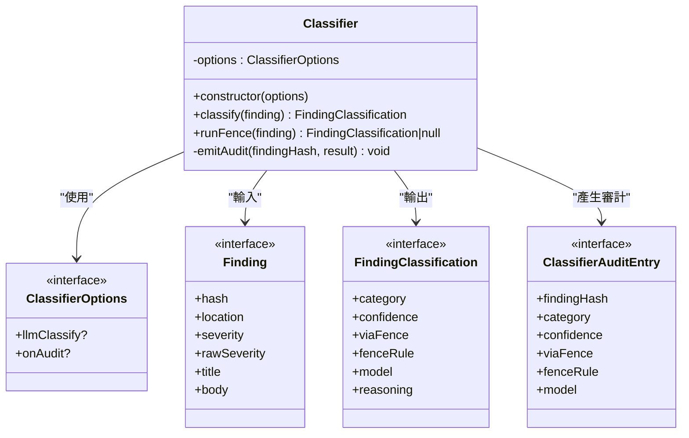

# Classifier 分類器

**本文引用的檔案**

- [Classifier.ts](https://github.com/mikeah2011/maestro/blob/master/src/core/classify/Classifier.ts)
- [Finding.ts](https://github.com/mikeah2011/maestro/blob/master/src/core/types/Finding.ts)
- [DESIGN.md](https://github.com/mikeah2011/maestro/blob/master/docs/DESIGN.md)
- [.maestro.example.yaml](https://github.com/mikeah2011/maestro/blob/master/.maestro.example.yaml)
- [Classifier.test.ts](https://github.com/mikeah2011/maestro/blob/master/tests/core/classify/Classifier.test.ts)

## 目錄
1. [簡介](#簡介)
2. [專案結構與角色定位](#專案結構與角色定位)
3. [圍欄式設計核心概念](#圍欄式設計核心概念)
4. [輸入與輸出模型](#輸入與輸出模型)
5. [規則優先順序與匹配邏輯](#規則優先順序與匹配邏輯)
6. [classify() 方法流程](#classify-方法流程)
7. [設定範例與擴展方式](#設定範例與擴展方式)
8. [依賴關係與架構圖](#依賴關係與架構圖)
9. [性能考量](#性能考量)
10. [常見問題與調優指南](#常見問題與調優指南)
11. [測試驗證要點](#測試驗證要點)
12. [結語](#結語)

## 簡介
Classifier 是 Maestro 中的「圍欄式」分類器，負責把機器審查產生的 Finding 轉換為結構化的 `FindingClassification`。它的核心設計原則是：先用確定性規則進行快速短路判斷；只有在所有規則都未命中時，才考慮降級到 LLM 做模糊分類。這樣能最大化避免昂貴的語言模型呼叫，同時保留可審計的決策軌跡。

## 專案結構與角色定位
Classifier 位於 `src/core/classify/Classifier.ts`，屬於核心層模組。它不直接連線平台或 AI Provider，而是透過注入的 `llmClassify` 函式取得 LLM 能力，並透過 `onAudit` 回呼記錄每次分類的影子審計日誌。

**圖表來源**
- [Classifier.ts:1-191](https://github.com/mikeah2011/maestro/blob/master/src/core/classify/Classifier.ts#L1-L191)
- [Finding.ts:1-129](https://github.com/mikeah2011/maestro/blob/master/src/core/types/Finding.ts#L1-L129)

**章節來源**
- [DESIGN.md:1-200](https://github.com/mikeah2011/maestro/blob/master/docs/DESIGN.md#L1-L200)

## 圍欄式設計核心概念
Classifier 的圍欄（fence）是一組確定性規則，按固定優先順序檢查一個 Finding。只要任何一條規則命中，就立即返回分類結果，不再進入 LLM。只有當所有規則都沒有匹配時，才可能調用 LLM，或直接回傳 `unknown`。

這個設計有三個重要目的：
1. **零成本快速路徑**：關鍵字、嚴重性、路徑匹配都是本地記憶體操作，不需要網路請求。
2. **高置信度明確決策**：對明顯 bug、敏感路徑、嚴重等級的 finding 給出高 confidence。
3. **完整審計追蹤**：無論是否走圍欄或 LLM，都會透過 `onAudit` 產生結構化審計條目，便於後續分析與回溯。

**章節來源**
- [Classifier.ts:1-20](https://github.com/mikeah2011/maestro/blob/master/src/core/classify/Classifier.ts#L1-L20)
- [DESIGN.md:1-200](https://github.com/mikeah2011/maestro/blob/master/docs/DESIGN.md#L1-L200)

## 輸入與輸出模型

### 輸入：Finding
`classify()` 接收單一 `Finding`，而不是批量 `Finding[]`。批量處理應由上層迴圈逐一調用 `classify()`，並配合 RoundBudget 等機制控制呼叫次數。

| 欄位 | 型別 | 用途 |
|---|---|---|
| `hash` | string | 穩定雜湊，用於去重與審計追蹤 |
| `bot` | BotIdentity | 指出是哪個機器人提出此 finding |
| `location.file` | string | 問題所在的程式碼路徑 |
| `severity` | Severity | 已正規化的嚴重程度 |
| `rawSeverity` | string \| undefined | 機器人原始嚴重程度字串 |
| `title` | string | 簡短標題 |
| `body` | string | 完整說明文字 |
| `classification` | FindingClassification \| undefined | 分類結果可寫入原 object，但 classify 本身不回傳修改過的 finding |

**章節來源**
- [Finding.ts:1-129](https://github.com/mikeah2011/maestro/blob/master/src/core/types/Finding.ts#L1-L129)

### 輸出：FindingClassification
| 欄位 | 型別 | 意義 |
|---|---|---|
| `category` | FindingCategory | 分類類別，包含 `bug`、`yagni`、`wrong`、`taste`、`duplicate`、`unknown` |
| `confidence` | number | 介於 0 到 1 之間的信心值 |
| `viaFence` | boolean | 是否由圍欄規則短路決定 |
| `fenceRule` | string \| undefined | 命中的圍欄規則標識 |
| `model` | string \| undefined | LLM 使用的模型名稱 |
| `reasoning` | string \| undefined | LLM 或其他步驟提供的推理說明 |

**章節來源**
- [Finding.ts:1-129](https://github.com/mikeah2011/maestro/blob/master/src/core/types/Finding.ts#L1-L129)

## 規則優先順序與匹配邏輯
Classifier 的規則採用「第一個命中者勝出」策略。優先順序如下：

| 優先順序 | 規則 | 分類 | 信心值 | 說明 |
|---:|---|---|---:|---|
| 1 | 機器人原始嚴重度為 critical 等級 | `bug` | 1.0 | 大小寫不敏感，支援 `critical`、`blocker`、`error`、`fatal` |
| 2 | 正規化嚴重度為 `critical` | `bug` | 1.0 | 使用系統內部的 Severity 梯子 |
| 3 | 檔案路徑落在敏感前綴區間 | `bug` | 0.95 | 例如 `/auth/`、`/crypto/`、`/payment/`、`/security/`、`/token/` 等 |
| 4 | 標題或正文包含錯誤關鍵字 | `bug` | 0.90 | 包含 NPE、SQL injection、XSS、buffer overflow、race condition 等安全與穩定性關鍵字 |
| 5 | 標題或正文包含品味關鍵字 | `taste` | 0.85 | 包含 `nit:`、`cosmetic`、`style preference`、`consider renaming` 等風格偏好詞 |
| 6 | 無規則命中 | 取決於 LLM 或未配置 | — | 若有 LLM 則呼叫，否則回傳 `unknown` |

注意：
- 第 4 類與第 5 類雖然都是「關鍵字」，但因為 bug 關鍵字優先於 taste 關鍵字，所以同一條文本若同時出現兩類關鍵字，仍會歸類為 `bug`。
- 敏感路徑是子字串匹配，不是完整路徑比對，因此 `/services/payment/stripe.ts` 也能命中 `/payment/`。
- 每條命中的圍欄規則都會以 `fenceRule` 標識，方便審計與除錯。

**圖表來源**
- [Classifier.ts:1-191](https://github.com/mikeah2011/maestro/blob/master/src/core/classify/Classifier.ts#L1-L191)

**章節來源**
- [Classifier.ts:21-120](https://github.com/mikeah2011/maestro/blob/master/src/core/classify/Classifier.ts#L21-L120)

## classify() 方法流程
`classify(finding)` 是 Classifier 的公開入口。它執行以下步驟：

1. 先執行 `runFence(finding)`，取得圍欄結果。
2. 如果圍欄有結果，立刻發送審計紀錄並返回該結果。
3. 如果沒有圍欄結果，且提供了 `options.llmClassify`，則 await 呼叫 LLM。
4. 如果連 LLM 也沒有，則返回 `unknown` 分類。
5. 所有分支最終都會透過 `emitAudit()` 產生審計條目。

**圖表來源**
- [Classifier.ts:56-100](https://github.com/mikeah2011/maestro/blob/master/src/core/classify/Classifier.ts#L56-L100)

**章節來源**
- [Classifier.ts:56-100](https://github.com/mikeah2011/maestro/blob/master/src/core/classify/Classifier.ts#L56-L100)

## 設定範例與擴展方式

### LLM 提供者設定
Classifier 本身不直接管理 LLM Provider，而是接受 `llmClassify` 作為注入選項。在 Maestro 整體設定中，`classifyUnknown` 路由會指定哪個 provider 與 model 處理無法被圍欄確定的 finding。

| 設定位置 | 用途 |
|---|---|
| `ai.routing.classifyUnknown.provider` | 選擇 LLM provider |
| `ai.routing.classifyUnknown.tier` | 選擇 tier，通常搭配 cheap 或 strong |
| `ai.providers.*.models` | 定義實際可用的模型名稱 |

**章節來源**
- [.maestro.example.yaml:1-120](https://github.com/mikeah2011/maestro/blob/master/.maestro.example.yaml#L1-L120)

### 關鍵字規則
關鍵字規則目前寫在 Classifier 內部：
- `BUG_KEYWORDS`：包含空指標、記憶體錯誤、注入攻擊、越界、死鎖等關鍵詞。
- `TASTE_KEYWORDS`：包含風格偏好、建議語氣、非實質問題的提示詞。

如果要新增規則：
- 擴充 `BUG_KEYWORDS` 或 `TASTE_KEYWORDS` 陣列。
- 新增新的規則常數與對應的 `runFence` 分支。
- 更新測試，確保新關鍵字不會誤傷既有行為。

### 路徑規則
敏感路徑使用前綴匹配，適合保護認證、加密、付款、權限、金鑰相關目錄。若要新增：
- 在 `SENSITIVE_PATH_PREFIXES` 中加入新的前綴。
- 確認命名一致性，避免過寬導致誤判。

### 嚴重性閾值
目前圍欄只對 `critical` 等級啟用高信心 bug 分類。如果需要調整：
- 修改 `CRITICAL_RAW_SEVERITIES` 集合，加入更多視為嚴重的原始字串。
- 或在 `runFence` 中新增針對 `high` 或其他等級的新規則分支。

**章節來源**
- [Classifier.ts:21-120](https://github.com/mikeah2011/maestro/blob/master/src/core/classify/Classifier.ts#L21-L120)

## 依賴關係與架構圖

**圖表來源**
- [Classifier.ts:1-191](https://github.com/mikeah2011/maestro/blob/master/src/core/classify/Classifier.ts#L1-L191)
- [Finding.ts:1-129](https://github.com/mikeah2011/maestro/blob/master/src/core/types/Finding.ts#L1-L129)

**章節來源**
- [Classifier.ts:1-191](https://github.com/mikeah2011/maestro/blob/master/src/core/classify/Classifier.ts#L1-L191)
- [Finding.ts:1-129](https://github.com/mikeah2011/maestro/blob/master/src/core/types/Finding.ts#L1-L129)

## 性能考量
Classifier 的性能特性非常明確：

| 項目 | 特性 |
|---|---|
| 圍欄匹配時間複雜度 | O(n)，其中 n 是規則數量；實務上規則數量很小，幾乎等同 O(1) |
| 記憶體開銷 | 常量級，僅讀取靜態規則集合與 finding 欄位 |
| I/O 成本 | 圍欄階段零 I/O；LLM 階段才會產生外部網路請求 |
| 可預測性 | 相同 input 永遠得到相同圍欄結果 |
| 擴展性 | 新增規則的成本很低，但過多規則會增加匹配比較次數 |
| 最佳實踐 | 盡量讓常見模式命中圍欄，減少 LLM 呼叫頻率 |

從測試可觀察到：
- 圍欄命中時不會呼叫 LLM。
- 沒有圍欄結果且沒有 LLM 提供者時，直接回傳 `unknown`。
- 每個 `classify()` 都會觸發一次 `onAudit`。

**章節來源**
- [Classifier.test.ts:1-258](https://github.com/mikeah2011/maestro/blob/master/tests/core/classify/Classifier.test.ts#L1-L258)

## 常見問題與調優指南

### 規則衝突如何解決？
Classifier 使用固定優先順序：
1. `critical_raw_severity`
2. `critical_severity`
3. `sensitive_path`
4. `bug_keyword`
5. `taste_keyword`

因此，即使一條 finding 同時符合 bug 關鍵字與 taste 關鍵字，也會被分類為 `bug`。若希望 taste 優先，需要調整 `runFence` 的判斷順序。

### 如何提高分類準確度？
- **補充關鍵字**：根據團隊常見的錯誤模式加入更精確的關鍵字。
- **縮小路徑範圍**：避免太寬的前綴造成誤報。
- **調整信心值**：不同規則可反映不同把握程度，例如 sensitive path 較一般 keyword 更有把握。
- **優化 LLM prompt**：透過 `llmClassify` 的實現客製化 prompt，使 fallback 分類更接近預期。

### 如何避免不必要的 LLM 呼叫？
- 將高頻、明確的模式放入圍欄規則。
- 使用 `onAudit` 監控 `viaFence=false` 的比例。
- 在業務層面過濾掉低價值 finding，減少送進 Classifier 的數量。

### 如何診斷分類結果？
利用 `ClassifierAuditEntry`：
- `viaFence`：判斷是否繞過 LLM。
- `fenceRule`：確認哪條規則命中。
- `model`：確認 LLM 使用了哪個模型。
- `category` 與 `confidence`：評估分類是否合理。

**章節來源**
- [Classifier.ts:21-191](https://github.com/mikeah2011/maestro/blob/master/src/core/classify/Classifier.ts#L21-L191)

## 測試驗證要點
現有測試覆蓋了 Classifier 的主要行為：

| 測試主題 | 驗證內容 |
|---|---|
| 嚴重性圍欄 | `rawSeverity` 與 `severity` 為 critical 時分類為 bug |
| 敏感路徑 | `/auth/`、`/crypto/`、`/payment/` 等路徑命中 |
| 錯誤關鍵字 | NPE、SQL injection、XSS、buffer overflow、deadlock 等 |
| 品味關鍵字 | `nit:`、`cosmetic`、建議語氣 |
| LLM fallback | 無圍欄結果時呼叫 `llmClassify`，無 LLM 時回傳 `unknown` |
| 審計日誌 | 每次 classify 都產生一次 audit entry |

這些測試也說明了 Classifier 的設計約束：
- 大小寫不敏感的路徑與嚴重度比對。
- 圍欄命中時不調用 LLM。
- 無 LLM 時仍應有明確的 `unknown` 結果，不會抛錯。

**章節來源**
- [Classifier.test.ts:1-258](https://github.com/mikeah2011/maestro/blob/master/tests/core/classify/Classifier.test.ts#L1-L258)

## 結語
Classifier 的核心價值在於「用廉價的確定性規則盡早截斷不確定性」。對於明確的 bug、敏感路徑與嚴重問題，它應該直接給出高信心分類；只有真正模糊的情況才交給 LLM。這樣的圍欄式設計讓 Maestro 能在大量機器審查輸入下維持低成本、高可審計、可預測的分類行為。

若未來要強化分類能力，建議優先完善圍欄規則與審計可視化，再考慮調整 LLM 端 prompt 與模型路由，避免把 Classifier 變成另一個黑盒。