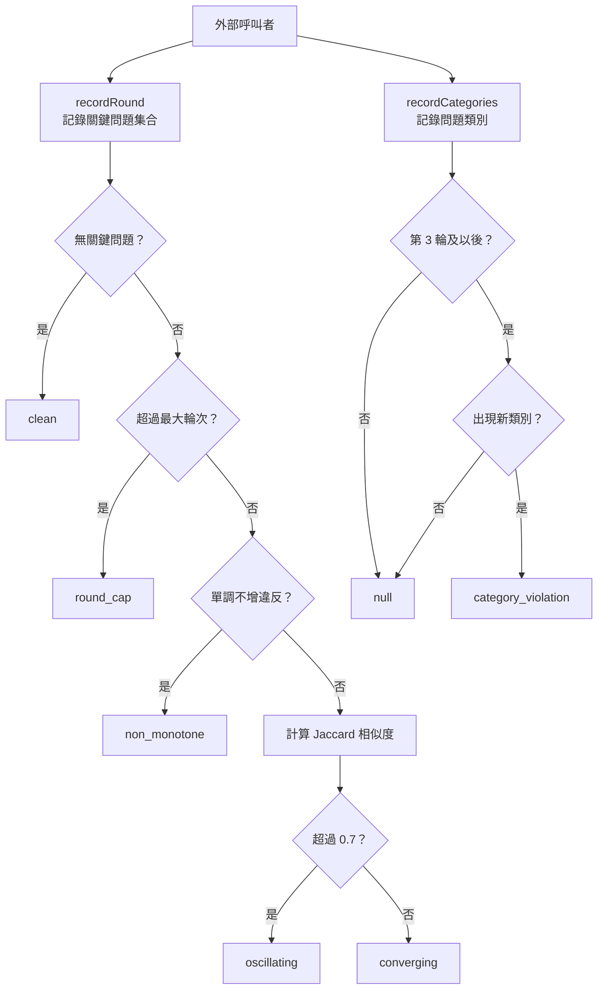
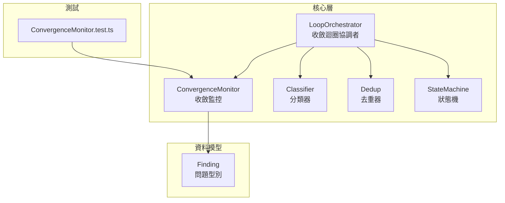
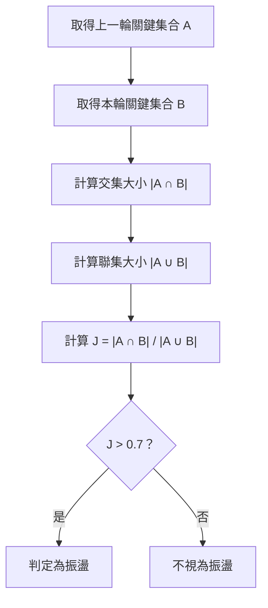
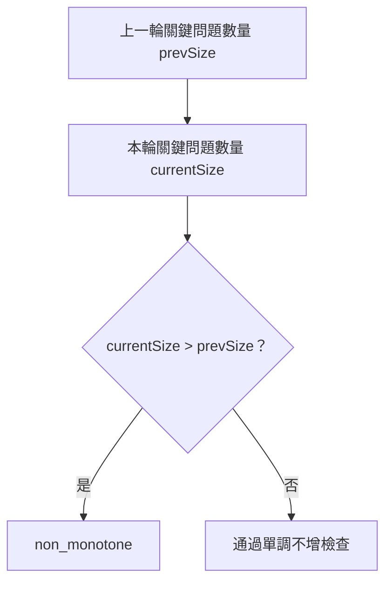
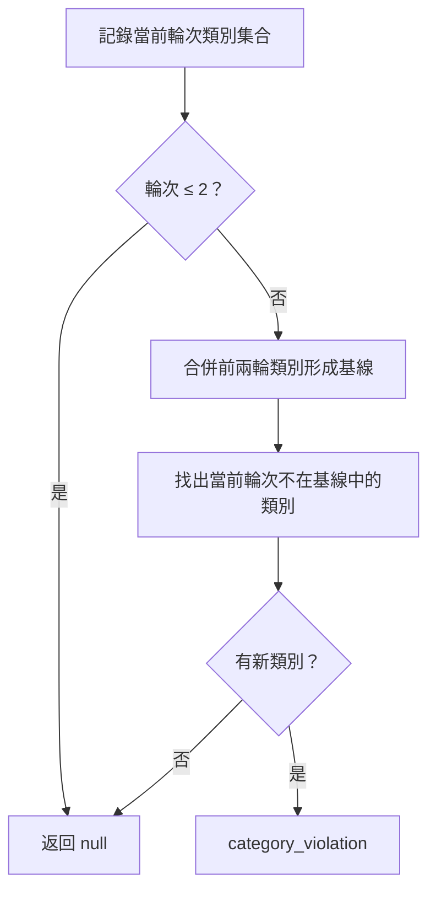
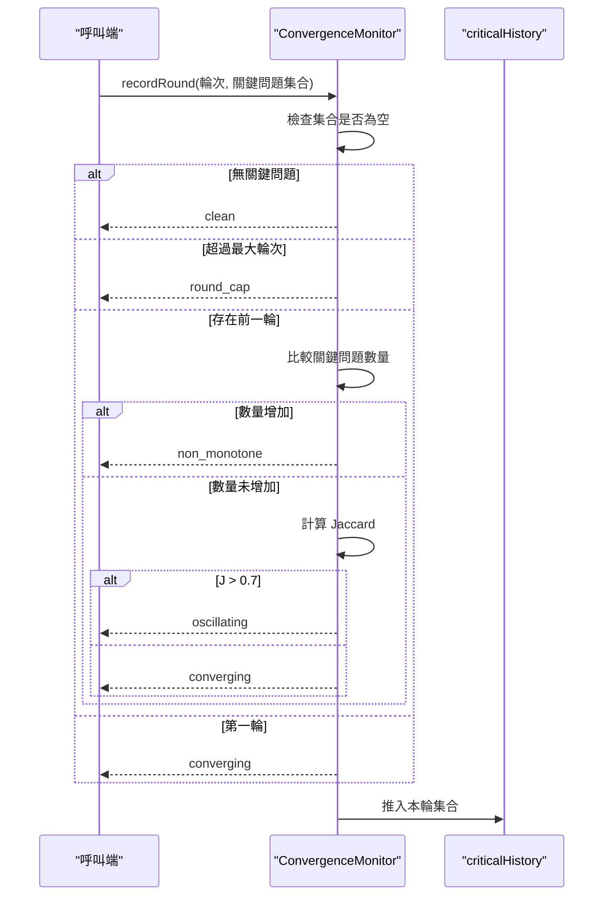
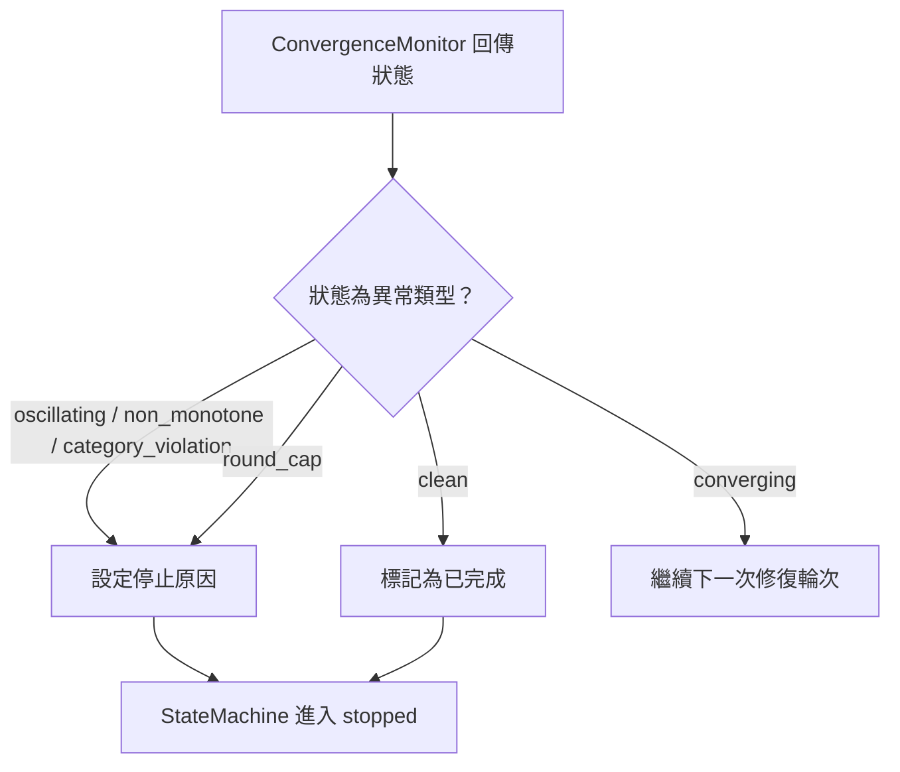
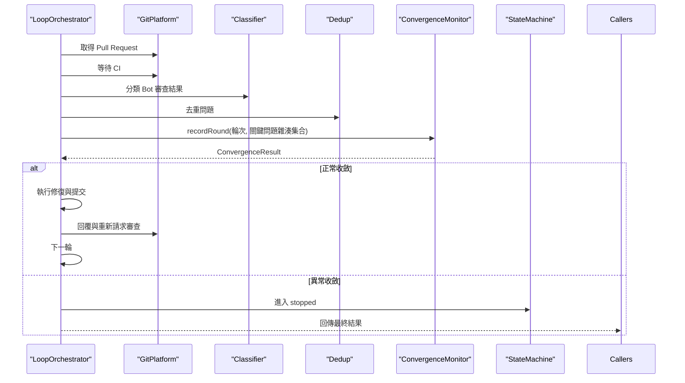
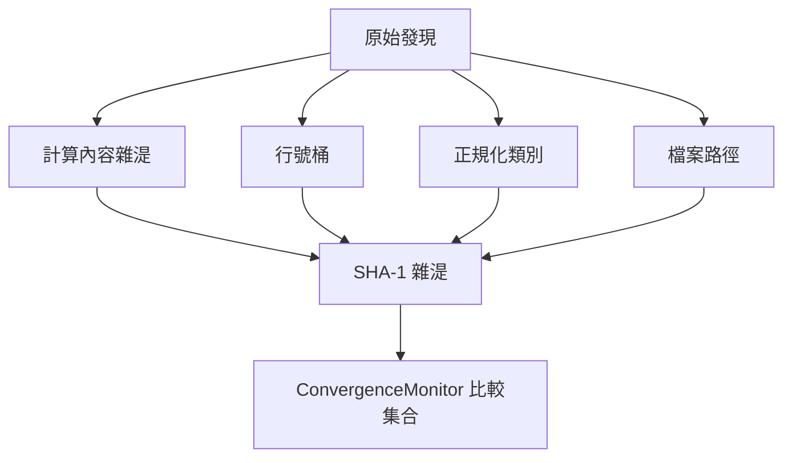

# ConvergenceMonitor 收斂監控

**本文引用的檔案**

- [ConvergenceMonitor.ts](https://github.com/mikeah2011/maestro/blob/master/src/core/convergence/ConvergenceMonitor.ts)
- [ConvergenceMonitor.test.ts](https://github.com/mikeah2011/maestro/blob/master/tests/core/convergence/ConvergenceMonitor.test.ts)
- [LoopOrchestrator.ts](https://github.com/mikeah2011/maestro/blob/master/src/core/loop/LoopOrchestrator.ts)
- [Finding.ts](https://github.com/mikeah2011/maestro/blob/master/src/core/types/Finding.ts)

## 目錄
1. [簡介](#簡介)
2. [專案結構與角色定位](#專案結構與角色定位)
3. [核心機制一：Jaccard 振盪偵測](#jaccard-振盪偵測)
4. [核心機制二：單調不增保證](#單調不增保證)
5. [第三個保證：輪次後不得出現新問題類別](#第三個保證輪次後不得出現新問題類別)
6. [isConverged() 判斷邏輯與 round 計數器](#isconverged-判斷邏輯與-round-計數器)
7. [如何觸發升級或停止循環](#如何觸發升級或停止循環)
8. [與其他組件的協作流程](#與其他組件的協作流程)
9. [數學公式與計算範例](#數學公式與計算範例)
10. [性能考量與設計決策](#性能考量與設計決策)
11. [常見問題與調整建議](#常見問題與調整建議)
12. [結論](#結論)

## 簡介

ConvergenceMonitor 是 Maestro Tool 收斂迴圈的終止保障模組。它的目標不是「猜測程式碼是否已經修好」，而是為自動化修復流程提供明確、可驗證的數學約束：每輪新增的問題數量不得超過前一輪；相鄰兩輪關鍵問題集合的重疊程度不得過高；在前三輪之後，不應突然出現新的問題類別；並且最多允許三個修復輪次。

這些約束共同解決一個實務問題：當 AI 或人工反覆修改程式碼時，系統需要知道「現在還是在改善」、「問題集合只是在重排」、「問題反而變多」，或是「已經沒有關鍵問題」。ConvergenceMonitor 把這些狀態轉譯成標準化結果，供 LoopOrchestrator 決定繼續、提升嚴重性、切換策略或停止。

該模組由三部分組成：

| 部分 | 責任 | 輸入 | 輸出 |
|---|---|---|---|
| 輪次記錄器 | 比較每輪的關鍵問題集合 | 輪次編號、關鍵問題雜湊集合 | `ConvergenceResult` |
| 類別追蹤器 | 檢查輪次後是否出現新問題類別 | 輪次編號、問題類別集合 | `ConvergenceResult` 或空值 |
| 雜湊工具 | 產生穩定且對小改動魯棒的問題識別鍵 | 檔案路徑、行號、正規化類別、上下文內容 | SHA-1 字串 |

**圖表來源**
- [ConvergenceMonitor.ts:27-165](https://github.com/mikeah2011/maestro/blob/master/src/core/convergence/ConvergenceMonitor.ts#L27-L165)

**章節來源**
- [ConvergenceMonitor.ts:1-206](https://github.com/mikeah2011/maestro/blob/master/src/core/convergence/ConvergenceMonitor.ts#L1-L206)

## 專案結構與角色定位

ConvergenceMonitor 位於 `src/core/convergence`，屬於核心層中的橫切關注點。它不直接操作 Git、Pull Request、AI Provider 或 CI 狀態，而是專注於「跨輪次的問題集合行為分析」。

**圖表來源**
- [LoopOrchestrator.ts:19-20](https://github.com/mikeah2011/maestro/blob/master/src/core/loop/LoopOrchestrator.ts#L19-L20)
- [LoopOrchestrator.ts:116-137](https://github.com/mikeah2011/maestro/blob/master/src/core/loop/LoopOrchestrator.ts#L116-L137)
- [Finding.ts:1-129](https://github.com/mikeah2011/maestro/blob/master/src/core/types/Finding.ts#L1-L129)
- [ConvergenceMonitor.ts:1-206](https://github.com/mikeah2011/maestro/blob/master/src/core/convergence/ConvergenceMonitor.ts#L1-L206)

ConvergenceMonitor 的設計原則如下：

| 原則 | 說明 |
|---|---|
| 低耦合 | 只接收雜湊與類別字串，不依賴 Finding 完整物件 |
| 可測試 | 內部狀態封裝在實例中，對外暴露純函式與明確狀態 |
| 可組合 | LoopOrchestrator 可注入自訂實例，便於單元測試替換 |
| 可觀測 | 每次記錄回傳結果包含狀態、輪次、數量、相似度與訊息 |
| 有上限 | 最多三輪，避免無限修復循環 |

**章節來源**
- [LoopOrchestrator.ts:19-20](https://github.com/mikeah2011/maestro/blob/master/src/core/loop/LoopOrchestrator.ts#L19-L20)
- [LoopOrchestrator.ts:116-137](https://github.com/mikeah2011/maestro/blob/master/src/core/loop/LoopOrchestrator.ts#L116-L137)
- [ConvergenceMonitor.ts:27-53](https://github.com/mikeah2011/maestro/blob/master/src/core/convergence/ConvergenceMonitor.ts#L27-L53)

## 核心機制一：Jaccard 振盪偵測

Jaccard 振盪偵測用來判斷相鄰兩輪的關鍵問題集合是否「過度重疊」。如果兩輪的關鍵問題幾乎相同，但修復動作仍在重複執行，系統會視為振盪並要求人類介入。

### 定義

設第 `n-1` 輪的關鍵問題雜湊集合為 `A`，第 `n` 輪為 `B`。Jaccard 相似度定義為：

\[
J(A, B) = \frac{|A \cap B|}{|A \cup B|}
\]

其中：

- \( |A \cap B| \) 是兩輪都出現的關鍵問題數量。
- \( |A \cup B| \) 是兩輪至少出現一次的關鍵問題總數。
- 若兩個集合皆為空，相似度視為 1，代表兩者一致。

### 判斷規則

實現中使用閾值 `0.7`：

| Jaccard 值 | 解釋 | 狀態 |
|---|---|---|
| 高於 0.7 | 相鄰兩輪的關鍵問題覆蓋高度重疊 | `oscillating` |
| 等於 0.7 | 未超過閾值，不視為振盪 | 繼續評估 |
| 低於 0.7 | 覆蓋變化足夠大 | 可能 `converging` |

### 實際意義

Jaccard 衡量的是「兩輪問題的覆蓋重疊程度」，而不是「問題是否被修復」。舉例來說：

- 若第 1 輪有三個關鍵問題，第 2 輪仍是同一組三個問題，則交集為 3，聯集為 3，相似度為 1.0。
- 若第 1 輪有九個問題，第 2 輪也有九個問題，其中八個相同、一個不同，則交集為 8，聯集為 9，相似度約為 0.889。
- 若第 1 輪有四個問題，第 2 輪有六個問題，其中三個相同，則交集為 3，聯集為 7，相似度約為 0.429。

這個閾值捕捉的是「修復動作似乎沒有改變問題集合本質」的訊號。即使關鍵問題數量不變甚至減少，只要集合高度重疊，系統就認為修復策略可能需要調整。

**圖表來源**
- [ConvergenceMonitor.ts:117-145](https://github.com/mikeah2011/maestro/blob/master/src/core/convergence/ConvergenceMonitor.ts#L117-L145)
- [ConvergenceMonitor.ts:198-206](https://github.com/mikeah2011/maestro/blob/master/src/core/convergence/ConvergenceMonitor.ts#L198-L206)

**章節來源**
- [ConvergenceMonitor.ts:27-53](https://github.com/mikeah2011/maestro/blob/master/src/core/convergence/ConvergenceMonitor.ts#L27-L53)
- [ConvergenceMonitor.ts:117-145](https://github.com/mikeah2011/maestro/blob/master/src/core/convergence/ConvergenceMonitor.ts#L117-L145)
- [ConvergenceMonitor.ts:198-206](https://github.com/mikeah2011/maestro/blob/master/src/core/convergence/ConvergenceMonitor.ts#L198-L206)
- [ConvergenceMonitor.test.ts:128-167](https://github.com/mikeah2011/maestro/blob/master/tests/core/convergence/ConvergenceMonitor.test.ts#L128-L167)
- [ConvergenceMonitor.test.ts:229-249](https://github.com/mikeah2011/maestro/blob/master/tests/core/convergence/ConvergenceMonitor.test.ts#L229-L249)

## 核心機制二：單調不增保證

單調不增保證確保每輪的關鍵問題數量不會增加。其數學表述為：

\[
|C_n| \leq |C_{n-1}|
\]

其中 \( C_n \) 是第 `n` 輪的關鍵問題集合。若不等式被打破，即：

\[
|C_n| > |C_{n-1}|
\]

則返回 `non_monotone`。

### 為什麼用「關鍵問題」而非所有問題

`Finding` 支援多個嚴重性等級，包括 `critical`、`high`、`medium`、`low`、`info`。ConvergenceMonitor 只比較關鍵問題集合，因為：

1. 關鍵問題代表修復流程必須優先處理的問題。
2. 非關鍵問題可能因上下文變化、偵測範圍調整或次要修正而出現波動。
3. 將所有嚴重性混在一起會放大噪音，降低收斂判定的準確度。

### 與 Jaccard 的關係

這兩個機制互相補充：

| 現象 | 單調不增 | Jaccard |
|---|---:|---:|
| 問題減少 | 通過 | 可能通過 |
| 問題數量不變但集合重疊高 | 通過 | 可能失敗 |
| 問題數量增加 | 立即失敗 | 仍會計算但不必要 |
| 問題完全改變但數量減少 | 通過 | 通常通過 |

這意味著「單調不增」保護的是數量趨勢，「Jaccard」保護的是集合本質穩定性。

**圖表來源**
- [ConvergenceMonitor.ts:73-96](https://github.com/mikeah2011/maestro/blob/master/src/core/convergence/ConvergenceMonitor.ts#L73-L96)

**章節來源**
- [ConvergenceMonitor.ts:73-96](https://github.com/mikeah2011/maestro/blob/master/src/core/convergence/ConvergenceMonitor.ts#L73-L96)
- [Finding.ts:17-24](https://github.com/mikeah2011/maestro/blob/master/src/core/types/Finding.ts#L17-L24)
- [ConvergenceMonitor.test.ts:155-167](https://github.com/mikeah2011/maestro/blob/master/tests/core/convergence/ConvergenceMonitor.test.ts#L155-L167)

## 第三個保證：輪次後不得出現新問題類別

除了關鍵問題集合外，ConvergenceMonitor 還追蹤每輪出現的問題類別。從第 3 輪開始，若出現之前基線中沒有的新類別，會返回 `category_violation`。

基線由前兩輪的問題類別集合合併而成。這樣設計的原因是：

- 第 1、2 輪作為觀察期，允許系統建立初始類別基線。
- 第 3 輪及以後出現的新類別，代表問題空間發生了較大的偏移。
- 這種偏移可能是偵測器行為改變、PR 內容劇烈變化，或修復策略偏離預期。

**圖表來源**
- [ConvergenceMonitor.ts:150-165](https://github.com/mikeah2011/maestro/blob/master/src/core/convergence/ConvergenceMonitor.ts#L150-L165)

**章節來源**
- [ConvergenceMonitor.ts:55-56](https://github.com/mikeah2011/maestro/blob/master/src/core/convergence/ConvergenceMonitor.ts#L55-L56)
- [ConvergenceMonitor.ts:150-165](https://github.com/mikeah2011/maestro/blob/master/src/core/convergence/ConvergenceMonitor.ts#L150-L165)
- [ConvergenceMonitor.test.ts:201-228](https://github.com/mikeah2011/maestro/blob/master/tests/core/convergence/ConvergenceMonitor.test.ts#L201-L228)

## isConverged() 判斷邏輯與 round 計數器

ConvergenceMonitor 並沒有名為 `isConverged()` 的方法。其收斂判斷邏輯集中在 `recordRound()`，而「已記錄輪次數」透過 `roundCount` getter 取得。

### recordRound() 的判斷順序

1. **空集合**：若本輪沒有關鍵問題，直接返回 `clean`。
2. **超過最大輪次**：若 `round > MAX_ROUNDS`，返回 `round_cap`。
3. **存在前一輪**：
   - 若本輪關鍵問題數量大於前一輪，返回 `non_monotone`。
   - 計算 Jaccard 相似度。
   - 若超過 0.7，返回 `oscillating`。
   - 否則返回 `converging`。
4. **第一輪**：返回 `converging`，不包含 Jaccard。

### round 計數器的作用

`roundCount` 是 `criticalHistory` 陣列的長度。它不代表使用者傳入的 `round` 參數，而是「已成功記錄的輪次數」。這讓外部系統可以知道監控器目前掌握多少歷史，而不必自行維護計數。

| 屬性或方法 | 用途 | 時間複雜度 |
|---|---|---|
| `recordRound(round, criticalHashes)` | 記錄一輪關鍵問題並判斷狀態 | O(n)，n 為前一輪集合大小 |
| `recordCategories(round, categories)` | 記錄類別並檢查新類別 | O(m + k)，m 為基線類別數，k 為當前類別數 |
| `roundCount` | 取得已記錄輪次數 | O(1) |

**圖表來源**
- [ConvergenceMonitor.ts:60-115](https://github.com/mikeah2011/maestro/blob/master/src/core/convergence/ConvergenceMonitor.ts#L60-L115)

**章節來源**
- [ConvergenceMonitor.ts:60-115](https://github.com/mikeah2011/maestro/blob/master/src/core/convergence/ConvergenceMonitor.ts#L60-L115)
- [ConvergenceMonitor.ts:167-171](https://github.com/mikeah2011/maestro/blob/master/src/core/convergence/ConvergenceMonitor.ts#L167-L171)
- [ConvergenceMonitor.test.ts:118-199](https://github.com/mikeah2011/maestro/blob/master/tests/core/convergence/ConvergenceMonitor.test.ts#L118-L199)

## 如何觸發升級或停止循環

ConvergenceMonitor 本身不執行升級或停止動作；它回傳狀態，由 LoopOrchestrator 根據狀態採取行動。

可觸發升級或停止的狀態包括：

| 狀態 | 含義 | 典型處理方式 |
|---|---|---|
| `oscillating` | 相鄰兩輪關鍵問題集合高度重疊 | 停止自動修復，提示人類介入 |
| `non_monotone` | 關鍵問題數量增加 | 停止或重新審視修復策略 |
| `category_violation` | 第 3 輪後出現新問題類別 | 停止或通知人類檢查問題空間變化 |
| `round_cap` | 達到最大輪次上限 | 停止並回報已執行的修復輪次 |
| `clean` | 無關鍵問題 | 正常完成 |
| `converging` | 正常持續 | 繼續下一輪 |

LoopOrchestrator 在收到這些狀態後，會轉換到停止狀態，並將收斂原因寫入狀態機器中。這使日誌、儀表板或後續分析可以追溯是哪一個收斂條件導致迴圈結束。

**圖表來源**
- [LoopOrchestrator.ts:317-343](https://github.com/mikeah2011/maestro/blob/master/src/core/loop/LoopOrchestrator.ts#L317-L343)

**章節來源**
- [LoopOrchestrator.ts:317-343](https://github.com/mikeah2011/maestro/blob/master/src/core/loop/LoopOrchestrator.ts#L317-L343)

## 與其他組件的協作流程

LoopOrchestrator 負責驅動整個修復週期：等待 CI、收集 Bot 審查、分類問題、去重、執行修復、提交、回覆、解析並重新請求審查。ConvergenceMonitor 在每輪末尾參與收斂判斷。

**圖表來源**
- [LoopOrchestrator.ts:116-137](https://github.com/mikeah2011/maestro/blob/master/src/core/loop/LoopOrchestrator.ts#L116-L137)
- [LoopOrchestrator.ts:199-343](https://github.com/mikeah2011/maestro/blob/master/src/core/loop/LoopOrchestrator.ts#L199-L343)
- [ConvergenceMonitor.ts:60-115](https://github.com/mikeah2011/maestro/blob/master/src/core/convergence/ConvergenceMonitor.ts#L60-L115)

LoopOrchestrator 使用 `computeFindingHash` 來產生穩定的問題雜湊，再過濾出關鍵問題雜湊集合交給 ConvergenceMonitor。這確保比較的是「問題身份」，而不是原始文字或 Bot ID。

**章節來源**
- [LoopOrchestrator.ts:19-20](https://github.com/mikeah2011/maestro/blob/master/src/core/loop/LoopOrchestrator.ts#L19-L20)
- [LoopOrchestrator.ts:116-137](https://github.com/mikeah2011/maestro/blob/master/src/core/loop/LoopOrchestrator.ts#L116-L137)
- [LoopOrchestrator.ts:317-343](https://github.com/mikeah2011/maestro/blob/master/src/core/loop/LoopOrchestrator.ts#L317-L343)
- [ConvergenceMonitor.ts:173-197](https://github.com/mikeah2011/maestro/blob/master/src/core/convergence/ConvergenceMonitor.ts#L173-L197)

## 數學公式與計算範例

### Jaccard 相似度公式

\[
J(A, B) = \frac{|A \cap B|}{|A \cup B|}
\]

### 範例一：完全相同

| 項目 | 第 1 輪 | 第 2 輪 |
|---|---|---|
| 關鍵問題 | h1, h2, h3 | h1, h2, h3 |
| 交集 | h1, h2, h3 | 大小 3 |
| 聯集 | h1, h2, h3 | 大小 3 |
| Jaccard | — | 1.0 |
| 狀態 | — | `oscillating` |

### 範例二：大部分相同

| 項目 | 第 1 輪 | 第 2 輪 |
|---|---|---|
| 關鍵問題 | a, b, c, d, e, f, g, h, x | a, b, c, d, e, f, g, h, y |
| 交集 | a, b, c, d, e, f, g, h | 大小 8 |
| 聯集 | a, b, c, d, e, f, g, h, x, y | 大小 10 |
| Jaccard | — | 0.8 |
| 狀態 | — | `oscillating` |

注意：上述範例中聯集實際為 10（x 與 y 各唯一），因此 Jaccard 為 8/10 = 0.8，仍超過 0.7。測試中也以 8/9 的情況作為另一個接近閾值的例子。

### 範例三：明顯變化

| 項目 | 第 1 輪 | 第 2 輪 |
|---|---|---|
| 關鍵問題 | a, b, c, d | a, b, c, e, f, g |
| 交集 | a, b, c | 大小 3 |
| 聯集 | a, b, c, d, e, f, g | 大小 7 |
| Jaccard | — | 約 0.429 |
| 狀態 | — | 需進一步檢查單調不增 |

若第 2 輪問題數量比第 1 輪多，即使 Jaccard 很低，也會先被 `non_monotone` 攔截。

### 範例四：問題減少但完全不同

| 項目 | 第 1 輪 | 第 2 輪 |
|---|---|---|
| 關鍵問題 | a, b | c |
| 交集 | 空集合 | 大小 0 |
| 聯集 | a, b, c | 大小 3 |
| Jaccard | — | 0 |
| 狀態 | — | `converging`，因為數量下降 |

這顯示 Jaccard 並不要求「問題被修復」，只要求「集合變化足夠大且數量未增加」。

**章節來源**
- [ConvergenceMonitor.ts:117-145](https://github.com/mikeah2011/maestro/blob/master/src/core/convergence/ConvergenceMonitor.ts#L117-L145)
- [ConvergenceMonitor.ts:198-206](https://github.com/mikeah2011/maestro/blob/master/src/core/convergence/ConvergenceMonitor.ts#L198-L206)
- [ConvergenceMonitor.test.ts:139-167](https://github.com/mikeah2011/maestro/blob/master/tests/core/convergence/ConvergenceMonitor.test.ts#L139-L167)
- [ConvergenceMonitor.test.ts:229-249](https://github.com/mikeah2011/maestro/blob/master/tests/core/convergence/ConvergenceMonitor.test.ts#L229-L249)

## 性能考量與設計決策

### 只比較 category 與 hash，不比較完整 finding

ConvergenceMonitor 接收的是 `ReadonlySet<string>`，也就是雜湊字串集合。它不直接存取 `Finding` 物件，也不比較標題、內文、Bot 資訊或平台 ID。這帶來以下好處：

| 優點 | 說明 |
|---|---|
| 記憶體佔用低 | 每個關鍵問題只是一個雜湊字串 |
| 比較速度快 | Set 查找與交集運算針對字串優化 |
| 解耦清晰 | 不需要傳遞完整 Finding 物件 |
| 穩定性強 | 使用 `computeFindingHash` 產生的穩定雜湜，避免 paraphrase 或小幅 diff 造成誤判 |

### 時間與空間複雜度

| 操作 | 時間複雜度 | 空間複雜度 |
|---|---|---|
| `recordRound` | O(n)，n 為前一輪集合大小 | O(n)，保存歷史集合 |
| Jaccard 計算 | O(n)，遍歷较小集合並查詢另一集合 | 額外常數空間 |
| `recordCategories` | O(m + k)，m 為基線類別數，k 為當前類別數 | O(m + k) |
| `roundCount` | O(1) | O(1) |

### 避免不必要的集合運算

實現中先檢查數量是否增加，再計算 Jaccard。這是有意義的短路優化：

1. 單調不增檢查是 O(1)。
2. Jaccard 需要遍歷集合與 Set 查詢。
3. 若數量已經增加，就沒有必要計算相似度。

此外，Jaccard 實現遍歷集合 `a` 並查詢集合 `b` 中的成員，利用 Hash Set 的近似 O(1) 查詢特性。

### 雜湊穩定性

`computeFindingHash` 組合以下欄位：

- 檔案路徑
- 行號桶：將行號映射到大小為 5 的區間，抵抗小幅重排或 rebase
- 正規化後的類別：小寫、去除空白
- 上下文內容雜湜：使用 `computeContentHash`

這使得 ConvergenceMonitor 能在 PR 內容微小變動下仍然正確識別同一問題。

**圖表來源**
- [ConvergenceMonitor.ts:173-197](https://github.com/mikeah2011/maestro/blob/master/src/core/convergence/ConvergenceMonitor.ts#L173-L197)
- [ConvergenceMonitor.ts:198-206](https://github.com/mikeah2011/maestro/blob/master/src/core/convergence/ConvergenceMonitor.ts#L198-L206)

**章節來源**
- [ConvergenceMonitor.ts:60-115](https://github.com/mikeah2011/maestro/blob/master/src/core/convergence/ConvergenceMonitor.ts#L60-L115)
- [ConvergenceMonitor.ts:173-206](https://github.com/mikeah2011/maestro/blob/master/src/core/convergence/ConvergenceMonitor.ts#L173-L206)
- [ConvergenceMonitor.test.ts:14-117](https://github.com/mikeah2011/maestro/blob/master/tests/core/convergence/ConvergenceMonitor.test.ts#L14-L117)

## 常見問題與調整建議

### 閾值過低導致過度敏感

若閾值設得太低，即使是正常的問題集合微調也可能被視為振盪。例如：

- 原本有三個問題，修復後只剩一個問題，但該問題仍是原問題之一。
- 雖然數量減少，但若集合重疊比例仍高，可能觸發振盪。

**建議：**

| 情境 | 建議方向 |
|---|---|
| 修復速度緩慢但方向正確 | 暫時提高閾值，或延長觀察輪次 |
| 問題集合確實重排但未改善 | 保持或降低閾值 |
| 多數 PR 誤判為振盪 | 檢視問題雜湜穩定性，確認是否因行號或類別變化造成 |

不過，當前實作使用硬編碼常量 `OSCILLATION_THRESHOLD = 0.7`，並未公開為建構子選項。若需調整，應考慮將其納入配置，同時保留預設值以維持現有行為。

### 新問題被誤判為振盪

新問題被視為振盪的原因通常不是「它是新問題」，而是「舊問題集合重疊太高」。例如：

- 第 1 輪有三個關鍵問題。
- 第 2 輪仍有三個關鍵問題，其中兩個相同。
- 即使第三個是新問題，只要 Jaccard 超過 0.7，仍會被判定為振盪。

**調適方法：**

1. 檢查問題雜湜是否過於穩定，導致舊問題無法與新版本區分。
2. 檢視 `computeFindingHash` 的輸入：文件路徑、行號桶、類別、上下文內容。
3. 若 PR 內容發生較大變動，可考慮在 orchestrator 層重置監控器，或使用更寬鬆的初期容忍策略。
4. 若問題集合確實應該持續變化，應優先排查為何關鍵問題集合沒有充分更新。

### 單調不增違反的根因

關鍵問題數量增加通常表示：

- 新發現了先前未偵測到的問題。
- 修復引入了副作用。
- 分類邏輯或嚴重性正規化改變了哪些問題被視為關鍵。
- 去重邏輯未能跨輪次穩定識別問題。

**調適方法：**

1. 確認 `computeFindingHash` 能穩定識別同一問題。
2. 檢查 Classifier 是否將原本非關鍵問題升級為關鍵問題。
3. 檢查 Dedup 是否跨輪次正確合併相同問題。
4. 若問題確實合理增加，應視為策略信號，而非單純忽略。

### 第 3 輪後出現新類別

這可能表示：

- Bot 行為改變。
- PR 內容引入全新領域的問題。
- Classifier 的規則或模型輸出發生漂移。
- 問題分類管道需要重新校準。

**建議：**

- 記錄並告警新類別。
- 暫停自動修復，讓人類審查問題空間變化。
- 檢視 Classifier 的 fence 規則與 LLM 推理結果。
- 若新類別屬預期範圍，可考慮調整基線計算方式，但需謹慎避免掩蓋真實漂移。

### 輪次上限不足

最大輪次為 3。對於複雜 PR，這可能不夠；對於簡單 PR，可能太保守。

**建議：**

- 將 `MAX_ROUNDS` 與 LoopOrchestrator 的 `maxRounds` 保持一致或建立單一來源。
- 提供環境或配置文件選項。
- 在日誌中清楚記錄 reached cap 的原因，方便事後分析。

**章節來源**
- [ConvergenceMonitor.ts:27-53](https://github.com/mikeah2011/maestro/blob/master/src/core/convergence/ConvergenceMonitor.ts#L27-L53)
- [ConvergenceMonitor.ts:60-115](https://github.com/mikeah2011/maestro/blob/master/src/core/convergence/ConvergenceMonitor.ts#L60-L115)
- [ConvergenceMonitor.ts:150-165](https://github.com/mikeah2011/maestro/blob/master/src/core/convergence/ConvergenceMonitor.ts#L150-L165)
- [ConvergenceMonitor.ts:173-206](https://github.com/mikeah2011/maestro/blob/master/src/core/convergence/ConvergenceMonitor.ts#L173-L206)
- [ConvergenceMonitor.test.ts:128-199](https://github.com/mikeah2011/maestro/blob/master/tests/core/convergence/ConvergenceMonitor.test.ts#L128-L199)
- [ConvergenceMonitor.test.ts:201-249](https://github.com/mikeah2011/maestro/blob/master/tests/core/convergence/ConvergenceMonitor.test.ts#L201-L249)

## 結論

ConvergenceMonitor 是一個小而堅實的收斂保障模組。它不依賴 LLM 的直覺，也不直接操作 Git 或 CI，而是用三個明確的數學約束來判斷修復迴圈是否應該繼續：

1. 關鍵問題數量不得增加。
2. 相鄰兩輪關鍵問題集合的 Jaccard 相似度不得超過 0.7。
3. 第 3 輪及以後不得出現新的問題類別。
4. 最多允許三個修復輪次。

這些約束讓 LoopOrchestrator 能夠做出可解釋的決策：當問題集合穩定減少且變化合理時繼續；當問題集合重排卻未改善時升級；當問題數量增加或問題空間突然偏移時停止。

對於維護者而言，最重要的調整點在於：

- 閾值 0.7 是否適合當前 Bot 與問題空間。
- `computeFindingHash` 是否能穩定識別問題。
- 關鍵問題過濾邏輯是否正確反映業務意圖。
- 是否需要將最大輪次與閾值暴露為可配置選項。

當這些要素配合良好時，ConvergenceMonitor 能有效防止無效修復循環，同時保留足夠靈活性容納合理的問題集合變化。