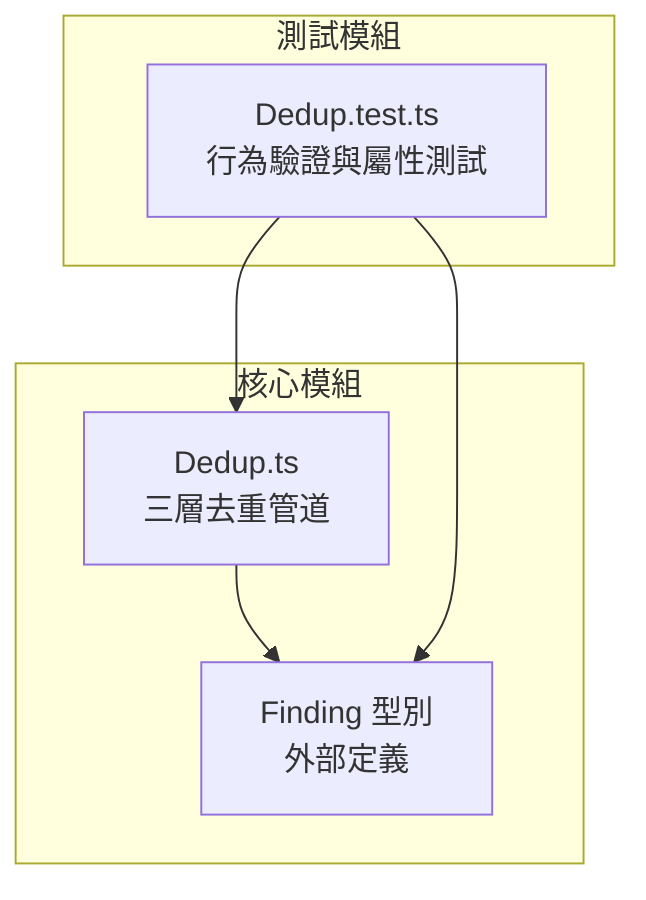
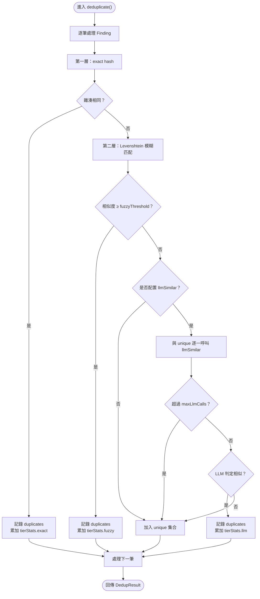
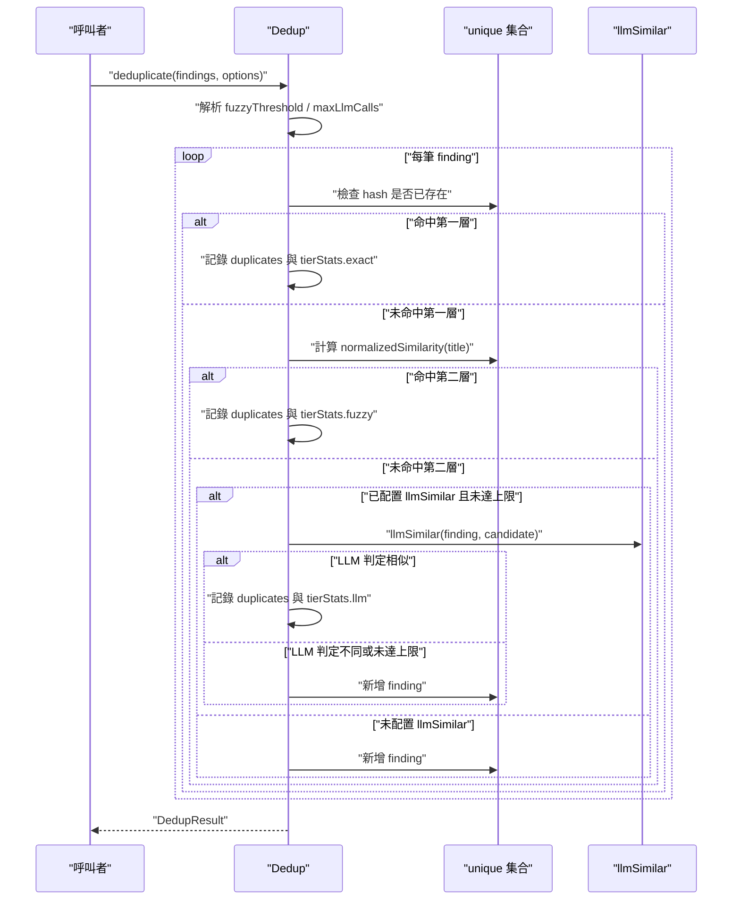
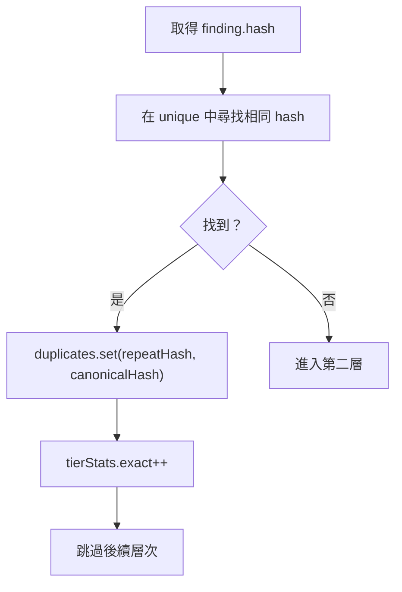
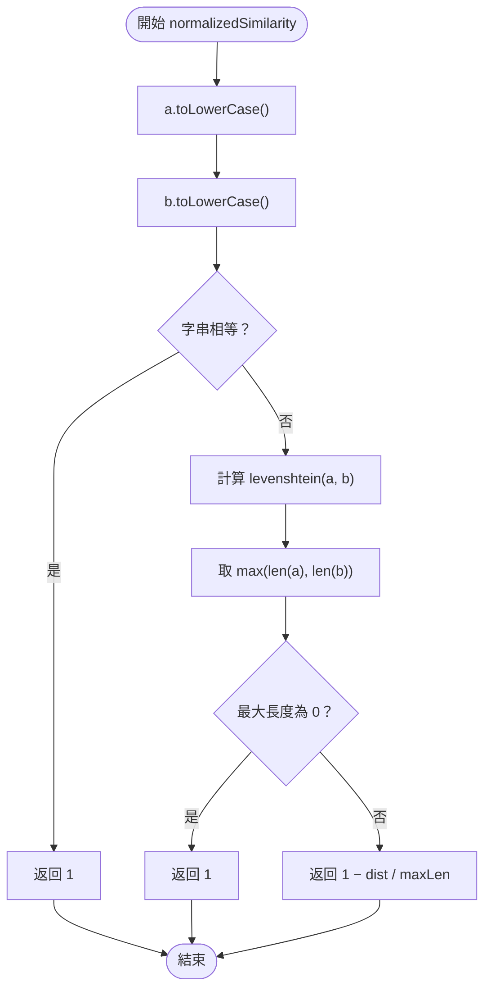
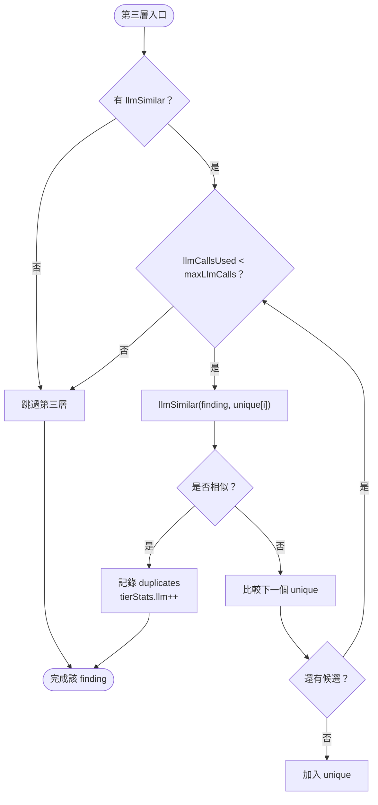
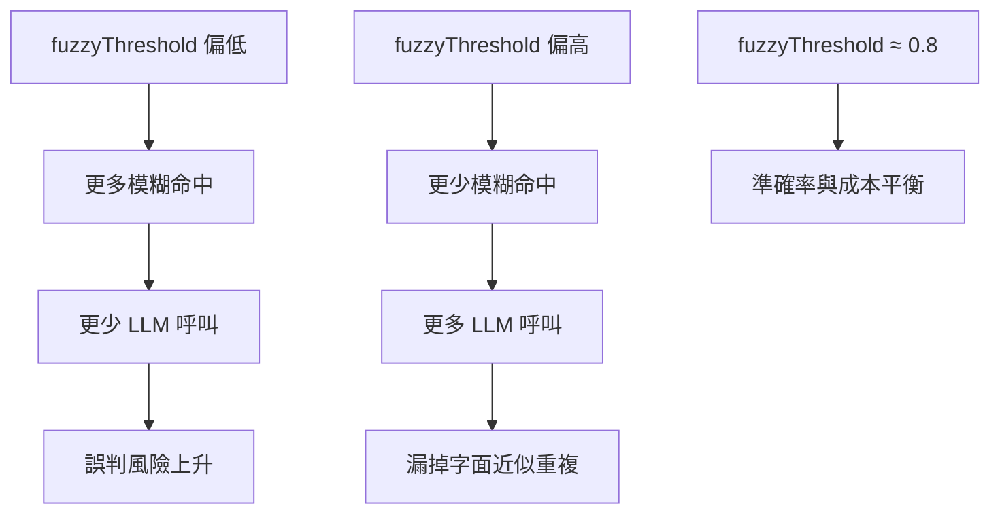
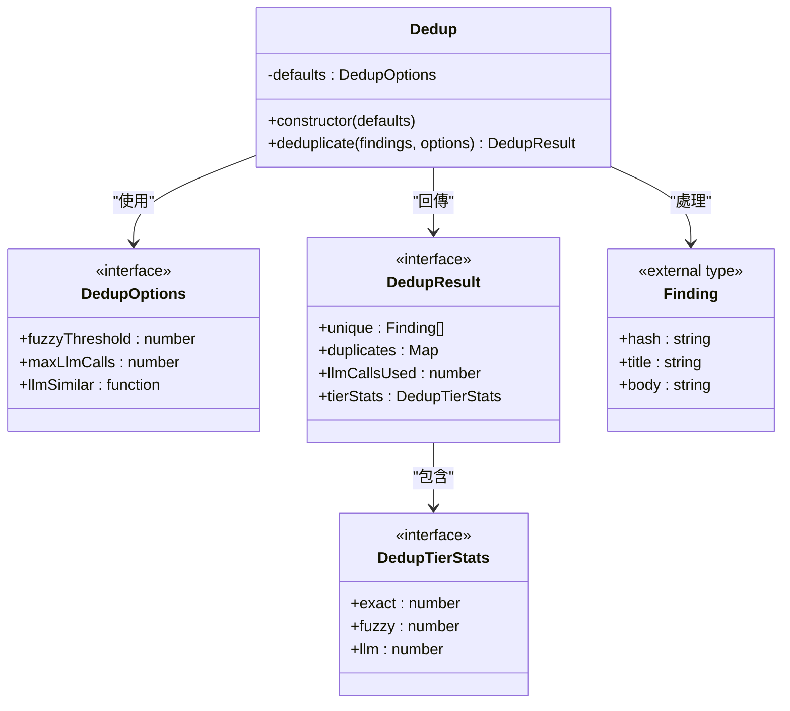

# Dedup 三層去重管道

<cite>
**本文引用的檔案**   
- [src/core/dedup/Dedup.ts](https://github.com/mikeah2011/maestro/blob/master/src/core/dedup/Dedup.ts)
- [tests/core/dedup/Dedup.test.ts](https://github.com/mikeah2011/maestro/blob/master/tests/core/dedup/Dedup.test.ts)
</cite>

## 目錄

1. [引言](#引言)
2. [專案結構與角色定位](#專案結構與角色定位)
3. [核心資料模型](#核心資料模型)
4. [三層去重架構總覽](#三層去重架構總覽)
5. [deduplicate() 執行流程](#deduplicate-執行流程)
6. [第一層：精確雜湊去重](#第一層精確雜湊去重)
7. [第二層：Levenshtein 模糊匹配](#第二層levenshtein-模糊匹配)
8. [第三層：語義 LLM 去重](#第三層語義-llm-去重)
9. [輸入輸出格式與失敗處理](#輸入輸出格式與失敗處理)
10. [閾值調整指南](#閾值調整指南)
11. [效能優化原則](#效能優化原則)
12. [常見問題診斷](#常見問題診斷)
13. [依賴關係分析](#依賴關係分析)
14. [結論](#結論)

## 引言

Dedup 模組是 Maestro 中負責將多個偵測來源產出的 Finding（發現項目）合併為「唯一集合」的核心組件。它的設計重點有三個：

1. **成本優先**：先用極廉價的雜湊比較，再用字串相似度，最後才呼叫 LLM。
2. **可預測性**：提供明確的統計資訊 `tierStats`、`duplicates` 映射與 `llmCallsUsed`，方便監控重複率與 LLM 消耗。
3. **可組合性**：透過可注入的 `llmSimilar` 函式，讓語義判斷邏輯獨立於核心流程。

根據程式碼註解中的預期分佈：

| 層次 | 主要用途 | 預期命中比例 | 時間複雜度特性 |
|---|---|---:|---|
| 第一層 exact hash | 精確重複檢測 | 約 60% | O(1) 雜湊查找 |
| 第二層 Levenshtein | 字面近似問題 | 約 25% | O(m × n)，但通常只在未命中第一層時執行 |
| 第三層 semantic LLM | 跨語言或重述問題 | 剩餘約 15% | 受 `maxLlmCalls` 限制，最多呼叫 10 次 |

這些數字是設計目標；實際命中率會因輸入資料品質而異，這也是診斷章節的重點。

**段落來源**
- [src/core/dedup/Dedup.ts:1-36](https://github.com/mikeah2011/maestro/blob/master/src/core/dedup/Dedup.ts#L1-L36)

## 專案結構與角色定位

Dedup 位於 `src/core/dedup/Dedup.ts`，屬於核心模組之一。它不直接存取資料庫、網路或外部服務，而是透過以下方式保持邊界清晰：

- 從 `../types/Finding` 引入 Finding 型別。
- 以 `DedupOptions` 暴露外部可設定參數。
- 以 `llmSimilar` 作為可注入的語義相似函式，而非硬編碼 LLM 客戶端。
- 提供 `levenshtein` 與 `normalizedSimilarity` 工具函式供測試使用。



**圖表來源**
- [src/core/dedup/Dedup.ts:1-36](https://github.com/mikeah2011/maestro/blob/master/src/core/dedup/Dedup.ts#L1-L36)
- [tests/core/dedup/Dedup.test.ts:1-10](https://github.com/mikeah2011/maestro/blob/master/tests/core/dedup/Dedup.test.ts#L1-L10)

**段落來源**
- [src/core/dedup/Dedup.ts:1-36](https://github.com/mikeah2011/maestro/blob/master/src/core/dedup/Dedup.ts#L1-L36)
- [tests/core/dedup/Dedup.test.ts:1-10](https://github.com/mikeah2011/maestro/blob/master/tests/core/dedup/Dedup.test.ts#L1-L10)

## 核心資料模型

### Finding

Dedup 不定義 Finding，只引用其型別。根據測試中的建構方式，一個 Finding 至少包含以下欄位：

| 欄位 | 用途 | 在去重中的角色 |
|---|---|---|
| `hash` | 穩定識別碼 | 第一層精確比對主鍵 |
| `title` | 發現標題 | 第二層模糊比對主體 |
| `body` | 詳細內容 | 可作為 LLM 語義判斷上下文 |
| `bot` | 來源機器人資訊 | 用於追蹤來源，但不參與去重 |
| `location` | 檔案位置 | 保留原始發現位置 |
| `severity` | 嚴重程度 | 保留原始嚴重性 |
| `firstSeenRound` / `lastSeenRound` | 輪次資訊 | 用於生命週期追蹤 |

### DedupOptions

| 選項 | 類型 | 預設值 | 說明 |
|---|---|---:|---|
| `fuzzyThreshold` | `number` | `0.8` | Levenshtein 正規化相似度閾值 |
| `maxLlmCalls` | `number` | `10` | 每次 `deduplicate()` 最多允許的 LLM 呼叫次數 |
| `llmSimilar` | `(a, b) => Promise<boolean>` | 無 | 可注入的語義相似判斷函式 |

### DedupResult

| 欄位 | 類型 | 說明 |
|---|---|---|
| `unique` | `Finding[]` | 去重後的唯一發現集合 |
| `duplicates` | `Map<string, string>` | 每個重複項目的 hash → 標準項目 hash |
| `llmCallsUsed` | `number` | 本次調用實際消耗的 LLM 呼叫次數 |
| `tierStats` | `DedupTierStats` | 各層命中統計 |

### DedupTierStats

| 欄位 | 類型 | 說明 |
|---|---|---|
| `exact` | `number` | 第一層精確雜湊命中數量 |
| `fuzzy` | `number` | 第二層模糊匹配命中數量 |
| `llm` | `number` | 第三層語義 LLM 命中數量 |

**段落來源**
- [src/core/dedup/Dedup.ts:37-73](https://github.com/mikeah2011/maestro/blob/master/src/core/dedup/Dedup.ts#L37-L73)
- [tests/core/dedup/Dedup.test.ts:11-33](https://github.com/mikeah2011/maestro/blob/master/tests/core/dedup/Dedup.test.ts#L11-L33)

## 三層去重架構總覽

Dedup 的設計哲學是「由便宜到昂貴、由確定到不確定」。每筆 Finding 依序經過三層篩選：



**圖表來源**
- [src/core/dedup/Dedup.ts:75-125](https://github.com/mikeah2011/maestro/blob/master/src/core/dedup/Dedup.ts#L75-L125)

這個流程保證了：

1. 同一 hash 的第一個 Finding 成為「標準項目」。
2. 後續相同 hash 的項目不會再進入模糊或語義階段。
3. 未通過前兩層的項目才會觸發 LLM 比較。
4. LLM 呼叫總數不會超過 `maxLlmCalls`。
5. 最終 `unique` 一定是原始輸入的子集。

**段落來源**
- [src/core/dedup/Dedup.ts:75-125](https://github.com/mikeah2011/maestro/blob/master/src/core/dedup/Dedup.ts#L75-L125)

## deduplicate() 執行流程

`Dedup.deduplicate(findings, options)` 是一個非同步方法，主要責任是：

1. 解析並合併預設值與呼叫者提供的選項。
2. 初始化結果容器：`unique`、`duplicates`、`tierStats`、`llmCallsUsed`。
3. 依序遍歷輸入的 `findings`。
4. 依序嘗試三層去重。
5. 若全部失敗，則把該 Finding 加入 `unique`。
6. 回傳完整結果。



**圖表來源**
- [src/core/dedup/Dedup.ts:75-125](https://github.com/mikeah2011/maestro/blob/master/src/core/dedup/Dedup.ts#L75-L125)

**段落來源**
- [src/core/dedup/Dedup.ts:75-125](https://github.com/mikeah2011/maestro/blob/master/src/core/dedup/Dedup.ts#L75-L125)

## 第一層：精確雜湊去重

第一層是整個管道的快速通道。只要兩個 Finding 的 `hash` 相同，就視為同一問題，無論它們的 title、body、bot 或其他欄位是否不同。

### 設計理由

- 雜湊查找的時間複雜度接近 O(1)。
- 如果系統產生的 hash 是穩定的，那麼相同問題的多次報告可以直接歸一化。
- 這層應佔據最高命中率，理想狀態下超過 90%。

### 實現要點

- 使用 `unique.find((u) => u.hash === finding.hash)` 進行線性掃描。
- 雖然這裡不是真正的 Map，但因為 expected exact hit rate 很高，簡單實現仍具實用性。
- 命中時把重複 hash 映射到標準 hash，並累加 `tierStats.exact`。

### 邊界行為

| 情境 | 行為 |
|---|---|
| 無重複 | 不會增加 `tierStats.exact` |
| 多筆相同 hash | 只有第一個進入 `unique`，其餘計入 duplicates |
| 不同 hash | 繼續進入第二層 |



**圖表來源**
- [src/core/dedup/Dedup.ts:84-95](https://github.com/mikeah2011/maestro/blob/master/src/core/dedup/Dedup.ts#L84-L95)

**段落來源**
- [src/core/dedup/Dedup.ts:75-95](https://github.com/mikeah2011/maestro/blob/master/src/core/dedup/Dedup.ts#L75-L95)

## 第二層：Levenshtein 模糊匹配

當雜湊無法判斷時，第二層比較的是 title 的字串相似度。它使用經典的 Levenshtein 編輯距離，並轉換為 0 到 1 之間的正規化相似度。

### 相似度公式

正規化相似度定義為：

> similarity = 1 − editDistance(a, b) / max(len(a), len(b))

其中：

- a、b 先轉為小寫。
- 空字串的相似度為 1。
- 完全相同字串相似度為 1。
- 差異越大，相似度越低。

### 時間與空間複雜度

| 函式 | 時間複雜度 | 空間複雜度 | 備註 |
|---|---:|---:|---|
| `levenshtein` | O(m × n) | O(n) | 使用兩行 Int32Array 優化 |
| `normalizedSimilarity` | O(m × n) | O(n) | 包裝 Levenshtein 並做正規化 |

### 預設閾值

預設 `fuzzyThreshold = 0.8`。這個值是平衡點：

- 太高：容易漏掉字面相近但文字略有不同的重複。
- 太低：可能誤判不同問題為重複。

測試中顯示：

- `"Missing null check"` 與 `"Missing null checks"` 的相似度約為 0.94。
- `"null pointer dereference"` 與 `"stripe api key leak"` 的相似度低於 0.5。

### 演算法流程



**圖表來源**
- [src/core/dedup/Dedup.ts:138-153](https://github.com/mikeah2011/maestro/blob/master/src/core/dedup/Dedup.ts#L138-L153)

**段落來源**
- [src/core/dedup/Dedup.ts:96-125](https://github.com/mikeah2011/maestro/blob/master/src/core/dedup/Dedup.ts#L96-L125)
- [src/core/dedup/Dedup.ts:138-153](https://github.com/mikeah2011/maestro/blob/master/src/core/dedup/Dedup.ts#L138-L153)

## 第三層：語義 LLM 去重

第三層是成本最高的一層，只有在同時滿足以下條件時才會執行：

1. 第一層未命中。
2. 第二層未命中。
3. 提供了 `llmSimilar`。
4. 尚未達到 `maxLlmCalls`。

### 注入式設計

`llmSimilar` 的簽名是：

```typescript
llmSimilar: (a: Finding, b: Finding) => Promise<boolean>
```

這代表：

- 核心邏輯不關心 LLM 供應商是哪一家。
- 呼叫順序是 `(finding, u)`，也就是「當前待處理項目」與「已有唯一項目」比較。
- 回傳 `true` 表示兩者語義上重複，應被標記為 duplicates。
- 由於是 Promise，呼叫可以是非同步的。

### LLM 上限保護

每次 `deduplicate()` 最多允許 `maxLlmCalls` 次呼叫，預設為 10。實作中有兩處保護：

1. 進入第三層前先檢查 `llmCallsUsed < maxLlmCalls`。
2. 每次呼叫前再次檢查 `llmCallsUsed >= maxLlmCalls`，避免在 async 間隙中超額。

### 行為驗證

測試涵蓋了四個關鍵情境：

| 測試情境 | 預期行為 |
|---|---|
| 已配置 `llmSimilar` | 會對未命中前兩層的項目呼叫語義判斷 |
| 未配置 `llmSimilar` | `llmCallsUsed` 為 0，不會呼叫任何外部服務 |
| 超過 `maxLlmCalls` | 實際呼叫次數 ≤ 上限 |
| 多次呼叫 | `llmCallsUsed` 精確累計 |



**圖表來源**
- [src/core/dedup/Dedup.ts:106-125](https://github.com/mikeah2011/maestro/blob/master/src/core/dedup/Dedup.ts#L106-L125)

**段落來源**
- [src/core/dedup/Dedup.ts:106-125](https://github.com/mikeah2011/maestro/blob/master/src/core/dedup/Dedup.ts#L106-L125)
- [tests/core/dedup/Dedup.test.ts:201-260](https://github.com/mikeah2011/maestro/blob/master/tests/core/dedup/Dedup.test.ts#L201-L260)

## 輸入輸出格式與失敗處理

### 輸入

`deduplicate()` 接受兩個參數：

| 參數 | 必要 | 類型 | 說明 |
|---|---:|---|---|
| `findings` | 是 | `Finding[]` | 待去重的發現集合 |
| `options` | 否 | `DedupOptions` | 覆寫預設行為 |

### 輸出

回傳 `DedupResult`，包含：

| 欄位 | 用途 |
|---|---|
| `unique` | 下游修復引擎或報告系統使用的最終集合 |
| `duplicates` | 用於追蹤哪個重複項目對應到哪個標準項目 |
| `llmCallsUsed` | 用於計費、限流與監控 |
| `tierStats` | 用於分析哪一層發揮主要作用 |

### 失敗處理策略

| 故障情境 | 處理方式 |
|---|---|
| 沒有重複 | 所有項目進入 `unique`，duplicates 為空 |
| 所有重複都在第一層 | 不會執行第二層與第三層 |
| 模糊匹配過於嚴格 | 更多項目進入第三層或直接保留 |
| 未配置 `llmSimilar` | 第三層完全跳過，不會產生 LLM 呼叫 |
| LLM 呼叫超過上限 | 停止額外呼叫，剩餘項目可能未被去重 |
| LLM 回傳錯誤 | 目前實作未包裹 try-catch；錯誤會向上冒泡 |

值得注意：第三層沒有內部錯誤恢復機制。如果自訂的 `llmSimilar` 拋出異常，整個 `deduplicate()` 會失敗。因此，建議在注入的 `llmSimilar` 中加入自己的重試、降級或回退邏輯。

**段落來源**
- [src/core/dedup/Dedup.ts:75-125](https://github.com/mikeah2011/maestro/blob/master/src/core/dedup/Dedup.ts#L75-L125)
- [tests/core/dedup/Dedup.test.ts:201-260](https://github.com/mikeah2011/maestro/blob/master/tests/core/dedup/Dedup.test.ts#L201-L260)

## 閾值調整指南

### 預設值

- `fuzzyThreshold = 0.8`
- `maxLlmCalls = 10`

### 何時調高閾值

調高閾值（例如 0.85、0.9、0.99）會讓模糊匹配更嚴格：

- 適合：標題很短、容錯率低、希望減少誤判的場景。
- 風險：可能放過字面略有差異的重複，導致更多項目進入第三層或保留為 unique。

### 何時調低閾值

調低閾值（例如 0.7、0.75）會讓模糊匹配更寬鬆：

- 適合：標題常有不重要詞彙差異、需要更高去重率的場景。
- 風險：可能誤判不同問題為重複，造成遺漏修復。

### 調整步驟建議

1. 先觀察現有系統的 `tierStats.exact` 比例。
2. 若 exact 很低（例如低於 70%），優先檢查 hash 生成邏輯，而不是急著調整模糊閾值。
3. 若 fuzzy 也很低，但 third 層呼叫很多，考慮微調 `fuzzyThreshold`。
4. 若 LLM 呼叫頻繁但重複率不高，可能是 `fuzzyThreshold` 太低，或 `llmSimilar` 太敏感。
5. 若 LLM 呼叫頻繁但沒能去重，考慮加強 prompt、改進 `llmSimilar` 輸入，而不是無限提高上限。

### 閾值與層級關係



**圖表來源**
- [src/core/dedup/Dedup.ts:48-60](https://github.com/mikeah2011/maestro/blob/master/src/core/dedup/Dedup.ts#L48-L60)
- [tests/core/dedup/Dedup.test.ts:146-179](https://github.com/mikeah2011/maestro/blob/master/tests/core/dedup/Dedup.test.ts#L146-L179)

**段落來源**
- [src/core/dedup/Dedup.ts:48-60](https://github.com/mikeah2011/maestro/blob/master/src/core/dedup/Dedup.ts#L48-L60)
- [tests/core/dedup/Dedup.test.ts:146-179](https://github.com/mikeah2011/maestro/blob/master/tests/core/dedup/Dedup.test.ts#L146-L179)

## 效能優化原則

### 1. 最大化第一層命中率

最佳實踐是讓 exact hash 承擔大部分重複檢測工作。這樣可以：

- 避免 O(m × n) 的字串比較。
- 避免昂貴的 LLM 呼叫。
- 降低整體延遲與成本。

目標是讓 `tierStats.exact` 佔總重複數量的 90% 以上。

### 2. 控制第二層成本

第二層會在每個未命中第一層的項目與 `unique` 集合之間進行字串比較。若 `unique` 很大，這可能變成瓶頸。優化方向包括：

- 確保 hash 穩定且夠細粒度。
- 過濾掉明顯無關的項目。
- 在業務層面對超大 batch 分批處理。

### 3. 最小化 LLM 呼叫

LLM 應該是「最後防線」，不是主力去重器。建議：

- 使用較高的 `fuzzyThreshold` 過濾掉明顯字面重複。
- 設置合理的 `maxLlmCalls`。
- 在 `llmSimilar` 中加入快取或早期拒絕邏輯。
- 監控 `llmCallsUsed` 與 `tierStats.llm`。

### 4. 結果不可變性與冪等性

測試驗證了兩個重要性質：

- **冪等性**：對已經去重過的結果再次去重，不會改變最終 unique 集合。
- **輸出子集性質**：`unique` 中的所有項目一定來自原始輸入。

這意味著你可以安全地多次執行去重，而不必擔心結果漂移。

**段落來源**
- [src/core/dedup/Dedup.ts:1-36](https://github.com/mikeah2011/maestro/blob/master/src/core/dedup/Dedup.ts#L1-L36)
- [tests/core/dedup/Dedup.test.ts:262-281](https://github.com/mikeah2011/maestro/blob/master/tests/core/dedup/Dedup.test.ts#L262-L281)

## 常見問題診斷

### 問題一：重複率很低

**現象：**

- `tierStats.exact` 很低。
- 大量項目進入第二層或第三層。

**診斷步驟：**

1. 檢查 Finding 的 `hash` 是否確實穩定。
2. 確認不同 bot 或不同輪次產生的同一問題是否有相同 hash。
3. 若 hash 本身已含隨機或輪次資訊，可能需要改用穩定識別碼。

**解決方向：**

- 修正上游 hash 生成邏輯。
- 不要為了提升 fuzzy 命中率而過度調低 `fuzzyThreshold`。

### 問題二：模糊匹配太敏感

**現象：**

- 不同問題被誤判為重複。
- `tierStats.fuzzy` 偏高。

**診斷步驟：**

1. 檢視被標記為 fuzzy 重複的項目對。
2. 檢查它們的 title 是否真的應該視為相同。
3. 計算它們的 `normalizedSimilarity` 分數。

**解決方向：**

- 提高 `fuzzyThreshold`。
- 改善 title 生成規則，使其更具區辨力。

### 問題三：LLM 呼叫太多

**現象：**

- `llmCallsUsed` 接近或達到 `maxLlmCalls`。
- 成本上升。
- 延遲增加。

**診斷步驟：**

1. 檢查 `tierStats.fuzzy` 是否偏低。
2. 確認 `fuzzyThreshold` 是否過低。
3. 檢視 `llmSimilar` 是否對本質上不相關的題目也回傳相似。

**解決方向：**

- 提高 `fuzzyThreshold`。
- 限制 `maxLlmCalls`。
- 改進 `llmSimilar` 的 prompt 或輸入摘要。

### 問題四：LLM 呼叫太少但仍有重複

**現象：**

- `llmCallsUsed` 很低。
- 仍有跨語言或重述問題未被去重。

**診斷步驟：**

1. 確認是否配置了 `llmSimilar`。
2. 檢查是否被 `maxLlmCalls` 提前截斷。
3. 確認這些項目是否已被 fuzzy 或 exact 層處理。

**解決方向：**

- 增加 `maxLlmCalls`（謹慎）。
- 調整 `fuzzyThreshold`，讓更多相關項目進入第三層。
- 改進 `llmSimilar` 的語義判斷能力。

### 問題五：無法分析重複率

**建議觀察指標：**

| 指標 | 健康狀態 | 警示 |
|---|---|---|
| `tierStats.exact / totalDuplicates` | > 0.9 | < 0.7 |
| `tierStats.fuzzy / totalDuplicates` | 適中 | 異常偏高或偏低 |
| `tierStats.llm / totalDuplicates` | 少量 | 異常偏高 |
| `llmCallsUsed` | 遠小於 `maxLlmCalls` | 接近上限 |
| `unique.length` | 合理下降 | 幾乎沒變化 |

**段落來源**
- [src/core/dedup/Dedup.ts:37-73](https://github.com/mikeah2011/maestro/blob/master/src/core/dedup/Dedup.ts#L37-L73)
- [tests/core/dedup/Dedup.test.ts:146-260](https://github.com/mikeah2011/maestro/blob/master/tests/core/dedup/Dedup.test.ts#L146-L260)

## 依賴關係分析

Dedup 模組的依賴關係很輕量，這是有意為之的設計：



**圖表來源**
- [src/core/dedup/Dedup.ts:37-125](https://github.com/mikeah2011/maestro/blob/master/src/core/dedup/Dedup.ts#L37-L125)

### 耦合度分析

| 元件 | 耦合程度 | 原因 |
|---|---|---|
| Finding 型別 | 低 | 僅參考型別，不修改結構 |
| LLM 提供者 | 極低 | 透過 `llmSimilar` 注入 |
| 測試模組 | 高 | 直接測試公開 API 與工具函式 |
| 其他核心模組 | 無直接耦合 | 未 import 其他 core 模組 |

這種設計讓 Dedup 可以獨立測試、獨立優化，也容易替換語義判斷實作。

**段落來源**
- [src/core/dedup/Dedup.ts:1-36](https://github.com/mikeah2011/maestro/blob/master/src/core/dedup/Dedup.ts#L1-L36)
- [tests/core/dedup/Dedup.test.ts:1-10](https://github.com/mikeah2011/maestro/blob/master/tests/core/dedup/Dedup.test.ts#L1-L10)

## 結論

Dedup 三層去重管道是一個成本意識強、邊界清晰的模組：

1. **第一層 exact hash** 是主力，應承擔絕大多數重複檢測。
2. **第二層 Levenshtein** 處理字面近似問題，預設閾值 0.8 是良好起點。
3. **第三層 semantic LLM** 是安全網，用於跨語言與重述問題，並受 `maxLlmCalls` 保護。
4. `deduplicate()` 保證冪等性與輸出子集性質，適合反覆執行。
5. 效能優化的核心原則是：盡量讓 cheap layers 發揮作用，盡量減少 LLM 呼叫。
6. 診斷重複問題時，應優先檢查 hash 穩定性、fuzzy 閾值與 LLM 配置，而不是盲目調整單一層。

對於實際部署，建議持續監控 `tierStats`、`llmCallsUsed` 與最終 `unique` 數量，並根據業務特性微調 `fuzzyThreshold` 與 `maxLlmCalls`。