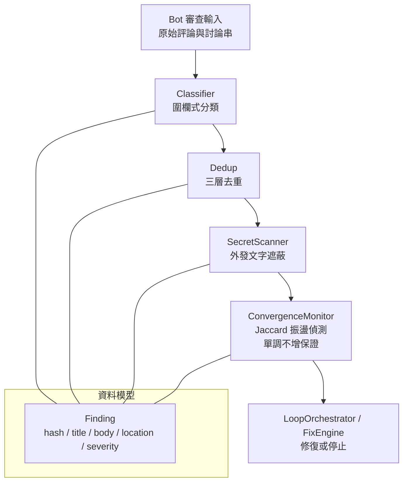
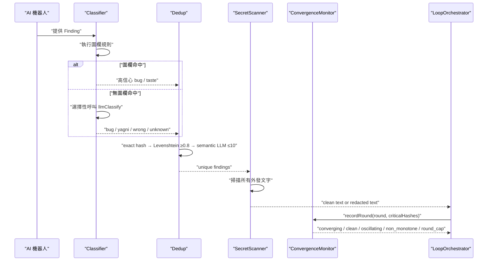
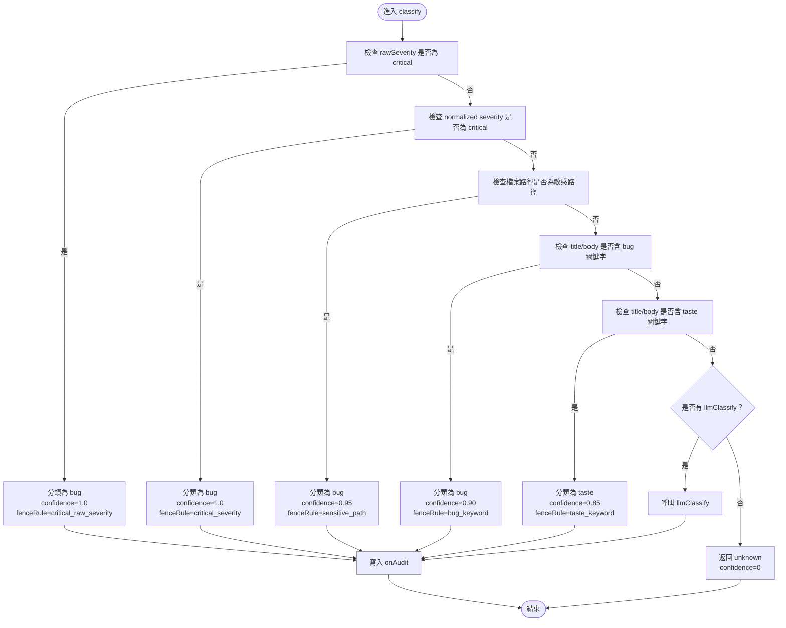
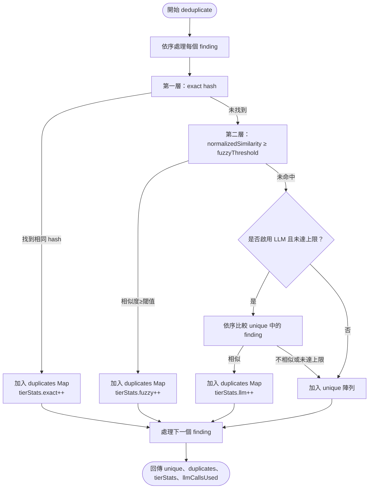
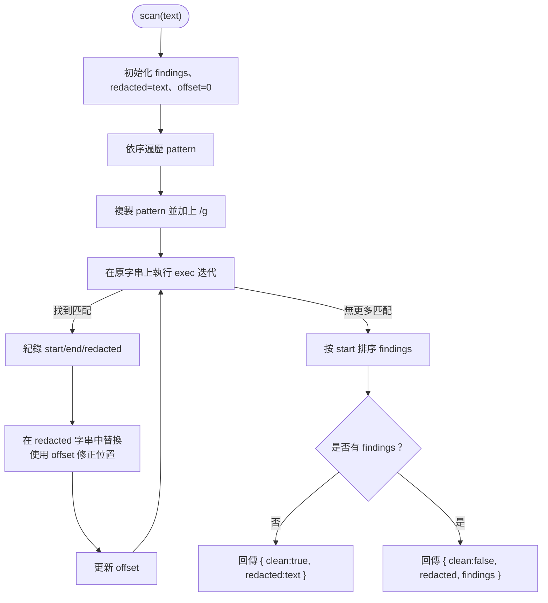
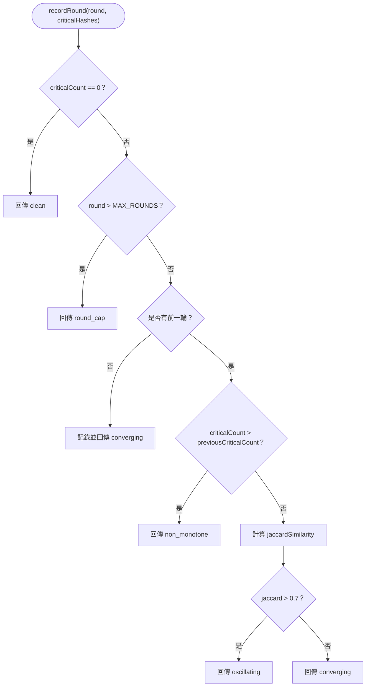
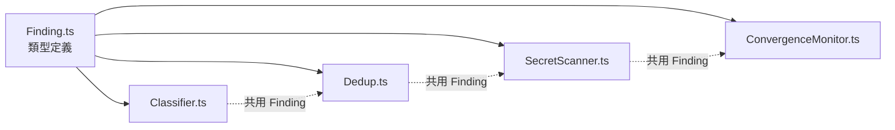

# 問題處理管道

**本文引用的檔案**

- [Classifier.ts](https://github.com/mikeah2011/maestro/blob/master/src/core/classify/Classifier.ts)
- [Dedup.ts](https://github.com/mikeah2011/maestro/blob/master/src/core/dedup/Dedup.ts)
- [SecretScanner.ts](https://github.com/mikeah2011/maestro/blob/master/src/core/security/SecretScanner.ts)
- [ConvergenceMonitor.ts](https://github.com/mikeah2011/maestro/blob/master/src/core/convergence/ConvergenceMonitor.ts)
- [Finding.ts](https://github.com/mikeah2011/maestro/blob/master/src/core/types/Finding.ts)
- [DESIGN.md](https://github.com/mikeah2011/maestro/blob/master/docs/DESIGN.md)
- [Classifier.test.ts](https://github.com/mikeah2011/maestro/blob/master/tests/core/classify/Classifier.test.ts)
- [Dedup.test.ts](https://github.com/mikeah2011/maestro/blob/master/tests/core/dedup/Dedup.test.ts)
- [SecretScanner.test.ts](https://github.com/mikeah2011/maestro/blob/master/tests/core/security/SecretScanner.test.ts)
- [ConvergenceMonitor.test.ts](https://github.com/mikeah2011/maestro/blob/master/tests/core/convergence/ConvergenceMonitor.test.ts)

## 目錄

1. [簡介](#簡介)
2. [專案結構與管道總覽](#專案結構與管道總覽)
3. [核心組件](#核心組件)
4. [架構總覽](#架構總覽)
5. [詳細組件分析](#詳細組件分析)
6. [依賴關係分析](#依賴關係分析)
7. [性能考量與優化建議](#性能考量與優化建議)
8. [故障排除指南](#故障排除指南)
9. [結論](#結論)

## 簡介

本文件說明 Maestro 的「問題處理管道」，聚焦四層資料處理順序：

1. **Classifier（分類器）**
2. **Dedup（去重器）**
3. **SecretScanner（機密掃描器）**
4. **ConvergenceMonitor（收斂監控器）**

這個管道的目標是：把多個 AI 機器人生成的審查結果，轉成可操作、可重複、可終止的問題清單；同時防止無限修復循環、重複工作，以及外發文字洩漏敏感資訊。

設計上遵循「先確定性規則，再 LLM；先最廉價檢查，再昂貴檢查；每輪必須有收斂保證」的原則。

## 專案結構與管道總覽

問題處理管道由 `core` 模組中的四個獨立類別組成。它們不直接互相 import，而是透過統一的 `Finding` 資料模型協作：



**圖表來源**
- [Classifier.ts:1-191](https://github.com/mikeah2011/maestro/blob/master/src/core/classify/Classifier.ts#L1-L191)
- [Dedup.ts:1-153](https://github.com/mikeah2011/maestro/blob/master/src/core/dedup/Dedup.ts#L1-L153)
- [SecretScanner.ts:1-136](https://github.com/mikeah2011/maestro/blob/master/src/core/security/SecretScanner.ts#L1-L136)
- [ConvergenceMonitor.ts:1-206](https://github.com/mikeah2011/maestro/blob/master/src/core/convergence/ConvergenceMonitor.ts#L1-L206)
- [Finding.ts:1-129](https://github.com/mikeah2011/maestro/blob/master/src/core/types/Finding.ts#L1-L129)

**章節來源**
- [DESIGN.md:1-207](https://github.com/mikeah2011/maestro/blob/master/docs/DESIGN.md#L1-L207)

## 核心組件

| 組件 | 主要職責 | 關鍵輸入 | 關鍵輸出 | 是否呼叫 LLM |
|---|---|---|---|---|
| Classifier | 將機器人評論轉為可操作的 `FindingCategory` | `Finding` | `FindingClassification` | 僅在圍欄未命中時 |
| Dedup | 消除同一輪中相同或相似問題 | `Finding[]` | `unique[]` + `duplicates Map` | 可選，上限 10 次 |
| SecretScanner | 過濾回覆與 PR 更新中的機密 | 字串 | `clean` / `redacted` / `findings` | 否 |
| ConvergenceMonitor | 確保修復循環可終止 | 每輪關鍵問題雜湊集合 | `ConvergenceStatus` | 否 |

**章節來源**
- [Classifier.ts:1-191](https://github.com/mikeah2011/maestro/blob/master/src/core/classify/Classifier.ts#L1-L191)
- [Dedup.ts:1-153](https://github.com/mikeah2011/maestro/blob/master/src/core/dedup/Dedup.ts#L1-L153)
- [SecretScanner.ts:1-136](https://github.com/mikeah2011/maestro/blob/master/src/core/security/SecretScanner.ts#L1-L136)
- [ConvergenceMonitor.ts:1-206](https://github.com/mikeah2011/maestro/blob/master/src/core/convergence/ConvergenceMonitor.ts#L1-L206)
- [Finding.ts:1-129](https://github.com/mikeah2011/maestro/blob/master/src/core/types/Finding.ts#L1-L129)

## 架構總覽

從一個機器人生成的原始發現到最終收斂決策，資料流如下：



**圖表來源**
- [Classifier.ts:60-120](https://github.com/mikeah2011/maestro/blob/master/src/core/classify/Classifier.ts#L60-L120)
- [Dedup.ts:40-120](https://github.com/mikeah2011/maestro/blob/master/src/core/dedup/Dedup.ts#L40-L120)
- [SecretScanner.ts:80-136](https://github.com/mikeah2011/maestro/blob/master/src/core/security/SecretScanner.ts#L80-L136)
- [ConvergenceMonitor.ts:40-120](https://github.com/mikeah2011/maestro/blob/master/src/core/convergence/ConvergenceMonitor.ts#L40-L120)

## 詳細組件分析

### Classifier：圍欄式分類器

#### 設計原則

Classifier 的核心設計是「圍欄式短路」。它先執行完全確定性的規則，只有當所有規則都無法判斷時，才呼叫外部 LLM。這樣做有三個好處：

1. **節省成本**：大多數明確的 bug、taste、敏感路徑問題不需要 LLM。
2. **提升穩定性**：確定性規則不會因模型版本變化而改變分類結果。
3. **可審計**：每個分類都會產生審計記錄，包含是否走圍欄、哪個規則命中、是否使用模型等。

#### 圍欄規則優先順序



**圖表來源**
- [Classifier.ts:17-55](https://github.com/mikeah2011/maestro/blob/master/src/core/classify/Classifier.ts#L17-L55)
- [Classifier.ts:72-160](https://github.com/mikeah2011/maestro/blob/master/src/core/classify/Classifier.ts#L72-L160)

#### 關鍵實現細節

| 規則 | 條件 | 分類 | 信心值 | 備註 |
|---|---|---|---|---|
| 嚴重等級圍欄 | `rawSeverity` 為 `critical` / `blocker` / `error` / `fatal` | `bug` | `1.0` | 大小寫不敏感 |
| 正規化嚴重等級 | `severity === 'critical'` | `bug` | `1.0` | 跨機器人統一後仍為 critical |
| 敏感路徑 | 路徑包含 `/auth/`、`/crypto/`、`/payment/`、`/security/`、`/secret/` 等 | `bug` | `0.95` | 子路徑也會匹配 |
| Bug 關鍵字 | title/body 包含 NPE、SQL injection、XSS、deadlock 等 | `bug` | `0.90` | 常見漏洞與崩潰模式 |
| Taste 關鍵字 | title/body 包含 `nit:`、`cosmetic`、`style preference` 等 | `taste` | `0.85` | 風格偏好，通常不需修復 |
| LLM fallback | 以上皆未命中且提供 `llmClassify` | 由模型決定 | 由模型決定 | 未配置時回傳 `unknown` |

#### 錯誤處理與邊界情況

- 若未配置 `llmClassify`，且無圍欄命中，會回傳 `category: 'unknown'`，而不是拋出錯誤。
- 所有分類結果都會透過 `onAudit` 同步紀錄，不會阻塞主流程。
- 測試驗證了 `critical`、`high`、敏感路徑、keyword、taste、LLM fallback、audit 等情境。

**章節來源**
- [Classifier.ts:1-191](https://github.com/mikeah2011/maestro/blob/master/src/core/classify/Classifier.ts#L1-L191)
- [Classifier.test.ts:1-258](https://github.com/mikeah2011/maestro/blob/master/tests/core/classify/Classifier.test.ts#L1-L258)
- [Finding.ts:13-32](https://github.com/mikeah2011/maestro/blob/master/src/core/types/Finding.ts#L13-L32)

### Dedup：三層去重管道

#### 設計原則

Dedup 的目標是避免同一輪內重複修復相同問題。它採用「由快到慢、由確定到語義」的三層策略：

1. **第一層：精確雜湊匹配** — 約 60% 重複可在此層消滅。
2. **第二層：Levenshtein 模糊匹配** — 約 25% 重複可在此層消滅。
3. **第三層：語義 LLM 去重** — 處理剩餘約 15%，但每輪最多呼叫 10 次。

#### 三層流程



**圖表來源**
- [Dedup.ts:1-39](https://github.com/mikeah2011/maestro/blob/master/src/core/dedup/Dedup.ts#L1-L39)
- [Dedup.ts:40-120](https://github.com/mikeah2011/maestro/blob/master/src/core/dedup/Dedup.ts#L40-L120)

#### 模糊匹配演算法

第二層使用 Levenshtein 編輯距離計算標題相似度：

- `levenshtein(a, b)`：標準動態規劃，時間複雜度 O(m × n)，空間複雜度 O(n)。
- `normalizedSimilarity(a, b)`：將距離除以較長字串長度，得到 `[0, 1]` 範圍的相似度。
- 預設閾值 `fuzzyThreshold = 0.8`。

#### LLM 呼叫上限

第三層可選，需注入 `llmSimilar`。實作會維護 `llmCallsUsed`，一旦達到 `maxLlmCalls`（預設 10），就跳過剩餘比較。這使系統在大量問題下仍可預測成本。

#### 冪等性與正確性

設計文檔明確指出兩個屬性：

- **冪等性**：`deduplicate(deduplicate(S).unique) ≡ deduplicate(S).unique`
- **輸出子集**：`unique ⊆ input`

測試也涵蓋了 levenshtein 對稱性、三角不等式、normalizedSimilarity 範圍、exact/fuzzy/LLM 各層行為。

**章節來源**
- [Dedup.ts:1-153](https://github.com/mikeah2011/maestro/blob/master/src/core/dedup/Dedup.ts#L1-L153)
- [Dedup.test.ts:1-281](https://github.com/mikeah2011/maestro/blob/master/tests/core/dedup/Dedup.test.ts#L1-L281)
- [DESIGN.md:1-207](https://github.com/mikeah2011/maestro/blob/master/docs/DESIGN.md#L1-L207)

### SecretScanner：外發文字遮蔽

#### 設計原則

SecretScanner 是一個被動防護層。它不參與問題分類或去重，而是掃描「即將寫入平台」的所有文字，包括：

- 機器人的回覆內容
- PR 內容更新
- 任何可能重新持久化的字串

這是因為機器人本身可能在評論中引用 diff，而 diff 可能包含開發者不小心提交的金鑰、token、JWT 或私鑰。我們的「回聲」不能再次把它們寫進 PR。

#### 內建模式

| 模式名稱 | 典型格式 | 遮蔽方式 |
|---|---|---|
| `aws_access_key_id` | `AKIA...` | `AKIA[REDACTED]` |
| `aws_secret_access_key` | `AWS_SECRET_ACCESS_KEY=<40 位字元>` | 替換 value 部分 |
| `github_token` | `ghp_`、`ghs_`、`gho_`、`ghr_`、`github_pat_` | 保留前 8 碼 + `[REDACTED]` |
| `private_key_pem` | PEM 私鑰區塊 | `[PRIVATE KEY REDACTED]` |
| `jwt` | base64url三段點分隔 | 保留前 10 碼 + `…[JWT REDACTED]` |
| `stripe_key` | `sk_live_` / `pk_test_` | 保留前 12 碼 + `[REDACTED]` |
| `slack_token` | `xoxb-...` 等 | 保留前 12 碼 + `[REDACTED]` |
| `generic_api_key` | `api_key=`、`access_token:` 等 | 替換長值 |

#### 遮蔽演算法



**圖表來源**
- [SecretScanner.ts:60-136](https://github.com/mikeah2011/maestro/blob/master/src/core/security/SecretScanner.ts#L60-L136)

#### 重要行為

- 沒有匹配時，`clean=true` 且 `redacted` 等於原字串。
- 匹配時，`findings` 會按起始位置排序，確保輸出穩定。
- 支援額外自訂 pattern，可透過建構函數注入。
- 測試驗證 AWS key、GitHub token、PEM、JWT、Stripe key、generic API key、多重機密、自訂 pattern 等情境。

**章節來源**
- [SecretScanner.ts:1-136](https://github.com/mikeah2011/maestro/blob/master/src/core/security/SecretScanner.ts#L1-L136)
- [SecretScanner.test.ts:1-221](https://github.com/mikeah2011/maestro/blob/master/tests/core/security/SecretScanner.test.ts#L1-L221)

### ConvergenceMonitor：收斂監控器

#### 設計原則

ConvergenceMonitor 是整個修復循環的「終止仲裁者」。它不修改程式碼，也不直接與平台互動，只負責回答一個問題：「這一輪之後，我們還應該繼續嗎？」

它強制三個不變量：

1. **單調不增**：下一輪的關鍵問題數量不得大於上一輪。
2. **Jaccard 振盪偵測**：相鄰兩輪關鍵問題集合的 Jaccard 相似度不得超過 0.7。
3. **第 2 輪後不得出現新問題類別**：若第 3 輪引入之前未見的類別，視為修復創造了新問題。

此外，系統還有硬性上限：**最多 3 輪**。

#### 狀態定義

| 狀態 | 意義 | 後續動作 |
|---|---|---|
| `converging` | 正常收斂中 | 繼續下一輪 |
| `clean` | 無關鍵問題 | 完成循環 |
| `oscillating` | Jaccard > 0.7 | 升級人工介入 |
| `non_monotone` | 關鍵問題數量增加 | 升級人工介入 |
| `category_violation` | 第 2 輪後出現新類別 | 升級人工介入 |
| `round_cap` | 超過 3 輪 | 升級人工介入 |

#### Jaccard 振盪偵測

Jaccard 相似度定義為交集大小除以聯集大小：

$$
J(A, B) = \frac{|A \cap B|}{|A \cup B|}
$$

若連續兩輪的關鍵問題集合高度重疊，表示修復沒有真正減少問題，只是在不同問題之間來回震盪。此時系統停止自動修復，改由人類判斷。

#### 穩定問題雜湊

ConvergenceMonitor 依賴穩定的 `Finding.hash`，其定義為：

```
sha1(file + NUL + line_bucket + NUL + normalized_category + NUL + sha1(surrounding_content))
```

其中 `line_bucket` 以 5 行為單位：

| 行號範圍 | bucket |
|---|---|
| 1–5 | 0 |
| 6–10 | 1 |
| 11–15 | 2 |
| ... | ... |

這讓雜湊在以下情況下仍穩定：

- 機器人改寫評論內容
- rebase 或小修改導致行號偏移
- 不同 bot 對同一問題產生不同文字描述

#### 決策流程



**圖表來源**
- [ConvergenceMonitor.ts:17-120](https://github.com/mikeah2011/maestro/blob/master/src/core/convergence/ConvergenceMonitor.ts#L17-L120)
- [ConvergenceMonitor.ts:195-206](https://github.com/mikeah2011/maestro/blob/master/src/core/convergence/ConvergenceMonitor.ts#L195-L206)

**章節來源**
- [ConvergenceMonitor.ts:1-206](https://github.com/mikeah2011/maestro/blob/master/src/core/convergence/ConvergenceMonitor.ts#L1-L206)
- [ConvergenceMonitor.test.ts:1-249](https://github.com/mikeah2011/maestro/blob/master/tests/core/convergence/ConvergenceMonitor.test.ts#L1-L249)
- [DESIGN.md:1-207](https://github.com/mikeah2011/maestro/blob/master/docs/DESIGN.md#L1-L207)

## 依賴關係分析

四個組件的耦合關係非常低：



實際 import 關係：

- `Classifier` 依賴 `Finding` 中的 `Finding`、`FindingCategory`、`FindingClassification`。
- `Dedup` 依賴 `Finding`。
- `SecretScanner` 不依賴 `Finding`，只處理字串。
- `ConvergenceMonitor` 不依賴 `Finding`，只處理雜湊集合。
- 四者之間沒有互相 import，因此可以單獨測試、替換、重排。

潛在風險：

- 雖然組件解耦良好，但 `Finding.hash` 的穩定性是整體去重與收斂的基礎。如果上游產生的 hash 不穩定，Dedup 和 ConvergenceMonitor 都可能失效。
- `SecretScanner` 的 regex 模式若過於寬鬆，可能造成誤遮蔽；若過於嚴格，可能遺漏機密。

**圖表來源**
- [Classifier.ts:17-20](https://github.com/mikeah2011/maestro/blob/master/src/core/classify/Classifier.ts#L17-L20)
- [Dedup.ts:30-39](https://github.com/mikeah2011/maestro/blob/master/src/core/dedup/Dedup.ts#L30-L39)
- [SecretScanner.ts:1-20](https://github.com/mikeah2011/maestro/blob/master/src/core/security/SecretScanner.ts#L1-L20)
- [ConvergenceMonitor.ts:1-40](https://github.com/mikeah2011/maestro/blob/master/src/core/convergence/ConvergenceMonitor.ts#L1-L40)
- [Finding.ts:1-129](https://github.com/mikeah2011/maestro/blob/master/src/core/types/Finding.ts#L1-L129)

**章節來源**
- [Finding.ts:1-129](https://github.com/mikeah2011/maestro/blob/master/src/core/types/Finding.ts#L1-L129)

## 性能考量與優化建議

### 1. LLM 呼叫上限

**現況**：Dedup 第三層預設最多 10 次 `llmSimilar` 呼叫。

**建議**：

| 情境 | 建議設定 | 原因 |
|---|---|---|
| 小型 PR（≤50 個問題） | 維持 10 | 已足夠覆蓋語義重複 |
| 大型 PR（100+ 問題） | 降至 3–5 | 避免 O(n × maxLlmCalls) 成為瓶頸 |
| 高成本環境 | 關閉第三層，僅用 exact + fuzzy | 完全避免 LLM 費用 |
| 高準確率需求 | 提高至 20–30，但配合緩存 | 降低假正類，但成本上升 |

注意：即使 `maxLlmCalls` 很高，實作仍會在每次比較前檢查計數器，因此不會超過上限。

### 2. 模糊匹配閾值調整

**現況**：預設 `fuzzyThreshold = 0.8`。

**建議**：

| 閾值 | 效果 | 適用情境 |
|---|---|---|
| 0.7 | 更寬鬆，更容易判定重複 | 機器人常以不同措辭描述同一問題 |
| 0.8 | 預設平衡點 | 一般情況 |
| 0.95 | 更嚴格，接近精確匹配 | 高噪音環境，怕誤殺 |
| 1.0 | 等同字串相等 | 幾乎退化成 exact hash |

調整時應觀察 `tierStats.fuzzy` 與 `tierStats.exact` 的比例。若 fuzzy 層長期為 0，可能閾值過高；若 fuzzy 層吞掉太多不同問題，可能閾值過低。

### 3. Levenshtein 成本控制

Levenshtein 是 O(m × n)。對於極長標題，可考慮：

- 截斷標題至固定長度（例如 120 字元）。
- 先用字首比對或詞袋相似度快速排除。
- 對短標題直接使用，對長標題改用更廉價指標。

### 4. Classifier 圍欄擴展

Classifier 的關鍵字與敏感路徑是靜態陣列，適合新增而不影響效能。建議：

- 新增業務專屬 bug 關鍵字時，優先放在 `BUG_KEYWORDS`。
- 新增敏感目錄時，優先放在 `SENSITIVE_PATH_PREFIXES`。
- 避免新增過於通用的關鍵字，以免誤判 taste 或一般問題。

### 5. SecretScanner 模式管理

建議定期檢視 `BUILTIN_PATTERNS`：

- 移除長期無命中的模式，減少 regex 掃描次數。
- 為高流量服務新增內部 token 模式，避免未來洩漏。
- 使用 `extraPatterns` 而非修改核心模組，方便團隊擴充。

### 6. ConvergenceMonitor 閾值

| 參數 | 現值 | 調整方向 |
|---|---|---|
| `MAX_ROUNDS` | 3 | 一般不需調整；若組織流程需要更多輪，可提高但會延長迴圈 |
| `OSCILLATION_THRESHOLD` | 0.7 | 較高（如 0.85）可容忍更多重疊；較低（如 0.5）更早偵測振盪 |
| `lineBucket` 大小 | 5 | 較大值更容忍行號偏移，但也可能合併不同問題 |

**章節來源**
- [Dedup.ts:40-120](https://github.com/mikeah2011/maestro/blob/master/src/core/dedup/Dedup.ts#L40-L120)
- [Classifier.ts:56-160](https://github.com/mikeah2011/maestro/blob/master/src/core/classify/Classifier.ts#L56-L160)
- [SecretScanner.ts:40-80](https://github.com/mikeah2011/maestro/blob/master/src/core/security/SecretScanner.ts#L40-L80)
- [ConvergenceMonitor.ts:25-40](https://github.com/mikeah2011/maestro/blob/master/src/core/convergence/ConvergenceMonitor.ts#L25-L40)

## 故障排除指南

### 問題：修復循環沒有終止

**可能原因**：

1. `Finding.hash` 不穩定，導致 ConvergenceMonitor 認為每輪都是新問題。
2. `lineBucket` 太小，導致相近行號產生不同雜湊。
3. 修復引入了新問題，觸發 `non_monotone` 或 `category_violation`。
4. Jaccard 持續高於 0.7，觸發 `oscillating`。

**排查步驟**：

1. 檢查 `computeFindingHash` 的輸入是否一致。
2. 確認 `surroundingContent` 確實錨定到穩定程式碼區段。
3. 查看 ConvergenceMonitor 回傳的 `status` 與 `message`。
4. 若長期 `oscillating`，考慮手動介入並縮小修復範圍。

**相關測試**：
- [ConvergenceMonitor.test.ts:100-249](https://github.com/mikeah2011/maestro/blob/master/tests/core/convergence/ConvergenceMonitor.test.ts#L100-L249)

### 問題：大量重複問題未被去重

**可能原因**：

1. 問題不在同一輪，Dedup 只處理單次輸入。
2. `fuzzyThreshold` 過高。
3. 未啟用 `llmSimilar`，第三層語義去重未運作。
4. `Finding.hash` 不一致，導致第一層未能命中。

**排查步驟**：

1. 檢查 `tierStats.exact`、`tierStats.fuzzy`、`tierStats.llm`。
2. 調整 `fuzzyThreshold` 並觀察 fuzzy 層命中率。
3. 注入 `llmSimilar` 啟用第三層。
4. 確認上游 hash 生成邏輯一致。

**相關測試**：
- [Dedup.test.ts:100-281](https://github.com/mikeah2011/maestro/blob/master/tests/core/dedup/Dedup.test.ts#L100-L281)

### 問題：Classifier 將問題分類為 unknown

**可能原因**：

1. 無圍欄命中。
2. 未配置 `llmClassify`。

**解決方法**：

- 若該問題確實是 bug，考慮新增關鍵字或敏感路徑。
- 若該問題是 taste，新增 taste 關鍵字。
- 否則配置 `llmClassify`，讓模型判斷。

**相關測試**：
- [Classifier.test.ts:1-258](https://github.com/mikeah2011/maestro/blob/master/tests/core/classify/Classifier.test.ts#L1-L258)

### 問題：機密文字仍出現在 PR 回覆中

**可能原因**：

1. 機密格式不在內建模式中。
2. 使用了自訂 platform adapter 繞過 SecretScanner。
3. 文字經過其他管道直接寫入平台，未經 `scan()`。

**解決方法**：

- 新增對應 `SecretPattern`。
- 確保所有外發文字都經過 `SecretScanner.scan()`。
- 檢視 `findings` 確認是否成功匹配。

**相關測試**：
- [SecretScanner.test.ts:1-221](https://github.com/mikeah2011/maestro/blob/master/tests/core/security/SecretScanner.test.ts#L1-L221)

## 結論

Classifier、Dedup、SecretScanner、ConvergenceMonitor 四個組件共同構成一個可審計、可終止、可擴展的問題處理管道：

- **Classifier** 用圍欄規則保護 LLM 不被濫用，同時把明確問題快速分派。
- **Dedup** 用三層管道消除重複工作，並用 LLM 呼叫上限控制成本。
- **SecretScanner** 作為最後一道防線，防止外發文字洩漏機密。
- **ConvergenceMonitor** 用數學不變量保證循環終止，防止無限修復與振盪。

它們協作時的核心價值在於：每一層都有明確職責，資料流單一方向，錯誤路徑明確，並且全部由測試覆蓋。若要擴充功能，應優先新增圍欄規則、模糊閾值或安全模式，而不是直接修改現有邏輯。