# 系統架構

<cite>
**本文引用的檔案**   
- [README.md](https://github.com/mikeah2011/maestro/blob/master/README.md)
- [docs/DESIGN.md](https://github.com/mikeah2011/maestro/blob/master/docs/DESIGN.md)
- [package.json](https://github.com/mikeah2011/maestro/blob/master/package.json)
- [src/index.ts](https://github.com/mikeah2011/maestro/blob/master/src/index.ts)
- [src/cli/index.ts](https://github.com/mikeah2011/maestro/blob/master/src/cli/index.ts)
- [src/cli/commands/loop.ts](https://github.com/mikeah2011/maestro/blob/master/src/cli/commands/loop.ts)
- [src/core/events/EventEmitter.ts](https://github.com/mikeah2011/maestro/blob/master/src/core/events/EventEmitter.ts)
- [src/core/state/StateMachine.ts](https://github.com/mikeah2011/maestro/blob/master/src/core/state/StateMachine.ts)
- [src/core/classify/Classifier.ts](https://github.com/mikeah2011/maestro/blob/master/src/core/classify/Classifier.ts)
- [src/core/dedup/Dedup.ts](https://github.com/mikeah2011/maestro/blob/master/src/core/dedup/Dedup.ts)
- [src/core/convergence/ConvergenceMonitor.ts](https://github.com/mikeah2011/maestro/blob/master/src/core/convergence/ConvergenceMonitor.ts)
- [src/core/security/SecretScanner.ts](https://github.com/mikeah2011/maestro/blob/master/src/core/security/SecretScanner.ts)
- [src/core/fix/FixEngine.ts](https://github.com/mikeah2011/maestro/blob/master/src/core/fix/FixEngine.ts)
- [src/core/round/RoundBudget.ts](https://github.com/mikeah2011/maestro/blob/master/src/core/round/RoundBudget.ts)
- [src/platforms/interfaces/GitPlatform.ts](https://github.com/mikeah2011/maestro/blob/master/src/platforms/interfaces/GitPlatform.ts)
- [src/platforms/github/GitHubPlatform.ts](https://github.com/mikeah2011/maestro/blob/master/src/platforms/github/GitHubPlatform.ts)
- [src/ai/interfaces/AIProvider.ts](https://github.com/mikeah2011/maestro/blob/master/src/ai/interfaces/AIProvider.ts)
</cite>

## 目錄
1. [引言](#引言)
2. [專案結構與分層設計](#專案結構與分層設計)
3. [核心組件](#核心組件)
4. [系統架構總覽](#系統架構總覽)
5. [詳細組件分析](#詳細組件分析)
6. [依賴關係與資料流程](#依賴關係與資料流程)
7. [技術決策與權衡](#技術決策與權衡)
8. [邊界定義](#邊界定義)
9. [效能考量](#效能考量)
10. [故障診斷與排錯指南](#故障診斷與排錯指南)
11. [結論](#結論)

## 引言
Maestro 是「審查機器人之上的收斂層」，不是另一個獨立程式碼審查工具。它把 CodeRabbit、Ellipsis、Copilot Code Review 等外部機器人視為輸入，透過確定性狀態機、反垃圾郵件執行期斷言、Jaccard 收斂監控與圍欄式分類，在最多三輪內強制結束 PR 審查循環，並輸出已分類問題、討論串回覆、修復提交、已解決討論串以及最終摘要。

高層目標有三個：
- **可組合**：抽象 Git 平台與 AI Provider，讓 GitHub、GitLab、Claude、OpenAI 等可以替換或擴充。
- **可證明**：以 StateMachine、RoundBudget、ConvergenceMonitor 提供硬上限、單調不增關鍵問題集、振盪偵測等不變量。
- **可觀察**：所有狀態轉換、寫入操作、分類決策都走 EventEmitter 的 JSONL 事件流。

本文件面向架構師與資深開發者，先說明分層與模組邊界，再深入 LoopOrchestrator 如何整合 StateMachine、RoundBudget、Classifier、Dedup、ConvergenceMonitor、SecretScanner、FixEngine 等組件，最後整理技術決策、權衡與常見排錯方式。

**Section sources**
- [README.md:1-80](https://github.com/mikeah2011/maestro/blob/master/README.md#L1-L80)
- [docs/DESIGN.md:1-40](https://github.com/mikeah2011/maestro/blob/master/docs/DESIGN.md#L1-L40)

## 專案結構與分層設計
Maestro 的程式碼結構採用「CLI → Core → Platform / AI 抽象層」的分層組織：

| 層次 | 目錄 | 責任 |
|---|---|---|
| CLI 層 | `src/cli` | 命令列入口、子命令註冊、環境載入、UI 事件訂閱。 |
| 設定層 | `src/config` | Zod schema、多層設定載入、環境變數展開。 |
| 核心層 | `src/core` | 狀態機、事件、回合預算、分類、去重、收斂監控、安全掃描、修復引擎、收斂循環。 |
| 平台層 | `src/platforms` | Git 平台抽象與 GitHub 實作。 |
| AI 層 | `src/ai` | AI Provider 抽象與 Claude / Claude Code 實作。 |
| 公共匯出 | `src/index.ts` | 對外重新匯出類型與主要類別，供 CI、測試、未來插件使用。 |

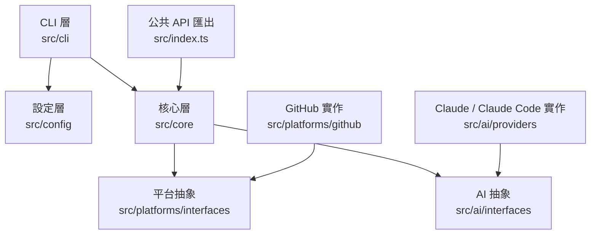

**圖表來源**
- [src/cli/index.ts:1-86](https://github.com/mikeah2011/maestro/blob/master/src/cli/index.ts#L1-L86)
- [src/cli/commands/loop.ts:1-200](https://github.com/mikeah2011/maestro/blob/master/src/cli/commands/loop.ts#L1-L200)
- [src/index.ts:1-150](https://github.com/mikeah2011/maestro/blob/master/src/index.ts#L1-L150)

**Section sources**
- [README.md:80-160](https://github.com/mikeah2011/maestro/blob/master/README.md#L80-L160)
- [docs/DESIGN.md:40-120](https://github.com/mikeah2011/maestro/blob/master/docs/DESIGN.md#L40-L120)
- [src/cli/index.ts:1-86](https://github.com/mikeah2011/maestro/blob/master/src/cli/index.ts#L1-L86)
- [src/index.ts:1-150](https://github.com/mikeah2011/maestro/blob/master/src/index.ts#L1-L150)

## 核心組件
核心層是 Maestro 的有狀態邏輯中心，主要組件如下：

| 組件 | 檔案 | 角色 |
|---|---|---|
| EventEmitter | `src/core/events/EventEmitter.ts` | 所有領域事件的單一真實來源，支援 sink、handler、上下文注入。 |
| StateMachine | `src/core/state/StateMachine.ts` | 明確驗證的狀態轉換；包含正常前進路徑與跨切面錯誤狀態。 |
| RoundBudget | `src/core/round/RoundBudget.ts` | 反垃圾郵件執行期斷言，每輪限制提交、回覆、PR body 更新等次數。 |
| Classifier | `src/core/classify/Classifier.ts` | 圍欄式分類器：確定性規則優先，LLM 作為 fallback。 |
| Dedup | `src/core/dedup/Dedup.ts` | 三層去重：精確雜湊、模糊標題相似度、語義 LLM 去重。 |
| ConvergenceMonitor | `src/core/convergence/ConvergenceMonitor.ts` | 關鍵問題集收斂監控：單調不增、Jaccard 振盪、新類別違規。 |
| SecretScanner | `src/core/security/SecretScanner.ts` | 外發文字中的敏感資訊掃描與遮蔽。 |
| FixEngine | `src/core/fix/FixEngine.ts` | M6 自動修復引擎，讀取上下文、呼叫 AI Provider、產生行替換、寫回檔案。 |
| LoopOrchestrator | `src/core/loop/LoopOrchestrator.ts` | 主收斂循環，協調上述所有組件。 |
| GitPlatform | `src/platforms/interfaces/GitPlatform.ts` | Git 平台抽象介面。 |
| GitHubPlatform | `src/platforms/github/GitHubPlatform.ts` | GitHub REST + GraphQL 實作。 |
| AIProvider | `src/ai/interfaces/AIProvider.ts` | AI Provider 抽象介面，支援模型階層路由。 |

**Section sources**
- [src/core/events/EventEmitter.ts:1-108](https://github.com/mikeah2011/maestro/blob/master/src/core/events/EventEmitter.ts#L1-L108)
- [src/core/state/StateMachine.ts:1-114](https://github.com/mikeah2011/maestro/blob/master/src/core/state/StateMachine.ts#L1-L114)
- [src/core/round/RoundBudget.ts:1-131](https://github.com/mikeah2011/maestro/blob/master/src/core/round/RoundBudget.ts#L1-L131)
- [src/core/classify/Classifier.ts:1-191](https://github.com/mikeah2011/maestro/blob/master/src/core/classify/Classifier.ts#L1-L191)
- [src/core/dedup/Dedup.ts:1-153](https://github.com/mikeah2011/maestro/blob/master/src/core/dedup/Dedup.ts#L1-L153)
- [src/core/convergence/ConvergenceMonitor.ts:1-200](https://github.com/mikeah2011/maestro/blob/master/src/core/convergence/ConvergenceMonitor.ts#L1-L200)
- [src/core/security/SecretScanner.ts:1-136](https://github.com/mikeah2011/maestro/blob/master/src/core/security/SecretScanner.ts#L1-L136)
- [src/core/fix/FixEngine.ts:1-200](https://github.com/mikeah2011/maestro/blob/master/src/core/fix/FixEngine.ts#L1-L200)
- [src/platforms/interfaces/GitPlatform.ts:1-130](https://github.com/mikeah2011/maestro/blob/master/src/platforms/interfaces/GitPlatform.ts#L1-L130)
- [src/platforms/github/GitHubPlatform.ts:1-200](https://github.com/mikeah2011/maestro/blob/master/src/platforms/github/GitHubPlatform.ts#L1-L200)
- [src/ai/interfaces/AIProvider.ts:1-114](https://github.com/mikeah2011/maestro/blob/master/src/ai/interfaces/AIProvider.ts#L1-L114)

## 系統架構總覽
從使用者到平台 API 的完整請求路徑如下：

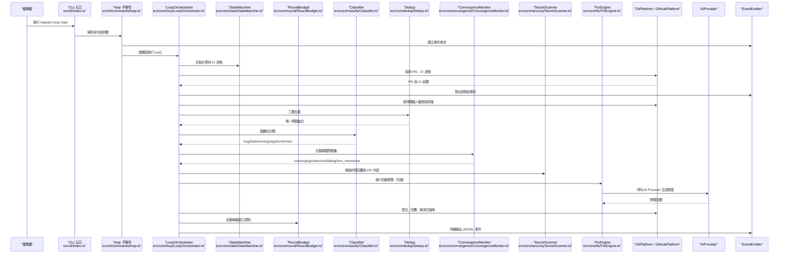

**圖表來源**
- [src/cli/index.ts:1-86](https://github.com/mikeah2011/maestro/blob/master/src/cli/index.ts#L1-L86)
- [src/cli/commands/loop.ts:1-200](https://github.com/mikeah2011/maestro/blob/master/src/cli/commands/loop.ts#L1-L200)
- [src/core/loop/LoopOrchestrator.ts:1-200](https://github.com/mikeah2011/maestro/blob/master/src/core/loop/LoopOrchestrator.ts#L1-L200)
- [src/core/state/StateMachine.ts:1-114](https://github.com/mikeah2011/maestro/blob/master/src/core/state/StateMachine.ts#L1-L114)
- [src/core/round/RoundBudget.ts:1-131](https://github.com/mikeah2011/maestro/blob/master/src/core/round/RoundBudget.ts#L1-L131)
- [src/core/classify/Classifier.ts:1-191](https://github.com/mikeah2011/maestro/blob/master/src/core/classify/Classifier.ts#L1-L191)
- [src/core/dedup/Dedup.ts:1-153](https://github.com/mikeah2011/maestro/blob/master/src/core/dedup/Dedup.ts#L1-L153)
- [src/core/convergence/ConvergenceMonitor.ts:1-200](https://github.com/mikeah2011/maestro/blob/master/src/core/convergence/ConvergenceMonitor.ts#L1-L200)
- [src/core/security/SecretScanner.ts:1-136](https://github.com/mikeah2011/maestro/blob/master/src/core/security/SecretScanner.ts#L1-L136)
- [src/core/fix/FixEngine.ts:1-200](https://github.com/mikeah2011/maestro/blob/master/src/core/fix/FixEngine.ts#L1-L200)
- [src/platforms/interfaces/GitPlatform.ts:1-130](https://github.com/mikeah2011/maestro/blob/master/src/platforms/interfaces/GitPlatform.ts#L1-L130)
- [src/ai/interfaces/AIProvider.ts:1-114](https://github.com/mikeah2011/maestro/blob/master/src/ai/interfaces/AIProvider.ts#L1-L114)

## 詳細組件分析

### 狀態機：StateMachine
StateMachine 負責管理收斂循環的生命週期，將狀態分為三類：

| 類別 | 狀態 | 用途 |
|---|---|---|
| 正常前進狀態 | idle、writing、preflight、pr_created、waiting_for_ci、waiting_for_bot、racing、classifying、fixing、commit_pushed、replying、resolving | 主循環前進。 |
| 錯誤與跨切面狀態 | ci_failing、bot_timeout、human_intervened、rate_limited、token_expired、paused | 任何非終端狀態都可進入這些狀態。 |
| 終端狀態 | stopped、token_expired | 沒有 outgoing transition。 |

狀態機的核心約束是：
- 若當前狀態為終端狀態，則禁止任何 transition。
- 跨切面狀態允許從任何非終端狀態進入。
- 其他 transition 必須符合 FORWARD 表中定義的前進路徑。
- 每次成功 transition 會更新 EventEmitter 的 state 上下文並發出 `state.transition` 事件。

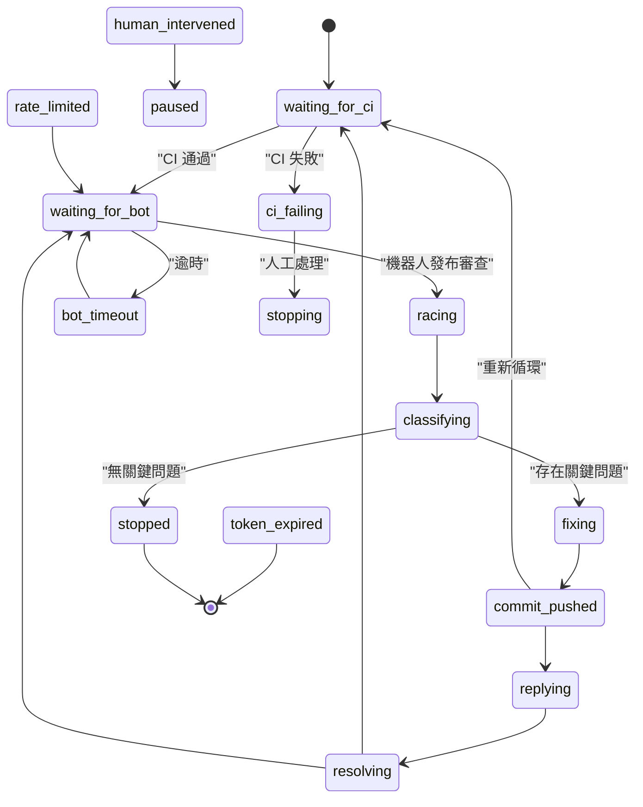

**圖表來源**
- [src/core/state/StateMachine.ts:1-114](https://github.com/mikeah2011/maestro/blob/master/src/core/state/StateMachine.ts#L1-L114)

**Section sources**
- [src/core/state/StateMachine.ts:1-114](https://github.com/mikeah2011/maestro/blob/master/src/core/state/StateMachine.ts#L1-L114)

### 策略模式與 Provider 抽象：AIProvider 與 GitPlatform
Maestro 使用 Strategy/Provider 模式分離「什麼能力可用」與「如何實作」。

- `AIProvider` 定義統一的 prompt → completion 介面，並允許按階段選擇 cheap、strong、flagship 等模型階層。ClaudeProvider 與 ClaudeCodeProvider 是兩個具體實作。
- `GitPlatform` 定義 PR I/O、審查、討論串、CI、速率限制等能力，`GitHubPlatform` 是目前的主要實作。

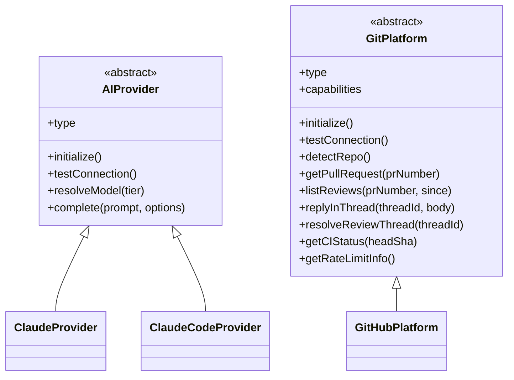

**圖表來源**
- [src/ai/interfaces/AIProvider.ts:1-114](https://github.com/mikeah2011/maestro/blob/master/src/ai/interfaces/AIProvider.ts#L1-L114)
- [src/platforms/interfaces/GitPlatform.ts:1-130](https://github.com/mikeah2011/maestro/blob/master/src/platforms/interfaces/GitPlatform.ts#L1-L130)
- [src/platforms/github/GitHubPlatform.ts:1-200](https://github.com/mikeah2011/maestro/blob/master/src/platforms/github/GitHubPlatform.ts#L1-L200)

**Section sources**
- [src/ai/interfaces/AIProvider.ts:1-114](https://github.com/mikeah2011/maestro/blob/master/src/ai/interfaces/AIProvider.ts#L1-L114)
- [src/platforms/interfaces/GGitPlatform.ts:1-130](https://github.com/mikeah2011/maestro/blob/master/src/platforms/interfaces/GitPlatform.ts#L1-L130)
- [src/platforms/github/GitHubPlatform.ts:1-200](https://github.com/mikeah2011/maestro/blob/master/src/platforms/github/GitHubPlatform.ts#L1-L200)

### 觀察者模式：EventEmitter
EventEmitter 是所有 UI 與外部系統的單一真實來源。每個 event 包含時間戳、事件類型、回合數、狀態與 payload。sink 負責決定事件流向 stdout、檔案、Claude Code skill、MCP 伺服器或未來 GitHub Action UI。

重要特性：
- sink 失敗不會中斷主循環。
- handler 訂閱與取消訂閱支援。
- setContext 讓下游事件自動攜帶 round 與 state。
- toLine、streamSink、stdoutSink 提供 JSONL 序列化與標準輸出 sink。

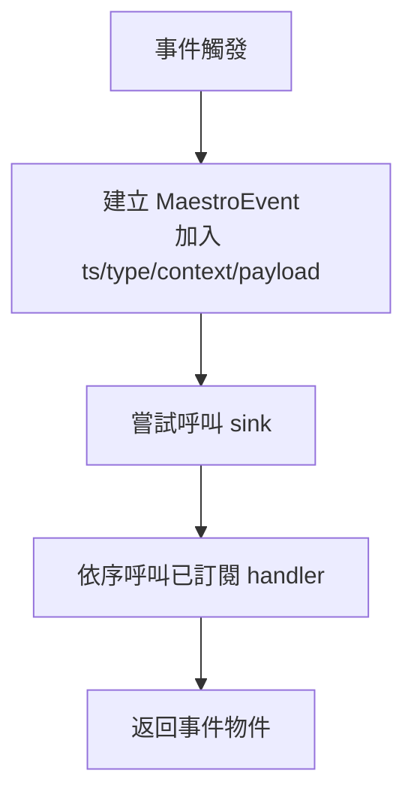

**圖表來源**
- [src/core/events/EventEmitter.ts:1-108](https://github.com/mikeah2011/maestro/blob/master/src/core/events/EventEmitter.ts#L1-L108)

**Section sources**
- [src/core/events/EventEmitter.ts:1-108](https://github.com/mikeah2011/maestro/blob/master/src/core/events/EventEmitter.ts#L1-L108)

### 圍欄式分類器：Classifier
Classifier 採用 Fence + LLM 的設計：

1. 若原始嚴重程度是 critical/blocker/error/fatal，直接分類為 bug。
2. 若正規化後嚴重程度是 critical，分類為 bug。
3. 若檔案路徑屬於敏感路徑前綴，分類為 bug。
4. 若標題或內文包含已知 bug 關鍵字，分類為 bug。
5. 若包含品味關鍵字，分類為 taste。
6. 否則交由可注入的 llmClassify，若無提供者則返回 unknown。

所有決策都會透過 onAudit 輸出審計紀錄，包含 findingHash、category、confidence、viaFence、fenceRule 與 model。

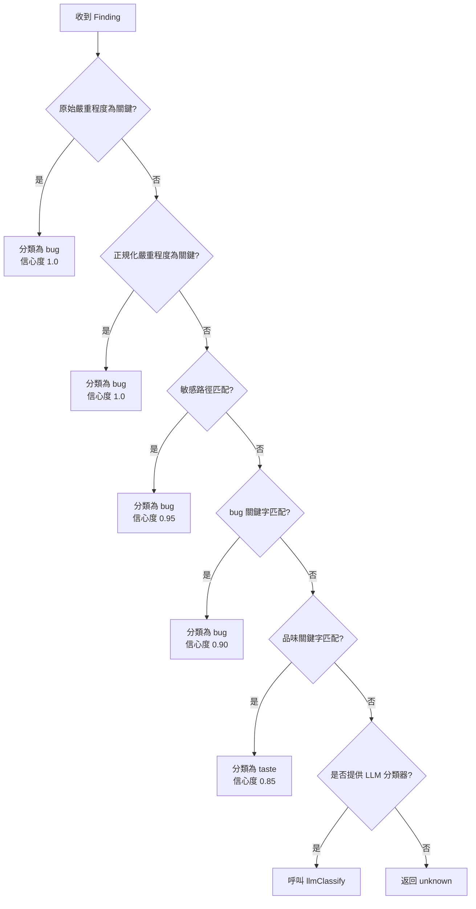

**圖表來源**
- [src/core/classify/Classifier.ts:1-191](https://github.com/mikeah2011/maestro/blob/master/src/core/classify/Classifier.ts#L1-L191)

**Section sources**
- [src/core/classify/Classifier.ts:1-191](https://github.com/mikeah2011/maestro/blob/master/src/core/classify/Classifier.ts#L1-L191)

### 去重管道：Dedup
Dedup 是一個「最廉價優先」的三層去重管道：

| 層級 | 方法 | 目標 | 複雜度與行為 |
|---|---|---|---|
| Tier 1 | 精確雜湊 matching | 消除完全相同的穩定雜湊 | O(n × m)，其中 unique 列表較小時很快。 |
| Tier 2 | Levenshtein 正規化標題相似度 | 消除描述不同但意圖相同的问题 | normalizedSimilarity 使用經典兩行 DP，O(m × n) 時間、O(n) 空間。 |
| Tier 3 | 語義 LLM 去重 | 處理剩餘模糊重複 | 受 maxLlmCalls 限制，預設每輪最多 10 次。 |

Dedup 保證冪等性與輸出為輸入的子集合。

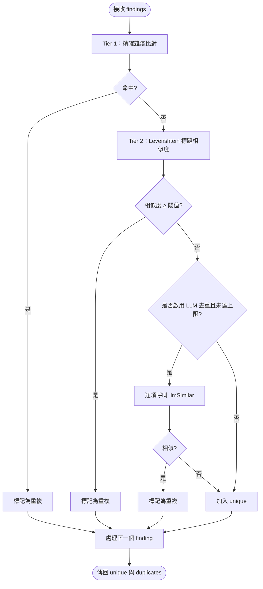

**圖表來源**
- [src/core/dedup/Dedup.ts:1-153](https://github.com/mikeah2011/maestro/blob/master/src/core/dedup/Dedup.ts#L1-L153)

**Section sources**
- [src/core/dedup/Dedup.ts:1-153](https://github.com/mikeah2011/maestro/blob/master/src/core/dedup/Dedup.ts#L1-L153)

### 收斂監控：ConvergenceMonitor
ConvergenceMonitor 維護連續回合的關鍵問題雜湊集合，並檢查三個不變量：

1. **單調不增**：第 N+1 輪的關鍵問題數量不得大於第 N 輪。
2. **Jaccard 振盪**：相鄰兩輪關鍵問題集的 Jaccard 相似度超過 0.7 即判定為振盪。
3. **新類別違規**：第 2 輪之後出現之前未見的問題類別。

此外，它還提供穩定雜湊計算工具：
- `lineBucket`：將行號桶化為大小 5 的區間，避免微小重排影響身份。
- `computeContentHash`：對周圍程式碼區塊做 sha1。
- `computeFindingHash`：組合 file、bucket、normalized category 與內容雜湊，形成穩定 finding identity。

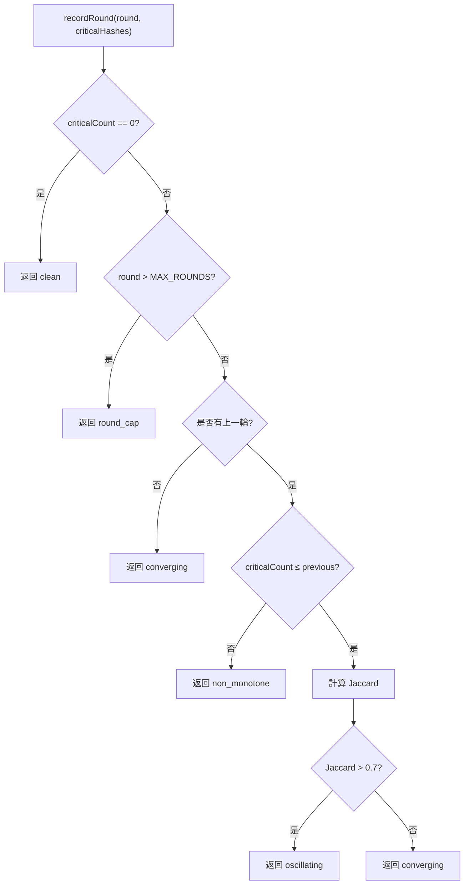

**圖表來源**
- [src/core/convergence/ConvergenceMonitor.ts:1-200](https://github.com/mikeah2011/maestro/blob/master/src/core/convergence/ConvergenceMonitor.ts#L1-L200)

**Section sources**
- [src/core/convergence/ConvergenceMonitor.ts:1-200](https://github.com/mikeah2011/maestro/blob/master/src/core/convergence/ConvergenceMonitor.ts#L1-L200)

### 安全掃描：SecretScanner
SecretScanner 在平台寫入前掃描外發字串，防止機器人引用原始 diff 時帶出金鑰。內建模式包含 AWS key、GitHub token、PEM private key、JWT、Stripe key、Slack token、通用 API key 等。

掃描結果包含：
- clean：是否找到密鑰。
- redacted：遮蔽後的字串。
- findings：每個匹配的 patternName、start、end、redacted。

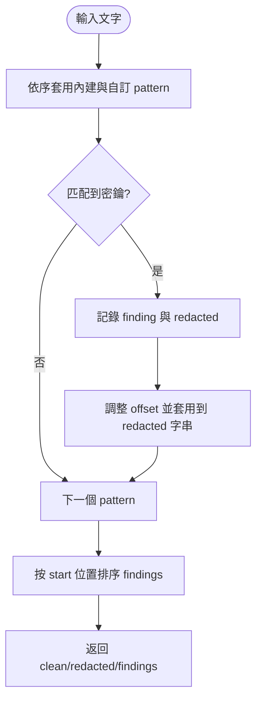

**圖表來源**
- [src/core/security/SecretScanner.ts:1-136](https://github.com/mikeah2011/maestro/blob/master/src/core/security/SecretScanner.ts#L1-L136)

**Section sources**
- [src/core/security/SecretScanner.ts:1-136](https://github.com/mikeah2011/maestro/blob/master/src/core/security/SecretScanner.ts#L1-L136)

### 自動修復引擎：FixEngine
FixEngine 是 LoopOrchestrator 的 onFix 預設實現（M6）。流程如下：

1. 根據 finding.location 讀取檔案。
2. 取出上下WithContextLines 的行，加上行號。
3. 呼叫 AIProvider.complete，要求 JSON 格式的修復回應。
4. 驗證 canFix、confidence、replacements。
5. 由下往上應用 replacement，避免行號偏移。
6. 寫回檔案。

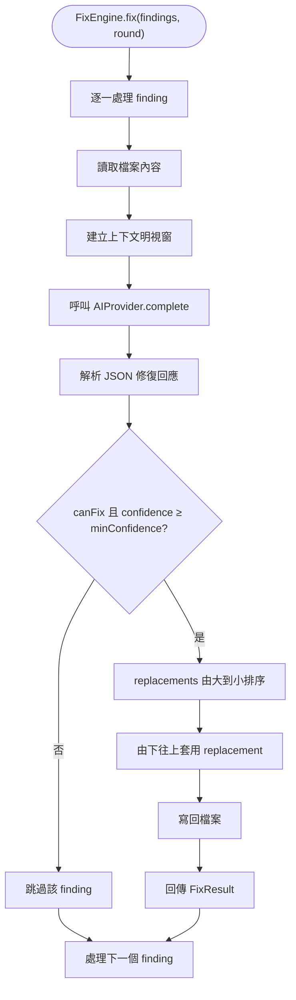

**圖表來源**
- [src/core/fix/FixEngine.ts:1-200](https://github.com/mikeah2011/maestro/blob/master/src/core/fix/FixEngine.ts#L1-L200)

**Section sources**
- [src/core/fix/FixEngine.ts:1-200](https://github.com/mikeah2011/maestro/blob/master/src/core/fix/FixEngine.ts#L1-L200)

### 回合預算：RoundBudget
RoundBudget 是反垃圾郵件的執行期斷言層，而不是可覆寫的軟策略。其不變量包括：

| 不變量 | 限制 |
|---|---|
| commits_per_round | 每輪最多一次提交。 |
| replies_per_thread | 每個討論串每輪最多一次回覆。 |
| pr_body_updates | 每輪最多一次 PR body 更新。 |
| reviewer_requests | 每輪最多一次 reviewer 請求。 |
| classify memoization | 同一 finding hash 的分類結果被快取。 |

違反時拋出 RoundBudgetViolation，而不是警告或繼續。

**Section sources**
- [src/core/round/RoundBudget.ts:1-131](https://github.com/mikeah2011/maestro/blob/master/src/core/round/RoundBudget.ts#L1-L131)

### 收斂循環：LoopOrchestrator
LoopOrchestrator 是整個系統的 orchestrator，它：

1. 建立 StateMachine，初始狀態為 waiting_for_ci。
2. 建立 RoundBudget。
3. 取得 PR 與 HEAD SHA。
4. 等待 CI 通過，否則進入 ci_failing → stopped。
5. 預先掃描現有 PR comment 與 review，識別已達到終端狀態或已 satisfied/approved 的機器人。
6. 進入主迴圈：等待 CI → 等待機器人 → Racing → Classifying → Fixing → CommitPushed → Replying → Resolving → WaitingForCI。
7. 使用 Classifier 分類問題、Dedup 去重、ConvergenceMonitor 判斷收斂。
8. 使用 SecretScanner 過濾外發內容。
9. 使用 FixEngine 或 onFix hook 產生修復。
10. 使用 platform 提交、回覆、解決討論串。
11. 透過 emitter 輸出 JSONL 事件。

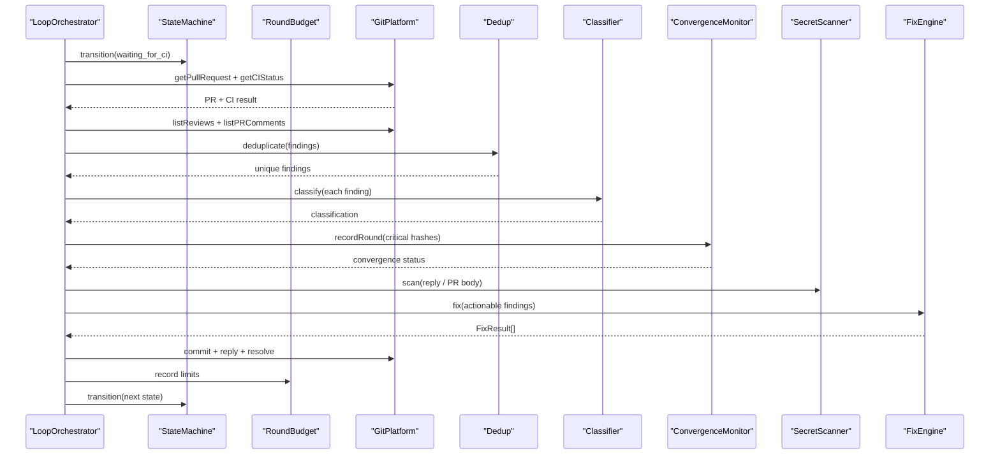

**圖表來源**
- [src/core/loop/LoopOrchestrator.ts:1-200](https://github.com/mikeah2011/maestro/blob/master/src/core/loop/LoopOrchestrator.ts#L1-L200)
- [src/core/state/StateMachine.ts:1-114](https://github.com/mikeah2011/maestro/blob/master/src/core/state/StateMachine.ts#L1-L114)
- [src/core/dedup/Dedup.ts:1-153](https://github.com/mikeah2011/maestro/blob/master/src/core/dedup/Dedup.ts#L1-L153)
- [src/core/classify/Classifier.ts:1-191](https://github.com/mikeah2011/maestro/blob/master/src/core/classify/Classifier.ts#L1-L191)
- [src/core/convergence/ConvergenceMonitor.ts:1-200](https://github.com/mikeah2011/maestro/blob/master/src/core/convergence/ConvergenceMonitor.ts#L1-L200)
- [src/core/security/SecretScanner.ts:1-136](https://github.com/mikeah2011/maestro/blob/master/src/core/security/SecretScanner.ts#L1-L136)
- [src/core/fix/FixEngine.ts:1-200](https://github.com/mikeah2011/maestro/blob/master/src/core/fix/FixEngine.ts#L1-L200)

**Section sources**
- [src/core/loop/LoopOrchestrator.ts:1-200](https://github.com/mikeah2011/maestro/blob/master/src/core/loop/LoopOrchestrator.ts#L1-L200)

## 依賴關係與資料流程
Maestro 的依賴方向是單向的：

- CLI 依賴 config、platforms、core、events。
- core 依賴 types、platforms/interfaces、ai/interfaces。
- platforms/github 依賴 interfaces。
- ai/providers 依賴 interfaces。
- 公共 API src/index.ts 重新匯出 interface、type 與主要類別，但不暴露內部 wiring。

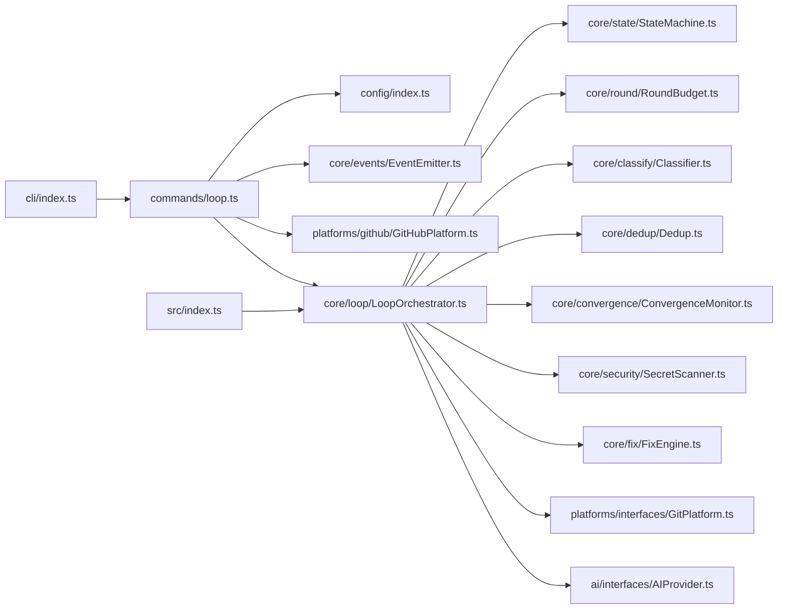

**圖表來源**
- [src/cli/index.ts:1-86](https://github.com/mikeah2011/maestro/blob/master/src/cli/index.ts#L1-L86)
- [src/cli/commands/loop.ts:1-200](https://github.com/mikeah2011/maestro/blob/master/src/cli/commands/loop.ts#L1-L200)
- [src/index.ts:1-150](https://github.com/mikeah2011/maestro/blob/master/src/index.ts#L1-L150)

**Section sources**
- [src/cli/index.ts:1-86](https://github.com/mikeah2011/maestro/blob/master/src/cli/index.ts#L1-L86)
- [src/cli/commands/loop.ts:1-200](https://github.com/mikeah2011/maestro/blob/master/src/cli/commands/loop.ts#L1-L200)
- [src/index.ts:1-150](https://github.com/mikeah2011/maestro/blob/master/src/index.ts#L1-L150)

## 技術決策與權衡

| 決策 | 選擇 | 理由 | 風險與權衡 |
|---|---|---|---|
| 狀態管理 | 顯式 StateMachine | 可驗證轉換、可觀測、易測試。 | 新增狀態需要同時修改 FORWARD、CROSS_CUTTING、TERMINAL。 |
| 防濫用機制 | RoundBudget 執行期斷言 | 工具長期運行時，warn-and-continue 會累積垃圾郵件。 | 過於嚴苛可能使異常路徑難以除錯，需搭配事件與日誌。 |
| 分類策略 | Fence + LLM | 高置信度規則不花 LLM 費用，未知問題才用模型。 | 規則維護成本較高，keyword/sensitive path 可能誤判。 |
| 去重策略 | 三層最廉價優先 | 先砍掉約 60% + 25%，最後才用 LLM。 | Levenshtein 與 LLM 相似度有參數敏感性。 |
| 收斂保證 | Jaccard + 單調不增 + 新類別檢測 | 數學上限制無限循環。 | 閾值 0.7 與 round cap 是產品假設，不是絕對真理。 |
| 平台抽象 | GitPlatform | 支援 GitHub、GitLab、Gitea、Gitee。 | 多平台實作成本高，部分功能需降級。 |
| AI 抽象 | AIProvider | 支援 Claude、OpenAI、Gemini、本地模型。 | Provider 差異較大，prompt 與 JSON schema 需針對調整。 |
| 事件模型 | EventEmitter JSONL | CLI、skill、MCP、Action 共用同一事件源。 | 下游 sink 崩潰不能影響主循環，因此錯誤隔離必要。 |
| 修復引擎 | FixEngine 作為 onFix | 可插拔，dry-run 可跳過。 | 自動修復風險高，仍需人工確認或低溫度、高門檻。 |

**Section sources**
- [docs/DESIGN.md:40-120](https://github.com/mikeah2011/maestro/blob/master/docs/DESIGN.md#L40-L120)
- [README.md:80-200](https://github.com/mikeah2011/maestro/blob/master/README.md#L80-L200)

## 邊界定義

### 模組邊界
- **CLI 只負責輸入輸出與 wiring**：解析 commander 命令、載入 dotenv、讀取 .maestro.yaml、建立 GitHubPlatform、EventEmitter、Classifier、FixEngine，並呼叫 LoopOrchestrator.run。
- **Core 只負責領域邏輯**：狀態、預算、分類、去重、收斂、安全、修復、循環。
- **Platform 抽象只暴露 orchestrator-grade 能力**：不需要暴露 git commit message、branch name 等純 git 細節給核心。
- **AI Provider 只提供 prompt → completion**：不自行決定「這是 review」還是「這是 fix」，路由由 caller 指定 tier/model。

### 資料邊界
- **Finding**：包含 location、title、body、severity、hash 等，是分類與去重的輸入單位。
- **ReviewThread / ThreadComment**：平台無關的討論串模型，GitHubPlatform.mappers 負責映射。
- **PullRequest / PullRequestDiff**：PR 元資料與差異檔。
- **CIStatus / CICheckState**：CI 狀態抽象。
- **MaestroEvent**：所有跨模組通訊的統一事件格式。

### 控制邊界
- LoopOrchestrator 是唯一驅動 StateMachine 的地方。
- RoundBudget 是唯一允許 side effect 的闸门。
- SecretScanner 是唯一在平台寫入前掃描敏感資訊的位置。
- EventEmitter 是唯一外部觀察點。

**Section sources**
- [src/cli/commands/loop.ts:1-200](https://github.com/mikeah2011/maestro/blob/master/src/cli/commands/loop.ts#L1-L200)
- [src/platforms/interfaces/GitPlatform.ts:1-130](https://github.com/mikeah2011/maestro/blob/master/src/platforms/interfaces/GitPlatform.ts#L1-L130)
- [src/ai/interfaces/AIProvider.ts:1-114](https://github.com/mikeah2011/maestro/blob/master/src/ai/interfaces/AIProvider.ts#L1-L114)

## 效能考量
- **Classifier fence**：避免不必要的 LLM 呼叫，適合高頻低風險判斷。
- **Dedup Tier 1 與 Tier 2**：先砍掉大量重複，減少 Tier 3 LLM 呼叫次數。
- **Classifier classify cache via RoundBudget**：同 round 內對同一 finding hash 的分類結果可重複使用。
- **ConvergenceMonitor**：一旦 clean、round_cap、non_monotone 或 oscillating，should short-circuit 後續昂貴動作。
- **FixEngine temperature 0 與 minConfidence**：降低隨機性，過濾低信心修復。
- **GitHubPlatform GraphQL**：用於 thread 操作，比 REST bulk 更有效率。
- **EventEmitter sink isolation**：stdout 或 handler 阻塞/panic 不應拖慢主循環。

[本節為一般性效能指導，未直接分析特定程式片段，故不提供 Section sources。]

## 故障診斷與排錯指南

| 現象 | 可能原因 | 診斷位置 | 建議處理 |
|---|---|---|---|
| 狀態轉換錯誤 | 非法 transition | StateMachine.canTransition / transition | 檢查當前狀態與目標狀態是否符合 FORWARD 或 CROSS_CUTTING。 |
| 每輪多次提交或回覆 | 違反 RoundBudget | RoundBudgetViolation | 修正 orchestrator 或 command 層重複寫入邏輯。 |
| 分類全部 unknown | 未提供 llmClassify | Classifier.classify | 在 CLI wiring 中注入 AIProvider.llmClassify。 |
| 去重效果差 | fuzzyThreshold 太低或 LLM 未啟用 | Dedup.deduplicate | 調整 fuzzyThreshold、啟用 llmSimilar 並檢查 maxLlmCalls。 |
| 循環不停止 | ConvergenceMonitor 未正確記錄或 threshold 不合理 | ConvergenceMonitor.recordRound | 檢查 critical hashes 是否穩定、round 編號是否正確。 |
| 回覆洩漏金鑰 | SecretScanner 未覆蓋某類 pattern | SecretScanner.scan | 增加 custom patterns 並重新掃描。 |
| 自動修復失敗 | AI provider 不可用、JSON 解析失敗、confidence 太低 | FixEngine.fixOne | 檢查 provider、systemPrompt、responseFormat、minConfidence。 |
| PR 無法連線 | token 錯誤、baseUrl 錯誤、owner/repo 未偵測 | GitHubPlatform.initialize / detectRepo | 檢查 GITHUB_TOKEN、config.platform.auth、git remote。 |
| 事件看不到 | EventEmitter 未訂閱 sink | cli/commands/loop.ts | 確保 subscribe(stdoutSink) 或其他 sink。 |

**Section sources**
- [src/core/state/StateMachine.ts:1-114](https://github.com/mikeah2011/maestro/blob/master/src/core/state/StateMachine.ts#L1-L114)
- [src/core/round/RoundBudget.ts:1-131](https://github.com/mikeah2011/maestro/blob/master/src/core/round/RoundBudget.ts#L1-L131)
- [src/core/classify/Classifier.ts:1-191](https://github.com/mikeah2011/maestro/blob/master/src/core/classify/Classifier.ts#L1-L191)
- [src/core/dedup/Dedup.ts:1-153](https://github.com/mikeah2011/maestro/blob/master/src/core/dedup/Dedup.ts#L1-L153)
- [src/core/convergence/ConvergenceMonitor.ts:1-200](https://github.com/mikeah2011/maestro/blob/master/src/core/convergence/ConvergenceMonitor.ts#L1-L200)
- [src/core/security/SecretScanner.ts:1-136](https://github.com/mikeah2011/maestro/blob/master/src/core/security/SecretScanner.ts#L1-L136)
- [src/core/fix/FixEngine.ts:1-200](https://github.com/mikeah2011/maestro/blob/master/src/core/fix/FixEngine.ts#L1-L200)
- [src/platforms/github/GitHubPlatform.ts:1-200](https://github.com/mikeah2011/maestro/blob/master/src/platforms/github/GitHubPlatform.ts#L1-L200)
- [src/cli/commands/loop.ts:1-200](https://github.com/mikeah2011/maestro/blob/master/src/cli/commands/loop.ts#L1-L200)

## 結論
Maestro 的架構以「可組合抽象」與「可驗證循環」為核心：

- **Strategy/Provider**：AIProvider 與 GitPlatform 讓 Claude、OpenAI、GitHub、GitLab 等可替換。
- **StateMachine**：明確狀態與合法轉換，提供錯誤狀態與終端狀態的清晰邊界。
- **Registry/Observer**：EventEmitter 作為 UI 與外部系統的觀察點；Bot registry 概念在 CLI 與設計文件中被定位為混合登錄表。
- **Fence + LLM**：Classifier 先用確定性規則短路，再用 LLM 處理未知問題。
- **Pipeline**：Dedup 以精確雜湸、模糊相似度、語義 LLM 三層管道控制成本與準確率。
- **收斂保障**：LoopOrchestrator 整合 StateMachine、RoundBudget、Classifier、Dedup、ConvergenceMonitor、SecretScanner、FixEngine，在最多三輪內強制收斂或升級人工處理。

對架構師而言，最重要的擴展點是：
- 新增 Git 平台實作。
- 新增 AI Provider 實作。
- 擴充 Classifier fence 規則。
- 調整 Dedup 閾值與 LLM 去重策略。
- 增強 ConvergenceMonitor 的收斂條件。
- 擴展 SecretScanner 的密鑰 pattern。
- 在 CLI wiring 中替換 or 強化 onFix、onDecide、onCommit。

**Section sources**
- [README.md:1-200](https://github.com/mikeah2011/maestro/blob/master/README.md#L1-L200)
- [docs/DESIGN.md:1-200](https://github.com/mikeah2011/maestro/blob/master/docs/DESIGN.md#L1-L200)
- [package.json:1-89](https://github.com/mikeah2011/maestro/blob/master/package.json#L1-L89)