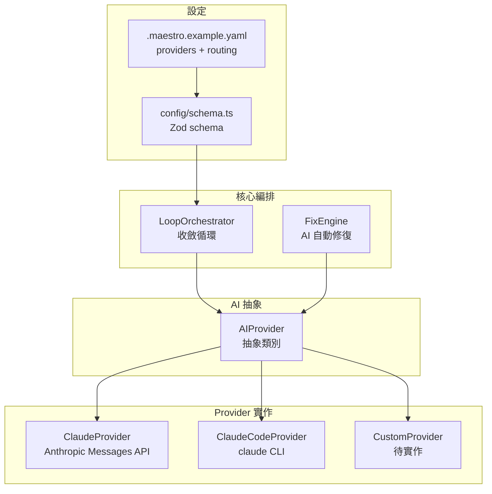
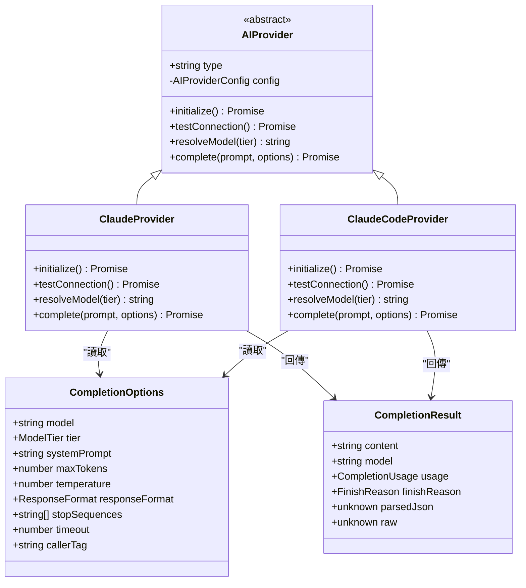
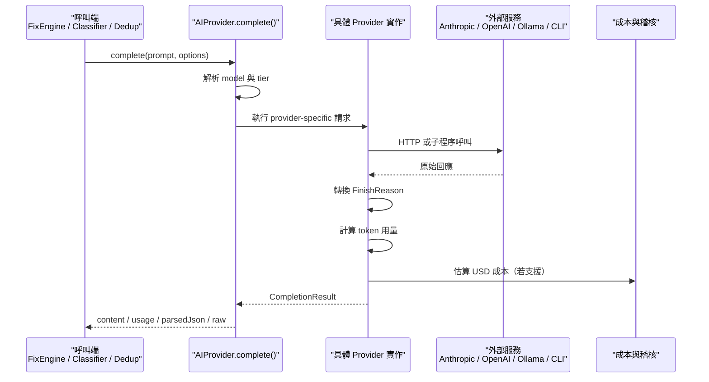
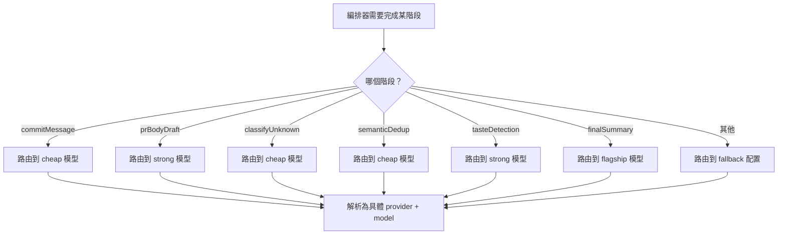
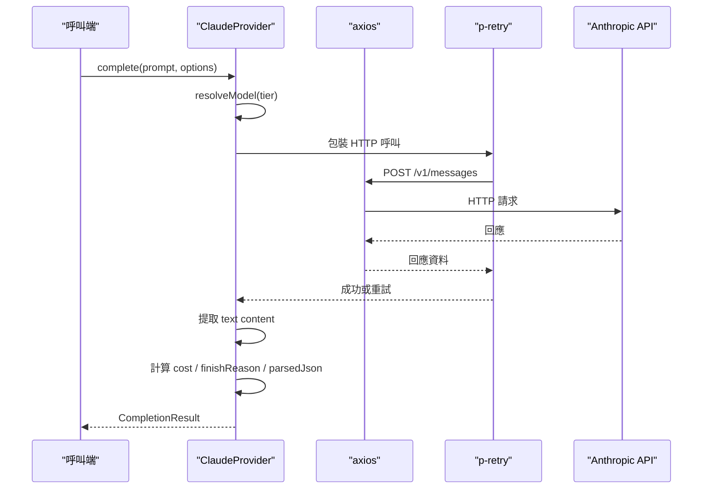
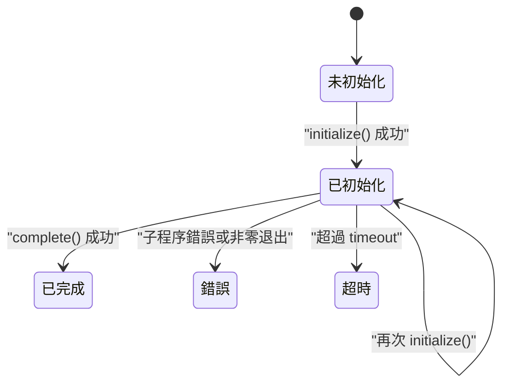
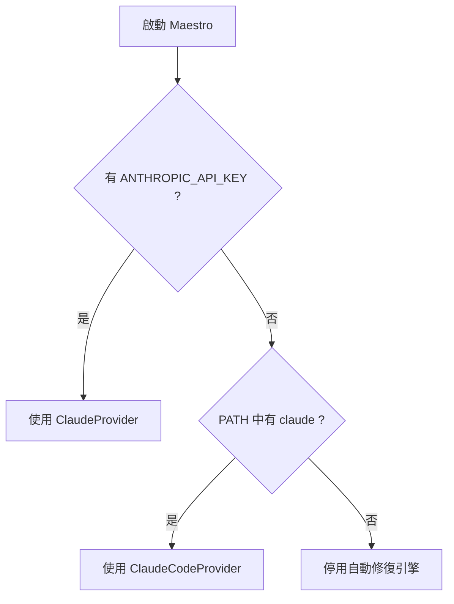

# 自訂 AI Provider

**本文引用的檔案**

- [AIProvider.ts](https://github.com/mikeah2011/maestro/blob/master/src/ai/interfaces/AIProvider.ts)
- [ClaudeProvider.ts](https://github.com/mikeah2011/maestro/blob/master/src/ai/providers/ClaudeProvider.ts)
- [ClaudeCodeProvider.ts](https://github.com/mikeah2011/maestro/blob/master/src/ai/providers/ClaudeCodeProvider.ts)
- [schema.ts](https://github.com/mikeah2011/maestro/blob/master/src/config/schema.ts)
- [.maestro.example.yaml](https://github.com/mikeah2011/maestro/blob/master/.maestro.example.yaml)
- [DESIGN.md](https://github.com/mikeah2011/maestro/blob/master/docs/DESIGN.md)
- [CLAUDE.md](https://github.com/mikeah2011/maestro/blob/master/CLAUDE.md)
- [FixEngine.ts](https://github.com/mikeah2011/maestro/blob/master/src/core/fix/FixEngine.ts)
- [LoopOrchestrator.ts](https://github.com/mikeah2011/maestro/blob/master/src/core/loop/LoopOrchestrator.ts)
- [ClaudeProvider.test.ts](https://github.com/mikeah2011/maestro/blob/master/tests/ai/providers/ClaudeProvider.test.ts)
- [ClaudeCodeProvider.test.ts](https://github.com/mikeah2011/maestro/blob/master/tests/ai/providers/ClaudeCodeProvider.test.ts)

## 目錄

1. [簡介](#簡介)
2. [專案結構與定位](#專案結構與定位)
3. [抽象介面設計](#抽象介面設計)
4. [完成呼叫流程](#完成呼叫流程)
5. [模型層級、路由與成本歸因](#模型層級路由與成本歸因)
6. [現有實作：ClaudeProvider](#現有實作-claudaprovider)
7. [現有實作：ClaudeCodeProvider](#現有實作-claudocodeprovider)
8. [新增自訂 Provider 的完整步驟](#新增自訂-provider-的完整步驟)
9. [Provider 自動偵測順序與設定](#provider-自動偵測順序與設定)
10. [錯誤處理與重試策略](#錯誤處理與重試策略)
11. [效能優化建議](#效能優化建議)
12. [故障排除指南](#故障排除指南)
13. [結論](#結論)

## 簡介

Maestro 的 AI Provider 層是一個「無腦管道」：編排器只負責準備提示，Provider 只負責把提示轉成完成結果。審判、分類、去重複、修復等業務邏輯不在 Provider 內；Provider 的職責是統一 `prompt → completion` 的介面。

這讓系統可以針對不同階段選擇不同模型：高頻低風險操作使用便宜模型，判斷性操作使用強力模型，最終摘要使用旗艦模型。Provider 本身不自行挑選模型，而是由呼叫端透過 `tier` 或明確 `model` 來決定。

## 專案結構與定位



**圖表來源**   
- [LoopOrchestrator.ts:1-200](https://github.com/mikeah2011/maestro/blob/master/src/core/loop/LoopOrchestrator.ts#L1-L200)
- [FixEngine.ts:1-200](https://github.com/mikeah2011/maestro/blob/master/src/core/fix/FixEngine.ts#L1-L200)
- [AIProvider.ts:1-114](https://github.com/mikeah2011/maestro/blob/master/src/ai/interfaces/AIProvider.ts#L1-L114)
- [ClaudeProvider.ts:1-175](https://github.com/mikeah2011/maestro/blob/master/src/ai/providers/ClaudeProvider.ts#L1-L175)
- [ClaudeCodeProvider.ts:1-146](https://github.com/mikeah2011/maestro/blob/master/src/ai/providers/ClaudeCodeProvider.ts#L1-L146)
- [schema.ts:1-200](https://github.com/mikeah2011/maestro/blob/master/src/config/schema.ts#L1-L200)
- [.maestro.example.yaml:1-200](https://github.com/mikeah2011/maestro/blob/master/.maestro.example.yaml#L1-L200)

**章節來源**   
- [DESIGN.md:1-200](https://github.com/mikeah2011/maestro/blob/master/docs/DESIGN.md#L1-L200)
- [CLAUDE.md:1-98](https://github.com/mikeah2011/maestro/blob/master/CLAUDE.md#L1-L98)

## 抽象介面設計

`AIProvider` 是整個 AI 層的契約。所有 Provider 都必須實作以下能力：

| 成員 | 用途 |
|---|---|
| `type` | Provider 識別字串，例如 `claude`、`openai`、`google`、`local`、`custom` |
| `initialize()` | 驗證設定、建立 HTTP 或 SDK 連線；可冪等 |
| `testConnection()` | 輕量連線檢查，供健康檢查或自動偵測使用 |
| `resolveModel(tier)` | 把 `cheap` / `strong` / `flagship` 解析為具體模型 ID |
| `complete(prompt, options)` | 唯一對外入口：提示到完成結果 |

### 重要型別

| 型別 | 說明 |
|---|---|
| `ModelTier` | 三層模型等級：`cheap`、`strong`、`flagship` |
| `AIProviderType` | Provider 類型：`claude`、`openai`、`google`、`local`、`custom` |
| `AIProviderConfig` | Provider 共用設定：API key、base URL、tier→model 映射、預設 tier、timeout、retries |
| `CompletionOptions` | 每次完成的參數：model、tier、systemPrompt、maxTokens、temperature、responseFormat、stopSequences、timeout、callerTag |
| `CompletionUsage` | Token 用量與估算成本 |
| `CompletionResult` | 完成結果：content、model、usage、finishReason、parsedJson、raw |
| `ResponseFormat` | 輸出格式：純文字、JSON object、或 JSON schema |
| `FinishReason` | 停止原因：stop、max_tokens、content_filter、tool_use、error |



**圖表來源**   
- [AIProvider.ts:1-114](https://github.com/mikeah2011/maestro/blob/master/src/ai/interfaces/AIProvider.ts#L1-L114)
- [ClaudeProvider.ts:1-175](https://github.com/mikeah2011/maestro/blob/master/src/ai/providers/ClaudeProvider.ts#L1-L175)
- [ClaudeCodeProvider.ts:1-146](https://github.com/mikeah2011/maestro/blob/master/src/ai/providers/ClaudeCodeProvider.ts#L1-L146)

**章節來源**   
- [AIProvider.ts:1-114](https://github.com/mikeah2011/maestro/blob/master/src/ai/interfaces/AIProvider.ts#L1-L114)

## 完成呼叫流程

最常見的呼叫路徑是 `FixEngine` 透過 `AIProvider.complete()` 產生修復方案。整體流程如下：



**圖表來源**   
- [FixEngine.ts:1-200](https://github.com/mikeah2011/maestro/blob/master/src/core/fix/FixEngine.ts#L1-L200)
- [AIProvider.ts:1-114](https://github.com/mikeah2011/maestro/blob/master/src/ai/interfaces/AIProvider.ts#L1-L114)
- [ClaudeProvider.ts:1-175](https://github.com/mikeah2011/maestro/blob/master/src/ai/providers/ClaudeProvider.ts#L1-L175)
- [ClaudeCodeProvider.ts:1-146](https://github.com/mikeah2011/maestro/blob/master/src/ai/providers/ClaudeCodeProvider.ts#L1-L146)

### `complete()` 方法簽章重點

| 參數 | 行為 |
|---|---|
| `prompt` | 使用者提示內容 |
| `options.model` | 明確指定模型時直接覆蓋 tier 解析 |
| `options.tier` | 未指定 model 時用來解析模型 |
| `options.systemPrompt` | 系統提示；某些 Provider 會原生支援，有些會拼接到使用者提示前 |
| `options.maxTokens` | 輸出 token 上限 |
| `options.temperature` | 默認為 0，確保編排決策穩定 |
| `options.responseFormat` | 要求 Provider 嘗試解析 JSON |
| `options.stopSequences` | 停止序列 |
| `options.timeout` | 單次呼叫超時覆寫 |
| `options.callerTag` | 成本歸因與稽核標籤，例如 `fix_engine` |

**章節來源**   
- [AIProvider.ts:43-114](https://github.com/mikeah2011/maestro/blob/master/src/ai/interfaces/AIProvider.ts#L43-L114)
- [FixEngine.ts:120-200](https://github.com/mikeah2011/maestro/blob/master/src/core/fix/FixEngine.ts#L120-L200)

## 模型層級、路由與成本歸因

### 三層模型

| 層級 | 適合場景 | 預設 Claude 模型 |
|---|---|---|
| `cheap` | 高頻、低風險：提交訊息、未知問題分類、語義去重複 | `claude-haiku-4-5-20251001` |
| `strong` | 判斷性任務：PR 內容草稿、品味偵測、自動修復 | `claude-sonnet-4-6` |
| `flagship` | 最終輸出：PR 內容最終摘要 | `claude-opus-4-7` |

### 路由設定

`.maestro.yaml` 中的 `ai.routing` 為每個階段指定 provider 與 tier：

| 階段 | 用途 | 建議層級 |
|---|---|---|
| `commitMessage` | 每輪產生的提交訊息 | `cheap` |
| `prBodyDraft` | 每支 PR 一次的 PR 內容草稿 | `strong` |
| `classifyUnknown` | 圍欄分類器的 LLM 備援 | `cheap` |
| `semanticDedup` | 第三層語義去重複 | `cheap` |
| `tasteDetection` | 判斷是否已陷入意見爭論 | `strong` |
| `finalSummary` | 循環結束前的最終摘要 | `flagship` |
| `fallback` | 其他未列出的階段 | `cheap` |



**圖表來源**   
- [schema.ts:20-50](https://github.com/mikeah2011/maestro/blob/master/src/config/schema.ts#L20-L50)
- [.maestro.example.yaml:1-120](https://github.com/mikeah2011/maestro/blob/master/.maestro.example.yaml#L1-L120)

### 成本歸因

`CompletionUsage.estimatedCostUsd` 是 Provider 根據 token 用量和模型定價表估算的美元成本。目前 `ClaudeProvider` 內建 Claude 系列模型的輸入與輸出每百萬 token 價格；其他 Provider 可自由實現或留空。

`callerTag` 則可用於稽核日誌中標記是哪個組件觸發了這次呼叫，例如 `fix_engine`。

**章節來源**   
- [AIProvider.ts:31-60](https://github.com/mikeah2011/maestro/blob/master/src/ai/interfaces/AIProvider.ts#L31-L60)
- [ClaudeProvider.ts:19-40](https://github.com/mikeah2011/maestro/blob/master/src/ai/providers/ClaudeProvider.ts#L19-L40)
- [ClaudeProvider.ts:118-175](https://github.com/mikeah2011/maestro/blob/master/src/ai/providers/ClaudeProvider.ts#L118-L175)
- [schema.ts:20-50](https://github.com/mikeah2011/maestro/blob/master/src/config/schema.ts#L20-L50)
- [.maestro.example.yaml:1-120](https://github.com/mikeah2011/maestro/blob/master/.maestro.example.yaml#L1-L120)

## 現有實作：ClaudeProvider

`ClaudeProvider` 是基於 Anthropic Messages API 的實作。它直接使用 `axios`，避免引入完整的 Anthropic SDK，以維持較小的安裝體積。

### 關鍵行為

| 功能 | 行為 |
|---|---|
| 連線初始化 | 驗證 `apiKey`，建立 axios 用戶端，設定 Anthropic headers |
| 連線測試 | 發送極短提示並嘗試取得回應 |
| 模型解析 | 優先使用 `config.models[tier]`，否則使用內建預設值 |
| 完成呼叫 | POST `/v1/messages`，包裝在 `p-retry` 中 |
| 重試條件 | HTTP 429 或狀態碼 ≥ 500 |
| JSON 解析 | 當 `responseFormat` 為 `json_object` 或 `json_schema` 時嘗試解析 |
| 成本計算 | 根據模型 ID 查表計算預估美元成本 |
| 停止原因映射 | 將 Anthropic 的 `stop_reason` 映射到標準 `FinishReason` |

### 呼叫流程



**圖表來源**   
- [ClaudeProvider.ts:60-175](https://github.com/mikeah2011/maestro/blob/master/src/ai/providers/ClaudeProvider.ts#L60-L175)

### 限制與注意事項

- 必須先呼叫 `initialize()`，否則 `complete()` 會拋錯。
- `testConnection()` 內部也會呼叫 `complete()`，因此連線測試仍會消耗一次 API 調用。
- 若 API 回傳非 text 類型的 content block，會被過濾掉；只有 `type === 'text'` 的內容會被拼接。
- JSON 解析失敗時不會拋錯，`parsedJson` 保持 `undefined`。

**章節來源**   
- [ClaudeProvider.ts:1-175](https://github.com/mikeah2011/maestro/blob/master/src/ai/providers/ClaudeProvider.ts#L1-L175)
- [ClaudeProvider.test.ts:1-177](https://github.com/mikeah2011/maestro/blob/master/tests/ai/providers/ClaudeProvider.test.ts#L1-L177)

## 現有實作：ClaudeCodeProvider

`ClaudeCodeProvider` 透過本地安裝的 `claude` CLI 子程序提供 AI 能力。它不需要 `ANTHROPIC_API_KEY`，因為 Claude Code CLI 本身管理登入憑證。

### 適用情境

- 開發者機器上已經安裝並設定好 Claude Code。
- CI 環境不方便儲存 API Key。
- 想使用 Claude Code 的互動式體驗，但需要程式化入口。

### 與 ClaudeProvider 的主要差異

| 項目 | ClaudeProvider | ClaudeCodeProvider |
|---|---|---|
| 通訊方式 | HTTP API | 子程序 `claude --print` |
| 憑證 | `ANTHROPIC_API_KEY` | Claude Code 登入狀態 |
| Token 用量 | 真實用量 | 永遠為 0 |
| 成本估算 | 支援 | 不支援 |
| 模型名稱 | 實際模型 ID | 固定為 `claude-code-cli` |
| System prompt | 原生 `system` 欄位 | 前置拼接到使用者提示 |
| 重試機制 | p-retry | 無 |
| 預設超時 | 60 秒 | 120 秒 |

### 子程序生命週期



**圖表來源**   
- [ClaudeCodeProvider.ts:40-146](https://github.com/mikeah2011/maestro/blob/master/src/ai/providers/ClaudeCodeProvider.ts#L40-L146)

### 限制

- Token usage 始終報告為 0。
- 無法計算成本。
- 沒有自動重試。
- System prompt 不是原生角色，只是文本前置。
- 若 CLI 不存在或登入失效，`initialize()` 或 `testConnection()` 會失敗。

**章節來源**   
- [ClaudeCodeProvider.ts:1-146](https://github.com/mikeah2011/maestro/blob/master/src/ai/providers/ClaudeCodeProvider.ts#L1-L146)
- [ClaudeCodeProvider.test.ts:1-200](https://github.com/mikeah2011/maestro/blob/master/tests/ai/providers/ClaudeCodeProvider.test.ts#L1-L200)

## 新增自訂 Provider 的完整步驟

### 第一步：決定 Provider 類型

常見類型：

| 類型 | 適合情境 |
|---|---|
| `openai` | OpenAI GPT 系列 |
| `google` | Gemini / Google AI |
| `local` | Ollama、LocalAI 等本機推理伺服器 |
| `custom` | 內部 API、代理伺服器、任何自訂 HTTP 端點 |

### 第二步：建立 Provider 類別

新增一個繼承 `AIProvider` 的類別，至少實作四個方法：

1. `initialize()`：驗證 API key、base URL，建立 SDK 或 HTTP 客戶端。
2. `testConnection()`：發送輕量請求確認服務可用。
3. `resolveModel(tier)`：從 `config.models` 或預設表解析具體模型。
4. `complete(prompt, options)`：把選項轉換為目標 API 的請求格式，並回傳 `CompletionResult`。

### 第三步：處理 `CompletionResult`

你的實作必須填滿：

| 欄位 | 必要程度 | 說明 |
|---|---|---|
| `content` | 必填 | 原始文字內容 |
| `model` | 必填 | 實際使用的模型 ID |
| `usage.inputTokens` | 建議填寫 | 輸入 token 數 |
| `usage.outputTokens` | 建議填寫 | 輸出 token 數 |
| `usage.cacheReadTokens` | 選填 | Prompt cache 讀取 token |
| `usage.cacheWriteTokens` | 選填 | Prompt cache 寫入 token |
| `usage.estimatedCostUsd` | 選填 | 估算美元成本 |
| `finishReason` | 必填 | 停止原因 |
| `parsedJson` | 選填 | 當 `responseFormat` 為 JSON 時的解析結果 |
| `raw` | 選填 | 原始回應，用於稽核或重放 |

### 第四步：註冊 Provider

在 `.maestro.yaml` 的 `ai.providers` 下宣告新的 provider：

```yaml
ai:
  providers:
    my_provider:
      type: custom
      apiKey: ${MY_PROVIDER_API_KEY}
      baseUrl: https://api.internal.example.com/v1
      models:
        cheap:    fast-model
        strong:   smart-model
        flagship: best-model
      defaultTier: strong
      timeout: 30000
      retries: 3
```

### 第五步：設定路由

在 `ai.routing` 中指定哪些階段使用這個 provider：

```yaml
ai:
  routing:
    commitMessage:     { provider: my_provider, tier: cheap }
    prBodyDraft:       { provider: my_provider, tier: strong }
    finalSummary:      { provider: my_provider, tier: flagship }
    fallback:          { provider: claude, tier: cheap }
```

### 第六步：測試

最少應測試：

- 缺少 API key 時 `initialize()` 失敗。
- `testConnection()` 能正確反映連線狀態。
- `resolveModel()` 能返回正確的模型。
- `complete()` 能正確組合提示並解析回應。
- JSON 模式能解析預期結構。
- 錯誤與超時行為符合預期。

**章節來源**   
- [AIProvider.ts:1-114](https://github.com/mikeah2011/maestro/blob/master/src/ai/interfaces/AIProvider.ts#L1-L114)
- [schema.ts:15-50](https://github.com/mikeah2011/maestro/blob/master/src/config/schema.ts#L15-L50)
- [.maestro.example.yaml:1-120](https://github.com/mikeah2011/maestro/blob/master/.maestro.example.yaml#L1-L120)

## Provider 自動偵測順序與設定

Maestro 預設的 Provider 自動偵測順序如下：

1. **Claude API Provider**：存在 `ANTHROPIC_API_KEY`。
2. **Claude Code CLI Provider**：`claude` 二進位可在 PATH 中找到。
3. **停用修復引擎**：兩者皆不存在時，自動修復能力被停用。

這是 CLAUDE.md 中明確記錄的行為。注意：這個自動偵測順序主要影響「是否啟用 Claude 相關 Provider」；若你在設定檔中手動定義多個 provider 並透過路由選擇，仍可同時使用 OpenAI、Gemini、Ollama 或自訂 Provider。



**圖表來源**   
- [CLAUDE.md:1-98](https://github.com/mikeah2011/maestro/blob/master/CLAUDE.md#L1-L98)

### 設定方式比較

| 設定位置 | 用途 |
|---|---|
| `~/.maestro/config.yaml` | 使用者層級全域設定 |
| `.maestro.yaml` | 倉庫層級設定，會深層合併覆蓋使用者設定 |
| 環境變數 | `${ENV_VAR}` 在合併後展開 |
| `.env` | CLI 啟動時自動載入 |
| CLI 旗標 | 最高優先級 |

**章節來源**   
- [CLAUDE.md:1-98](https://github.com/mikeah2011/maestro/blob/master/CLAUDE.md#L1-L98)
- [DESIGN.md:1-200](https://github.com/mikeah2011/maestro/blob/master/docs/DESIGN.md#L1-L200)

## 錯誤處理與重試策略

### ClaudeProvider 的重試策略

ClaudeProvider 使用 `p-retry` 包裝 HTTP 呼叫，預設最多重試 3 次，最小間隔 1 秒，最大間隔 30 秒。重試條件是：

- HTTP 狀態碼為 429（速率限制）。
- HTTP 狀態碼大於等於 500（伺服器錯誤）。

你可以透過 `config.retries` 調整重試次數，透過 `config.timeout` 調整基礎超時。

### ClaudeCodeProvider 的錯誤處理

ClaudeCodeProvider 沒有自動重試。錯誤來自子程序：

- 找不到二進位：spawn 抛错。
- CLI 非零退出：reject 包含 exit code 與 stderr。
- 超時：殺死子程序並 reject。
- 未先初始化：直接拋錯。

### 通用錯誤處理建議

| 情境 | 建議 |
|---|---|
| API key 缺失 | `initialize()` 立即拋出明確錯誤 |
| 網路超時 | Provider 應暴露 timeout 設定 |
| 速率限制 | 使用指數退避重試 |
| 伺服器錯誤 | 重試有限次數，不要無限重試 |
| JSON 解析失敗 | 保留原始內容，`parsedJson` 設為 undefined |
| 子程序死亡 | 回報 exit code 與 stderr |
| 模型不存在 | `resolveModel()` 應回傳明確錯誤或 fallback |

### 重試策略配置

Zod schema 支援進階重試設定：

| 選項 | 預設值 | 說明 |
|---|---:|---|
| `retryStrategy.maxRetries` | 3 | 最大重試次數 |
| `retryStrategy.backoffMultiplier` | 2 | 退避倍數 |
| `rateLimit.honorRemainingHeader` | true | 尊重速率限制剩餘標頭 |
| `rateLimit.minInterRequestMs` | 100 | 最小請求間隔 |

**章節來源**   
- [ClaudeProvider.ts:95-175](https://github.com/mikeah2011/maestro/blob/master/src/ai/providers/ClaudeProvider.ts#L95-L175)
- [ClaudeCodeProvider.ts:60-146](https://github.com/mikeah2011/maestro/blob/master/src/ai/providers/ClaudeCodeProvider.ts#L60-L146)
- [schema.ts:180-200](https://github.com/mikeah2011/maestro/blob/master/src/config/schema.ts#L180-L200)

## 效能優化建議

### 1. 合理使用模型層級

高頻、低風險任務一律使用 `cheap` 層級。只有真正需要判斷力的任務才升級到 `strong` 或 `flagship`。

### 2. 設定合理的 `maxTokens`

過大的 `maxTokens` 會增加延遲與成本。例如 FixEngine 預設使用 2048，ClaudeProvider 預設使用 4096。

### 3. 使用 `temperature: 0`

編排器需要確定性行為，因此大多數自動化任務應關閉隨機性。

### 4. 利用 Prompt Cache

如果 Provider 支援，請填寫 `cacheReadTokens` 與 `cacheWriteTokens`，便於分析提示快取效益。

### 5. 減少不必要呼叫

- 分類器已有圍欄規則，可短路部分 LLM 呼叫。
- 去重複有三層：雜湊 → Levenshtein → LLM，越廉價越先執行。
- 使用 `RoundBudget` 強制每輪呼叫上限。

### 6. 選擇合適的 Provider

- 開發階段可用 Claude Code CLI，免設定 API key。
- 生產環境建議使用雲端 API Provider，具備用量、成本、重試與監控。
- 對隱私敏感的情境可使用本地 Ollama。

### 7. 觀察成本與用量

鼓勵 Provider 回報 `estimatedCostUsd`，讓系統能追蹤每次 loop 的花費。

**章節來源**   
- [FixEngine.ts:1-200](https://github.com/mikeah2011/maestro/blob/master/src/core/fix/FixEngine.ts#L1-L200)
- [ClaudeProvider.ts:1-175](https://github.com/mikeah2011/maestro/blob/master/src/ai/providers/ClaudeProvider.ts#L1-L175)
- [DESIGN.md:1-200](https://github.com/mikeah2011/maestro/blob/master/docs/DESIGN.md#L1-L200)

## 故障排除指南

| 症狀 | 可能原因 | 處理方式 |
|---|---|---|
| `initialize()` 報錯缺少 API key | 未設定 `apiKey` 或環境變數未展開 | 檢查 `.env`、`.maestro.yaml`、`~/.maestro/config.yaml` |
| `complete()` 報錯尚未初始化 | 忘記先呼叫 `initialize()` | 確保建構後先執行 `initialize()` |
| Claude API 429 | 觸及速率限制 | 降低呼叫頻率、增加 `retries`、使用指數退避 |
| Claude API 5xx | 供應商服務異常 | 等待後重試，或切換 provider |
| ClaudeCodeProvider 找不到二進位 | PATH 中沒有 `claude` | 安裝 Claude Code 或使用 `claudeBin` 指定路徑 |
| ClaudeCodeProvider 超時 | CLI 處理過慢或卡住 | 增加 `timeout`，檢查 CLI 是否正常運作 |
| JSON 解析失敗 | 模型回傳非合法 JSON | 檢查提示詞，或容許 `parsedJson` 為 undefined |
| 成本為 undefined | Provider 未實作成本表 | 自訂 Provider 加入定價表 |
| Token 用量為 0 | 使用 ClaudeCodeProvider | 屬預期行為；改用 ClaudeProvider 取得真實用量 |
| 自動修復未啟用 | 沒有 Claude API key 也沒有 Claude CLI | 設定其中之一，或手動啟用其他 provider |

**章節來源**   
- [ClaudeProvider.test.ts:1-177](https://github.com/mikeah2011/maestro/blob/master/tests/ai/providers/ClaudeProvider.test.ts#L1-L177)
- [ClaudeCodeProvider.test.ts:1-200](https://github.com/mikeah2011/maestro/blob/master/tests/ai/providers/ClaudeCodeProvider.test.ts#L1-L200)
- [CLAUDE.md:1-98](https://github.com/mikeah2011/maestro/blob/master/CLAUDE.md#L1-L98)

## 結論

自訂 AI Provider 的核心在於統一 `prompt → completion` 的抽象介面。Maestro 的設計把 Provider 視為管道：路由與層級由設定控制，成本歸因由 Provider 回報，業務邏輯由編排器與核心模組負責。

要新增一個 Provider，你只需要實作四個方法、處理三種輸入格式、回傳一致的完成結果，並在設定檔中註冊與路由。現有的 `ClaudeProvider` 與 `ClaudeCodeProvider` 提供了雲端 API 與本地 CLI 兩個範例，足以作為 OpenAI、Gemini、Ollama 或任意 HTTP Provider 的藍圖。

最重要的是：不要讓 Provider 自己決定要用哪個模型；讓路由表決定，讓成本可見，讓錯誤明確，讓自動化穩定。