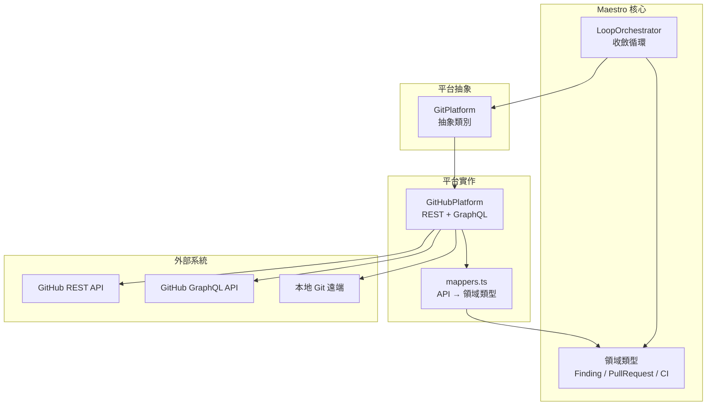
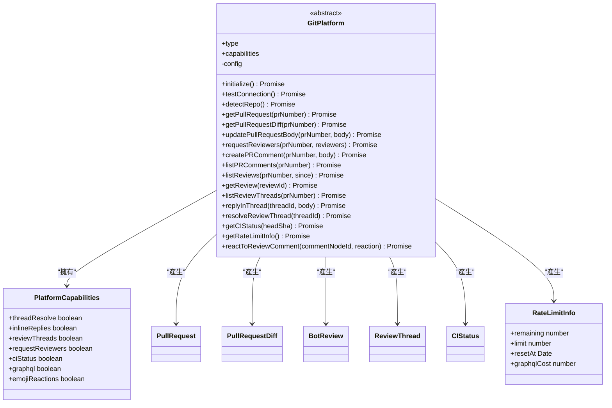
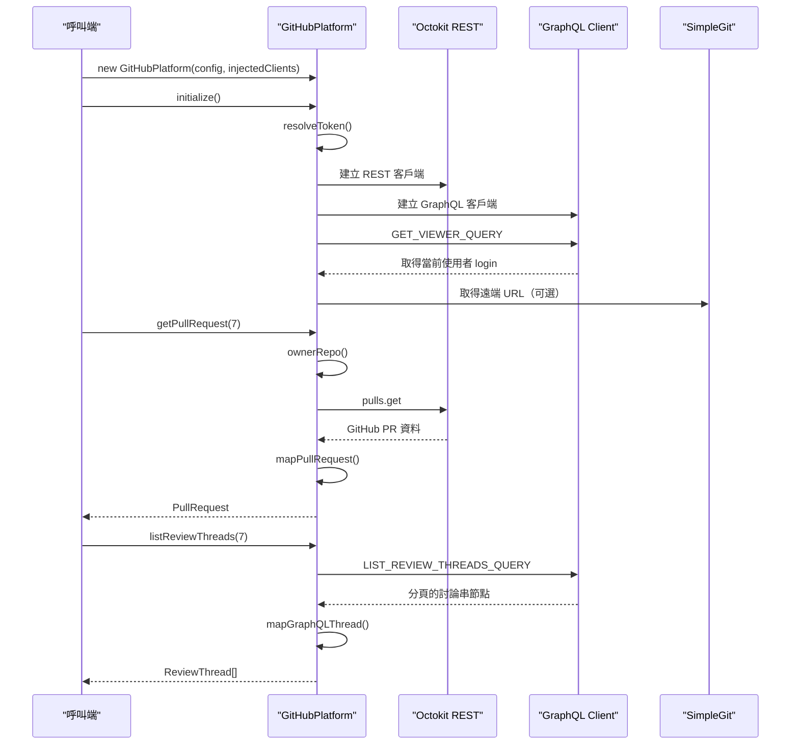
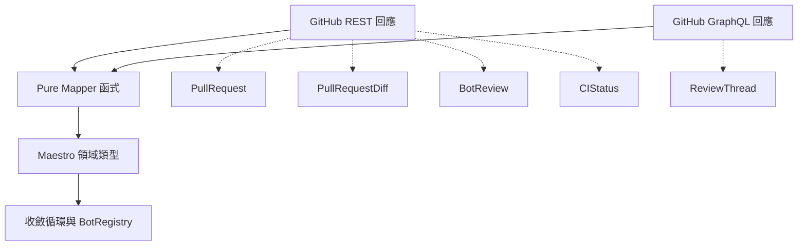
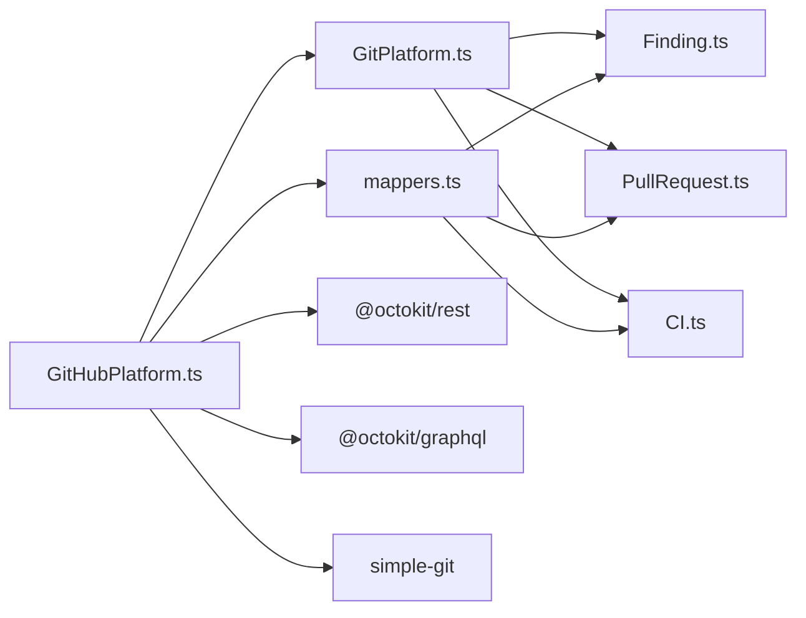

# 自訂 Git Platform

**本文引用的檔案**

- [GitPlatform.ts](https://github.com/mikeah2011/maestro/blob/master/src/platforms/interfaces/GitPlatform.ts)
- [GitHubPlatform.ts](https://github.com/mikeah2011/maestro/blob/master/src/platforms/github/GitHubPlatform.ts)
- [mappers.ts](https://github.com/mikeah2011/maestro/blob/master/src/platforms/github/mappers.ts)
- [Finding.ts](https://github.com/mikeah2011/maestro/blob/master/src/core/types/Finding.ts)
- [PullRequest.ts](https://github.com/mikeah2011/maestro/blob/master/src/core/types/PullRequest.ts)
- [CI.ts](https://github.com/mikeah2011/maestro/blob/master/src/core/types/CI.ts)
- [README.md](https://github.com/mikeah2011/maestro/blob/master/README.md)
- [GitHubPlatform.test.ts](https://github.com/mikeah2011/maestro/blob/master/tests/platforms/github/GitHubPlatform.test.ts)

## 目錄

1. [引言](#引言)
2. [專案結構與平台層定位](#專案結構與平台層定位)
3. [核心抽象：GitPlatform 介面](#核心抽象gitplatform-介面)
4. [能力旗標與降級策略](#能力旗標與降級策略)
5. [GitHubPlatform 完整實作範例](#githubplatform-完整實作範例)
6. [資料模型映射邏輯](#資料模型映射邏輯)
7. [平台註冊與選擇機制](#平台註冊與選擇機制)
8. [如何實作 GitLab、Gitea、Gitee 等平台](#如何實作-gitlab-gitea-gitee-等平臺)
9. [依賴關係分析](#依賴關係分析)
10. [效能考量](#效能考量)
11. [除錯與常見問題](#除錯與常見問題)
12. [結論](#結論)

## 引言

Maestro 是一個「統一調度 AI PR 審查機器人」的收斂工具。它本身不是另一個程式碼審查器，而是協調 CodeRabbit、Ellipsis、Copilot Code Review、Codex、Gemini Code Assist、Sourcery 等多個審查機器人，並負責分類問題、去重、自動修復、在討論串中回覆、解決討論串、請求重新審查，以及判斷何時停止循環。

在這個架構中，`platforms/` 層是 Maestro 與不同 Git 平台之間的橋樑。目前官方提供 `github` 實作，但抽象介面的註解明確指出，設計目標是支援 `github`、`gitlab`、`gitea`、`gitee` 四種平台。自訂平台的關鍵在於：

- 實作 `GitPlatform` 抽象類別。
- 正確宣告 `capabilities`，讓上層 orchestrator 知道哪些功能可用。
- 將各平台的 REST / GraphQL API 回應映射到 Maestro 的內部領域類型。
- 當某些功能不可用時，透過降級策略（例如寫入哨兵標記）維持行為一致性。

這份文件聚焦於如何理解現有 GitHub 實作，以及如何依此模式實作其他 Git 平台。

**Section sources**
- [README.md:1-60](https://github.com/mikeah2011/maestro/blob/master/README.md#L1-L60)
- [README.md:150-231](https://github.com/mikeah2011/maestro/blob/master/README.md#L150-L231)
- [GitPlatform.ts:1-30](https://github.com/mikeah2011/maestro/blob/master/src/platforms/interfaces/GitPlatform.ts#L1-L30)

## 專案結構與平台層定位



**圖表來源**
- [GitPlatform.ts:31-130](https://github.com/mikeah2011/maestro/blob/master/src/platforms/interfaces/GitPlatform.ts#L31-L130)
- [GitHubPlatform.ts:1-40](https://github.com/mikeah2011/maestro/blob/master/src/platforms/github/GitHubPlatform.ts#L1-L40)
- [mappers.ts:1-30](https://github.com/mikeah2011/maestro/blob/master/src/platforms/github/mappers.ts#L1-L30)

平台層的設計原則是「高內聚、低耦合」：

- **orchestrator** 只依賴 `GitPlatform` 抽象方法，不需要知道 GitHub、GitLab、Gitea 或 Gitee 的 API 差異。
- **平台實作** 封裝具體的 HTTP 呼叫、權杖解析、owner/repo 偵測、API 錯誤處理。
- **mapper** 純函式轉換平台原始資料到 Maestro 的領域類型，不含 I/O。
- **領域類型** 定義在 `core/types/`，是所有平台共享的共同語言。

這種設計讓新增平台時，只需要修改 `platforms/` 下的新實作，而不必改動核心的收斂循環邏輯。

**Section sources**
- [README.md:80-150](https://github.com/mikeah2011/maestro/blob/master/README.md#L80-L150)
- [GitPlatform.ts:1-30](https://github.com/mikeah2011/maestro/blob/master/src/platforms/interfaces/GitPlatform.ts#L1-L30)

## 核心抽象：GitPlatform 介面

`GitPlatform` 是一個 orchestrator-grade 的抽象類別，意即它的每個方法都是 loop 或 BotRegistry 可能需要的操作。它把 Git 平台的差異隱藏在一個穩定的合約後面。

### 主要區塊

| 區塊 | 主要方法 | 用途 |
|---|---|---|
| 生命週期 | `initialize()`、`testConnection()` | 建立平台客戶端、驗證權杖 |
| 倉庫偵測 | `detectRepo()` | 從 `git remote get-url origin` 取得 owner 與 repo |
| PR 輸入輸出 | `getPullRequest()`、`updatePullRequestBody()`、`createPRComment()` | 讀寫 PR 基本資訊與評論 |
| 審查與討論串 | `listReviews()`、`listReviewThreads()`、`replyInThread()`、`resolveReviewThread()` | 核心審查流程 |
| CI | `getCIStatus()` | 取得檢查結果聚合狀態 |
| 速率限制 | `getRateLimitInfo()` | 供 backoff 策略使用 |
| 反應 | `reactToReviewComment()` | 預設為空操作，可被平台覆寫 |

### 重要型別



**圖表來源**
- [GitPlatform.ts:31-130](https://github.com/mikeah2011/maestro/blob/master/src/platforms/interfaces/GitPlatform.ts#L31-L130)
- [Finding.ts:1-129](https://github.com/mikeah2011/maestro/blob/master/src/core/types/Finding.ts#L1-L129)
- [PullRequest.ts:1-56](https://github.com/mikeah2011/maestro/blob/master/src/core/types/PullRequest.ts#L1-L56)
- [CI.ts:1-34](https://github.com/mikeah2011/maestro/blob/master/src/core/types/CI.ts#L1-L34)

`GitPlatform` 的關鍵字段包括：

- `type`：平台識別字串，例如 `'github'`。
- `capabilities`：宣告這個平台支援哪些進階功能。
- `config`：包含 token、baseUrl、owner、repo 等設定。
- 所有 IO 方法都回傳 Promise，便於測試與錯誤處理。

值得注意的是，`reactToReviewComment` 有一個預設無操作實作；這表示不支援 emoji 反應的平台不需要覆寫該方法，而支援的平台可以覆寫以啟用該功能。

**Section sources**
- [GitPlatform.ts:31-130](https://github.com/mikeah2011/maestro/blob/master/src/platforms/interfaces/GitPlatform.ts#L31-L130)

## 能力旗標與降級策略

`PlatformCapabilities` 是 orchestrator 選擇策略的關鍵依據。它不只是技術細節，更是「功能契約」。

### 能力旗標說明

| 旗標 | 含義 | 為 false 時的影響 |
|---|---|---|
| `threadResolve` | 是否可透過 API 將討論串標記為已解決 | 無法關閉討論串時，實作可寫入哨兵標記代替 |
| `inlineReplies` | 是否可在討論串內回覆，而非僅頂層 PR 評論 | 只能貼頂層評論，上下文較弱 |
| `reviewThreads` | 平台是否把 review threads 當作一等公民 | 無法精確對應 bot 意見與討論串 |
| `requestReviewers` | 是否能透過 API 指定 reviewer | 需要手動或其他方式指派 |
| `ciStatus` | 是否能查詢 CI checks | 無法自動等待或判斷 CI 狀態 |
| `graphql` | 是否可用 GraphQL 進行批量操作 | 必須退回 REST 或降低效能 |
| `emojiReactions` | 是否支援對評論加上 emoji 反應 | 忽略反應操作或不實作 |

### 降級策略

GitPlatform 的註解明確提到：

> capability flags 讓降級平台（例如不支援 thread resolve 的舊版 Gitea）宣告哪些功能不可用；orchestrator 會在 `threadResolve` 為 false 時，改用「正文中的哨兵標記」作為替代方案。

這意味著：

1. **平台實作** 應該根據實際 API 能力設定正確的 `capabilities`。
2. **orchestrator** 應根據這些旗標決定使用哪種策略。
3. **若 platform 仍希望盡量完成動作**，可以在能力不足時寫入特殊標記（例如 `[RESOLVED]`），讓上層系統仍可視為「已處理」。
4. **若功能完全不可用**，則不應偽造成功；應拋出有意義的錯誤，讓 orchestrator 記錄或升級處理。

### GitHub 的能力宣告

GitHubPlatform 宣告了最完整的支援：

- 支援討論串解決。
- 支援討論串內回覆。
- 支援一等公民 review threads。
- 支援指派 reviewer。
- 支援 CI checks。
- 支援 GraphQL。
- 支援 emoji 反應。

這代表 GitHubPlatform 是參考實作中最接近理想狀態的版本。

**Section sources**
- [GitPlatform.ts:1-30](https://github.com/mikeah2011/maestro/blob/master/src/platforms/interfaces/GitPlatform.ts#L1-L30)
- [GitPlatform.ts:39-58](https://github.com/mikeah2011/maestro/blob/master/src/platforms/interfaces/GitPlatform.ts#L39-L58)
- [GitHubPlatform.ts:120-140](https://github.com/mikeah2011/maestro/blob/master/src/platforms/github/GitHubPlatform.ts#L120-L140)
- [GitHubPlatform.test.ts:130-160](https://github.com/mikeah2011/maestro/blob/master/tests/platforms/github/GitHubPlatform.test.ts#L130-L160)

## GitHubPlatform 完整實作範例

GitHubPlatform 是目前唯一提供的平台實作，也是自訂平台最重要的參考藍本。

### 整體流程



**圖表來源**
- [GitHubPlatform.ts:120-200](https://github.com/mikeah2011/maestro/blob/master/src/platforms/github/GitHubPlatform.ts#L120-L200)
- [GitHubPlatform.ts:201-260](https://github.com/mikeah2011/maestro/blob/master/src/platforms/github/GitHubPlatform.ts#L201-L260)
- [GitHubPlatform.ts:300-370](https://github.com/mikeah2011/maestro/blob/master/src/platforms/github/GitHubPlatform.ts#L300-L370)
- [GitHubPlatform.ts:370-450](https://github.com/mikeah2011/maestro/blob/master/src/platforms/github/GitHubPlatform.ts#L370-L450)

### 建構子與注入式客戶端

GitHubPlatform 支援透過構造參數注入測試用的客戶端：

- `octokit`：REST API 客戶端。
- `graphql`：GraphQL 查詢函式。
- `git`：simple-git 實例。

這種設計讓單元測試可以不經過網路，直接模擬 API 回應。

### 權杖解析

權杖解析優先順序如下：

1. `config.token`
2. `config.tokenEnv` 指定的環境變數
3. 預設環境變數名稱（例如 `GITHUB_TOKEN`）
4. 找不到時拋出錯誤

如果同時提供 `token` 與 `tokenEnv`，實作會先使用 `config.token`；這是為了方便測試與 CI 覆蓋。

### owner/repo 偵測

若配置中未提供 owner 與 repo，GitHubPlatform 會：

1. 嘗試從 `_owner`、`_repo` 欄位取得值。
2. 否則執行 `git remote get-url origin`。
3. 分別匹配 SSH 與 HTTPS GitHub URL。
4. 解析失敗時拋出錯誤，提示遠端 URL 格式無法辨識。

### REST API 用法

REST API 用於：

- 讀取 PR 基本資訊。
- 取得 PR diff 檔列表。
- 更新 PR body。
- 指派 reviewer。
- 建立與列出 PR 評論。
- 取得 CI check runs。
- 取得速率限制。

這些方法大多遵循相同模式：

1. 取得 owner 與 repo。
2. 呼叫 Octokit REST。
3. 將回應交給 mapper。
4. 回傳領域類型。

### GraphQL API 用法

GraphQL 用於需要「一等公民 discussion thread」的功能：

- 列出 review threads。
- 在討論串中回覆。
- 解決討論串。
- 取得單一 review node。
- 取得當前 viewer。
- 對評論加上 emoji 反應。

GraphQL 查詢以常數字串定義，並在 `initialize()` 期間建立帶授權標頭與可選 baseUrl 的 client。

### 錯誤處理重點

- 未呼叫 `initialize()` 就使用 platform 時，會拋出明確錯誤。
- `replyInThread` 與 `resolveReviewThread` 若 GraphQL 回傳 null，會拋出權限相關錯誤。
- `testConnection` 不會向上拋出異常，而是回傳 boolean。
- `detectRepo` 在無法解析遠端 URL 時拋出錯誤。

**Section sources**
- [GitHubPlatform.ts:1-120](https://github.com/mikeah2011/maestro/blob/master/src/platforms/github/GitHubPlatform.ts#L1-L120)
- [GitHubPlatform.ts:120-200](https://github.com/mikeah2011/maestro/blob/master/src/platforms/github/GitHubPlatform.ts#L120-L200)
- [GitHubPlatform.ts:201-450](https://github.com/mikeah2011/maestro/blob/master/src/platforms/github/GitHubPlatform.ts#L201-L450)
- [GitHubPlatform.test.ts:1-120](https://github.com/mikeah2011/maestro/blob/master/tests/platforms/github/GitHubPlatform.test.ts#L1-L120)

## 資料模型映射邏輯

mappers.ts 的核心責任是把 GitHub REST 與 GraphQL API 的原始形狀轉換成 Maestro 的領域類型。這是一個非常重要的設計決策：所有 API 差異都被隔離在 mapper 中，上層邏輯只依賴穩定領域類型。

### 映射方向



**圖表來源**
- [mappers.ts:1-30](https://github.com/mikeah2011/maestro/blob/master/src/platforms/github/mappers.ts#L1-L30)
- [mappers.ts:31-120](https://github.com/mikeah2011/maestro/blob/master/src/platforms/github/mappers.ts#L31-L120)
- [mappers.ts:121-200](https://github.com/mikeah2011/maestro/blob/master/src/platforms/github/mappers.ts#L121-L200)
- [mappers.ts:201-260](https://github.com/mikeah2011/maestro/blob/master/src/platforms/github/mappers.ts#L201-L260)

### 主要映射函式

| 函式 | 輸入 | 輸出 | 重點邏輯 |
|---|---|---|---|
| `mapPullRequest` | GitHub PR REST 資料 | `PullRequest` | 處理 draft、open、closed state，轉換日期與 reviewer |
| `mapDiffFiles` | GitHub file list | `PullRequestDiff` | 累計 additions/deletions，計算 filesChanged |
| `mapReview` | GitHub review REST 資料 | `BotReview` | 處理 Bot 身分、review state、body |
| `mapGraphQLThread` | GraphQL review thread | `ReviewThread` | 轉換 comments、isOurs、location |
| `mapCheckRuns` | GitHub check runs | `CIStatus` | 聚合 pending/failure/success |
| `mapRateLimit` | GitHub rate limit | `RateLimitInfo` | 轉換 core 與 graphql 剩餘次數 |

### Review State 的特殊處理

`mapReviewState` 不只是簡單轉換字串，還包含業務邏輯：

- `approved` → `approved`
- `changes_requested` → `changes_requested`
- `dismissed` → `dismissed`
- 內容包含「generated no new comments」→ `satisfied`
- 內容包含 Codex usage limits → `satisfied`
- 其他 → `commented`

這類邏輯體現了「平台差異由 mapper 吸收」的設計原則：orchestrator 不需要知道 Copilot 或 Codex 的特定訊息格式。

### Location 映射

ReviewThread 的 location 可包含：

- `file`
- `startLine`
- `endLine`

這些欄位來自 GitHub 的 inline review comment，讓 orchestrator 能精準對應 finding 到程式碼位置。

**Section sources**
- [mappers.ts:1-120](https://github.com/mikeah2011/maestro/blob/master/src/platforms/github/mappers.ts#L1-L120)
- [mappers.ts:121-200](https://github.com/mikeah2011/maestro/blob/master/src/platforms/github/mappers.ts#L121-L200)
- [mappers.ts:201-260](https://github.com/mikeah2011/maestro/blob/master/src/platforms/github/mappers.ts#L201-L260)
- [Finding.ts:70-129](https://github.com/mikeah2011/maestro/blob/master/src/core/types/Finding.ts#L70-L129)
- [PullRequest.ts:1-56](https://github.com/mikeah2011/maestro/blob/master/src/core/types/PullRequest.ts#L1-L56)
- [CI.ts:1-34](https://github.com/mikeah2011/maestro/blob/master/src/core/types/CI.ts#L1-L34)

## 平台註冊與選擇機制

從目前提供的程式碼來看，Maestro 的 platform 註冊與選擇並未集中於某個單一的 registry 類別。相反地，它更多是透過設定與型別約束來驅動。

### 設定層的角色

README 顯示 `.maestro.yaml` 中有以下設定區塊：

```yaml
platform:
  type: github
  auth:
    tokenEnv: GITHUB_TOKEN
  owner: your-org
  repo: your-repo
```

其中 `platform.type` 的值必須符合 `PlatformType`：

```ts
export type PlatformType = 'github' | 'gitlab' | 'gitea' | 'gitee';
```

這表示：

- 新增平台時，應將新平台字串加入 `PlatformType`。
- 設定載入與 schema 驗證應允許該字串。
- 平台工廠或選擇器會根據 `type` 建立對應實例。

### 建議的註冊模式

雖然目前倉庫沒有看到集中式的 platform registry，但基於現有設計，合理的做法是：

1. 在 `platforms/` 下新增目錄，例如 `gitlab/`、`gitea/`、`gitee/`。
2. 每個目錄提供自己的 `XxxPlatform.ts`，繼承 `GitPlatform`。
3. 每個目錄可有自己的 `mappers.ts`，處理該平台專屬 API 到領域類型的映射。
4. 在主入口或配置載入處，根據 `platform.type` 動態 import 或 factory 建立實例。
5. 將新平台字串加入 `PlatformType` union。

### 為什麼現在沒有明顯的 registry？

從現有程式碼看，platform 的選擇很可能是在 CLI 指令或 orchestrator 初始化階段完成的。`GitPlatform` 是一個 abstract class，因此 TypeScript 編譯時期就能確保實作必須實現所有抽象方法，減少 run-time 選擇的風險。

不過，若要擴展多平台，建議未來引入一個輕量 registry，例如：

- `PlatformRegistry`：維護 `type → constructor` 或 `type → factory` 的對應。
- `createPlatform(type, config)`：根據 type 建立 platform。
- 在 `initialize()` 之前驗證 type 是否受支援。

這樣可以避免分散的 if/else 或 switch 判斷。

**Section sources**
- [GitPlatform.ts:31-38](https://github.com/mikeah2011/maestro/blob/master/src/platforms/interfaces/GitPlatform.ts#L31-L38)
- [README.md:120-170](https://github.com/mikeah2011/maestro/blob/master/README.md#L120-L170)
- [README.md:150-231](https://github.com/mikeah2011/maestro/blob/master/README.md#L150-L231)

## 如何實作 GitLab、Gitea、Gitee 等平臺

以下是針對不同平台的實作指南，全部基於現有 `GitPlatform` 與 `GitHubPlatform` 的設計。

### 通用步驟

1. 建立 `src/platforms/<platform>/XxxPlatform.ts`。
2. 匯入 `GitPlatform`、`GitPlatformConfig`、`PlatformCapabilities`、`RateLimitInfo`。
3. 宣告 `type` 與 `capabilities`。
4. 實作所有抽象方法。
5. 若有平台專屬 API 回應，建立對應的 mapper 模組。
6. 在 platform 選擇邏輯中註冊新 type。

### GitLab

GitLab 的特點：

- Merge Request 概念類似 PR。
- 有 Discussion 與 Notes。
- CI Pipelines 可用 GraphQL 或 REST 查詢。
- Self-hosted 版本可使用 `baseUrl`。

實作重點：

- `getPullRequest` 對應 GitLab MR API。
- `listReviewThreads` 對應 GitLab Discussion API。
- `replyInThread` 對應在 discussion note 中回覆。
- `resolveReviewThread` 可能沒有原生「resolve」按鈕；可寫入哨兵標記或使用 API 關閉 discussion。
- `getCIStatus` 對應 GitLab Pipeline API。
- `capabilities.graphql` 視 GitLab GraphQL 支援情況而定。

### Gitea

Gitea 的特點：

- API 設計接近 GitHub，但語法略有不同。
- 較舊版本可能缺少 review threads 或 GraphQL。
- 適合宣告 `threadResolve: false`、`reviewThreads: false`、`graphql: false`。
- 降級策略：在評論中使用 `[RESOLVED]` 或類似標記。

實作重點：

- 優先使用 REST API。
- 若沒有 discussion thread，則 `listReviews` 回傳的 threads 可能為空，或由 orchestrator 根據评论内容重建。
- `reactToReviewComment` 通常不需要實作，因為 Gitea 未必支援 emoji reactions。

### Gitee

Gitee 的特點：

- 國內 Git 服務。
- API 與 GitHub 不完全相容。
- 可能需要額外的認證或代理設定。
- CI 支援程度因版本與企業版而異。

實作重點：

- 確認 token 與 baseUrl 解析方式。
- 若無 discussion thread，可回退到 PR 評論。
- 若無 CI API，可將 `ciStatus` 設為 false，並讓 orchestrator 跳過 CI 檢查或回報未知狀態。

### 能力宣告建議

| 平台 | 建議能力 |
|---|---|
| GitHub | 全部 true |
| GitLab | 多數 true；若 GraphQL 受限，可降低 `graphql` |
| Gitea | 保守宣告；`threadResolve`、`reviewThreads`、`graphql` 可為 false |
| Gitee | 視 API 能力而定；若功能缺失，明確宣告 false |

### 降級實作範例

假設某平台不支援 `threadResolve`：

- `resolveReviewThread` 不應偽造成功。
- 可寫入評論內容中的哨兵標記，例如：

  ```
  [Maestro resolved]
  ```

- 或在 metadata 中紀錄該 thread 已被視為 closed。
- orchestrator 看到 `capabilities.threadResolve === false` 後，應避免依賴原生 resolved 狀態，而是檢查哨兵標記。

**Section sources**
- [GitPlatform.ts:1-30](https://github.com/mikeah2011/maestro/blob/master/src/platforms/interfaces/GitPlatform.ts#L1-L30)
- [GitPlatform.ts:39-58](https://github.com/mikeah2011/maestro/blob/master/src/platforms/interfaces/GitPlatform.ts#L39-L58)
- [GitPlatform.ts:105-130](https://github.com/mikeah2011/maestro/blob/master/src/platforms/interfaces/GitPlatform.ts#L105-L130)
- [GitHubPlatform.ts:120-140](https://github.com/mikeah2011/maestro/blob/master/src/platforms/github/GitHubPlatform.ts#L120-L140)

## 依賴關係分析



**圖表來源**
- [GitPlatform.ts:12-20](https://github.com/mikeah2011/maestro/blob/master/src/platforms/interfaces/GitPlatform.ts#L12-L20)
- [GitHubPlatform.ts:16-40](https://github.com/mikeah2011/maestro/blob/master/src/platforms/github/GitHubPlatform.ts#L16-L40)
- [mappers.ts:1-20](https://github.com/mikeah2011/maestro/blob/master/src/platforms/github/mappers.ts#L1-L20)

### 依賴方向

- `GitPlatform` 依賴領域類型，但不依賴任何平台實作。
- `GitHubPlatform` 依賴：
  - `@octokit/rest`：REST API。
  - `@octokit/graphql`：GraphQL API。
  - `simple-git`：取得 git remote URL。
  - `mappers.ts`：將 API 回應轉為領域類型。
- `mappers.ts` 是純函式模組，只依賴領域類型。
- 測試透過注入 `GitHubClients` 避開真實網路。

### 耦合度評估

- **高內聚**：平台相關邏輯集中在各自 platform 目錄。
- **低耦合**：orchestrator 只知 `GitPlatform`。
- **可測試性**：透過 injected clients 與 pure mappers，單元測試不需網路。
- **可擴展性**：新增平台只需新增目錄與實作，不需改動核心。

**Section sources**
- [GitHubPlatform.ts:16-40](https://github.com/mikeah2011/maestro/blob/master/src/platforms/github/GitHubPlatform.ts#L16-L40)
- [mappers.ts:1-20](https://github.com/mikeah2011/maestro/blob/master/src/platforms/github/mappers.ts#L1-L20)
- [GitHubPlatform.test.ts:1-60](https://github.com/mikeah2011/maestro/blob/master/tests/platforms/github/GitHubPlatform.test.ts#L1-L60)

## 效能考量

GitHubPlatform 的實作已經考慮了一些效能面向：

### GraphQL 分頁

`listReviewThreads` 使用 `after` cursor 分頁，直到 `pageInfo.hasNextPage` 為 false。這避免一次載入過多 review threads。

### 批量化優勢

GraphQL 可用較少的 API 呼叫取得 thread、comments、author、resolved status 等關聯資料，比 REST 多次呼叫更有效率。

### REST 與 GraphQL 分工

- REST 用於簡單、標準化高的操作：PR、diff、reviews、checks、rate limit。
- GraphQL 用於複雜關聯資料：review threads、reactions、viewer。

### 潛在優化空間

1. **緩存 viewer login**：目前已在 `_ourLogin` 中保留，避免重複查詢。
2. **可考慮批次合併多個 mutation**：若 orchestrator 在同一輪中需要解決多個 thread，可考慮批次提交。
3. **錯誤重試與 backoff**：可根據 `RateLimitInfo` 調整請求間隔。
4. **分頁大小調整**：目前 review threads 每頁 100、comments 每頁 50，可依平台負載調整。

**Section sources**
- [GitHubPlatform.ts:300-370](https://github.com/mikeah2011/maestro/blob/master/src/platforms/github/GitHubPlatform.ts#L300-L370)
- [GitHubPlatform.ts:420-450](https://github.com/mikeah2011/maestro/blob/master/src/platforms/github/GitHubPlatform.ts#L420-L450)
- [mappers.ts:240-260](https://github.com/mikeah2011/maestro/blob/master/src/platforms/github/mappers.ts#L240-L260)

## 除錯與常見問題

### 問題一：未呼叫 initialize() 就使用 platform

**現象**：拋出類似「must be called before using the platform」的錯誤。

**原因**：Octokit 或 GraphQL client 尚未建立。

**解決方式**：

1. 在建立 platform 後立即呼叫 `initialize()`。
2. 在測試中使用 `initializedPlatform()` 輔助函式。
3. 確認注入的 octokit 與 graphql 非 undefined。

**Section sources**
- [GitHubPlatform.ts:420-450](https://github.com/mikeah2011/maestro/blob/master/src/platforms/github/GitHubPlatform.ts#L420-L450)
- [GitHubPlatform.test.ts:160-190](https://github.com/mikeah2011/maestro/blob/master/tests/platforms/github/GitHubPlatform.test.ts#L160-L190)

### 問題二：權杖遺漏

**現象**：初始化時找不到 token。

**原因**：`config.token`、`config.tokenEnv`、環境變數皆未設定。

**解決方式**：

1. 在 `.env` 或 CI environment 設定對應 token。
2. 在 `.maestro.yaml` 設定 `auth.tokenEnv`。
3. 或直接設定 `config.token`。

**Section sources**
- [GitHubPlatform.ts:100-120](https://github.com/mikeah2011/maestro/blob/master/src/platforms/github/GitHubPlatform.ts#L100-L120)
- [README.md:120-170](https://github.com/mikeah2011/maestro/blob/master/README.md#L120-L170)

### 問題三：無法偵測 owner/repo

**現象**：拋出無法從遠端 URL 解析 owner/repo 的錯誤。

**原因**：`git remote get-url origin` 回傳的 URL 不符合預期格式。

**解決方式**：

1. 在配置中明確提供 `owner` 與 `repo`。
2. 確認 git remote URL 是 GitHub SSH 或 HTTPS 格式。
3. 若使用 Enterprise 或自託管，注意 URL 是否仍指向 GitHub。

**Section sources**
- [GitHubPlatform.ts:220-260](https://github.com/mikeah2011/maestro/blob/master/src/platforms/github/GitHubPlatform.ts#L220-L260)

### 問題四：GraphQL 回覆為 null

**現象**：`replyInThread` 或 `resolveReviewThread` 拋出權限錯誤。

**原因**：token 缺乏寫入權限，或 token 對應的使用者無法對該 PR 操作。

**解決方式**：

1. 確認 token 具有 repo 與 pull_requests 寫入權限。
2. 確認 token 對應的使用者是 PR contributor 或 maintainer。
3. 檢查 GitHub Enterprise 或 self-hosted 的 GraphQL 設定。

**Section sources**
- [GitHubPlatform.ts:350-410](https://github.com/mikeah2011/maestro/blob/master/src/platforms/github/GitHubPlatform.ts#L350-L410)

### 問題五：測試無法連線

**現象**：測試執行時嘗試真實網路。

**原因**：未正確注入 injected clients。

**解決方式**：

1. 使用測試輔助函式建立 mock octokit、graphql、git。
2. 確保所有 method 回傳 Promise。
3. 參考現有 `GitHubPlatform.test.ts` 的 stub 寫法。

**Section sources**
- [GitHubPlatform.test.ts:1-120](https://github.com/mikeah2011/maestro/blob/master/tests/platforms/github/GitHubPlatform.test.ts#L1-L120)

## 結論

要為自訂 Git 平台創建詳細文檔，最重要的是理解三個層次：

1. **抽象層**：`GitPlatform` 定義了 orchestrator 需要的穩定合約，包含 PR、review、thread、CI、rate limit 等操作。
2. **能力層**：`PlatformCapabilities` 告訴 orchestrator 這個平台能做什麼；false 的旗標觸發降級策略，而不是強行偽造功能。
3. **映射層**：mappers 把平台專屬 API 回應轉換成共同領域類型，讓上層邏輯不受平台差異影響。

GitHubPlatform 是最完整的參考實作，展示了：

- 如何使用 Octokit REST 處理基礎 PR 與 CI。
- 如何使用 GraphQL 處理 review threads、reply、resolve、reaction。
- 如何透過 injected clients 使程式碼可測試。
- 如何在 mapper 中處理平台特有邏輯，例如 Copilot 或 Codex 的狀態。

對於 GitLab、Gitea、Gitee 等自訂平台，開發者應：

- 先調查該平台的 PR/MR、discussion/thread、CI、GraphQL 能力。
- 誠實宣告 `capabilities`。
- 在功能不足時實作降級策略。
- 將平台差異限制在 platform 實作與 mapper 中。
- 在 platform 選擇邏輯中註冊新的 `PlatformType`。

這樣的設計讓 Maestro 既能保持核心穩定，又能持續擴充更多 Git 平台。