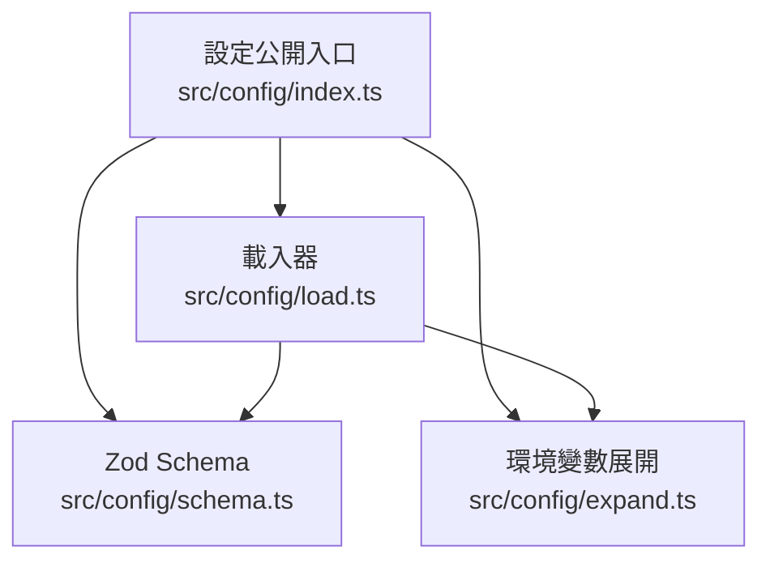
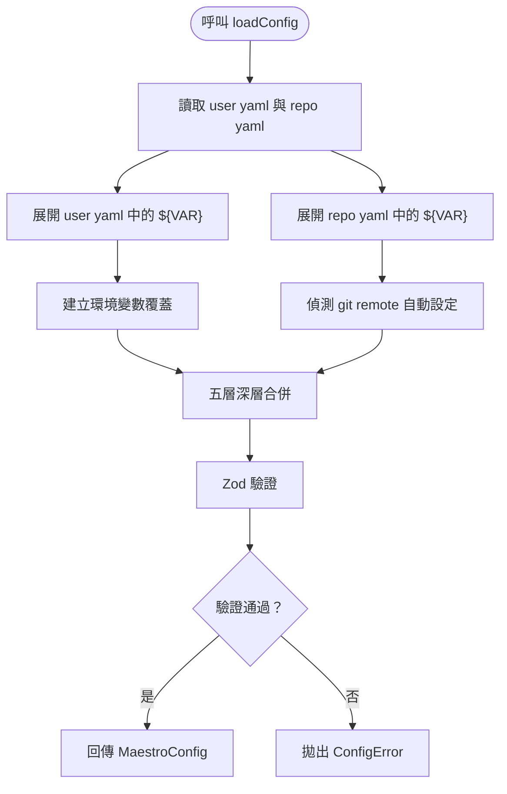
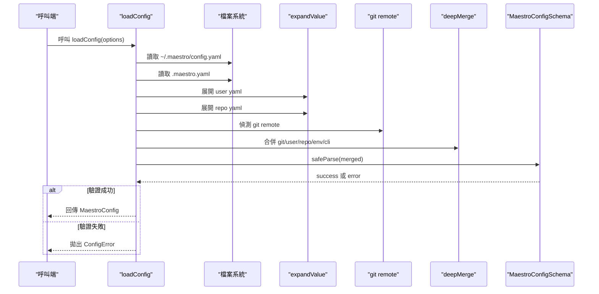
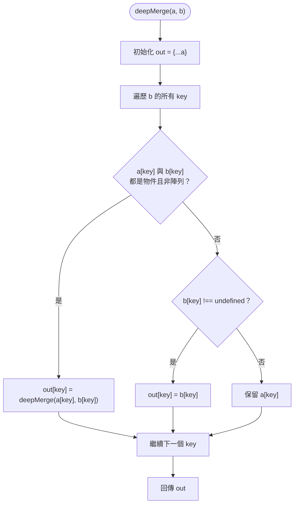
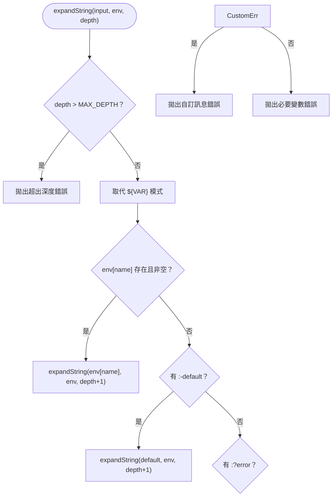
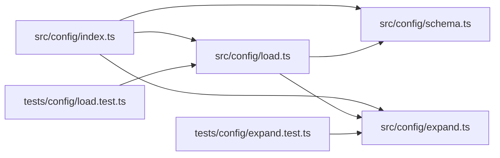

# 設定優先順序與載入機制

<cite>
**本文引用的檔案**   
- [src/config/index.ts](https://github.com/mikeah2011/maestro/blob/master/src/config/index.ts)
- [src/config/load.ts](https://github.com/mikeah2011/maestro/blob/master/src/config/load.ts)
- [src/config/schema.ts](https://github.com/mikeah2011/maestro/blob/master/src/config/schema.ts)
- [src/config/expand.ts](https://github.com/mikeah2011/maestro/blob/master/src/config/expand.ts)
- [tests/config/load.test.ts](https://github.com/mikeah2011/maestro/blob/master/tests/config/load.test.ts)
- [tests/config/expand.test.ts](https://github.com/mikeah2011/maestro/blob/master/tests/config/expand.test.ts)
- [.maestro.example.yaml](https://github.com/mikeah2011/maestro/blob/master/.maestro.example.yaml)
- [README.md](https://github.com/mikeah2011/maestro/blob/master/README.md)
</cite>

## 目錄
1. [簡介](#簡介)
2. [專案結構](#專案結構)
3. [核心元件](#核心元件)
4. [架構總覽](#架構總覽)
5. [詳細元件分析](#詳細元件分析)
6. [依賴關係分析](#依賴關係分析)
7. [效能考量](#效能考量)
8. [疑難排解指南](#疑難排解指南)
9. [結論](#結論)

## 簡介
本文件說明 Maestro 設定系統的載入機制，重點包括：

- **五層設定優先順序**：CLI flags → 環境變數 → repo config（`.maestro.yaml`）→ user config（`~/.maestro/config.yaml`）→ defaults。
- **深層合併策略**：物件遞迴合併、陣列整體覆蓋、忽略 `undefined`。
- **型別驗證流程**：Zod schema 在最後一階段驗證，並產生人類可讀的錯誤訊息。
- **環境變數展開**：`${VAR}`、`${VAR:-default}`、`${VAR:?error}`，支援巢狀展開與深度限制。
- **Git remote 自動偵測**：從 git remote URL 推斷平台、owner、repo 與 token env。
- **診斷技巧**：如何閱讀 `ConfigError`、`EnvExpansionError`、debug log level，以及使用測試模擬路徑。

## 專案結構
設定系統集中在 `src/config/` 目錄中，由四個模組組成：



**圖表來源**
- [src/config/index.ts:1-25](https://github.com/mikeah2011/maestro/blob/master/src/config/index.ts#L1-L25)
- [src/config/load.ts:1-216](https://github.com/mikeah2011/maestro/blob/master/src/config/load.ts#L1-L216)
- [src/config/schema.ts:1-226](https://github.com/mikeah2011/maestro/blob/master/src/config/schema.ts#L1-L226)
- [src/config/expand.ts:1-81](https://github.com/mikeah2011/maestro/blob/master/src/config/expand.ts#L1-L81)

設定載入器的主要責任是：

| 模組 | 主要職責 |
|---|---|
| `index.ts` | 暴露 `loadConfig`、`deepMerge`、`ConfigError`、Zod types 與 `expandValue` |
| `load.ts` | 讀取多層設定、env 展開、git remote 自動偵測、深層合併、Zod 驗證 |
| `schema.ts` | 定義所有設定欄位的 Zod schema、預設值與 TypeScript type |
| `expand.ts` | 將 `${VAR}` 語法展開為實際環境變數值 |

**Section sources**
- [src/config/index.ts:1-25](https://github.com/mikeah2011/maestro/blob/master/src/config/index.ts#L1-L25)

## 核心元件
### 設定載入器
`loadConfig(options)` 是外部程式碼取得最終 `MaestroConfig` 的唯一入口。它會：

1. 計算使用者配置路徑、倉庫配置路徑、當前工作目錄與環境物件。
2. 讀取 user yaml 與 repo yaml。
3. 對兩者執行環境變數展開。
4. 透過 `applyEnvOverrides` 把白名單環境變數轉成設定覆蓋。
5. 透過 `detectGitRemote` 自動偵測平台資訊。
6. 依序 deep merge 五個 layer。
7. 用 `MaestroConfigSchema.safeParse` 驗證結果。
8. 成功時回傳 typed `MaestroConfig`；失敗時拋出 `ConfigError`。



**圖表來源**
- [src/config/load.ts:100-216](https://github.com/mikeah2011/maestro/blob/master/src/config/load.ts#L100-L216)

**Section sources**
- [src/config/load.ts:1-216](https://github.com/mikeah2011/maestro/blob/master/src/config/load.ts#L1-L216)

## 架構總覽
以下序列圖展示一次完整設定載入過程：



**圖表來源**
- [src/config/load.ts:100-216](https://github.com/mikeah2011/maestro/blob/master/src/config/load.ts#L100-L216)
- [src/config/expand.ts:1-81](https://github.com/mikeah2011/maestro/blob/master/src/config/expand.ts#L1-L81)
- [src/config/schema.ts:200-226](https://github.com/mikeah2011/maestro/blob/master/src/config/schema.ts#L200-L226)

## 詳細元件分析

### 五層設定優先順序
載入器明確規定最高權限到最低權限如下：

| 層級 | 來源 | 覆蓋行為 |
|---|---|---|
| 第 1 層 | CLI flags（`options.overrides`） | 最高優先，完全覆蓋低層 |
| 第 2 層 | 環境變數白名單 | 僅允許特定欄位，例如 `MAESTRO_MAX_ROUNDS`、`MAESTRO_COST_BUDGET_USD`、`MAESTRO_LOG_LEVEL`、`MAESTRO_AUDIT_DIR` |
| 第 3 層 | repo `.maestro.yaml` | 覆寫 user config 與 git auto-detect |
| 第 4 層 | user `~/.maestro/config.yaml` | 提供使用者層級預設值 |
| 第 5 層 | git remote 自動偵測 | 提供 platform type、owner、repo、auth.tokenEnv |
| 第 6 層 | Zod schema defaults | 最底層預設值 |

實作上的合併順序是：

```text
gitRemoteLayer
  ↓ deepMerge
expandedUser
  ↓ deepMerge
expandedRepo
  ↓ deepMerge
envOverrides
  ↓ deepMerge
cliOverrides
```

因此最終順序是：**CLI > env > repo yaml > user yaml > git remote > schema defaults**。

#### 常見覆蓋範例

| 情境 | 預期結果 |
|---|---|
| user config 指定 `platform.type = gitlab`，repo config 指定 `platform.type = github` | 最終為 `github` |
| repo config 未指定 `audit.dir`，user config 指定 `./user-audit` | 保留 user config 的值 |
| repo config 設定 `stopConditions.maxRounds = 2`，env 設定 `MAESTRO_MAX_ROUNDS=4` | 最終為 `4` |
| CLI overrides 設定 `stopConditions.maxRounds = 1` | 最終為 `1`，覆蓋所有其他層 |
| 使用者想設定 `maxRounds = 10` | Zod 驗證失敗，因為上限為 `5` |

這些行為由測試檔確認：

**Section sources**
- [src/config/load.ts:100-216](https://github.com/mikeah2011/maestro/blob/master/src/config/load.ts#L100-L216)
- [tests/config/load.test.ts:1-228](https://github.com/mikeah2011/maestro/blob/master/tests/config/load.test.ts#L1-L228)
- [README.md:120-160](https://github.com/mikeah2011/maestro/blob/master/README.md#L120-L160)

### 深層合併策略
`deepMerge(a, b)` 的行為可以歸納為三條規則：

1. **物件遞迴合併**：若兩個值都是物件且都不是陣列，則遞迴合併。
2. **陣列整體覆蓋**：若 key 存在陣列，後者直接取代前者，不 concat。
3. **忽略 undefined**：若後者 value 為 `undefined`，不會覆蓋前者的值。



**圖表來源**
- [src/config/load.ts:40-60](https://github.com/mikeah2011/maestro/blob/master/src/config/load.ts#L40-L60)

測試確認以下行為：

| 測試項目 | 行為 |
|---|---|
| 陣列覆蓋 | `{ list: [1,2] }` + `{ list: [3] }` → `{ list: [3] }` |
| 物件遞迴 | `{ x: { y:1, z:2 } }` + `{ x: { z:3 } }` → `{ x: { y:1, z:3 } }` |
| undefined 跳過 | `{ y:2 }` + `{ y:undefined }` → `{ y:2 }` |

**Section sources**
- [src/config/load.ts:40-60](https://github.com/mikeah2011/maestro/blob/master/src/config/load.ts#L40-L60)
- [tests/config/load.test.ts:200-228](https://github.com/mikeah2011/maestro/blob/master/tests/config/load.test.ts#L200-L228)

### 環境變數展開機制
`expandString` 支援三種模式：

| 語法 | 行為 |
|---|---|
| `${VAR}` | 必要變數；未設定時拋出 `EnvExpansionError` |
| `${VAR:-default}` | 若 VAR 未設定或為空字串，使用 default |
| `${VAR:?error}` | 必要變數；未設定時拋出包含自訂訊息的 `EnvExpansionError` |

重要特性：

- **巢狀展開**：若環境變數值本身含有 `${...}`，會再次展開。
- **深度限制**：最大深度為 `MAX_DEPTH = 10`，避免循環引用。
- **不支援 default 內的嵌套**：regex 無法可靠解析平衡大括號。
- **只匹配大寫變數名**：符合 `[A-Z_][A-Z0-9_]*`。
- `$NAME`（無花括号）不會被展開。



**圖表來源**
- [src/config/expand.ts:1-81](https://github.com/mikeah2011/maestro/blob/master/src/config/expand.ts#L1-L81)

**Section sources**
- [src/config/expand.ts:1-81](https://github.com/mikeah2011/maestro/blob/master/src/config/expand.ts#L1-L81)
- [tests/config/expand.test.ts:1-79](https://github.com/mikeah2011/maestro/blob/master/tests/config/expand.test.ts#L1-L79)

### Zod Schema 驗證規則
Zod schema 是所有設定欄位的唯一型別來源。它同時提供：

- **欄位型別**：例如 `z.enum(['github','gitlab','gitea','gitee'])`。
- **必填檢查**：例如 `platform.type` 沒有 default，因此必須由某層設定提供。
- **範圍限制**：例如 `stopConditions.maxRounds.min(1).max(5)`。
- **預設值**：幾乎所有區塊都有 `.default(...)`，讓 user config 只需填寫差異部分。
- **進階條件約束**：例如 bots detection rule 至少需要一個偵測欄位。

主要區塊與用途如下：

| 區塊 | 用途 | 關鍵規則 |
|---|---|---|
| `ai.providers` | 宣告 AI provider | `type`、`apiKey`、`baseUrl`、`models`、`timeout`、`retries` |
| `ai.routing` | 每個 stage 選擇 provider 與 tier | commitMessage、prBodyDraft、classifyUnknown、semanticDedup、tasteDetection、finalSummary、fallback |
| `platform` | Git 平台設定 | `type`、`auth.tokenEnv`、`auth.token`、`baseUrl`、`owner`、`repo` |
| `bots` | 機器人註冊與慣例偵測 | registry、watch、detectByConvention.rules |
| `stopConditions` | 收斂控制 | maxRounds ≤ 5、jaccardCeiling ∈ [0,1]、costBudgetUSD ≥ 0 |
| `preflight` | 推送前檢查 | selfReview、lint、typecheck、test |
| `plugins.languages` | 語言工具命令 | lint、typecheck、test、format |
| `prBody` | PR body template 標記與樣板 | start/end marker、template |
| `security` | 敏感資料掃描 | scanOutgoing、redactPatterns |
| `audit` | 審計輸出 | enabled、dir、shadowLogClassifications |
| `logging` | 日誌等級與格式 | debug/info/warn/error、text/jsonl |
| `advanced` | 快取、重試、rate limit | cacheProviders、retryStrategy、rateLimit |

Top-level schema 會把所有子區塊包起來，並賦予預設值：

**Section sources**
- [src/config/schema.ts:1-226](https://github.com/mikeah2011/maestro/blob/master/src/config/schema.ts#L1-L226)
- [tests/config/load.test.ts:1-228](https://github.com/mikeah2011/maestro/blob/master/tests/config/load.test.ts#L1-L228)

### Git Remote 自動偵測
當 `platform.owner` 或 `platform.repo` 未明確設定時，載入器會嘗試從 git remote URL 自動推斷：

1. 依序嘗試 `preferredRemote`（可選）、`upstream`、`origin`。
2. 忽略 `DISABLED` 開頭的 remote。
3. 支援 SSH 與 HTTPS URL。
4. 根據 host 判斷平台：
   - `github` → `github`
   - `gitlab` → `gitlab`
   - `gitee` → `gitee`
   - 其他 → `gitea`
5. 自動設定 `auth.tokenEnv`：
   - GitHub → `GITHUB_TOKEN`
   - GitLab → `GITLAB_TOKEN`
   - Gitea/Gitee → `GITEA_TOKEN`

這個 layer 是最早被合併的，因此任何後續 layer 都可以覆寫它。

**Section sources**
- [src/config/load.ts:62-100](https://github.com/mikeah2011/maestro/blob/master/src/config/load.ts#L62-L100)

### YAML 讀取與容錯
`readYamlIfExists` 負責安全讀取 YAML：

- 若檔案不存在，回傳 `null`。
- 使用 `yaml.loadAll` 支援結尾 `---` 等分隔符號。
- 若根節點不是物件，拋出 `ConfigError`。
- 若解析失敗，包裝為 `ConfigError`，保留原始錯誤作為 `cause`。

這使得 example file 的結尾分隔符號不會造成載入失敗。

**Section sources**
- [src/config/load.ts:20-40](https://github.com/mikeah2011/maestro/blob/master/src/config/load.ts#L20-L40)
- [.maestro.example.yaml:1-239](https://github.com/mikeah2011/maestro/blob/master/.maestro.example.yaml#L1-L239)

## 依賴關係分析



**圖表來源**
- [src/config/index.ts:1-25](https://github.com/mikeah2011/maestro/blob/master/src/config/index.ts#L1-L25)
- [src/config/load.ts:1-216](https://github.com/mikeah2011/maestro/blob/master/src/config/load.ts#L1-L216)
- [src/config/schema.ts:1-226](https://github.com/mikeah2011/maestro/blob/master/src/config/schema.ts#L1-L226)
- [src/config/expand.ts:1-81](https://github.com/mikeah2011/maestro/blob/master/src/config/expand.ts#L1-L81)
- [tests/config/load.test.ts:1-228](https://github.com/mikeah2011/maestro/blob/master/tests/config/load.test.ts#L1-L228)
- [tests/config/expand.test.ts:1-79](https://github.com/mikeah2011/maestro/blob/master/tests/config/expand.test.ts#L1-L79)

### 耦合度與內聚性
- `index.ts` 只是重新匯出，耦合極低。
- `load.ts` 依賴 `schema.ts` 與 `expand.ts`，但方向單向，沒有 circular import。
- `expand.ts` 是純函式模組，內聚性高。
- `schema.ts` 獨立於載入邏輯，適合被多個模組共用。

### 潛在風險
- `detectGitRemote` 使用 `execSync('git remote get-url ...')`，屬於 shell command call；若 git 未安裝或 remote 不可用，會回傳空設定而非錯誤，因此不會中斷載入。
- `deepMerge` 只處理 plain object，不處理 Date、RegExp、Function 等類型。
- 環境變數展開只在 YAML 載入後進行，不會展開 CLI overrides。

**Section sources**
- [src/config/load.ts:62-100](https://github.com/mikeah2011/maestro/blob/master/src/config/load.ts#L62-L100)
- [src/config/load.ts:40-60](https://github.com/mikeah2011/maestro/blob/master/src/config/load.ts#L40-L60)

## 效能考量
設定載入屬於一次性啟動期操作，成本很低。但仍需注意：

| 項目 | 影響 | 建議 |
|---|---|---|
| YAML 讀取 | 每次載入讀取最多兩個檔案 | 正常情況可忽略 |
| 環境變數展開 | 遞迴展開，深度限制為 10 | 避免過深巢狀變數 |
| git remote 偵測 | 可能執行 shell command | 開發環境注意 git 是否可用 |
| Zod 驗證 | 整個 merged object 驗證一次 | 大型 config 仍屬輕量 |
| deepMerge | O(n) 遍歷 merged object | 設定通常不大，不成瓶頸 |

[No sources needed since this section provides general guidance]

## 疑難排解指南

### 常見錯誤與解決方式

| 症狀 | 可能原因 | 診斷方式 | 解決方式 |
|---|---|---|---|
| `ConfigError: invalid maestro config:` | Zod 驗證失敗 | 查看錯誤訊息中的 path 與 message | 修正對應欄位型別或數值範圍 |
| `required env var X is unset` | `${VAR}` 未設定 | 檢查環境是否有該變數 | 設定變數或使用 `${VAR:-default}` |
| `env expansion exceeded max depth` | 循環或太深的巢狀展開 | 檢查環境變數是否互相引用 | 減少巢狀深度或移除循環 |
| `detection rule must specify at least one of ...` | bots.detectByConvention.rules 項目為空 | 檢查 rules 內容 | 加入 loginContains、appSlugContains 或 commentBodyContains |
| `maxRounds` 驗證失敗 | 超過最大值 5 | 檢查 stopConditions | 設定為 1–5 |
| 設定未按預期覆蓋 | 優先順序誤解 | 確認 CLI/env/repo/user/git 各層值 | 調整較高優先層 |

### 診斷步驟

1. **開啟 debug 日誌**  
   透過環境變數 `MAESTRO_LOG_LEVEL=debug` 或設定 `logging.level` 提高輸出。

2. **檢查環境變數展開**  
   使用 `tests/config/expand.test.ts` 中的測試模式驗證 `${VAR}`、`${VAR:-default}`、`${VAR:?error}`。

3. **隔離 user config 與 repo config**  
   使用測試提供的 `writeUserConfig` / `writeRepoConfig` 方法，分別驗證兩層行為。

4. **驗證 CLI overrides**  
   以 `overrides.stopConditions.maxRounds = 1` 等方式確認 CLI 確實最高優先。

5. **檢查 git remote 自動偵測**  
   在目標目錄執行類似 `git remote get-url origin`，確認 URL 可被解析。

6. **閱讀 Zod 錯誤路徑**  
   `formatZodError` 會列出每個 issue 的 path，例如 `platform.auth.tokenEnv`，方便定位。

### Debug 輸出解讀

`ConfigError` 的訊息格式如下：

```
invalid maestro config:
  - platform.type: <message>
  - stopConditions.maxRounds: <message>
```

每行代表一個 Zod validation issue，path 使用點號連接。

`EnvExpansionError` 則會帶 `variable` 屬性，表示哪個變數無法展開。

**Section sources**
- [src/config/load.ts:200-216](https://github.com/mikeah2011/maestro/blob/master/src/config/load.ts#L200-L216)
- [src/config/expand.ts:10-35](https://github.com/mikeah2011/maestro/blob/master/src/config/expand.ts#L10-L35)
- [tests/config/load.test.ts:1-120](https://github.com/mikeah2011/maestro/blob/master/tests/config/load.test.ts#L1-L120)
- [tests/config/expand.test.ts:1-79](https://github.com/mikeah2011/maestro/blob/master/tests/config/expand.test.ts#L1-L79)

## 結論
Maestro 的設定系統採用明確的五層優先順序、可預測的深層合併、嚴格的 Zod 驗證，以及安全的環境變數展開。設計上鼓勵使用者只設定差異部分，其餘由預設值補齊；CLI 與環境變數提供運行期覆蓋能力；git remote 自動偵測降低初始設定成本。

實務上建議：

- 將機敏金鑰放在環境變數或 CI secret store，不要在 repo config 中硬編碼。
- 使用 `${VAR:-default}` 提供可接受的 fallback。
- 透過 `MAESTRO_LOG_LEVEL=debug` 診斷載入問題。
- 遇到驗證錯誤時，先從 Zod 錯誤 path 入手，再逐層檢查 CLI、env、repo、user、git 設定。
- 不要手動修改 `deepMerge` 的陣列行為；它刻意以覆蓋取代 concat，避免意外合併列表。

[No sources needed since this section summarizes without analyzing specific files]