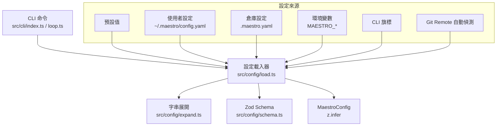
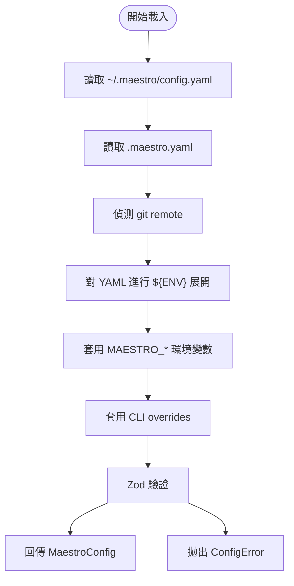
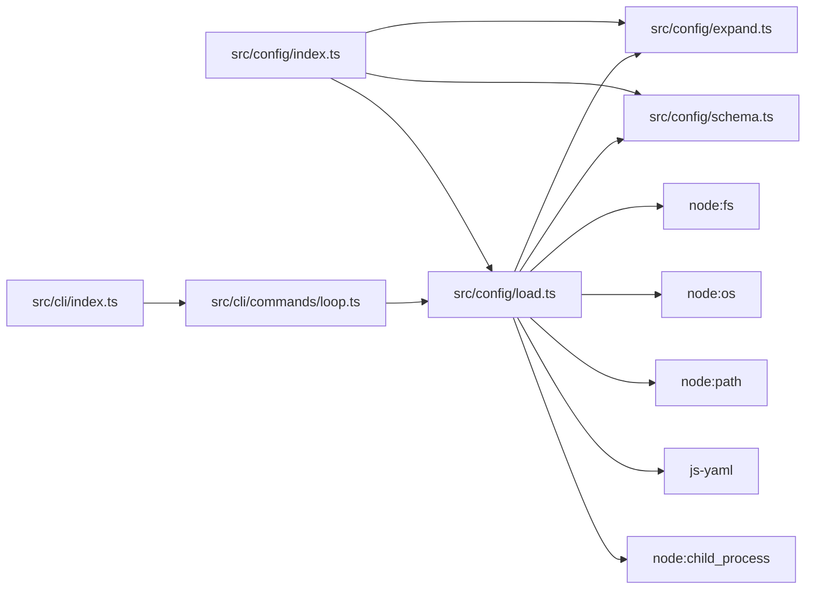

# 設定指南

<cite>
**本文引用的檔案**   
- [.maestro.example.yaml](https://github.com/mikeah2011/maestro/blob/master/.maestro.example.yaml)
- [src/config/schema.ts](https://github.com/mikeah2011/maestro/blob/master/src/config/schema.ts)
- [src/config/load.ts](https://github.com/mikeah2011/maestro/blob/master/src/config/load.ts)
- [src/config/expand.ts](https://github.com/mikeah2011/maestro/blob/master/src/config/expand.ts)
- [src/config/index.ts](https://github.com/mikeah2011/maestro/blob/master/src/config/index.ts)
- [src/cli/index.ts](https://github.com/mikeah2011/maestro/blob/master/src/cli/index.ts)
- [src/cli/commands/loop.ts](https://github.com/mikeah2011/maestro/blob/master/src/cli/commands/loop.ts)
- [README.md](https://github.com/mikeah2011/maestro/blob/master/README.md)
</cite>

## 目錄
1. [簡介](#簡介)
2. [專案結構與設定載入流程](#專案結構與設定載入流程)
3. [五層設定優先順序](#五層設定優先順序)
4. `.maestro.yaml` 完整欄位定義
5. [AI Provider 設定](#ai-provider-設定)
6. [Git Platform 設定](#git-platform-設定)
7. [Bots Registry 設定](#bots-registry-設定)
8. [停止條件（Stop Conditions）](#停止條件stop-conditions)
9. [安全設定（Security）](#安全設定security)
10. [語言插件（Language Plugins）](#語言插件language-plugins)
11. [字串展開語法 `${ENV}`](#字串展開語法-env)
12. [使用情境與最佳實踐](#使用情境與最佳實踐)
13. [依賴分析](#依賴分析)
14. [效能考量](#效能考量)
15. [故障排除指南](#故障排除指南)
16. [結論](#結論)

## 簡介
Maestro 的設定系統負責把使用者意圖轉成單一、可驗證、具型別的 `MaestroConfig`。它支援五層設定來源，並依固定優先順序合併；所有欄位都透過 Zod schema 驗證，錯誤訊息會包含完整路徑，方便定位問題。

本文件說明：
- 設定載入流程與優先順序
- `.maestro.yaml` 所有欄位的型別、預設值與驗證規則
- AI provider、Git platform、bots registry、停止條件、安全遮蔽、語言插件
- `${ENV}` 字串展開語法
- 常見使用情境與最佳實踐

**章節來源**
- [README.md:1-60](https://github.com/mikeah2011/maestro/blob/master/README.md#L1-L60)

## 專案結構與設定載入流程
設定相關程式碼集中在 `src/config`：

**圖表來源**
- [src/config/load.ts:1-216](https://github.com/mikeah2011/maestro/blob/master/src/config/load.ts#L1-L216)
- [src/config/expand.ts:1-81](https://github.com/mikeah2011/maestro/blob/master/src/config/expand.ts#L1-L81)
- [src/config/schema.ts:1-226](https://github.com/mikeah2011/maestro/blob/master/src/config/schema.ts#L1-L226)
- [src/cli/index.ts:1-86](https://github.com/mikeah2011/maestro/blob/master/src/cli/index.ts#L1-L86)
- [src/cli/commands/loop.ts:45-50](https://github.com/mikeah2011/maestro/blob/master/src/cli/commands/loop.ts#L45-L50)

**章節來源**
- [src/config/index.ts:1-25](https://github.com/mikeah2011/maestro/blob/master/src/config/index.ts#L1-L25)
- [src/config/load.ts:1-60](https://github.com/mikeah2011/maestro/blob/master/src/config/load.ts#L1-L60)

## 五層設定優先順序
設定載入器依以下順序合併（越高越優先）：

1. **CLI flags**  
   例如 `--max-rounds`、`--cost-budget`、`--dry-run`、`--pr`、`--remote`、`--cwd`。這些由 Commander 解析後作為 `overrides` 傳入載入器。
2. **環境變數（MAESTRO_*）**  
   目前明確支援：
   - `MAESTRO_MAX_ROUNDS`
   - `MAESTRO_COST_BUDGET_USD`
   - `MAESTRO_LOG_LEVEL`
   - `MAESTRO_AUDIT_DIR`
3. **倉庫設定 `.maestro.yaml`**  
   位於執行目錄根目錄。
4. **使用者設定 `~/.maestro/config.yaml`**  
   可由測試或外部呼叫端透過選項覆蓋路徑。
5. **Git remote 自動偵測**  
   根據遠端 URL 推斷 `platform.type`、`owner`、`repo`，並設定預設 `tokenEnv`。
6. **Schema 預設值**  
   最後由 Zod schema 補齊未提供欄位。

注意：雖然 README 寫「CLI flags → env vars → repo config → user config → defaults」，但載入器的實際合併順序是「git remote auto-detect → user yaml → repo yaml → env overrides → CLI overrides」。因此，**CLI flags 仍是最終贏家**，而 git remote 自動偵測只填補使用者或倉庫設定中未指定的部分。

**圖表來源**
- [src/config/load.ts:60-216](https://github.com/mikeah2011/maestro/blob/master/src/config/load.ts#L60-L216)

**章節來源**
- [src/config/load.ts:60-216](https://github.com/mikeah2011/maestro/blob/master/src/config/load.ts#L60-L216)
- [src/cli/commands/loop.ts:45-50](https://github.com/mikeah2011/maestro/blob/master/src/cli/commands/loop.ts#L45-L50)
- [src/cli/index.ts:1-86](https://github.com/mikeah2011/maestro/blob/master/src/cli/index.ts#L1-L86)

## `.maestro.yaml` 完整欄位定義
以下是顶层 `MaestroConfig` 所有欄位、型別、預設值與驗證規則。

| 欄位 | 型別 | 預設值 | 驗證規則與行為 |
|---|---|---|---|
| `ai` | `AISchema` | `{ providers: {}, routing: {} }` | `providers` 為 string → `ProviderConfig` map；`routing` 支援七個 stage key。 |
| `platform` | `PlatformSchema` | 無預設（但 git remote 自動偵測常會填入） | `type` 必須是 `github`、`gitlab`、`gitea`、`gitee`；`auth.tokenEnv` 或 `auth.token` 至少一個有值時才有意義。 |
| `bots` | `BotsSchema` | `{ watch: [], registry: [], detectByConvention: { enabled: true, rules: [] } }` | `registry` 每筆需有 `login`；`detectByConvention.rules` 每筆至少指定 `loginContains`、`appSlugContains` 或 `commentBodyContains` 其中一個。 |
| `stopConditions` | `StopConditionsSchema` | `maxRounds=3`、`jaccardCeiling=0.7`、`noNewCategoryAfterRound=2`、`duplicateFindingPolicy=pushback`、`ciFail=exit`、`idleTimeoutPolls=20`、`quietPeriodSec=90`、`costBudgetUSD=5` | `maxRounds` 限制在 1–5；`jaccardCeiling` 限制在 0–1；其他都有整數或非負數限制。 |
| `preflight` | `PreflightSchema` | `{ enabled: true, steps: ['selfReview','lint','typecheck','test'], blockOnSeverity: critical }` | `steps` 元素必須是四個允許值之一；`blockOnSeverity` 僅接受 `critical`、`high`、`medium`。 |
| `plugins.languages` | `Record<string, LanguagePlugin>` | `{}` | 每個 language plugin 的 `lint`、`typecheck`、`test`、`format` 都是選填字串。 |
| `prBody.marker.start` | `string` | `<!-- maestro:start -->` | 用於 idempotent 更新 PR body 的起始 marker。 |
| `prBody.marker.end` | `string` | `<!-- maestro:end -->` | 用於 idempotent 更新 PR body 的結束 marker。 |
| `prBody.template` | `string?` | 無 | Handlebars 風格範本。 |
| `security.scanOutgoing` | `boolean` | `true` | 控制是否在每次回覆／PR body 更新前執行敏感資訊掃描。 |
| `security.redactPatterns` | `string[]` | 包含 `api[_-]?key`、`secret`、`password`、`token`、GitHub personal token、OpenAI secret key 等預設模式 | 字串陣列，供 `SecretScanner` 使用。 |
| `audit.enabled` | `boolean` | `true` | 是否啟用分類決策稽核。 |
| `audit.dir` | `string` | `.maestro/audit` | 稽核輸出目錄。 |
| `audit.shadowLogClassifications` | `boolean` | `true` | 是否 shadow-log 分類決策。 |
| `logging.level` | `debug \| info \| warn \| error` | `info` | 日誌層級。 |
| `logging.format` | `text \| jsonl` | `jsonl` | 日誌格式。 |
| `logging.eventStream` | `string` | `.maestro/events.jsonl` | 事件流檔案路徑。 |
| `advanced.cacheProviders` | `boolean` | `true` | 是否快取 provider。 |
| `advanced.retryStrategy.maxRetries` | `number` | `3` | 重試次數上限。 |
| `advanced.retryStrategy.backoffMultiplier` | `number` | `2` | 退避倍數。 |
| `advanced.rateLimit.honorRemainingHeader` | `boolean` | `true` | 是否尊重 API remaining header。 |
| `advanced.rateLimit.minInterRequestMs` | `number` | `100` | 最小請求間隔毫秒。 |

**章節來源**
- [src/config/schema.ts:1-226](https://github.com/mikeah2011/maestro/blob/master/src/config/schema.ts#L1-L226)
- [src/config/load.ts:200-216](https://github.com/mikeah2011/maestro/blob/master/src/config/load.ts#L200-L216)

## AI Provider 設定
`ai.providers` 是一個以自訂名稱（例如 `claude`、`openai`、`gemini`、`local`、`custom`）為 key 的物件，每個 provider 支援以下欄位：

| 欄位 | 型別 | 必要 | 預設值 | 說明 |
|---|---|---:|---|---|
| `type` | `'claude' \| 'openai' \| 'google' \| 'local' \| 'custom'` | 是 | 無 | 識別 provider 類型。 |
| `apiKey` | `string?` | 否 | 無 | API Key；通常搭配 `${ANTHROPIC_API_KEY}` 等字串展開。 |
| `baseUrl` | `string?` | 否 | 無 | 若指定，必須是合法 URL；常用於 local Ollama 或自訂 HTTP provider。 |
| `models` | `Record<'cheap' \| 'strong' \| 'flagship', string>` | 否 | 無 | 將 tier 映射到實際模型名稱。 |
| `defaultTier` | `'cheap' \| 'strong' \| 'flagship'` | 否 | 無 | 該 provider 的預設 tier。 |
| `timeout` | `positive integer?` | 否 | 無 | 逾時毫秒數。 |
| `retries` | `nonnegative integer?` | 否 | 無 | 重試次數。 |

### Routing（階段路由）
`ai.routing` 決定每個處理階段使用哪個 provider 與 model tier：

| Stage | 用途 | 預設 |
|---|---|---|
| `commitMessage` | 每輪產生 commit message | 未設定 |
| `prBodyDraft` | 每 PR 一次產生 PR body 草稿 | 未設定 |
| `classifyUnknown` | 圍欄 classifier fallback | 未設定 |
| `semanticDedup` | tier-3 語義去重 | 未設定 |
| `tasteDetection` | 判斷 review 是否已進入 bikeshedding | 未設定 |
| `finalSummary` | 迴圈結束時的 PR body rollup | 未設定 |
| `fallback` | 找不到對應 stage 時的備用設定 | 未設定 |

每個 route 的型別：

| 欄位 | 型別 | 預設 |
|---|---|---|
| `provider` | `string`（至少 1 字元） | 無 |
| `tier` | `'cheap' \| 'strong' \| 'flagship'` | `cheap` |

**章節來源**
- [src/config/schema.ts:11-65](https://github.com/mikeah2011/maestro/blob/master/src/config/schema.ts#L11-L65)
- [.maestro.example.yaml:1-60](https://github.com/mikeah2011/maestro/blob/master/.maestro.example.yaml#L1-L60)

## Git Platform 設定
`platform` 支援四種平台：

| 欄位 | 型別 | 預設值 | 說明 |
|---|---|---|---|
| `type` | `'github' \| 'gitlab' \| 'gitea' \| 'gitee'` | 無 | 必設，除非被 git remote 自動偵測填滿。 |
| `auth` | `PlatformAuthSchema` | `{}` | 包含 `tokenEnv` 或 `token`。 |
| `auth.tokenEnv` | `string?` | 無 | 環境變數名，用於取得 token。 |
| `auth.token` | `string?` | 無 | 直接指定 token（較不建議）。 |
| `baseUrl` | `string?` | 無 | 若指定，必須是合法 URL；可用於 GitHub Enterprise 或 self-hosted。 |
| `owner` | `string?` | 無 | 通常由 git remote 自動偵測。 |
| `repo` | `string?` | 無 | 通常由 git remote 自動偵測。 |

自動偵測邏輯：
- 嘗試 `git remote get-url upstream`，失敗則嘗試 `origin`。
- 支援 SSH 與 HTTPS URL。
- 根據 host 判斷平台：`github.com` → `github`、`gitlab` → `gitlab`、`gitee` → `gitee`、其餘 → `gitea`。
- 預設 `tokenEnv`：GitHub 用 `GITHUB_TOKEN`、GitLab 用 `GITLAB_TOKEN`、其餘用 `GITEA_TOKEN`。

**章節來源**
- [src/config/schema.ts:68-91](https://github.com/mikeah2011/maestro/blob/master/src/config/schema.ts#L68-L91)
- [src/config/load.ts:118-178](https://github.com/mikeah2011/maestro/blob/master/src/config/load.ts#L118-L178)
- [.maestro.example.yaml:62-98](https://github.com/mikeah2011/maestro/blob/master/.maestro.example.yaml#L62-L98)

## Bots Registry 設定
`bots` 區塊有三個子區段：

| 欄位 | 型別 | 預設值 | 說明 |
|---|---|---|---|
| `watch` | `string[]` | `[]` | Maestro 監聽的 bot login 清單。 |
| `registry` | `BotRegistryEntrySchema[]` | `[]` | 已知 bot 的註冊清單。 |
| `detectByConvention.enabled` | `boolean` | `true` | 是否啟用慣例偵測。 |
| `detectByConvention.rules` | `ConventionRuleSchema[]` | `[]` | 慣例匹配規則。 |

每筆 `registry` entry：

| 欄位 | 型別 | 預設值 | 說明 |
|---|---|---|---|
| `login` | `string`（至少 1 字元） | 無 | bot 登入名稱。 |
| `treatAs` | `'blocking' \| 'advisory'` | `advisory` | 該 bot 的回覆視為 blocking 或 advisory。 |
| `severityMap` | `Record<string, string>` | 無 | 自訂嚴重等級映射，例如 `red: critical`。 |

每筆 convention rule 至少需指定以下三者之一：
- `loginContains`: 匹配 bot login 的字串片段。
- `appSlugContains`: 匹配 app slug 的字串片段。
- `commentBodyContains`: 匹配評論內容的字串片段。

**章節來源**
- [src/config/schema.ts:94-125](https://github.com/mikeah2011/maestro/blob/master/src/config/schema.ts#L94-L125)
- [.maestro.example.yaml:100-150](https://github.com/mikeah2011/maestro/blob/master/.maestro.example.yaml#L100-L150)

## 停止條件（Stop Conditions）
停止條件是收斂循環的硬性保證，不是單純建議：

| 欄位 | 型別 | 預設值 | 驗證規則 | 說明 |
|---|---|---:|---|---|
| `maxRounds` | `integer` | `3` | 1–5 | 硬式回合上限；即使使用者設超過 5 也會被截斷。 |
| `jaccardCeiling` | `number` | `0.7` | 0–1 | Jaccard 相似度高於此值表示振盪，停止並升級。 |
| `noNewCategoryAfterRound` | `integer` | `2` | ≥1 | 第 N 輪之後不允許出現新的 finding category。 |
| `duplicateFindingPolicy` | `enum` | `pushback` | `pushback` \| `escalate` \| `accept` | 重複發現的處理策略。 |
| `ciFail` | `enum` | `exit` | `exit` \| `retry-with-fix` | CI 失敗時的行為。 |
| `idleTimeoutPolls` | `integer` | `20` | >0 | 多少次 poll 後觸發 BotTimeout。 |
| `quietPeriodSec` | `number` | `90` | ≥0 | 多個 bot 發文後的 debounce 秒數。 |
| `costBudgetUSD` | `number` | `5` | ≥0 | 單次 loop 成本上限（美元）。 |

**章節來源**
- [src/config/schema.ts:128-146](https://github.com/mikeah2011/maestro/blob/master/src/config/schema.ts#L128-L146)
- [.maestro.example.yaml:152-168](https://github.com/mikeah2011/maestro/blob/master/.maestro.example.yaml#L152-L168)

## 安全設定（Security）
`security` 區塊控制敏感資訊掃描與遮蔽：

| 欄位 | 型別 | 預設值 | 說明 |
|---|---|---|---|
| `scanOutgoing` | `boolean` | `true` | 每次回覆或更新 PR body 前執行 `SecretScanner`。 |
| `redactPatterns` | `string[]` | 包含 `(?i)api[_-]?key`、`(?i)secret`、`(?i)password`、`(?i)token`、`ghp_[A-Za-z0-9]{20,}`、`sk-[A-Za-z0-9]{20,}` | 正規表達式字串陣列，用於遮蔽敏感資訊。 |

建議：
- 不要關閉 `scanOutgoing`，除非你清楚風險。
- 如需新增公司內部 token pattern，請追加到 `redactPatterns`。
- 避免在 PR body template 或評論中使用明文 token。

**章節來源**
- [src/config/schema.ts:171-186](https://github.com/mikeah2011/maestro/blob/master/src/config/schema.ts#L171-L186)
- [.maestro.example.yaml:210-239](https://github.com/mikeah2011/maestro/blob/master/.maestro.example.yaml#L210-L239)

## 語言插件（Language Plugins）
`plugins.languages` 讓不同語言套用各自的 lint、typecheck、test、format 指令：

| 欄位 | 型別 | 預設值 | 說明 |
|---|---|---|---|
| `lint` | `string?` | 無 | 語言專屬 linter 指令。 |
| `typecheck` | `string?` | 無 | 型別檢查指令。 |
| `test` | `string?` | 無 | 測試指令。 |
| `format` | `string?` | 無 | 格式化指令。 |

範例語言包括 typescript、python、go、rust；你可以新增更多語言 key，只要其 value 符合 `LanguagePluginSchema`。

**章節來源**
- [src/config/schema.ts:155-170](https://github.com/mikeah2011/maestro/blob/master/src/config/schema.ts#L155-L170)
- [.maestro.example.yaml:174-208](https://github.com/mikeah2011/maestro/blob/master/.maestro.example.yaml#L174-L208)

## 字串展開語法 `${ENV}`
設定檔中的字串值會在 YAML 解析後、深層合併前進行環境變數展開。支援三種語法：

| 語法 | 行為 |
|---|---|
| `${VAR}` | 必要變數；若未設定且無預設值，拋出 `EnvExpansionError`。 |
| `${VAR:-default}` | 選用變數；若 `VAR` 未設定或未設定為空字串，使用 `default`。 |
| `${VAR:?error}` | 必要變數，但顯示自訂錯誤訊息。 |

重要特性：
- 展開遞迴：env 值本身若包含 `${...}` 會繼續展開。
- 深度限制：最大遞迴深度為 10，防止環狀參考。
- default 值內不支援巢狀 `${}`，因為正規表達式無法可靠解析平衡括號。
- 展開範圍：字串、陣列、物件都會遞迴處理。

範例：
- `${ANTHROPIC_API_KEY}`
- `${OPENAI_API_KEY}`
- `${GOOGLE_API_KEY}`
- `${OLLAMA_BASE_URL:-http://localhost:11434}`

**章節來源**
- [src/config/expand.ts:1-81](https://github.com/mikeah2011/maestro/blob/master/src/config/expand.ts#L1-L81)
- [.maestro.example.yaml:1-60](https://github.com/mikeah2011/maestro/blob/master/.maestro.example.yaml#L1-L60)

## 使用情境與最佳實踐

### 情境一：個人開發者使用 Claude + GitHub
- 設定 `platform.type` 為 `github`。
- 使用 `${ANTHROPIC_API_KEY}` 注入 Anthropic API Key。
- 使用 `${GITHUB_TOKEN}` 注入 GitHub Token。
- 保留預設 `maxRounds: 3`。

### 情境二：團隊共用設定
- 在 `~/.maestro/config.yaml` 放 API Key 與 team-wide provider 設定。
- 在 `.maestro.yaml` 放 repo-specific 的 owner/repo、platform、bots registry。
- 用 CLI flag 覆蓋測試或 dry-run 行為。

### 情境三：CI 環境
- 使用 `MAESTRO_MAX_ROUNDS`、`MAESTRO_COST_BUDGET_USD`、`MAESTRO_LOG_LEVEL`、`MAESTRO_AUDIT_DIR` 控制 CI 行為。
- 使用 `--dry-run` 先驗證設定而不實際修改。
- 使用 `--pr <number>` 指定目標 PR。

### 情境四：本地 Ollama
- 在 `ai.providers.local` 設定 `type: local`。
- 使用 `${OLLAMA_BASE_URL:-http://localhost:11434}` 指定 base URL。
- 在 `models` 中列出本地模型名稱。

### 情境五：自訂 HTTP Provider
- 設定 `type: custom`。
- 指定 `baseUrl` 與必要的 `apiKey`。
- 使用 `models` 將 cheap/strong/flagship 映射到自訂模型 ID。

### 最佳實踐
1. **不要把 token 寫進 `.maestro.yaml`**，改用 `${ENV}` 與環境變數。
2. **保持 `maxRounds ≤ 5`**，這是系統硬限制。
3. **開啟 `security.scanOutgoing`**。
4. **在團隊共用設定中只放 provider 與 logging**，repo 設定放在 `.maestro.yaml`。
5. **使用 `detectByConvention` 降低維護 bots registry 的成本**。
6. **在 CI 中設定 `MAESTRO_COST_BUDGET_USD` 防止成本失控**。
7. **使用 `--dry-run` 驗證設定與 PR 影響範圍**。

**章節來源**
- [.maestro.example.yaml:1-239](https://github.com/mikeah2011/maestro/blob/master/.maestro.example.yaml#L1-L239)
- [src/config/load.ts:78-116](https://github.com/mikeah2011/maestro/blob/master/src/config/load.ts#L78-L116)
- [src/cli/commands/loop.ts:45-50](https://github.com/mikeah2011/maestro/blob/master/src/cli/commands/loop.ts#L45-L50)

## 依賴分析
設定模組的依賴關係如下：

**圖表來源**
- [src/config/index.ts:1-25](https://github.com/mikeah2011/maestro/blob/master/src/config/index.ts#L1-L25)
- [src/config/load.ts:1-30](https://github.com/mikeah2011/maestro/blob/master/src/config/load.ts#L1-L30)
- [src/cli/index.ts:1-86](https://github.com/mikeah2011/maestro/blob/master/src/cli/index.ts#L1-L86)

**章節來源**
- [src/config/index.ts:1-25](https://github.com/mikeah2011/maestro/blob/master/src/config/index.ts#L1-L25)
- [src/config/load.ts:1-30](https://github.com/mikeah2011/maestro/blob/master/src/config/load.ts#L1-L30)

## 效能考量
- **YAML 解析**：載入器使用 `yaml.loadAll` 並只取第一份文件，避免尾端 `---` 造成的多文件錯誤。
- **深層合併**：`deepMerge` 對物件做遞迴合併，陣列整體替換，避免意外 append。
- **字串展開深度限制**：最大 10 層遞迴，防止惡意或錯誤的環狀 `${VAR}` 造成無限展開。
- **Git remote 偵測**：只在載入設定時執行一次，並容錯忽略無法執行的 remote。
- **Zod 驗證**：在最終合併結果上執行一次性驗證，錯誤訊息會列出所有 path 與訊息。

[本節為一般性效能討論，不直接分析特定程式碼行]

## 故障排除指南

### 常見錯誤與解法

| 錯誤現象 | 可能原因 | 解法 |
|---|---|---|
| `EnvExpansionError: required env var X is unset` | 設定中使用 `${X}` 但未設定環境變數 | 設定 `X` 或使用 `${X:-default}` |
| `invalid maestro config` | YAML 欄位型別或驗證失敗 | 查看錯誤訊息中的 path，修正欄位值 |
| `failed to parse .maestro.yaml` | YAML 語法錯誤或頂層不是 mapping | 檢查 YAML 語法，確保頂層是物件 |
| `must be a YAML mapping at the top level` | YAML 頂層是 array 或 null | 確保設定檔頂層是物件 |
| `detection rule must specify at least one of ...` | convention rule 未指定任何匹配條件 | 加入 `loginContains`、`appSlugContains` 或 `commentBodyContains` |
| CI 一直停不下來 | `maxRounds` 過高或 `jaccardCeiling` 太低 | 調整停止條件，確認 `maxRounds ≤ 5` |
| cost 超出預期 | 未設定 `costBudgetUSD` 或 `MAESTRO_COST_BUDGET_USD` | 設定預算上限 |
| 敏感資訊洩漏 | `security.scanOutgoing` 關閉或 `redactPatterns` 不足 | 開啟掃描並補充 regex pattern |

### 診斷步驟
1. 執行 `maestro doctor` 檢查環境與 token。
2. 使用 `--dry-run` 執行 loop 觀察設定是否正確載入。
3. 檢查 `.maestro/audit` 目錄是否有分類決策紀錄。
4. 檢查 `logging.level` 是否調高至 `debug` 以便除錯。
5. 檢查環境變數是否確實存在：`echo $ANTHROPIC_API_KEY`、`echo $GITHUB_TOKEN` 等。

**章節來源**
- [src/config/load.ts:13-38](https://github.com/mikeah2011/maestro/blob/master/src/config/load.ts#L13-L38)
- [src/config/load.ts:130-216](https://github.com/mikeah2011/maestro/blob/master/src/config/load.ts#L130-L216)
- [src/config/expand.ts:12-40](https://github.com/mikeah2011/maestro/blob/master/src/config/expand.ts#L12-L40)

## 結論
Maestro 的設定系統以 Zod schema 為核心，結合五層來源合併與 `${ENV}` 字串展開，提供彈性且安全的配置體驗。建議使用者：
- 將敏感資訊放在環境變數，而非設定檔。
- 在團隊層級共用 provider 與 logging 設定。
- 在 repo 層級設定 platform、bots registry 與語言插件。
- 嚴格遵守停止條件與安全掃描，確保收斂與隱私。
- 使用 CLI flags 與環境變數進行 CI 與測試情境的微調。

[本節為總結，不直接分析特定檔案]