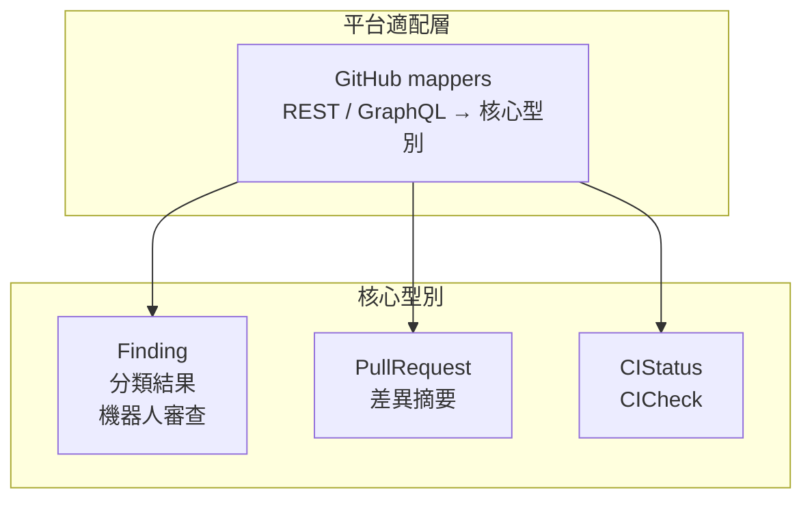
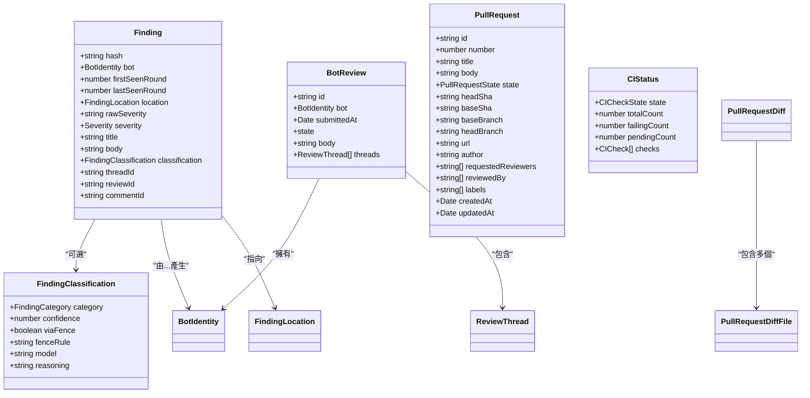
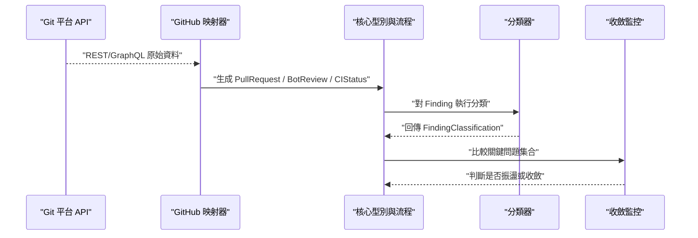
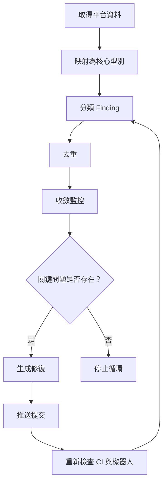
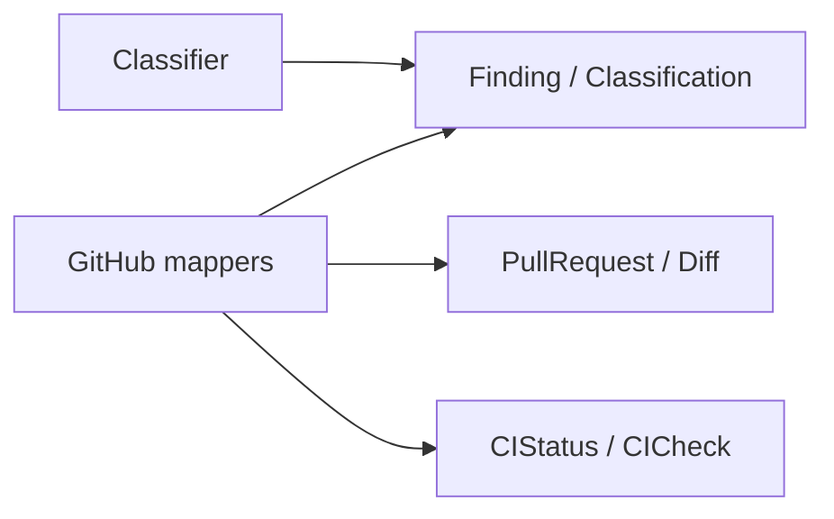
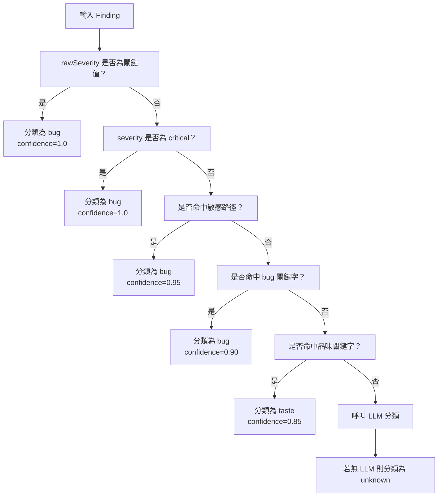

# 資料模型

<cite>
**本文引用的檔案**   
- [Finding.ts](https://github.com/mikeah2011/maestro/blob/master/src/core/types/Finding.ts)
- [PullRequest.ts](https://github.com/mikeah2011/maestro/blob/master/src/core/types/PullRequest.ts)
- [CI.ts](https://github.com/mikeah2011/maestro/blob/master/src/core/types/CI.ts)
- [Classifier.ts](https://github.com/mikeah2011/maestro/blob/master/src/core/classify/Classifier.ts)
- [mappers.ts](https://github.com/mikeah2011/maestro/blob/master/src/platforms/github/mappers.ts)
- [DESIGN.md](https://github.com/mikeah2011/maestro/blob/master/docs/DESIGN.md)
</cite>

## 目錄
1. [引言](#引言)
2. [專案結構與型別分佈](#專案結構與型別分佈)
3. [核心資料模型](#核心資料模型)
4. [架構總覽](#架構總覽)
5. [詳細型別分析](#詳細型別分析)
6. [依賴關係分析](#依賴關係分析)
7. [驗證規則與資料轉換](#驗證規則與資料轉換)
8. [序列化格式與版本相容性](#序列化格式與版本相容性)
9. [效能考量](#效能考量)
10. [故障排除指南](#故障排除指南)
11. [結論](#結論)

## 引言
本文件聚焦於 Maestro 工具的核心資料模型，涵蓋審查發現、拉取請求元資料、持續整合狀態、機器人審查、AI 完成結果與分類結果等關鍵型別。說明內容包括欄位定義、型別約束、關聯關係、驗證規則、序列化行為、版本相容性考量，以及實務上的資料轉換範例與最佳實踐。目標是讓具備不同技術背景的讀者都能理解這些資料如何被產生、轉換、分類與使用。

## 專案結構與型別分佈
核心資料型別集中在 `src/core/types`：
- `Finding.ts`：審查發現、分類結果、機器人審查與討論串。
- `PullRequest.ts`：拉取請求與其差異摘要。
- `CI.ts`：持續整合檢查與聚合狀態。

平台適配層則負責把外部 API 回應映射到這些核心型別：
- `src/platforms/github/mappers.ts`：GitHub REST/GraphQL → 核心型別的純函式映射。

**圖表來源**
- [Finding.ts:1-129](https://github.com/mikeah2011/maestro/blob/master/src/core/types/Finding.ts#L1-L129)
- [PullRequest.ts:1-56](https://github.com/mikeah2011/maestro/blob/master/src/core/types/PullRequest.ts#L1-L56)
- [CI.ts:1-34](https://github.com/mikeah2011/maestro/blob/master/src/core/types/CI.ts#L1-L34)
- [mappers.ts:1-200](https://github.com/mikeah2011/maestro/blob/master/src/platforms/github/mappers.ts#L1-L200)

**章節來源**
- [Finding.ts:1-129](https://github.com/mikeah2011/maestro/blob/master/src/core/types/Finding.ts#L1-L129)
- [PullRequest.ts:1-56](https://github.com/mikeah2011/maestro/blob/master/src/core/types/PullRequest.ts#L1-L56)
- [CI.ts:1-34](https://github.com/mikeah2011/maestro/blob/master/src/core/types/CI.ts#L1-L34)
- [mappers.ts:1-200](https://github.com/mikeah2011/maestro/blob/master/src/platforms/github/mappers.ts#L1-L200)

## 核心資料模型
以下為本次文檔重點關注的資料模型及其角色：
- **Finding（審查發現）**：單一機器人在一次審查回合中提出的問題，包含位置、嚴重程度、標題、內文、分類結果與平台線索 ID。
- **FindingClassification（分類結果）**：分類器產出的類別、信心值、是否由確定性圍欄短路、觸發規則或使用的模型。
- **BotReview（機器人審查）**：某個機器人對 PR 的一次審查，包含機器人身份、提交時間、頂層狀態、摘要與討論串集合。
- **PullRequest（拉取請求）**：跨平台的標準化 PR 元資料，包含編號、標題、主體、狀態、SHA、分支、URL、作者、審查者與標籤。
- **CIStatus（持續整合狀態）**：聚合後的 CI 狀態，包含總數、失敗數、待處理數與檢查清單。

**圖表來源**
- [Finding.ts:1-129](https://github.com/mikeah2011/maestro/blob/master/src/core/types/Finding.ts#L1-L129)
- [PullRequest.ts:1-56](https://github.com/mikeah2011/maestro/blob/master/src/core/types/PullRequest.ts#L1-L56)
- [CI.ts:1-34](https://github.com/mikeah2011/maestro/blob/master/src/core/types/CI.ts#L1-L34)

**章節來源**
- [Finding.ts:1-129](https://github.com/mikeah2011/maestro/blob/master/src/core/types/Finding.ts#L1-L129)
- [PullRequest.ts:1-56](https://github.com/mikeah2011/maestro/blob/master/src/core/types/PullRequest.ts#L1-L56)
- [CI.ts:1-34](https://github.com/mikeah2011/maestro/blob/master/src/core/types/CI.ts#L1-L34)

## 架構總覽
Maestro 的核心資料流從平台 API 開始，經過映射進入核心型別，再由分類器、去重模組、收斂監控與修復引擎消費。

**圖表來源**
- [mappers.ts:1-200](https://github.com/mikeah2011/maestro/blob/master/src/platforms/github/mappers.ts#L1-L200)
- [Classifier.ts:1-191](https://github.com/mikeah2011/maestro/blob/master/src/core/classify/Classifier.ts#L1-L191)
- [DESIGN.md:1-200](https://github.com/mikeah2011/maestro/blob/master/docs/DESIGN.md#L1-L200)

## 詳細型別分析

### 審查發現與分類：Finding 與 FindingClassification
- **Finding.hash**：穩定雜湊，基於檔案、行區間、正規化分類與內容雜湊計算；用於去重與追蹤。
- **Finding.bot**：機器人身份，包含登入名稱、顯示名稱、是否為機器人帳號與註冊鍵。
- **Finding.location**：定位到程式碼位置，支援單行或多行區間，並提供內容雜湊以抵抗行號偏移。
- **Finding.rawSeverity**：機器人生成的嚴重程度字串，可能尚未正規化。
- **Finding.severity**：正規化後的嚴重程度等級，取值為 `critical`、`high`、`medium`、`low`、`info`。
- **Finding.title** 與 **Finding.body**：人類可讀的標題與完整內文；body 已移除建議區塊標記。
- **Finding.classification**：分類結果，包含類別、信心值、是否由圍欄短路、觸發規則、使用的模型與審計推理。
- **Finding.threadId / reviewId / commentId**：平台原生 ID，用於回覆、追蹤與解決討論串。

**型別約束與驗證規則**
- `severity` 必須落在既定五級階梯中。
- `rawSeverity` 可選，但分類器的確定性圍欄會優先根據其值與正規化 `severity` 判定為 `bug`。
- `classification.confidence` 介於 0 到 1。
- `classification.category` 必須為已知類別之一：`bug`、`yagni`、`wrong`、`taste`、`duplicate`、`unknown`。

**序列化格式**
- TypeScript 型別在序列化為 JSON 時保留所有公開欄位；不存在的欄位不會出現。
- `Date` 欄位在 JSON 中會被序列化為 ISO 字串。
- `threadId`、`reviewId`、`commentId` 為可選欄位，若無對應平台資訊則不輸出。

**版本相容性考量**
- 新增可選欄位不會破壞舊版消費者。
- 若未來調整 `severity` 或 `category` 的合法值，需透過遷移策略與後向相容檢查。

**最佳實踐**
- 始終先寫入 `location.contentHash` 以增強去重穩定性。
- 將 `rawSeverity` 保留給審計；UI 顯示應使用正規化 `severity`。
- 對 `classification.reasoning` 做最小化與脫敏，避免洩漏敏感資訊。

**章節來源**
- [Finding.ts:1-129](https://github.com/mikeah2011/maestro/blob/master/src/core/types/Finding.ts#L1-L129)
- [Classifier.ts:1-191](https://github.com/mikeah2011/maestro/blob/master/src/core/classify/Classifier.ts#L1-L191)

### 機器人審查：BotReview
- **BotReview.id**：平台原生審查 ID。
- **BotReview.bot**：提交該審查的機器人身份。
- **BotReview.submittedAt**：審查提交時間。
- **BotReview.state**：頂層狀態，取值為 `commented`、`changes_requested`、`approved`、`dismissed`、`satisfied`。
- **BotReview.body**：可選的頂層摘要。
- **BotReview.threads**：屬於該審查的討論串列表。

**平台映射行為**
- GitHub 映射器會根據機器人類型判斷 `isBot`。
- 特定訊息（例如「未產生新評論」或「用量限制」）會被視為 `satisfied`，以避免無限等待。

**章節來源**
- [Finding.ts:1-129](https://github.com/mikeah2011/maestro/blob/master/src/core/types/Finding.ts#L1-L129)
- [mappers.ts:1-200](https://github.com/mikeah2011/maestro/blob/master/src/platforms/github/mappers.ts#L1-L200)

### 拉取請求：PullRequest 與相關差異型別
- **PullRequest.number**：PR 編號或 GitLab MR IID。
- **PullRequest.headSha / baseSha**：當前 HEAD SHA 與基底 SHA。
- **PullRequest.baseBranch / headBranch**：目標分支與源分支。
- **PullRequest.url**：人類可瀏覽的 URL。
- **PullRequest.author**：作者登入名稱。
- **PullRequest.requestedReviewers / reviewedBy**：已請求與已完成審查者的登入名列表。
- **PullRequest.labels**：已套用標籤列表。
- **PullRequest.createdAt / updatedAt**：時間戳記。

**PullRequestDiff 與 PullRequestDiffFile**
- **files**：變更檔案列表。
- **raw**：原始統一差異文字。
- **stats.additions / deletions / filesChanged**：統計資訊。
- **PullRequestDiffFile.path / oldPath**：路徑與更名前路徑。
- **PullRequestDiffFile.status**：`added`、`modified`、`removed`、`renamed`。
- **PullRequestDiffFile.patch**：可選的每檔案差異片段。

**章節來源**
- [PullRequest.ts:1-56](https://github.com/mikeah2011/maestro/blob/master/src/core/types/PullRequest.ts#L1-L56)
- [mappers.ts:1-200](https://github.com/mikeah2011/maestro/blob/master/src/platforms/github/mappers.ts#L1-L200)

### 持續整合狀態：CIStatus 與 CICheck
- **CIStatus.state**：聚合狀態，取值為 `pending`、`success`、`failure`、`error`、`cancelled`、`skipped`。
- **CIStatus.totalCount / failingCount / pendingCount**：總數、失敗數與待處理數。
- **CIStatus.checks**：詳細檢查清單，預設只包含失敗與待處理項目。
- **CICheck.name / state / targetUrl / output / completedAt**：檢查名稱、狀態、URL、摘要與完成時間。

**章節來源**
- [CI.ts:1-34](https://github.com/mikeah2011/maestro/blob/master/src/core/types/CI.ts#L1-L34)

### AI 完成結果：CompletionResult
目前倉庫中未定義明確的 `CompletionResult` 型別。依系統設計，AI 完成的內容通常由 AI Provider 返回，並被轉譯為內部結構（例如審計日誌、事件或最終摘要）。若需要納入本資料模型，建議擴充以下欄位：
- **content**：AI 產生的文字內容。
- **cost**：費用或成本指標。
- **tokens**：Token 使用量。

此為概念性建議；實際實作需新增對應型別與序列化邏輯。

## 架構總覽

[此圖為概念流程，不直接對應特定程式碼結構]

## 依賴關係分析
- `Classifier` 依賴 `Finding`、`FindingCategory`、`FindingClassification`。
- `GitHub mappers` 依賴 `BotIdentity`、`BotReview`、`ReviewThread`、`ThreadComment`、`CICheck`、`CIStatus`、`PullRequest`、`PullRequestDiff`、`PullRequestDiffFile`。
- 分類器使用確定性圍欄，優先於 LLM 分類，並將決策寫入審計。

**圖表來源**
- [Classifier.ts:1-191](https://github.com/mikeah2011/maestro/blob/master/src/core/classify/Classifier.ts#L1-L191)
- [mappers.ts:1-200](https://github.com/mikeah2011/maestro/blob/master/src/platforms/github/mappers.ts#L1-L200)

**章節來源**
- [Classifier.ts:1-191](https://github.com/mikeah2011/maestro/blob/master/src/core/classify/Classifier.ts#L1-L191)
- [mappers.ts:1-200](https://github.com/mikeah2011/maestro/blob/master/src/platforms/github/mappers.ts#L1-L200)

## 驗證規則與資料轉換

### 分類器規則與驗證
分類器遵循「圍欄式設計」，確定性規則優先：
1. 機器人生成的嚴重程度為關鍵值時，分類為 `bug`，信心值為 1.0。
2. 正規化嚴重程度為 `critical` 時，分類為 `bug`，信心值為 1.0。
3. 檔案路徑命中敏感路徑前綴時，分類為 `bug`，信心值為 0.95。
4. 標題或內文命中 bug 關鍵字時，分類為 `bug`，信心值為 0.90。
5. 標題或內文命中品味關鍵字時，分類為 `taste`，信心值為 0.85。
6. 若無規則命中，則呼叫 LLM 分類；若無 LLM，則回傳 `unknown`。

**圖表來源**
- [Classifier.ts:1-191](https://github.com/mikeah2011/maestro/blob/master/src/core/classify/Classifier.ts#L1-L191)

**章節來源**
- [Classifier.ts:1-191](https://github.com/mikeah2011/maestro/blob/master/src/core/classify/Classifier.ts#L1-L191)

### 平台映射轉換範例

#### PullRequest 映射
GitHub REST 的 `GHPullRequest` 會轉換為標準化 `PullRequest`：
- `draft`、`state` 映射為 `PullRequestState`。
- `head.sha`、`base.sha` 分別成為 `headSha`、`baseSha`。
- `html_url` 成為 `url`。
- `user.login` 成為 `author`。
- `requested_reviewers`、`labels` 提取為字串陣列。
- `created_at`、`updated_at` 轉換為 `Date`。

#### BotReview 映射
GitHub `GHReview` 轉換為 `BotReview`：
- `user.login` 成為 `bot.login`。
- `user.type === 'Bot'` 設定 `bot.isBot`。
- `submitted_at` 轉換為 `submittedAt`。
- `state` 經狀態映射；特定訊息會轉為 `satisfied`。
- `body` 作為可選摘要。

#### CIStatus 映射
GitHub Check Run 轉換為 `CICheck`：
- `name`、`status`、`conclusion` 決定 `state`。
- `html_url` 成為 `targetUrl`。
- `output.summary` 成為 `output`。
- `completed_at` 轉換為 `completedAt`。

**章節來源**
- [mappers.ts:1-200](https://github.com/mikeah2011/maestro/blob/master/src/platforms/github/mappers.ts#L1-L200)

## 序列化格式與版本相容性

### 序列化格式
- TypeScript 介面在序列化為 JSON 時，僅輸出具值的欄位。
- `Date` 欄位序列化為 ISO 字串。
- 可選欄位（如 `rawSeverity`、`classification`、`threadId`、`body`、`patch`、`targetUrl`）若未設定，不會出現在 JSON 中。
- 平台映射器會將平台特定的空值或 null 轉換為安全預設值（例如作者預設為 `'unknown'` 或 `'ghost'`）。

### 版本相容性
- 新增可選欄位不影響現有消費者。
- 修改必填欄位或列舉值時，需進行後向相容評估。
- 分類器規則與關鍵字清單屬於行為規範；若擴充，應記錄於審計日誌並保留歷史決策軌跡。
- 平台映射器應對未知狀態或欄位採取降級策略，避免崩潰。

**章節來源**
- [Finding.ts:1-129](https://github.com/mikeah2011/maestro/blob/master/src/core/types/Finding.ts#L1-L129)
- [PullRequest.ts:1-56](https://github.com/mikeah2011/maestro/blob/master/src/core/types/PullRequest.ts#L1-L56)
- [CI.ts:1-34](https://github.com/mikeah2011/maestro/blob/master/src/core/types/CI.ts#L1-L34)
- [mappers.ts:1-200](https://github.com/mikeah2011/maestro/blob/master/src/platforms/github/mappers.ts#L1-L200)

## 效能考量
- 分類器使用記憶體中的 `ReadonlySet` 與 `ReadonlyArray` 儲存關鍵字與敏感路徑，查詢時間接近常數或線性於規則數量。
- 去重與收斂監控依賴穩定雜湊，避免重複計算與浮動狀態。
- CIStatus 預設只載入失敗與待處理檢查，降低傳輸與解析成本。
- 平台映射器為純函式，無 I/O 副作用，適合批次處理與測試。

## 故障排除指南
- **分類結果異常**：檢查 `rawSeverity` 是否正確填入，並確認 `severity` 是否符合正規化階梯。查看分類器的審計輸出，確認是哪條規則觸發。
- **平台狀態錯誤**：檢查映射器狀態映射邏輯，特別是 GitHub 的 `state` 與特殊訊息（例如用量限制）是否被正確解讀為 `satisfied`。
- **CI 狀態不一致**：確認 `CICheck.state` 與 `conclusion` 的對應關係，並檢查 `targetUrl` 是否有效。
- **資料遺失**：確認平台 API 回傳欄位是否存在；映射器應對空值與 null 提供安全預設。

**章節來源**
- [Classifier.ts:1-191](https://github.com/mikeah2011/maestro/blob/master/src/core/classify/Classifier.ts#L1-L191)
- [mappers.ts:1-200](https://github.com/mikeah2011/maestro/blob/master/src/platforms/github/mappers.ts#L1-L200)

## 結論
本文件整理了 Maestro 的核心資料模型，涵蓋審查發現、分類結果、機器人審查、拉取請求與持續整合狀態。透過明確的欄位定義、型別約束與驗證規則，系統能穩定地將多平台資料轉換為一致的内部表示，並支持分類、去重與收斂控制。在未來擴展時，建議保持後向相容、完善審計軌跡，並繼續強化平台映射的容錯能力。