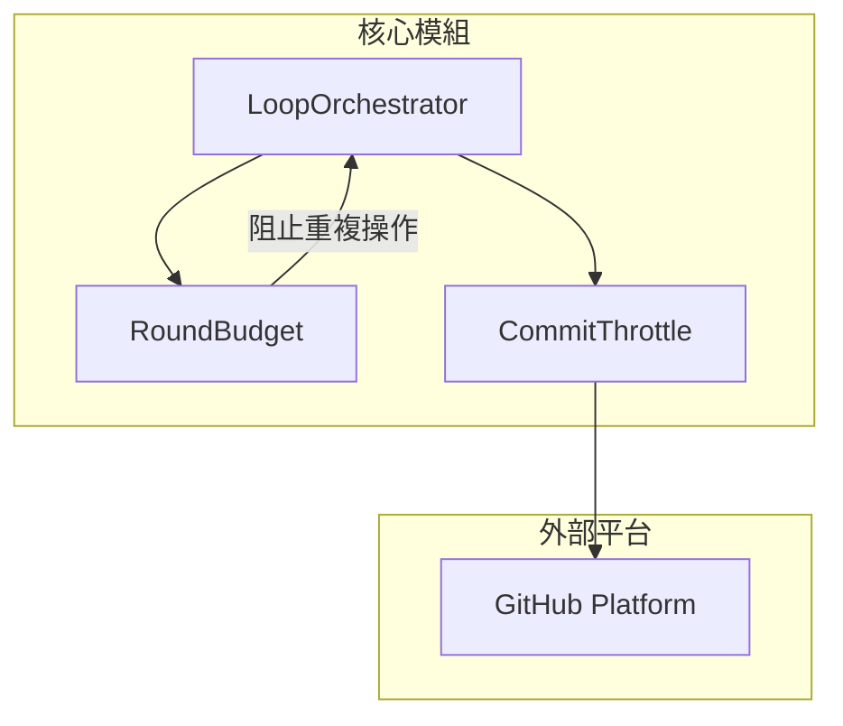
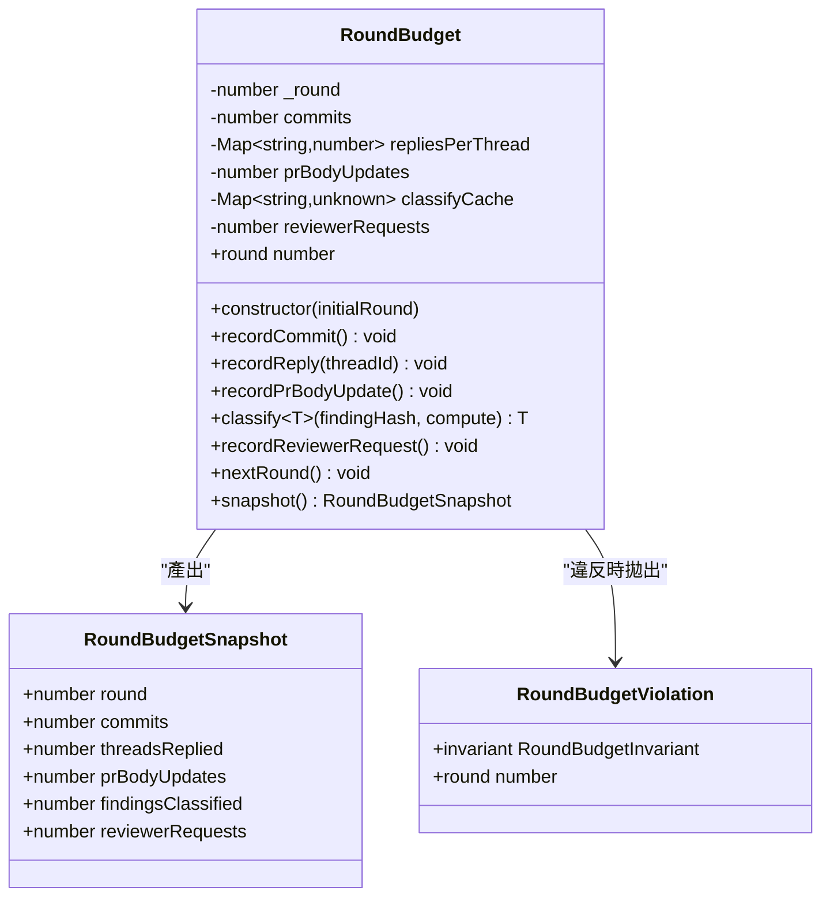
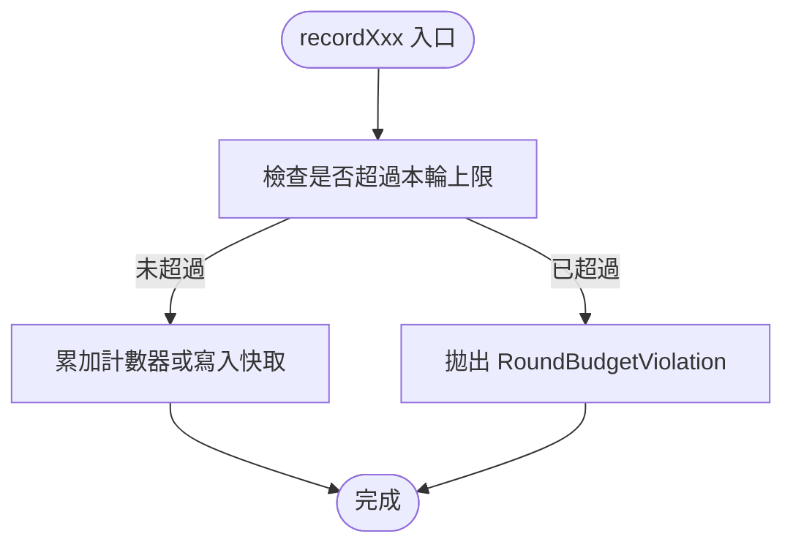
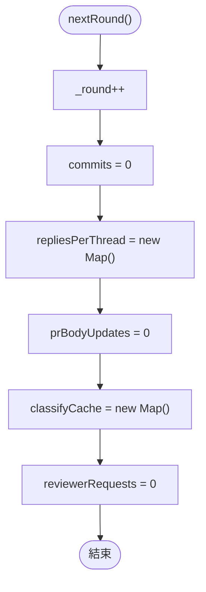
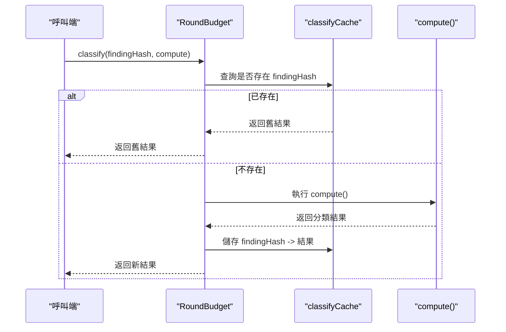
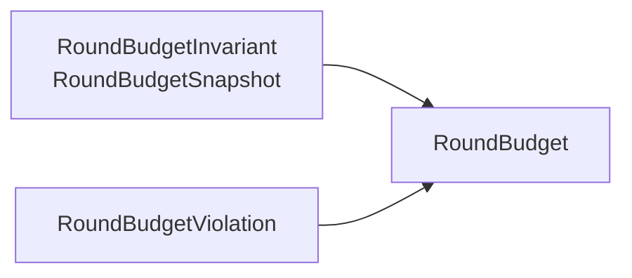

# 輪次預算（RoundBudget）

**本文引用的檔案**

- [RoundBudget.ts](https://github.com/mikeah2011/maestro/blob/master/src/core/round/RoundBudget.ts)
- [RoundBudget.test.ts](https://github.com/mikeah2011/maestro/blob/master/tests/core/round/RoundBudget.test.ts)

## 目錄
1. [簡介](#簡介)
2. [專案結構與角色定位](#專案結構與角色定位)
3. [核心元件](#核心元件)
4. [架構總覽](#架構總覽)
5. [詳細元件分析](#詳細元件分析)
6. [依賴關係分析](#依賴關係分析)
7. [效能考量](#效能考量)
8. [故障排除指南](#故障排除指南)
9. [結論](#結論)
10. [附錄：測試中注入 Mock Budget 的用法](#附錄測試中注入-mock-budget-的用法)

## 簡介
RoundBudget 是 Maestro 工具中的「反垃圾郵件」運行時不變量管理器。它確保在單一輪次內，系統不會濫用外部平台能力：每輪最多一次 commit、每個 review thread 最多一次 reply、PR body 最多更新一次、每個 finding 最多分類一次、reviewer requests 最多一次。

其設計哲學很明確：**不允許「警告並繼續」**。一旦違反任一不變量，就立即拋出 `RoundBudgetViolation` 錯誤並終止流程，以避免工具累積垃圾訊息。這種嚴格的防呆策略，能防止自動化修復或審閱循環造成 PR 污染。

## 專案結構與角色定位
RoundBudget 位於 `src/core/round` 模組下，與 `CommitThrottle.ts` 共同負責輪次級別的節流與約束。它被 orchestrator 或其他上層流程調用，作為所有可能觸發外部副作用的操作前的門閘。

圖表來源
- [RoundBudget.ts:1-131](https://github.com/mikeah2011/maestro/blob/master/src/core/round/RoundBudget.ts#L1-L131)

章節來源
- [RoundBudget.ts:1-131](https://github.com/mikeah2011/maestro/blob/master/src/core/round/RoundBudget.ts#L1-L131)

## 核心元件
RoundBudget 提供五種不變量監控：

| 不變量 | 對應方法 | 限制說明 |
|---|---|---|
| `commits_per_round` | `recordCommit()` | 每輪最多一次 commit |
| `replies_per_thread` | `recordReply(threadId)` | 每個 review thread 每輪最多一次 reply |
| `pr_body_updates` | `recordPrBodyUpdate()` | 每輪最多一次 PR body 更新 |
| `findings_classified` | `classify(findingHash, compute)` | 每個 finding hash 最多執行一次分類計算 |
| `reviewer_requests` | `recordReviewerRequest()` | 每輪最多一次 reviewer request |

此外還提供：

| API | 用途 |
|---|---|
| `nextRound()` | 重置所有計數器並進入下一輪 |
| `snapshot()` | 產出當前輪次的快照，用於監控與審計 |
| `round` getter | 取得目前輪次編號 |

章節來源
- [RoundBudget.ts:15-131](https://github.com/mikeah2011/maestro/blob/master/src/core/round/RoundBudget.ts#L15-L131)

## 架構總覽
RoundBudget 內部維護以下狀態：

- `_round`：目前輪次編號。
- `commits`：本輪 commit 次數。
- `repliesPerThread`：以 threadId 為鍵的 Map，記錄各 thread 已回覆次數。
- `prBodyUpdates`：本輪 PR body 更新次數。
- `classifyCache`：以 finding hash 為鍵的分類結果快取。
- `reviewerRequests`：本輪 reviewer request 次數。

圖表來源
- [RoundBudget.ts:15-131](https://github.com/mikeah2011/maestro/blob/master/src/core/round/RoundBudget.ts#L15-L131)

## 詳細元件分析

### 不變量與 recordXxx 方法

#### commits_per_round
- 首次呼叫 `recordCommit()` 會將 `commits` 從 0 設為 1。
- 第二次呼叫即拋出 `RoundBudgetViolation`，invariant 為 `commits_per_round`。
- 適合封裝任何實際執行 git push 或觸發 CI 的邏輯。

#### replies_per_thread
- 使用 `Map<string, number>` 追蹤每個 thread 的回覆次數。
- 不同 threadId 可各自擁有一次 reply。
- 同一 threadId 第二次回覆即拋出 `RoundBudgetViolation`，invariant 為 `replies_per_thread`。

#### pr_body_updates
- 每輪最多一次 PR body 更新。
- 第二次呼叫即拋出 `RoundBudgetViolation`，invariant 為 `pr_body_updates`。

#### findings_classified（分類快取）
- `classify(findingHash, compute)` 不會直接累加固定計數器，而是透過快取避免重複 LLM 調用。
- 若 `findingHash` 已在快取中，直接回傳舊結果。
- 否則執行 `compute()`，並將結果存入 `classifyCache`。
- 這使 `findings_classified` 在 snapshot 中以快取大小呈現，而非單純累加次數。

#### reviewer_requests
- 每輪最多一次 reviewer request。
- 第二次呼叫即拋出 `RoundBudgetViolation`，invariant 為 `reviewer_requests`。

圖表來源
- [RoundBudget.ts:39-110](https://github.com/mikeah2011/maestro/blob/master/src/core/round/RoundBudget.ts#L39-L110)

章節來源
- [RoundBudget.ts:39-110](https://github.com/mikeah2011/maestro/blob/master/src/core/round/RoundBudget.ts#L39-L110)

### nextRound：重置所有計數器
`nextRound()` 會：

1. 將 `_round` 遞增。
2. 將 `commits` 歸零。
3. 重建空的 `repliesPerThread` Map。
4. 將 `prBodyUpdates` 歸零。
5. 重建空的 `classifyCache` Map。
6. 將 `reviewerRequests` 歸零。

這表示「每一輪都是一個獨立的生命週期」。跨輪次的分類結果、thread 回覆、commit 與 reviewer request 都不會被保留。

圖表來源
- [RoundBudget.ts:112-120](https://github.com/mikeah2011/maestro/blob/master/src/core/round/RoundBudget.ts#L112-L120)

章節來源
- [RoundBudget.ts:112-120](https://github.com/mikeah2011/maestro/blob/master/src/core/round/RoundBudget.ts#L112-L120)

### snapshot：監控與審計
`snapshot()` 產出 `RoundBudgetSnapshot`，包含：

| 欄位 | 意義 |
|---|---|
| `round` | 目前輪次編號 |
| `commits` | 本輪 commit 次數 |
| `threadsReplied` | 已回覆的不同 thread 數量 |
| `prBodyUpdates` | 本輪 PR body 更新次數 |
| `findingsClassified` | 已分類 finding 的 distinct hash 數量 |
| `reviewerRequests` | 本輪 reviewer request 次數 |

這個快照非常適合：

- 在 orchestrator 中紀錄每輪活動。
- 輸出到日誌、指標或審計系統。
- 在測試中驗證行為是否符合預期。
- 判斷是否需要提早中斷過度的自動化動作。

章節來源
- [RoundBudget.ts:27-36](https://github.com/mikeah2011/maestro/blob/master/src/core/round/RoundBudget.ts#L27-L36)
- [RoundBudget.ts:122-131](https://github.com/mikeah2011/maestro/blob/master/src/core/round/RoundBudget.ts#L122-L131)

### classify memoization：避免重複 LLM 調用
`classify` 的設計重點不在於統計分類次數，而在於避免對相同 finding 重複執行高成本的 `compute()`。

圖表來源
- [RoundBudget.ts:91-101](https://github.com/mikeah2011/maestro/blob/master/src/core/round/RoundBudget.ts#L91-L101)

關鍵特性：

- 相同 `findingHash` 只會執行一次 `compute()`。
- 不同 `findingHash` 各自獨立。
- 快取內容在 `nextRound()` 後清空。
- 適合作為 LLM 分類、靜態分析結果彙整等昂貴操作的保護層。

章節來源
- [RoundBudget.ts:91-101](https://github.com/mikeah2011/maestro/blob/master/src/core/round/RoundBudget.ts#L91-L101)

## 依賴關係分析
RoundBudget 本身沒有引入其他業務模組，屬於低耦合的狀態與不變量管理元件。它的對外契約包括：

- 類型：`RoundBudgetInvariant`
- 錯誤：`RoundBudgetViolation`
- 快照：`RoundBudgetSnapshot`
- 實作：`RoundBudget`

圖表來源
- [RoundBudget.ts:15-131](https://github.com/mikeah2011/maestro/blob/master/src/core/round/RoundBudget.ts#L15-L131)

章節來源
- [RoundBudget.ts:15-131](https://github.com/mikeah2011/maestro/blob/master/src/core/round/RoundBudget.ts#L15-L131)

## 效能考量
- 所有 `recordXxx` 方法都是 O(1)。
- `recordReply` 使用 Map 存取，按 threadId 索引，平均時間複雜度為 O(1)。
- `classify` 的快取查詢與寫入也是 O(1)。
- `snapshot()` 需要讀取 Map size，時間複雜度為 O(1)。
- `nextRound()` 重建兩個 Map，空間與時間成本與當輪使用的 distinct thread 數量及 distinct finding hash 數量成正比。

因此，RoundBudget 的主要記憶體使用來自：

- `repliesPerThread`：與 distinct thread 數量成正比。
- `classifyCache`：與 distinct finding hash 數量成正比。

如果單輪產生大量 thread 或大量 finding，應留意這些 Map 的大小。不過由於每輪結束後都會重置，通常不會長期累積。

[本節為一般性效能討論，不直接分析特定程式碼片段]

## 故障排除指南

### RoundBudgetViolation 常見發生場景

| 場景 | invariant | 原因 | 修復建議 |
|---|---|---|---|
| 同一輪多次 commit | `commits_per_round` | 調用端未檢查 `recordCommit()` 是否已被調用 | 確保 orchestrator 只在必要時調用一次；或使用條件分支避免重複 |
| 同一 thread 多次 reply | `replies_per_thread` | 迴圈或重試邏輯對同一 thread 重複回覆 | 在調用前檢查 budget，或在處理 thread 時去重 |
| 多次更新 PR body | `pr_body_updates` | 多個子任務各自更新 PR body | 合併更新邏輯，只讓一個匯聚點調用 `recordPrBodyUpdate()` |
| 多次請求 reviewer | `reviewer_requests` | 多個路徑都嘗試請求 reviewer | 統一由 orchestrator 或專門模組負責一次 reviewer request |
| 分類函式被重複執行 | 非抛出錯誤，但造成重複 LLM 調用 | 同一 finding 被多次 `classify`，且尚未命中快取 | 確保 calling path 不重複調用；確認 finding hash 正確且穩定 |

### 診斷步驟
1. 捕獲 `RoundBudgetViolation` 例外。
2. 檢查 `invariant` 是哪一種不變量。
3. 檢查 `round` 是哪一輪。
4. 查看 message，確認具體 violated 資源，例如 threadId。
5. 回溯該輪次的 orchestrator 流程，找出重複調用位置。
6. 修正為只調用一次，或將重複邏輯改為條件判斷。

### 如何避免誤報
- 不要為了「防禦式調用」而繞過 RoundBudget。
- 不要在 try-catch 中吞掉 `RoundBudgetViolation` 然後繼續執行。
- 如果需要重試，應先 `nextRound()` 再重試，而不是假裝沒發生。
- 如果確實需要在多階段流程中分別提交，請把這些階段劃分為不同的輪次。

章節來源
- [RoundBudget.ts:19-37](https://github.com/mikeah2011/maestro/blob/master/src/core/round/RoundBudget.ts#L19-L37)
- [RoundBudget.ts:39-110](https://github.com/mikeah2011/maestro/blob/master/src/core/round/RoundBudget.ts#L39-L110)

## 結論
RoundBudget 是一個簡單但堅固的反垃圾郵件運行時不變量層。它把「每輪最多一次」的規則從手動紀律轉成程式語言強制執行的契約。配合 `nextRound()` 的完整重置機制與 `snapshot()` 的可觀測性，它能有效防止自動化工具在長時間運作中逐漸變成噪音源。

最佳實踐是：

- 把所有可能觸發外部副作用的操作包在 RoundBudget 之後。
- 把重複性高的 LLM 分類放入 `classify` 快取。
- 在 orchestrator 中集中控制每輪的 commit、PR body 更新與 reviewer request。
- 使用 snapshot 持續觀察每輪的活動規模。
- 遇到 `RoundBudgetViolation` 時視為嚴重錯誤，而不是可忽略的警告。

[本節為總結性內容，不直接分析特定檔案]

## 附錄：測試中注入 Mock Budget 的用法
測試檔案示範了如何建立 `RoundBudget`、模擬違規行為、驗證 reset 行為，以及驗證 snapshot。以下是測試中常見的注入模式摘要：

- 建立預設 RoundBudget：用於正常流程測試。
- 故意重複調用 `recordCommit`、`recordReply`、`recordPrBodyUpdate`、`recordReviewerRequest`，並斷言拋出 `RoundBudgetViolation`。
- 調用 `nextRound()` 後重新調用，驗證計數器已重置。
- 使用自訂 `compute` 函式驗證 `classify` 的 memoization 行為。
- 組合多個操作後驗證 `snapshot()` 的欄位值。

這些範例可以直接作為 orchestrator 測試的模板：在測試中創建 RoundBudget，將其注入待測組件，然後針對每個不變量撰寫正向與反向用例。

章節來源
- [RoundBudget.test.ts:1-153](https://github.com/mikeah2011/maestro/blob/master/tests/core/round/RoundBudget.test.ts#L1-L153)