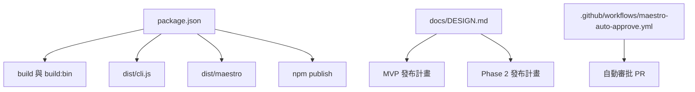
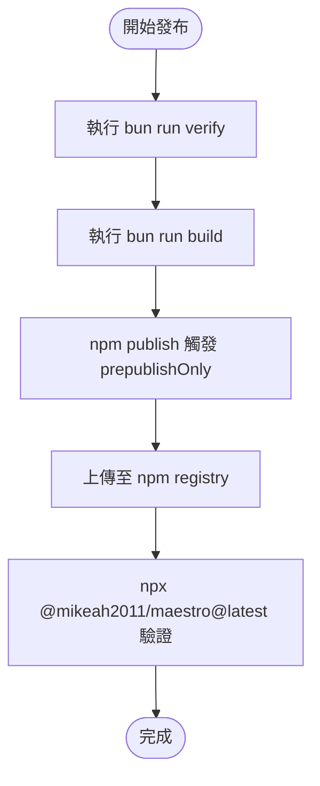
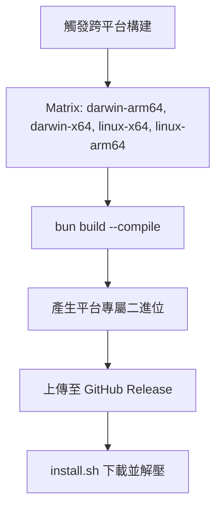
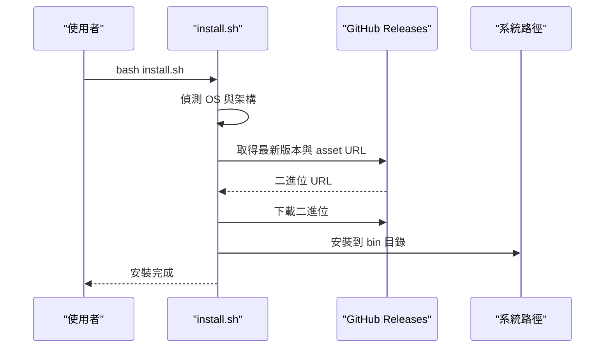
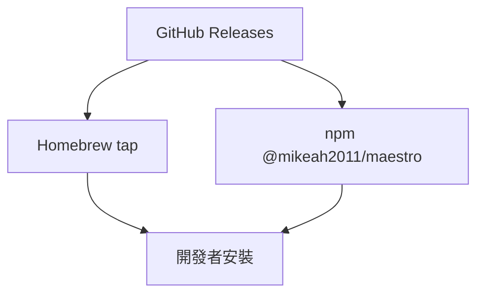
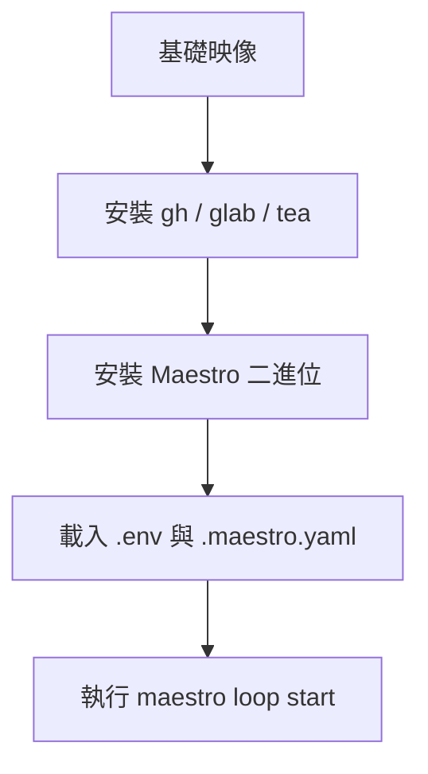
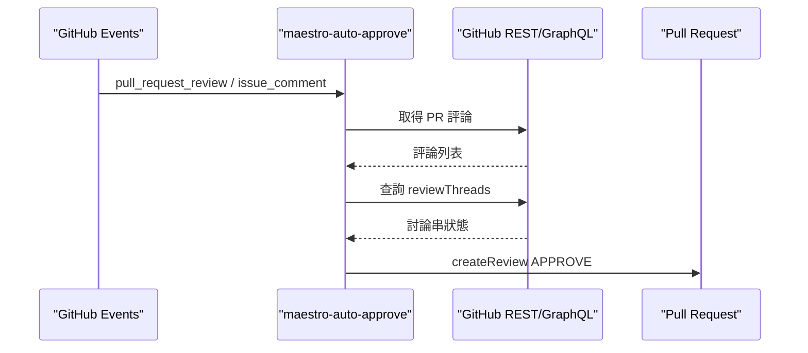
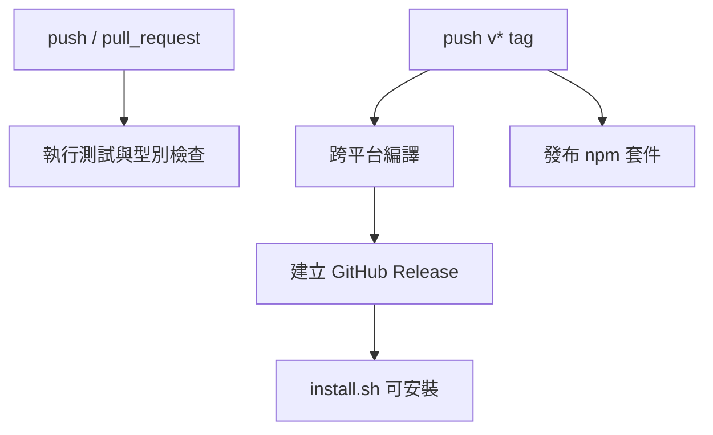
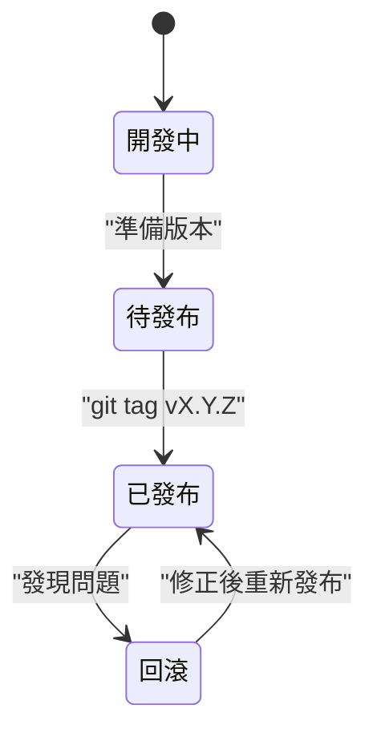
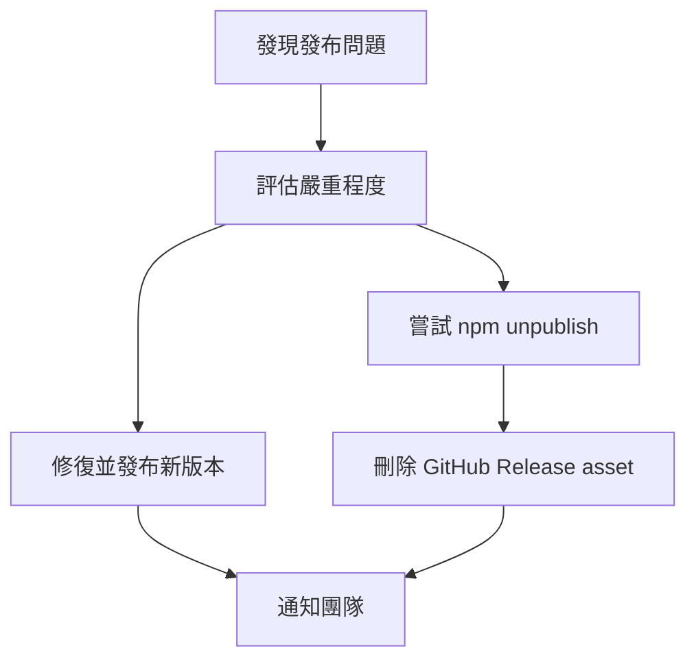

# 部署與發布

**本文引用的檔案**

- [package.json](https://github.com/mikeah2011/maestro/blob/master/package.json)
- [.github/workflows/maestro-auto-approve.yml](https://github.com/mikeah2011/maestro/blob/master/.github/workflows/maestro-auto-approve.yml)
- [README.md](https://github.com/mikeah2011/maestro/blob/master/README.md)
- [CLAUDE.md](https://github.com/mikeah2011/maestro/blob/master/CLAUDE.md)
- [docs/DESIGN.md](https://github.com/mikeah2011/maestro/blob/master/docs/DESIGN.md)
- [.maestro.example.yaml](https://github.com/mikeah2011/maestro/blob/master/.maestro.example.yaml)

## 目錄
1. [簡介](#簡介)
2. [專案結構與發布範圍](#專案結構與發布範圍)
3. [核心發布工件](#核心發布工件)
4. [npm 包發布流程](#npm-包發布流程)
5. [Bun 二進位編譯與跨平台策略](#bun-二進位編譯與跨平台策略)
6. [GitHub Releases 與 install.sh 腳本](#github-releases-與-installsh-腳本)
7. [Homebrew tap（Phase 2）](#homebrew-tap-phase-2)
8. [Docker 映像（Phase 2）](#docker-映像-phase-2)
9. [CI/CD 工作流與自動化審批](#cicd-工作流與自動化審批)
10. [版本管理策略](#版本管理策略)
11. [環境變數管理](#環境變數管理)
12. [發布檢查清單](#發布檢查清單)
13. [回滾程序](#回滾程序)
14. [不同環境的部署範例](#不同環境的部署範例)
15. [故障排除指南](#故障排除指南)
16. [結論](#結論)

## 簡介
本文件說明 `@mikeah2011/maestro` 的部署與發布機制，涵蓋 npm 包、Bun 二進位、GitHub Releases、自動化審批流程，以及規劃中的 Homebrew tap 與 Docker 映像。它同時提供版本管理、環境變數、檢查清單、回滾程序與本地／CI／容器化部署範例，讓維護者可以安全地發布與回退 Maestro CLI。

Maestro 是一個調度 AI PR 審查機器人的收斂層工具；其 CLI 由 Bun 編譯，npm 入口為 `dist/cli.js`，並支援 Node ≥ 20 與 Bun ≥ 1.1 執行環境。

**章節來源**
- [package.json:1-89](https://github.com/mikeah2011/maestro/blob/master/package.json#L1-L89)
- [README.md:1-231](https://github.com/mikeah2011/maestro/blob/master/README.md#L1-L231)

## 專案結構與發布範圍
目前倉庫的發布相關內容集中在：
- `package.json`：定義套件名稱、版本、執行器、二進位名稱、build script、依賴與 `prepublishOnly` 行為。
- `.github/workflows/maestro-auto-approve.yml`：GitHub Actions 自動審批 PR 的工作流程。
- `docs/DESIGN.md`：明確列出 MVP 與 Phase 2 的發布計畫，包含 npm、Bun 二進位、GitHub Releases、install.sh、Homebrew tap 與 Docker。

尚未在倉庫中出現但被引用或規劃的文件：
- `scripts/build-cross-platform.sh`：npm script 引用了此檔，但當前倉庫不存在。
- `install.sh`：設計文件中提到透過 GitHub Releases + install.sh 安裝二進位，但當前倉庫不存在。
- Dockerfile：設計文件中提到 Phase 2 會提供 Docker 映像，但當前倉庫不存在。



**圖表來源**
- [package.json:1-89](https://github.com/mikeah2011/maestro/blob/master/package.json#L1-L89)
- [docs/DESIGN.md:120-180](https://github.com/mikeah2011/maestro/blob/master/docs/DESIGN.md#L120-L180)
- [.github/workflows/maestro-auto-approve.yml:1-93](https://github.com/mikeah2011/maestro/blob/master/.github/workflows/maestro-auto-approve.yml#L1-L93)

**章節來源**
- [package.json:1-89](https://github.com/mikeah2011/maestro/blob/master/package.json#L1-L89)
- [docs/DESIGN.md:120-207](https://github.com/mikeah2011/maestro/blob/master/docs/DESIGN.md#L120-L207)

## 核心發布工件
| 工件 | 位置 / 用途 | 說明 |
|---|---|---|
| npm 套件 `@mikeah2011/maestro` | npm registry | 套件名固定為 `@mikeah2011/maestro`，CLI 二進位名固定為 `maestro`。 |
| CLI 模組 | `./dist/index.js` | 主要可匯出模組，供程式碼使用者使用。 |
| CLI 二進位 | `./dist/cli.js` | Commander CLI 主程式，也是 npm `bin.maestro` 的實際執行檔。 |
| CLI 獨立二進位 | `dist/maestro` | 透過 `bun build ... --compile` 產出的單文件二進位。 |
| 類型宣告 | `./dist/index.d.ts` | TypeScript 型別輸出。 |
| 設定範本 | `.maestro.example.yaml` | 使用者可複製到 `.maestro.yaml` 或 `~/.maestro/config.yaml`。 |
| 自動審批工作流 | `.github/workflows/maestro-auto-approve.yml` | 當監控的機器人皆滿意且討論串已解決時，自動核准 PR。 |

`package.json` 中的關鍵欄位包括：
- `name`: `@mikeah2011/maestro`
- `version`: 目前為 `0.0.1`
- `bin`: `maestro` → `./dist/cli.js`
- `main`: `./dist/index.js`
- `types`: `./dist/index.d.ts`
- `files`: 包含 `dist`、`README.md`、`DESIGN.md`、`LICENSE`、`.maestro.example.yaml`
- `engines.node`: `>=20`
- `engines.bun`: `>=1.1`

**章節來源**
- [package.json:1-89](https://github.com/mikeah2011/maestro/blob/master/package.json#L1-L89)
- [.maestro.example.yaml:1-239](https://github.com/mikeah2011/maestro/blob/master/.maestro.example.yaml#L1-L239)

## npm 包發布流程
### 前置條件
1. 確認你擁有 @mikeah2011/maestro 的 npm 發布權限。
2. 已在本機登入 npm：
   ```bash
   npm login --registry=https://registry.npmjs.org
   ```
3. 確保 Git tag 與要發布的版本一致。
4. 確認 CI 不會覆蓋手動發布的 tag。

### 發布步驟
1. 更新版本：
   - 修改 `package.json` 中的 `version`，或使用版本管理工具（例如 git tag + 人工審核）。
2. 執行驗證：
   ```bash
   bun run verify
   ```
   這會執行型別檢查與測試。
3. 執行建置：
   ```bash
   bun run build
   ```
   預設會將 CLI 打包成 `dist`。
4. 預發布前會觸發 `prepublishOnly`：
   - `package.json` 中已定義 `prepublishOnly: "bun run build"`，因此直接執行 `npm publish` 也會觸發建置。
5. 執行發布：
   ```bash
   npm publish
   ```
6. 驗證發布結果：
   ```bash
   npx @mikeah2011/maestro@latest --help
   ```

### 重要行為
- `prepublishOnly` 會在 `npm publish` 之前執行 `bun run build`，避免發布未建構的 `dist`。
- `engines.node >= 20` 與 `engines.bun >= 1.1` 表示該套件預期在 Node 20+ 或 Bun 1.1+ 上運作。
- `bin.maestro` 指向 `./dist/cli.js`，因此使用者安裝後可直接呼叫 `maestro`。



**圖表來源**
- [package.json:50-89](https://github.com/mikeah2011/maestro/blob/master/package.json#L50-L89)

**章節來源**
- [package.json:1-89](https://github.com/mikeah2011/maestro/blob/master/package.json#L1-L89)
- [CLAUDE.md:1-98](https://github.com/mikeah2011/maestro/blob/master/CLAUDE.md#L1-L98)

## Bun 二進位編譯與跨平台策略
### 現有的 Bun 構建指令
| Script | 行為 | 輸出 |
|---|---|---|
| `build` | 使用 `bun build` 打包 CLI，目標為 Bun，並壓縮 | `dist/cli.js` |
| `build:bin` | 使用 `--compile` 編譯為單一二進位 | `dist/maestro` |
| `build:cross` | 指向 `scripts/build-cross-platform.sh` | 預期產出多個平台的二進位 |

### 設計文件中的跨平台目標
設計文件明確指出 MVP 應支援以下平台：
- `darwin-arm64`
- `darwin-x64`
- `linux-x64`
- `linux-arm64`

Windows 二進位屬於無限期延後項目。

### 當前缺口
- `scripts/build-cross-platform.sh` 不存在於倉庫中，因此 `bun run build:cross` 無法成功執行。
- 目前沒有現成的 GitHub Actions job 負責多平台編譯與上傳至 GitHub Releases。
- 沒有現成的 `install.sh`。

建議實作方式：
1. 建立 `scripts/build-cross-platform.sh`，針對四個目標平台執行 `bun build ... --compile`。
2. 在 CI 中使用 matrix strategy 分別在 macOS 與 Linux runner 上編譯。
3. 將每個平台的二進位命名為：
   - `maestro-darwin-arm64`
   - `maestro-darwin-x64`
   - `maestro-linux-x64`
   - `maestro-linux-arm64`
4. 透過 GitHub API 或 `gh release upload` 上傳至對應 release asset。



**圖表來源**
- [package.json:55-57](https://github.com/mikeah2011/maestro/blob/master/package.json#L55-L57)
- [docs/DESIGN.md:120-180](https://github.com/mikeah2011/maestro/blob/master/docs/DESIGN.md#L120-L180)

**章節來源**
- [package.json:50-89](https://github.com/mikeah2011/maestro/blob/master/package.json#L50-L89)
- [docs/DESIGN.md:120-207](https://github.com/mikeah2011/maestro/blob/master/docs/DESIGN.md#L120-L207)

## GitHub Releases 與 install.sh 腳本
### 設計目標
設計文件說明 MVP 需要：
- 透過 GitHub Releases 提供二進位。
- 透過 `install.sh` 安裝 Maestro。
- 二進位應為零執行期依賴（由 Bun 編譯而成）。

### 建議的 Release 命名與資產
| 資產名稱 | 平台 |
|---|---|
| `maestro-darwin-arm64` | Apple Silicon Mac |
| `maestro-darwin-x64` | Intel Mac |
| `maestro-linux-x64` | x86_64 Linux |
| `maestro-linux-arm64` | ARM Linux |

### 建議的 install.sh 行為
雖然目前倉庫沒有 `install.sh`，但根據設計文件的意圖，它應該：
1. 偵測作業系統與 CPU 架構。
2. 計算正確的 asset 名稱。
3. 從 GitHub Releases 下載對應的二進位。
4. 驗證 SHA 或簽章（若未來有簽署）。
5. 移動到 `/usr/local/bin/maestro` 或 `$HOME/.local/bin/maestro`。
6. 設定可執行權限。
7. 失敗時返回非零退出碼。



**圖表來源**
- [docs/DESIGN.md:120-180](https://github.com/mikeah2011/maestro/blob/master/docs/DESIGN.md#L120-L180)

**章節來源**
- [docs/DESIGN.md:120-180](https://github.com/mikeah2011/maestro/blob/master/docs/DESIGN.md#L120-L180)

## Homebrew tap（Phase 2）
設計文件將 Homebrew tap 列為 Phase 2。這意味著：
- 它不是 MVP 的必要條件。
- 它可以在 npm 與 GitHub Releases 穩定之後再實作。
- 它適合用於 macOS 與 Linux 開發者快速安裝 CLI。

### 建議的 Homebrew Tap 結構
```text
tap/
├── README.md
└── Formula/
    └── maestro.rb
```

`Formula/maestro.rb` 的行為應類似：
- 從 GitHub Releases 取得指定版本的二進位。
- 安裝到 `$(brew --prefix)/bin/maestro`。
- 設定可執行權限。
- 支援 `brew upgrade maestro`。

### 與現有發布的關係
- Homebrew 不應直接發布 npm 包。
- 建議 Homebrew formula 依賴已存在的 GitHub Releases asset。
- 這樣可以避免重複實作跨平台編譯邏輯。



**圖表來源**
- [docs/DESIGN.md:120-180](https://github.com/mikeah2011/maestro/blob/master/docs/DESIGN.md#L120-L180)

**章節來源**
- [docs/DESIGN.md:120-180](https://github.com/mikeah2011/maestro/blob/master/docs/DESIGN.md#L120-L180)

## Docker 映像（Phase 2）
設計文件將 Docker 映像列為 Phase 2，並特別說明映像應預裝：
- `gh`
- `glab`
- `tea`

這些工具適合自託管 CI 環境使用。

### 建議的 Dockerfile 策略
1. 使用 Alpine 或 slim base image。
2. 安裝必要的系統依賴。
3. 安裝 `gh`、`glab`、`tea`。
4. 安裝或複製 Maestro 二進位。
5. 暴露必要環境變數。
6. 預設執行 `maestro` 或提供 entrypoint。

### 映像標籤策略
- `@mikeah2011/maestro:latest`
- `@mikeah2011/maestro:vX.Y.Z`
- 可考慮 `alpine`、`debian-slim` 等多重 variant。



**圖表來源**
- [docs/DESIGN.md:120-180](https://github.com/mikeah2011/maestro/blob/master/docs/DESIGN.md#L120-L180)

**章節來源**
- [docs/DESIGN.md:120-180](https://github.com/mikeah2011/maestro/blob/master/docs/DESIGN.md#L120-L180)

## CI/CD 工作流與自動化審批
### 現有工作流：自動審批 PR
`.github/workflows/maestro-auto-approve.yml` 會：
1. 監聽 `pull_request_review` 與 `issue_comment`。
2. 取得 PR 的所有評論。
3. 保留每個 bot 的最新評論。
4. 檢查是否滿足特定 bot 的審查狀態。
5. 使用 GraphQL 查詢 review threads，確認所有討論串已解決。
6. 若尚未由 `github-actions[bot]` 核准，則送出 `APPROVE`。



**圖表來源**
- [.github/workflows/maestro-auto-approve.yml:1-93](https://github.com/mikeah2011/maestro/blob/master/.github/workflows/maestro-auto-approve.yml#L1-L93)

### 建議新增的 CI/CD 工作流
目前倉庫只有自動審批工作流，沒有發布或跨平台構建工作流。建議新增：

| 工作流 | 觸發條件 | 職責 |
|---|---|---|
| `test-and-typecheck` | push、pull_request | 執行 `typecheck`、`test`、`coverage` |
| `build-cross-platform` | push tag、release | 編譯四種平台二進位 |
| `publish-npm` | push tag | 發布 `@mikeah2011/maestro` |
| `publish-release` | push tag | 上傳二進位至 GitHub Releases |



**圖表來源**
- [package.json:50-89](https://github.com/mikeah2011/maestro/blob/master/package.json#L50-L89)
- [.github/workflows/maestro-auto-approve.yml:1-93](https://github.com/mikeah2011/maestro/blob/master/.github/workflows/maestro-auto-approve.yml#L1-L93)

**章節來源**
- [.github/workflows/maestro-auto-approve.yml:1-93](https://github.com/mikeah2011/maestro/blob/master/.github/workflows/maestro-auto-approve.yml#L1-L93)
- [package.json:50-89](https://github.com/mikeah2011/maestro/blob/master/package.json#L50-L89)

## 版本管理策略
### 當前狀態
- `package.json.version` 為 `0.0.1`。
- 沒有看到現成的 versioning script、changelog generator 或 conventional commit tool。
- 沒有看到現成的 CI 自動打 tag 或自動發布 logic。

### 建議策略
1. **Git tag 作為唯一真源**：
   - 格式：`vX.Y.Z`
   - 例如：`v0.1.0`、`v0.2.0`、`v1.0.0`
2. **版本同步規則**：
   - 打 tag 時，tag 名稱必須與 `package.json.version` 一致。
   - CI 應驗證兩者一致。
3. **SemVer 原則**：
   - `PATCH`：bug 修復、不影響行為的改進。
   - `MINOR`：新功能，例如新的 platform、AI provider。
   - `MAJOR`：破壞性變更。
4. **發布觸發條件**：
   - 只有 tagged commit 才允許發布 npm 與 GitHub Release。
   - pull_request 只執行測試與構建，不發布。



**圖表來源**
- [package.json:1-10](https://github.com/mikeah2011/maestro/blob/master/package.json#L1-L10)

**章節來源**
- [package.json:1-10](https://github.com/mikeah2011/maestro/blob/master/package.json#L1-L10)

## 環境變數管理
### 必需環境變數
| 變數 | 用途 | 建議來源 |
|---|---|---|
| `GITHUB_TOKEN` | GitHub API 存取 token | GitHub Secrets、CI environment、`.env` |
| `ANTHROPIC_API_KEY` | Claude API Key（可選） | Anthropic、CI secrets |
| `OPENAI_API_KEY` | OpenAI provider（可選） | OpenAI、CI secrets |
| `GOOGLE_API_KEY` | Gemini provider（可選） | Google Cloud、CI secrets |
| `OLLAMA_BASE_URL` | 本機 Ollama（可選） | 本機服務 |

### 設定優先順序
根據設計文件與 `.maestro.example.yaml`，設定優先順序為：
1. CLI 旗標
2. 環境變數
3. 倉庫 `.maestro.yaml`
4. 使用者 `~/.maestro/config.yaml`
5. 預設值

此外，CLAUDE.md 也指出 CLI 啟動時會自動從 `process.cwd()/.env` 載入環境變數。

### 最佳實踐
- 不要在程式碼中硬编码 token。
- 在 CI 中使用 repository secrets。
- 在本地開發使用 `.env`，並將 `.env` 加入 `.gitignore`。
- 在 `.maestro.yaml` 中使用 `${ENV_VAR}` 語法引用環境變數。
- 若變數可省略，使用 `${VAR:-default}` 語法。

**章節來源**
- [.maestro.example.yaml:1-239](https://github.com/mikeah2011/maestro/blob/master/.maestro.example.yaml#L1-L239)
- [CLAUDE.md:1-98](https://github.com/mikeah2011/maestro/blob/master/CLAUDE.md#L1-L98)

## 發布檢查清單
### 發布前檢查
- [ ] 測試通過：`bun run test`
- [ ] 型別檢查通過：`bun run typecheck`
- [ ] 覆蓋率達到門檻（lines/functions/statements ≥ 80%，branches ≥ 75%）
- [ ] `package.json.version` 正確
- [ ] Git tag 與版本一致
- [ ] `bun run build` 成功
- [ ] `bun run build:bin` 成功
- [ ] `npx @mikeah2011/maestro@latest --help` 可執行
- [ ] GitHub Release 資產已上傳
- [ ] install.sh 可用
- [ ] Homebrew tap（Phase 2）已更新
- [ ] Docker 映像（Phase 2）已推送
- [ ] README 與 CHANGELOG 已更新

### 發布後檢查
- [ ] npm 套件可安裝
- [ ] CLI 二進位可執行
- [ ] GitHub Release asset 可下載
- [ ] install.sh 可在目標平台安裝
- [ ] Homebrew tap 可安裝（Phase 2）
- [ ] Docker 映像可拉取（Phase 2）
- [ ] CI 工作流正常觸發
- [ ] 自動審批流程正常運作

**章節來源**
- [CLAUDE.md:1-98](https://github.com/mikeah2011/maestro/blob/master/CLAUDE.md#L1-L98)
- [package.json:50-89](https://github.com/mikeah2011/maestro/blob/master/package.json#L50-L89)

## 回滾程序
### npm 回滾
1. 取消發布：
   ```bash
   npm unpublish @mikeah2011/maestro@VERSION --force
   ```
   注意：npm 對已發布超過 24 小時的套件通常不允許移除。
2. 若無法移除，則發布下一個 patch 版本修正問題。
3. 通知團隊改用新版本或暫時退回舊版本。

### GitHub Releases 回滾
1. 刪除錯誤的 release asset。
2. 重新上傳正確的二進位。
3. 若需要，重建 release。
4. 通知使用者 refresh cache。

### 緊急回滾建議
- 優先修復而非刪除：若 npm 已不可移除，發布 `vX.Y.Z+1`。
- 保持 changelog 清楚：使用者知道哪個版本有問題。
- 保留舊版本 tag：便於回溯問題。
- 在 CI 中加入發布驗證步驟：避免發布 broken artifact。



**圖表來源**
- [package.json:1-10](https://github.com/mikeah2011/maestro/blob/master/package.json#L1-L10)

**章節來源**
- [package.json:1-10](https://github.com/mikeah2011/maestro/blob/master/package.json#L1-L10)

## 不同環境的部署範例
### 本地開發
```bash
# 安裝依賴
bun install

# 開發模式
bun run dev

# 直接執行 CLI
bun run start loop start --pr 1 --dry-run

# 驗證環境
bun run src/cli/index.ts doctor

# 建置二進位
bun run build:bin
```

### CI 環境
建議的 CI 步驟：
1. 設定 Node.js / Bun 環境。
2. 安裝依賴。
3. 執行型別檢查與測試。
4. 構建 npm 包與二進位。
5. 僅在 tag push 時發布。

```yaml
# 概念性 CI 步驟
steps:
  - uses: actions/setup-node@v4
    with:
      node-version: 20
  - uses: oven-sh/setup-bun@v1
    with:
      bun-version: latest
  - run: bun install
  - run: bun run verify
  - run: bun run build
  - run: bun run build:bin
```

### 容器化環境
Phase 2 的 Docker 映像建議：
- 預裝 `gh`、`glab`、`tea`。
- 預裝 Maestro CLI。
- 掛載 `.env` 與 `.maestro.yaml`。
- 以 non-root 使用者執行。

```bash
docker run \
  --rm \
  -e GITHUB_TOKEN="${GITHUB_TOKEN}" \
  -v "$PWD/.maestro.yaml:/app/.maestro.yaml" \
  -v "$PWD/.env:/app/.env" \
  @mikeah2011/maestro:latest loop start --pr 1
```

### 二進位安裝
未來 install.sh 可用：
```bash
curl -fsSL https://raw.githubusercontent.com/mikeah2011/maestro/main/install.sh | bash
```

**章節來源**
- [README.md:1-231](https://github.com/mikeah2011/maestro/blob/master/README.md#L1-L231)
- [docs/DESIGN.md:120-180](https://github.com/mikeah2011/maestro/blob/master/docs/DESIGN.md#L120-L180)

## 故障排除指南
### npm 發布失敗
| 現象 | 可能原因 | 處理方式 |
|---|---|---|
| `prepublishOnly` 失敗 | build 失敗 | 先執行 `bun run build` |
| 權限不足 | 未登入 npm | `npm login` |
| 版本衝突 | 版本已存在 | 更新 `package.json.version` |
| engines 不符合 | Node/Bun 版本太低 | 升級 Node ≥ 20 或 Bun ≥ 1.1 |

### 二進位無法執行
| 現象 | 可能原因 | 處理方式 |
|---|---|---|
| `command not found: maestro` | 未安裝或未加入 PATH | 使用 `npx` 或安裝二進位 |
| `cannot execute binary file` | 平台不相符 | 下載正確平台 asset |
| `permission denied` | 缺少執行權限 | `chmod +x dist/maestro` |

### CI 測試失敗
| 現象 | 可能原因 | 處理方式 |
|---|---|---|
| 型別檢查失敗 | TypeScript 錯誤 | 執行 `bun run typecheck` |
| 測試失敗 | 單元測試或整合測試失敗 | 執行 `bun run test` |
| 覆蓋率不足 | 覆蓋率低於門檻 | 增加測試或調整門檻 |

### 自動審批未生效
| 現象 | 可能原因 | 處理方式 |
|---|---|---|
| PR 未被自動核准 | bot 未發出期望評論 | 檢查 bot 設定 |
| 討論串未解決 | 仍有未解決的 review thread | 手動解決或由 maestro 解決 |
| workflow 未觸發 | event 不符 | 檢查 `pull_request_review` 或 `issue_comment` |

**章節來源**
- [package.json:50-89](https://github.com/mikeah2011/maestro/blob/master/package.json#L50-L89)
- [.github/workflows/maestro-auto-approve.yml:1-93](https://github.com/mikeah2011/maestro/blob/master/.github/workflows/maestro-auto-approve.yml#L1-L93)

## 結論
目前的 Maestro 專案具備清晰的 npm 發布基礎，但尚未完整實作跨平台二進位構建、GitHub Releases 自動化、install.sh、Homebrew tap 與 Docker 映像。設計文件已清楚定義 MVP 與 Phase 2 的範圍，下一步應優先補齊：
1. 建立 `scripts/build-cross-platform.sh`。
2. 實作 CI matrix build 與 GitHub Release upload。
3. 實作 `install.sh`。
4. 在 Phase 2 推出 Homebrew tap 與 Docker 映像。
5. 強化版本管理與發布檢查清單，確保每次發布都可追溯、可回滾。

這樣能讓 `@mikeah2011/maestro` 不僅是 npm 套件，也能成為跨平台、可安裝、可容器化的成熟 CLI 工具。