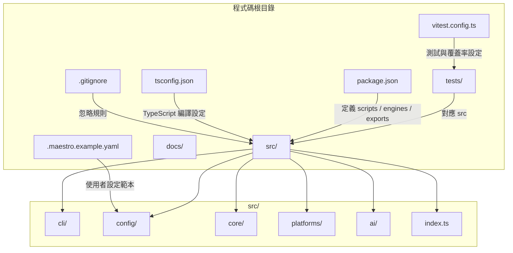
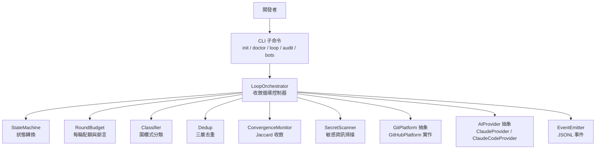
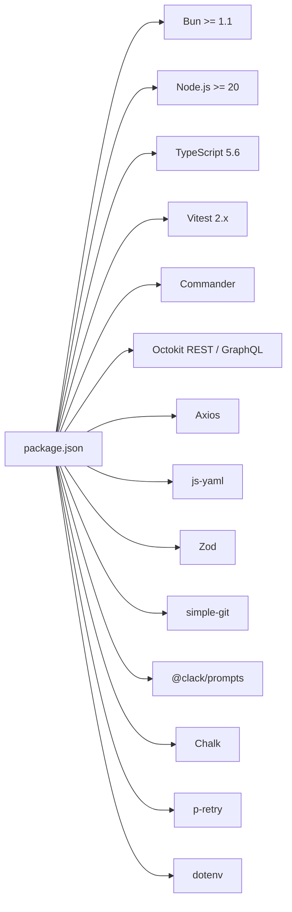

# 開發者指南

**本文引用的檔案**

- [package.json](https://github.com/mikeah2011/maestro/blob/master/package.json)
- [README.md](https://github.com/mikeah2011/maestro/blob/master/README.md)
- [tsconfig.json](https://github.com/mikeah2011/maestro/blob/master/tsconfig.json)
- [vitest.config.ts](https://github.com/mikeah2011/maestro/blob/master/vitest.config.ts)
- [.maestro.example.yaml](https://github.com/mikeah2011/maestro/blob/master/.maestro.example.yaml)
- [CLAUDE.md](https://github.com/mikeah2011/maestro/blob/master/CLAUDE.md)
- [docs/DESIGN.md](https://github.com/mikeah2011/maestro/blob/master/docs/DESIGN.md)
- [src/index.ts](https://github.com/mikeah2011/maestro/blob/master/src/index.ts)
- [.github/workflows/maestro-auto-approve.yml](https://github.com/mikeah2011/maestro/blob/master/.github/workflows/maestro-auto-approve.yml)
- [.gitignore](https://github.com/mikeah2011/maestro/blob/master/.gitignore)

## 目錄
1. [簡介](#簡介)
2. [專案結構](#專案結構)
3. [核心元件](#核心元件)
4. [架構總覽](#架構總覽)
5. [詳細元件分析](#詳細元件分析)
6. [相依性分析](#相依性分析)
7. [效能與記憶體優化](#效能與記憶體優化)
8. [除錯與問題排除](#除錯與問題排除)
9. [貢獻流程與規範](#貢獻流程與規範)
10. [結論](#結論)
11. [附錄：常用指令速查](#附錄常用指令速查)

## 簡介
Maestro 是一個用於統一調度 AI PR 審查機器人的收斂工具。它不是另一個程式碼審查工具，而是疊加在 CodeRabbit、Ellipsis、Copilot Code Review、Codex、Gemini Code Assist、Sourcery 等機器人之上的「收斂層」，負責分類問題、去重、自動修復、回覆討論串、解決討論串、請求重新審查，並在硬性上限（預設最多 3 輪）內強制收斂。

對開發者而言，這個專案提供：
- ESM TypeScript CLI 與可重複使用的函式庫入口。
- 明確的模組分層：CLI、設定、核心編排、Git 平台抽象、AI Provider 抽象與實作。
- 嚴格的測試、型別檢查與覆蓋率門檻。
- 可透過 Bun 或 Node.js >= 20 執行的雙環境支援。

**章節來源**
- [README.md:1-120](https://github.com/mikeah2011/maestro/blob/master/README.md#L1-L120)
- [CLAUDE.md:1-98](https://github.com/mikeah2011/maestro/blob/master/CLAUDE.md#L1-L98)
- [docs/DESIGN.md:1-120](https://github.com/mikeah2011/maestro/blob/master/docs/DESIGN.md#L1-L120)

## 專案結構
專案採用功能導向的模組組織方式，並依「CLI → 設定 → 核心領域 → 平台 → AI」的分層切分。

### 主要目錄說明
- `src/cli/`：Commander CLI 入口與子命令，例如初始化、環境診斷、循環控制、審計、機器人管理。
- `src/config/`：Zod schema、設定載入、變數展開與多層設定合併。
- `src/core/`：核心領域邏輯，包含事件、回合配額、狀態機、收斂監控、分類、去重、安全掃描、自動修復與循環編排。
- `src/platforms/`：Git 平台抽象與 GitHub 實作，包含 REST、GraphQL 與資料映射。
- `src/ai/`：AI Provider 抽象與 Claude（API 與 CLI）實作。
- `src/index.ts`：公共函式庫重新匯出點，供 CI、測試與未來插件使用。
- `tests/`：Vitest 測試，按模組結構對應 `src/`。
- `docs/DESIGN.md`：面向公眾的技術設計摘要。
- `.maestro.example.yaml`：完整設定範本，包含 AI provider、平台、機器人、停止條件、預檢、語言插件與 PR body 模板。

**圖表來源**
- [src/index.ts:1-150](https://github.com/mikeah2011/maestro/blob/master/src/index.ts#L1-L150)
- [package.json:1-89](https://github.com/mikeah2011/maestro/blob/master/package.json#L1-L89)
- [tsconfig.json:1-41](https://github.com/mikeah2011/maestro/blob/master/tsconfig.json#L1-L41)
- [.maestro.example.yaml:1-239](https://github.com/mikeah2011/maestro/blob/master/.maestro.example.yaml#L1-L239)

**章節來源**
- [README.md:60-160](https://github.com/mikeah2011/maestro/blob/master/README.md#L60-L160)
- [CLAUDE.md:15-98](https://github.com/mikeah2011/maestro/blob/master/CLAUDE.md#L15-L98)
- [docs/DESIGN.md:20-120](https://github.com/mikeah2011/maestro/blob/master/docs/DESIGN.md#L20-L120)

## 核心元件
以下元件是開發者最常接觸的核心模組：

| 模組 | 職責 | 開發重點 |
|---|---|---|
| `src/cli/` | Commander CLI 子命令與流程入口 | 新增子命令時需註冊並保持錯誤輸出一致。 |
| `src/config/` | Zod schema + YAML + 環境變數 + 使用者設定 | 新增設定欄位時要同步更新 schema、範本與測試。 |
| `src/core/events/EventEmitter.ts` | 結構化 JSONL 事件 | UI、MCP、CI 都依賴此事件流。 |
| `src/core/state/StateMachine.ts` | 循環狀態轉換 | 新增階段時需處理終止狀態與事件。 |
| `src/core/round/RoundBudget.ts` | 反垃圾郵件執行期斷言 | 違反即 throw；不可改為靜默警告。 |
| `src/core/convergence/ConvergenceMonitor.ts` | Jaccard 振盪偵測 | 關鍵問題集比較、內容雜湊穩定性。 |
| `src/core/classify/Classifier.ts` | 圍欄式分類 | 先確定性規則，再 LLM。 |
| `src/core/dedup/Dedup.ts` | 三層去重 | 精確雜湊 → Levenshtein → LLM。 |
| `src/core/security/SecretScanner.ts` | 外發文字敏感資訊遮蔽 | 每次回覆與 PR 內容更新前掃描。 |
| `src/core/loop/LoopOrchestrator.ts` | 收斂循環主控制器 | 整合上述模組，注入副作用以支援測試。 |
| `src/platforms/github/GitHubPlatform.ts` | GitHub REST + GraphQL | 速率限制、討論串解決、PR 內容更新。 |
| `src/ai/providers/ClaudeProvider.ts` | Anthropic API | 需要 API Key。 |
| `src/ai/providers/ClaudeCodeProvider.ts` | Claude Code CLI | 無需 API Key，作為 fallback。 |
| `src/index.ts` | 公共 API 匯出 | 新增公開類型或類別時必須在此重新匯出。 |

**章節來源**
- [src/index.ts:1-150](https://github.com/mikeah2011/maestro/blob/master/src/index.ts#L1-L150)
- [CLAUDE.md:20-98](https://github.com/mikeah2011/maestro/blob/master/CLAUDE.md#L20-L98)
- [docs/DESIGN.md:20-120](https://github.com/mikeah2011/maestro/blob/master/docs/DESIGN.md#L20-L120)

## 架構總覽
Maestro 的系統架構可理解為兩層：

1. **核心層**：與 Git 平台與 AI 工具無關的有狀態邏輯。包含設定、事件、回合配額、狀態機、分類、去重、安全掃描、自動修復與循環編排。
2. **平台與 AI 適配層**：`GitPlatform` 抽象與 `GitHubPlatform` 實作；`AIProvider` 抽象與 Claude API/CLI 實作。

**圖表來源**
- [src/index.ts:1-150](https://github.com/mikeah2011/maestro/blob/master/src/index.ts#L1-L150)
- [docs/DESIGN.md:20-120](https://github.com/mikeah2011/maestro/blob/master/docs/DESIGN.md#L20-L120)

**章節來源**
- [README.md:80-160](https://github.com/mikeah2011/maestro/blob/master/README.md#L80-L160)
- [CLAUDE.md:20-98](https://github.com/mikeah2011/maestro/blob/master/CLAUDE.md#L20-L98)
- [docs/DESIGN.md:20-120](https://github.com/mikeah2011/maestro/blob/master/docs/DESIGN.md#L20-L120)

## 詳細元件分析

### CLI 與常用指令
CLI 是主要的開發與操作入口，由 Commander 驅動。常見用途包括：
- `doctor`：檢查環境是否具備必要工具與權限。
- `init`：產生或驗證 `.maestro.yaml`。
- `loop start/status/stop/resume`：啟動、查看、停止與恢復收斂循環。
- `audit`：重播分類決策。
- `bots`：機器人管理與自動核准設定。

開發模式建議使用 watch 模式，避免每次修改後手動重啟。提交前則應執行型別檢查與測試。

**章節來源**
- [package.json:33-54](https://github.com/mikeah2011/maestro/blob/master/package.json#L33-L54)
- [README.md:100-160](https://github.com/mikeah2011/maestro/blob/master/README.md#L100-L160)
- [CLAUDE.md:3-35](https://github.com/mikeah2011/maestro/blob/master/CLAUDE.md#L3-L35)

### 設定系統與優先順序
設定系統基於 Zod schema 與 YAML，支援多層合併：
1. CLI 旗標
2. 環境變數
3. 倉庫 `.maestro.yaml`
4. 使用者 `~/.maestro/config.yaml`
5. 預設值

`.maestro.example.yaml` 提供完整範本，包含：
- AI provider 與路由策略。
- Git 平台與認證。
- 機器人登錄與慣例偵測。
- 停止條件與收斂保證。
- 反垃圾郵件不變量。
- 本地預檢步驟。
- 語言插件。
- PR body 模板。
- 安全掃描規則。

新增設定欄位時，需要同步更新：
- Zod schema。
- 設定載入邏輯。
- `.maestro.example.yaml`。
- 相關測試。

**章節來源**
- [.maestro.example.yaml:1-239](https://github.com/mikeah2011/maestro/blob/master/.maestro.example.yaml#L1-L239)
- [README.md:140-200](https://github.com/mikeah2011/maestro/blob/master/README.md#L140-L200)
- [CLAUDE.md:60-98](https://github.com/mikeah2011/maestro/blob/master/CLAUDE.md#L60-L98)
- [docs/DESIGN.md:20-80](https://github.com/mikeah2011/maestro/blob/master/docs/DESIGN.md#L20-L80)

### TypeScript 編譯設定與路徑別名
TypeScript 設定使用 ESM、ES2022 target，並啟用嚴格模式。重要設定包括：
- `moduleResolution: bundler`
- `strict: true`
- `noUncheckedIndexedAccess: true`
- `noImplicitOverride: true`
- `useUnknownInCatchVariables: true`
- `declaration: true`
- `sourceMap: true`
- `outDir: dist`
- `rootDir: src`
- `paths["@/*"]: ["src/*"]`

這表示：
- 所有源碼位於 `src/`，建置輸出到 `dist/`。
- 可使用 `@/` 路徑別名取代相對路徑，例如 `@/config/load`。
- 測試也參與型別檢查，但 excludes 排除測試檔的編譯輸出。

**章節來源**
- [tsconfig.json:1-41](https://github.com/mikeah2011/maestro/blob/master/tsconfig.json#L1-L41)

### 測試與覆蓋率
測試框架為 Vitest，環境為 Node。覆蓋率提供者為 V8，並針對 `src/**/*.ts` 計算覆蓋率，排除測試檔、CLI 入口與 types 目錄。

覆蓋率門檻：
- 行數：80%
- 函式：80%
- 分支：75%
- 語句：80%

開發時建議：
- 寫新功能時同步撰寫單元測試。
- 新增領域邏輯時，補上邊界條件與錯誤路徑測試。
- 若新增測試無法達到門檻，應優先改善測試品質而非降低門檻。

**章節來源**
- [vitest.config.ts:1-31](https://github.com/mikeah2011/maestro/blob/master/vitest.config.ts#L1-L31)
- [CLAUDE.md:30-35](https://github.com/mikeah2011/maestro/blob/master/CLAUDE.md#L30-L35)

### 環境變數與 .env
專案使用 dotenv，CLI 啟動時會從工作目錄下的 `.env` 載入環境變數。常見變數包含：
- `GITHUB_TOKEN`：GitHub 存取權杖。
- `ANTHROPIC_API_KEY`：Anthropic API Key（可選）。
- 其他 AI provider 的 API Key 或 baseUrl。

`.gitignore` 已排除 `.env`、`.env.local`、`.env.*.local`，但保留 `.env.example`。

**章節來源**
- [CLAUDE.md:60-98](https://github.com/mikeah2011/maestro/blob/master/CLAUDE.md#L60-L98)
- [.gitignore:17-26](https://github.com/mikeah2011/maestro/blob/master/.gitignore#L17-L26)

### Git Workflow
目前倉庫提供的 GitHub Actions 是自動核准流程，並非完整的 CI pipeline。其行為如下：
- 監聽 `pull_request_review.submitted` 與 `issue_comment.created`。
- 取得最新機器人審查結果。
- 檢查是否滿足被監控機器人的通過條件。
- 檢查所有討論串是否已解決。
- 若尚未由 GitHub Actions bot 核准，則建立 APPROVE 審查。

這代表開發者的標準 Git workflow 仍應遵循：
1. 建立功能分支。
2. 編寫程式碼與測試。
3. 執行 `bun run verify`。
4. 提交並推送到遠端。
5. 建立 Pull Request。
6. 等待人工審查與 CI 結果。

**章節來源**
- [.github/workflows/maestro-auto-approve.yml:1-93](https://github.com/mikeah2011/maestro/blob/master/.github/workflows/maestro-auto-approve.yml#L1-L93)

## 相依性分析
專案的執行環境與工具鏈如下：

**圖表來源**
- [package.json:1-89](https://github.com/mikeah2011/maestro/blob/master/package.json#L1-L89)

### 執行環境要求
- `engines.node >= 20`
- `engines.bun >= 1.1`
- 開發與建置預設使用 Bun。
- 二進位建置使用 `--target bun --minify`。
- 型別檢查使用 TypeScript。
- 測試使用 Vitest + V8 覆蓋率。

**章節來源**
- [package.json:25-32](https://github.com/mikeah2011/maestro/blob/master/package.json#L25-L32)
- [package.json:33-54](https://github.com/mikeah2011/maestro/blob/master/package.json#L33-L54)
- [package.json:55-89](https://github.com/mikeah2011/maestro/blob/master/package.json#L55-L89)

## 效能與記憶體優化
以下是針對本專案常見的效能與記憶體優化方向：

### 減少不必要的 LLM 呼叫
- 分類器應優先使用確定性規則，只在未知問題時呼叫 LLM。
- 去重模組應先使用精確雜湊與模糊匹配，最後才使用語義 LLM。
- 路由策略中，高頻低風險階段使用便宜模型，判斷性階段使用強力模型。

### 控制批次大小
- 回合配額限制每輪提交、回覆與 PR 內容更新次數。
- 避免在一輪內累積過多待處理項目。
- 使用 `CommitThrottle` 將修復批次化為單一提交。

### 避免重複 IO
- 減少對 Git 平台 API 的重複讀取。
- 利用 `RateLimitInfo` 與指數退避處理速率限制。
- 使用 `p-retry` 處理暫時性失敗。

### 記憶體使用優化
- 避免在記憶體中保存過大的 PR diff 或評論列表。
- 分批處理大檔案與大量討論串。
- 謹慎使用全域緩存，避免長期持有未釋放物件。
- 測試中使用替換副作用，避免實際網路與 Git 操作造成額外負載。

### 效能分析方法
- 使用 Bun 或 Node.js 的 CPU profiler 找出熱點。
- 使用 Node.js 記憶體 snapshot 分析堆積成長。
- 觀察 `EventEmitter` 的 JSONL 事件數量與頻率。
- 針對 LLM 調用次數、延遲與費用進行追蹤。

[本節為一般性指導，不直接分析特定程式碼檔案]

## 除錯與問題排除

### 常見開發問題與解法
| 問題 | 可能原因 | 解法 |
|---|---|---|
| `bun run dev` 無法啟動 | Bun 版本低於 1.1 或 Node.js 版本不符合 | 升級至符合 `engines` 要求的版本。 |
| `bun run build` 失敗 | TypeScript 錯誤或路徑別名未正確解析 | 先執行 `bun run typecheck`，確認 `@/` 路徑別名。 |
| 測試找不到 `@/` 路徑 | Vitest alias 未生效 | 確認 `vitest.config.ts` 中的 resolve.alias。 |
| `.env` 變數未載入 | 工作目錄錯誤或 dotenv 未載入 | 確認 CLI 啟動位置與 `.env` 存在。 |
| GitHub API 401/403 | Token 無效或缺少權限 | 檢查 `GITHUB_TOKEN` 與 repo、pull_requests 權限。 |
| LLM 呼叫失敗 | API Key 缺失、速率限制或模型不可用 | 檢查 Anthropic/OpenAI/Gemini 設定與速率限制。 |
| 循環不結束 | 收斂條件未觸發或問題持續新增 | 檢查 `maxRounds`、Jaccard 閾值與新類別規則。 |
| 測試覆蓋率不足 | 缺少邊界條件或錯誤路徑測試 | 補上異常輸入、外部服務失敗與狀態轉換測試。 |

### 除錯技巧
- 使用 `bun run start` 直接執行 CLI，搭配子命令參數逐步驗證。
- 開啟事件輸出，觀察 `EventEmitter` 的 JSONL 事件。
- 在 `LoopOrchestrator` 的關鍵階段加入日誌，但不要持久化敏感資訊。
- 使用 `doctor` 命令檢查環境。
- 使用 dry-run 模式測試循環，避免實際修改 PR。
- 使用單筆測試檔快速迭代：`bunx vitest run tests/core/loop/LoopOrchestrator.test.ts`。

**章節來源**
- [README.md:100-160](https://github.com/mikeah2011/maestro/blob/master/README.md#L100-L160)
- [CLAUDE.md:3-35](https://github.com/mikeah2011/maestro/blob/master/CLAUDE.md#L3-L35)
- [docs/DESIGN.md:80-120](https://github.com/mikeah2011/maestro/blob/master/docs/DESIGN.md#L80-L120)

## 貢獻流程與規範

### 開發環境設定
1. 安裝 Bun >= 1.1 或 Node.js >= 20。
2. 複製環境變數範本並填入 `GITHUB_TOKEN`。
3. 根據需求調整 `.maestro.yaml`。
4. 執行環境診斷：`bun run src/cli/index.ts doctor`。
5. 執行測試與型別檢查：`bun run verify`。

### 程式碼規範
- 使用 TypeScript，遵守 strict 模式。
- 使用 ESM 模組格式。
- 使用 `@/` 路徑別名引入 `src/` 下的模組。
- 新增公共 API 時，必須在 `src/index.ts` 重新匯出。
- 新增設定欄位時，同步更新 Zod schema、範本與測試。
- 所有副作用應透過建構選項注入，以利測試替換。
- 違反反垃圾郵件不變量的程式碼不得被接受。

### 提交前檢查
提交前至少執行：
- `bun run typecheck`
- `bun run test`
- `bun run verify`

建議在提交前也執行覆蓋率報告，確認新增程式碼符合門檻。

### Pull Request 規範
- 每個 PR 聚焦單一功能或修復。
- 包含必要測試與文件更新。
- 若影響設定，同步更新 `.maestro.example.yaml`。
- 若影響公共 API，更新 `src/index.ts` 與 README。
- 避免在 PR 中提交 `.env`、`node_modules`、`dist` 等忽略檔案。

### Issue 回報模板建議
雖然倉庫未提供固定模板，建議回報問題時包含：
- 環境資訊：作業系統、Bun/Node.js 版本。
- 指令與參數。
- 預期行為與實際行為。
- 錯誤訊息與事件輸出。
- 是否能以 dry-run 重現。
- 最小可重現案例。

### 自動化核准流程
`maestro-auto-approve.yml` 會在監控機器人審查完畢且討論串全數解決時自動核准 PR。該流程不會取代人工審查，僅作為輔助機制。

**章節來源**
- [README.md:100-160](https://github.com/mikeah2011/maestro/blob/master/README.md#L100-L160)
- [CLAUDE.md:3-35](https://github.com/mikeah2011/maestro/blob/master/CLAUDE.md#L3-L35)
- [.github/workflows/maestro-auto-approve.yml:1-93](https://github.com/mikeah2011/maestro/blob/master/.github/workflows/maestro-auto-approve.yml#L1-L93)

## 結論
Maestro 是一個結構清晰、模組分層明確的 TypeScript CLI 專案。對開發者而言，最重要的開發紀律是：
- 使用 Bun 或 Node.js >= 20。
- 使用 `dev`、`build`、`test`、`verify` 等腳本。
- 遵守 TypeScript strict 模式與 `@/` 路徑別名。
- 新增公共 API 時更新 `src/index.ts`。
- 所有領域邏輯都要可測試，並善用副作用注入。
- 尊重收斂保證與反垃圾郵件不變量。
- 提交前執行型別檢查與測試。

這份指南幫助新貢獻者快速理解專案結構、常用指令、程式碼規範、Git workflow、除錯技巧與貢獻流程，進而順利參與 Maestro 的開發與維護。

[本節為總結，不直接分析特定程式碼檔案]

## 附錄：常用指令速查

| 指令 | 用途 | 備註 |
|---|---|---|
| `bun run dev` | watch 模式開發 | 預設執行 `src/cli/index.ts` |
| `bun run start` | 直接執行 CLI | 可接子命令 |
| `bun run build` | 打包到 `dist/` | Bun target，已壓縮 |
| `bun run build:bin` | 編譯獨立二進位 | 輸出 `dist/maestro` |
| `bun run test` | 執行全部測試 | 單次執行 |
| `bun run test:watch` | Vitest watch 模式 | 適合開發時反覆執行 |
| `bun run test:coverage` | 含 V8 覆蓋率報告 | 包含 text、json-summary、html |
| `bun run typecheck` | TypeScript 型別檢查 | 不產出檔案 |
| `bun run verify` | 型別檢查 + 測試 | 提交前推薦執行 |
| `bunx vitest run <測試檔>` | 執行單一測試檔 | 適合快速定位問題 |

**章節來源**
- [package.json:33-54](https://github.com/mikeah2011/maestro/blob/master/package.json#L33-L54)
- [CLAUDE.md:3-35](https://github.com/mikeah2011/maestro/blob/master/CLAUDE.md#L3-L35)